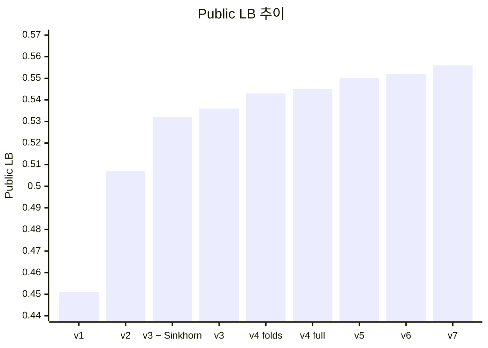
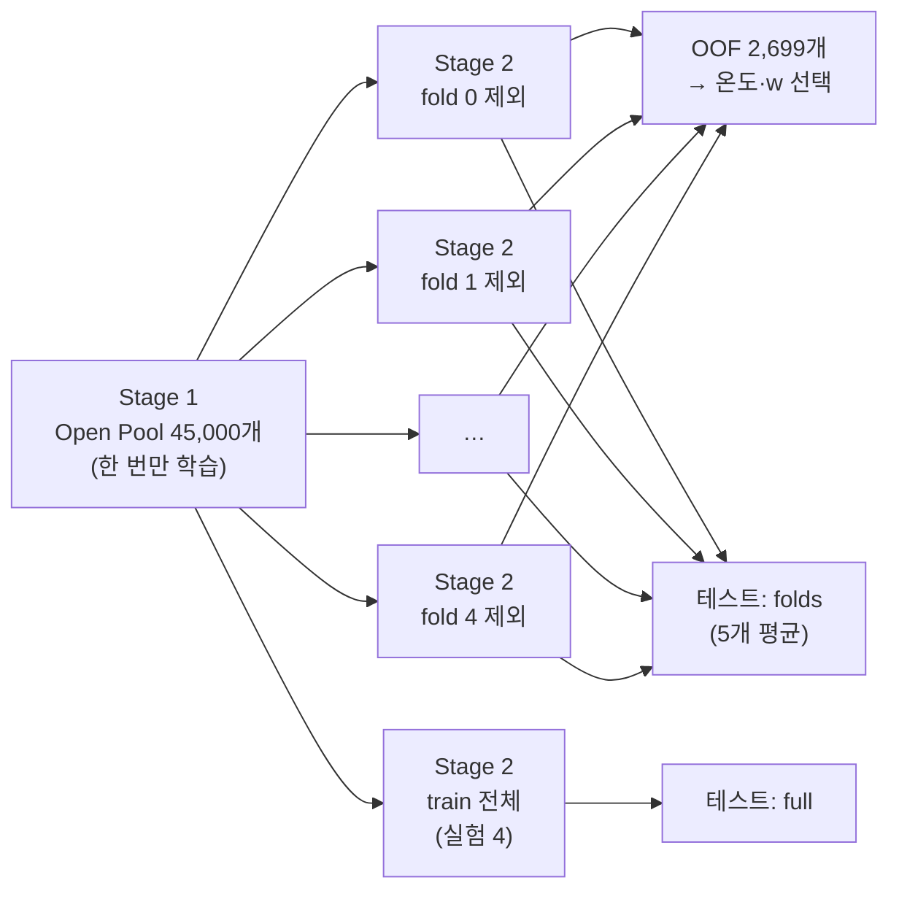

# Name That LLM 실험 기록

18개 LLM 중 어느 모델이 지문을 썼는지 맞히는 문제입니다. 지표는 balanced accuracy(BA)입니다.

- 검증은 `prompt_id` 단위 5-fold로 나눕니다. 테스트 프롬프트는 train에 없기 때문입니다.
- 홀드아웃은 fold 0(프롬프트 30개, 지문 540개)입니다. 지문 하나가 BA를 약 0.002 움직입니다.
- OOF는 2,699개 전체에 대한 fold 밖 예측입니다.

> [!NOTE]
> **수치 기준** · 이 문서의 검증 수치는 모두 **LB 점수를 낸 제출 커널(Kaggle T4, fp16) 로그**에서 가져왔습니다. LoRA를 학습한 Colab L4(bf16) 실행과는 LoRA 출력이 조금 달라서 지문 1~2개(BA 0.002~0.004) 차이가 납니다. 노트북에 저장된 출력은 Colab 학습 때 실행이라 이 문서와 숫자가 다를 수 있습니다.

## 한눈에 보기 (11/17~25)

| | 실험 | 바꾼 것 | 핵심 결과 | Public LB |
|:-:|---|---|---|:-:|
| **1** | v3 | n-gram train 가중치 12, Sinkhorn, `w` = 0.6 고정, LoRA 재학습 | 홀드아웃은 −0.0055인데 LB는 +0.029 | 0.507 → **0.536** |
| **2** | v3 − Sinkhorn | Sinkhorn만 끔 | Sinkhorn 기여는 +0.004뿐 | 0.532 |
| **3** | v4 | echo 입력 + LoRA 5-fold | OOF 블렌드 0.5749. echo 효과는 fold 0에서 안 보임 | (실험 4에서 제출) |
| **4** | v4 테스트 방식 | fold 5개 평균 vs 전체 학습 1개 | full이 0.002 높지만 차이가 작음 | 0.543 / **0.545** |
| **5** | v5 | n-gram에 문체 피처 27개(α = 0.2). Open Pool도 갱신됨 | n-gram OOF +0.0059, 블렌드 OOF는 +0.0018로 오차 범위 | 0.545 → **0.550** |
| **6** | v6 | 블렌드 뒤 회사 게이트(v4 full, 새 풀, 문체 블록 없음) | 블렌드 OOF 0.5719 → 0.5786(+0.0067). nested로는 +0.0044이고 구간이 0을 포함 | 0.545 → **0.552** |
| **7** | v7 | v6 + DeBERTa-v3-large 세 번째 분기(Colab T4에서 학습) | DeBERTa OOF 0.5053. 3분기 블렌드 0.5868(v6 가중치 0.5719, nested +0.011), 게이트 뒤 0.5882 | 0.552 → **0.556** |



---

## 저번 주까지의 모델 구조 (11/10 제출 기준)

| 구성 | 내용 |
|---|---|
| 데이터 | `train.csv` 2,699행 + Open Pool(`crtproduction/name-that-llm-open-pool`)에서 라벨당 2,500개(45,000개) 추출 |
| A. n-gram | 4뷰 TF-IDF(char 3-5, word 1-2, shape, 기능어) → LinearSVC(C=0.1). train 행과 풀 행 가중치는 모두 1 |
| B. LoRA | Qwen3-4B-Base 앞 18층, 깊이 7곳(2,4,…,18) 평균 풀링 + 층별 LayerNorm → 선형 헤드. q/k/v/o에 LoRA r=16 |
| B 학습 | Stage 1: Open Pool 45,000개, 1 epoch, lr 2e-4 → Stage 2: train 중 fold 0 제외, 2 epochs, lr 5e-5 |
| 블렌딩 | 두 모델을 각각 온도 조정해 log 확률로 바꾼 뒤 `w·LoRA + (1−w)·n-gram`. `w`와 LoRA 온도는 fold 0 홀드아웃에서 최고값 선택 |
| 후처리 | 테스트 지문을 주제 TF-IDF로 묶고, 묶음 평균의 0.5배를 뺌(프롬프트 중심화) |

| 제출 | 노트북 | n-gram OOF | LoRA fold 0 | 블렌드 fold 0 | Public LB |
|---|---|:-:|:-:|:-:|:-:|
| v1: LoRA(train만) + n-gram | [name_that_llm_v1.ipynb](name_that_llm_v1.ipynb) | 0.3663 | 0.4278 | 0.4407 (`w` = 0.5) | 0.451 |
| v2: LoRA(Open Pool Stage 1 + Stage 2) + n-gram | [name_that_llm_v2.ipynb](name_that_llm_v2.ipynb) | 0.4667 | 0.5222 | 0.5444 (`w` = 0.5) | **0.507** |

- v1은 Open Pool을 전혀 쓰지 않아서 LoRA는 Stage 2만, n-gram은 train만으로 학습했습니다.

---

## 실험 1. v3: n-gram train 가중치, Sinkhorn, 블렌드 가중치 고정

> [!NOTE]
> **요약** · 세 가지를 한꺼번에 바꿨습니다. 홀드아웃은 0.0055 떨어졌는데 LB는 **0.507 → 0.536 (+0.029)** 으로 올랐습니다.

### 변한 점
1. **n-gram train 가중치**: SVC에서 train 행 가중치 후보 {1, 4, 12}를 5-fold OOF로 비교해 고릅니다. 결과는 **12**였습니다.
2. **Sinkhorn**: 최종 argmax 직전에 Target-Shrunk Damped Sinkhorn을 추가했습니다. 클래스별 예측 비율을 균등 쪽으로 35% 옮기고, 테스트가 200행 이상일 때만 적용합니다.
3. **블렌드 가중치 고정**: `w = 0.6`으로 고정했습니다. 홀드아웃 최고값을 고르니 실행마다 0.5와 1.0을 오가서입니다.
4. **LoRA 재학습**: Open Pool이 갱신돼서(223,840 → 226,191행) 다시 학습했습니다.

#### n-gram train 가중치를 주는 방법

데이터를 복사해서 늘리지 않습니다. 지문마다 중요도 숫자를 하나씩 붙여 `LinearSVC.fit`의 `sample_weight`로 넘깁니다.

```python
def fit_svc(train_idx, train_weight):
    Xs = [X_train[train_idx]]
    ys = [y[train_idx]]
    ws = [np.full(len(train_idx), train_weight)]  # train 지문마다 12
    if X_pool is not None:
        Xs.append(X_pool)
        ys.append(y_pool)
        ws.append(np.ones(len(y_pool)))           # 풀 지문마다 1
    model = LinearSVC(C=CFG["svc_c"])
    model.fit(sparse.vstack(Xs).tocsr(), np.concatenate(ys),
              sample_weight=np.concatenate(ws))
    return model
```

LinearSVC는 다음 값을 최소화합니다. 여기서 $s_i$가 `sample_weight`입니다.

$$
\frac{1}{2}\|w\|^2 + C \sum_i s_i \cdot \text{hinge}_i
$$

train 지문 하나를 틀리면 벌점이 12배가 됩니다. 효과는 train 지문을 12번 복사해 넣은 것과 거의 같지만, 메모리와 학습 시간은 늘지 않습니다.

- **왜 올렸나**: train은 풀(45,000개)보다 17배쯤 적습니다. 가중치가 1이면 학습에서 train이 차지하는 몫이 6%도 안 됩니다. 그런데 테스트와 분포가 더 비슷한 쪽은 대회 데이터인 train일 가능성이 큽니다.
- **고르는 방법**: 후보 {1, 4, 12}마다 5-fold OOF를 만듭니다. fold마다 학습용 4개 fold의 train 지문에만 가중치를 주고, 남은 fold는 학습에 넣지 않고 예측만 합니다. 풀은 매번 가중치 1로 전부 들어갑니다.

| train 가중치 | 1 | 4 | 12 |
|:-:|:-:|:-:|:-:|
| 전체 가중치 중 train 비율 | 약 6% | 약 19% | 약 42% |

- 12가 후보 중 가장 큰 값이라 더 큰 값(20, 30 등)에서 더 오를 수도 있습니다. 아직 시험하지 않았습니다.

### 실험 세팅
| 단계 | 환경 | 시간 |
|---|---|---|
| LoRA 학습 | Colab L4, bf16, 배치 8 | Stage 1 31분, Stage 2 3분 |
| 제출 | Kaggle T4, 저장된 가중치로 추론만 (커널 `name-that-llm-lora` 버전 3) | - |

노트북: [name_that_llm_v3.ipynb](name_that_llm_v3.ipynb)

### 결과
| 항목 | v2 | v3 | 변화 |
|---|:-:|:-:|:-:|
| n-gram OOF BA | 0.4667 (가중치 1) | **0.4745** (가중치 12) | 🟢 +0.0078 |
| LoRA 홀드아웃 BA | 0.5222 | 0.5407 | 🟢 +0.0185 |
| 블렌드 홀드아웃 BA | 0.5444 (`w` = 0.5 선택) | 0.5389 (`w` = 0.6 고정) | 🔴 −0.0055 |
| **Public LB** | 0.507 | **0.536** | 🟢 **+0.029** |

n-gram train 가중치별 OOF BA (v3 풀 기준):

| 가중치 | 1 | 4 | 12 |
|:-:|:-:|:-:|:-:|
| OOF BA | 0.4675 | 0.4697 | **0.4745** |

v3 홀드아웃의 `w`별 블렌드 BA:

| `w` | 0.5 | 0.6 | 0.7 | 0.8 | 0.9 | 1.0 |
|:-:|:-:|:-:|:-:|:-:|:-:|:-:|
| 블렌드 BA | 0.5315 | 0.5389 | 0.5333 | 0.5389 | **0.5463** | 0.5407 |

### 해석
- 홀드아웃은 조금 떨어졌는데 LB는 0.029 올랐습니다. 540개 홀드아웃으로는 차이를 가리기 어렵습니다.
- `w`별 BA가 0.53~0.55 사이에서 들쭉날쭉합니다. 홀드아웃 최고값(0.9)을 따르지 않고 0.6으로 고정한 이유입니다.

---

## 실험 2. v3에서 Sinkhorn만 끄기 (비교 제출)

> [!NOTE]
> **요약** · Sinkhorn의 기여는 **+0.004**입니다. 실험 1의 개선분 +0.029 중 대부분은 다른 변경에서 왔습니다.

### 변한 점
- `use_sinkhorn=False` 한 줄만 바꿨습니다. 가중치와 나머지 설정은 v3와 같습니다.

### 실험 세팅
- Kaggle 커널 `name-that-llm-lora` 버전 4로, 같은 가중치 데이터셋을 씁니다.
- Sinkhorn은 테스트에서만 켜지기 때문에 제출 점수는 LB로만 비교할 수 있습니다. 로그에는 같은 보정을 홀드아웃에 적용해 본 점검 결과가 함께 찍힙니다.

### 결과
| 제출 | 블렌드 홀드아웃 BA (점검용) | Public LB | 변화 |
|---|:-:|:-:|:-:|
| v3 − Sinkhorn | 0.5389 | 0.532 | 기준 |
| v3 (Sinkhorn 켬, ρ = 0.35) | 0.5407 | **0.536** | 🟢 +0.004 |

### 해석
실험 1의 LB 개선 +0.029를 나누면 다음과 같습니다.

| 출처 | 기여 |
|---|:-:|
| 새 LoRA 가중치 + n-gram 가중치 12 + `w` 고정 | **+0.025** |
| Sinkhorn | +0.004 |

- 홀드아웃 점검에서도 Sinkhorn은 +0.0018(지문 1개)로 작습니다.

---

## 실험 3. v4: Qwen echo 입력 + LoRA 5-fold

> [!NOTE]
> **요약** · OOF 블렌드 BA **0.5749**. 다만 LoRA 단독 fold 0 점수가 v3와 지문 1개 차이라 **echo 효과는 확인되지 않았습니다.**

### 변한 점
1. **echo 입력**: Qwen에 `지문 + "\n\n" + 지문`을 넣고 두 번째 사본만 풀링합니다. causal attention이라 앞 토큰이 뒤 문맥을 못 보는 문제를 우회하려는 것입니다(Springer et al., ICLR 2025). 공개 상위 솔루션 12개를 확인했는데 이 방법을 쓴 곳은 없었습니다.
2. **LoRA 5-fold**: Stage 1은 train을 쓰지 않으므로 한 번만 학습합니다. 그다음 fold마다 Stage 1 가중치에서 다시 시작해 Stage 2를 학습합니다. 그래서 LoRA도 2,699개 OOF가 생기고, 테스트 예측은 fold 5개 평균입니다.
3. **OOF로 튜닝**: 블렌딩 온도와 가중치 비교, Sinkhorn 비교를 모두 2,699개 OOF로 합니다(v3는 540개).
4. **배치**: 입력이 두 배라 마이크로 배치 4 × 누적 2(실효 배치 8, v3와 같음)를 씁니다.



### 실험 세팅
| 단계 | 환경 | 비고 |
|---|---|---|
| Stage 1 | Colab T4(fp16) → L4(bf16) | 3,259/5,625 스텝에서 중단하고 상태(가중치, Adam, 스케줄러)를 저장한 뒤 L4로 옮겨 이어 학습. 이 때문에 v3와 GPU 및 수치 정밀도가 다름 |
| Stage 2 | L4 | fold당 약 7분 |
| n-gram | - | 가중치 12로 고정(실험 1에서 고른 값) |
| 제출 | Kaggle T4, 저장된 가중치로 추론만 | 커널 `name-that-llm-v4-echo`, `name-that-llm-v4-echo-full` |
| 검증 | - | 저장 가중치로 다시 계산한 OOF가 L4 학습 때와 100% 일치 |

노트북: [name_that_llm_v4.ipynb](name_that_llm_v4.ipynb)

### 결과
| 항목 | v3 | v4 | 변화 |
|---|:-:|:-:|:-:|
| LoRA 단독, fold 0 | 0.5407 | 0.5426 | ⚪ +0.0019 (지문 1개) |
| LoRA 단독, OOF 2,699개 | - | 0.5631 | |
| 블렌드(`w` = 0.6), fold 0 | 0.5389 | 0.5593 | 🟢 +0.0204 |
| 블렌드(`w` = 0.6), OOF | - | **0.5749** | |
| 블렌드 + Sinkhorn(ρ = 0.35), OOF | - | 0.5764 | |

OOF 기준 `w`별 블렌드 BA:

| `w` | 0.4 | 0.5 | 0.6 | 0.7 | 0.8 | 0.9 | 1.0 |
|:-:|:-:|:-:|:-:|:-:|:-:|:-:|:-:|
| 블렌드 BA | 0.5645 | 0.5723 | 0.5749 | 0.5749 | **0.5760** | 0.5705 | 0.5631 |

### 해석
> [!IMPORTANT]
> **echo 효과는 fold 0에서 보이지 않습니다.** LoRA 단독 점수가 v3와 지문 1개 차이입니다. L4 학습 때는 v3와 v4 모두 0.5426으로 같았습니다.

- fold 0 블렌드가 오른 건 LoRA 온도를 2,699개 OOF로 고른 덕으로 보입니다(추정).
- `w`에 따른 BA 변화가 실험 1의 홀드아웃(540개)보다 훨씬 매끄럽습니다. 0.6~0.8이 거의 같습니다.

---

## 실험 4. v4 테스트 예측 방식: fold 평균 vs 전체 학습

> [!NOTE]
> **요약** · 두 방식 모두 v3보다 LB가 올랐습니다(**+0.007 / +0.009**). folds와 full의 차이는 0.002라 우열을 가리기 어렵습니다.

### 변한 점
`CFG["lora_test"]`로 테스트 로짓을 만드는 방식을 고릅니다.

| 방식 | 테스트 로짓 | 각 모델이 본 train |
|---|---|:-:|
| `folds` | fold 모델 5개 평균 | 80% |
| `full` | Stage 1 가중치에서 train 전체 2,699개로 Stage 2를 한 번 더 학습한 모델 1개 | 100% |

온도와 블렌드 가중치는 두 방식 모두 fold OOF에서 정한 값을 씁니다. 그래서 두 커널의 검증 수치는 같습니다.

### 실험 세팅
- 전체 학습은 L4에서 676스텝, 8.4분 걸렸습니다.
- Kaggle 커널은 `name-that-llm-v4-echo`(folds)와 `name-that-llm-v4-echo-full`(full)입니다.
- 가중치 데이터셋은 `ntl-lora-weights-v4-echo-cv`(fold 5개 + full)입니다.

### 결과
| 제출 | OOF 블렌드 BA | Public LB | v3 대비 |
|---|:-:|:-:|:-:|
| v3 (비교용) | - | 0.536 | 기준 |
| v4 folds | 0.5749 | 0.543 | 🟢 +0.007 |
| v4 full | 0.5749 | **0.545** | 🟢 +0.009 |

### 해석
- v4는 v3보다 LB가 +0.007~0.009 올랐습니다. 다만 LoRA 단독 fold 0 점수가 v3와 거의 같아서, 이 개선을 echo 덕으로 볼 근거는 약합니다. 5-fold로 바뀐 점(OOF 2,699개로 고른 온도, 테스트 예측 앙상블 또는 전체 학습)의 효과로 보는 게 더 자연스럽습니다(추정).
- folds와 full의 차이(0.002)는 작아서 어느 쪽이 낫다고 단정하기 어렵습니다.

> [!TIP]
> **다음 할 일** · echo만의 효과를 확인하려면 echo를 끈 5-fold 실행이 필요합니다.

---

## 실험 5. v5: n-gram 분기에 문체 피처 27개 추가

> [!NOTE]
> **요약** · n-gram 단독 OOF는 **0.4690 → 0.4749 (+0.0059)** 로 올랐습니다. 블렌드 OOF(`w` = 0.6)는 **0.5716 → 0.5734 (+0.0018, 지문 5개쯤)** 로 오차 범위 안이고, `w`를 바꿔도 차이는 ±0.002 안입니다. Public LB는 **0.545 → 0.550 (+0.005)** 로 제출 시점까지 가장 높았습니다(이후 v6이 0.552, 실험 6). 다만 v4와 v5 사이에는 풀 갱신도 함께 들어 있어서 문체 블록만의 효과라고 할 수는 없습니다.

> [!IMPORTANT]
> **기준선이 바뀌었습니다.**
> - Open Pool이 v4 실행(11/17, 226,191개) 뒤에 갱신되어 지금은 **231,036개**입니다. 그래서 v5는 v4 로그 숫자(n-gram 0.4745, 블렌드 0.5749)가 아니라, v4 n-gram 코드(α = 0)를 새 풀로 다시 돌린 **새 풀 기준선**(n-gram 0.4690, 블렌드 0.5716)과 비교합니다.
> - 새 풀 기준선은 제출 커널이 아니라 **로컬 CPU**에서 쟀습니다. fold는 커널과 같은 분할을 썼습니다. 같은 방법으로 α = 0.2를 돌리면 커널 수치가 지문 2개 이내로 재현됩니다(n-gram 0.4756 대 0.4749, 블렌드 0.5738 대 0.5734).
> - 처음에 잰 기준선(n-gram 0.4641, 블렌드 0.5679)은 **fold 분할이 커널과 달라서** 쓰지 않습니다. 그 값과 비교하면 v5의 효과가 두 배쯤 크게 보입니다(n-gram +0.0108, 블렌드 +0.0055). 아래 "기준선을 다시 잰 이유"에 적었습니다.

### 변한 점
- n-gram 분기(4뷰 TF-IDF + LinearSVC)의 행렬 옆에 **문체 피처 27개**를 이어 붙였습니다. 문장 길이 평균·표준편차, 단어 길이, MATTR, 기능어 비율, 100단어당 구두점, 축약형 등입니다([analysis_intra_org/features.py](analysis_intra_org/features.py)의 `feats`와 같은 값).
- 스케일링: `log1p` → fold의 train 지문으로 z-score 표준화(풀은 쓰지 않음) → ±4에서 자름 → `α / √27` 곱하기. 곱한 뒤 문체 블록의 행 L2 노름은 약 α이고, TF-IDF 블록의 행 L2 노름은 약 1.4입니다.
- `CFG["stylo_alpha"] = 0.2`(0이면 v4와 같음), `CFG["lora_test"] = "full"`.
- LoRA 분기, 블렌드(`w` = 0.6), 중심화, Sinkhorn은 v4와 같습니다. LoRA 가중치도 v4 것을 그대로 씁니다(재학습 없음).

α = 0.2는 제출 전에 풀 없이 train만으로 잰 5-fold OOF에서 골랐습니다([v5_stylo/stylo_tfidf.py](v5_stylo/stylo_tfidf.py), 로컬 CPU).

| 설정 (train만, 풀 없음) | OOF BA |
|---|:-:|
| 기준: 4뷰 TF-IDF | 0.3704 |
| + 문체 27개, α = 0.15 / **0.2** / 0.3 / 0.4 / 1.0 | 0.3845 / **0.3864** / 0.3826 / 0.3786 / 0.3697 |
| + 구조 피처 10개만 / 구두점·어휘 17개만 (α = 0.3) | 0.3801 / 0.3741 |
| + 분위수 구간 one-hot (α = 0.3) | 0.3749 |

### 실험 세팅
| 단계 | 환경 | 비고 |
|---|---|---|
| v5 | Kaggle T4, 저장된 v4 LoRA 가중치로 추론만 | 커널 `name-that-llm-v5-stylo` 버전 1, 34.6분, 풀 231,036개 |
| 새 풀 기준선(α = 0), α 비교 | **로컬 CPU**, n-gram만, train 가중치 12 고정 | [v5_stylo/alpha_sweep.py](v5_stylo/alpha_sweep.py)가 v5 노트북의 n-gram 셀을 그대로 실행. fold는 커널의 분할([analysis_v4/oof_v4.npz](analysis_v4/oof_v4.npz)의 `fold`). 로그는 [v5_stylo/alpha_sweep_run.log](v5_stylo/alpha_sweep_run.log) |
| 로컬 블렌드 | - | [v5_stylo/blend.py](v5_stylo/blend.py)가 로컬 n-gram OOF와 v4 LoRA OOF로 노트북과 같은 온도 선택·블렌드를 계산. v4 원래 n-gram OOF를 넣으면 커널 로그의 0.4745 / 0.5749 / 0.5593이 그대로 나옴 |

노트북: [name_that_llm_v5.ipynb](name_that_llm_v5.ipynb)

#### 기준선을 다시 잰 이유: fold 분할이 환경마다 다름

`StratifiedGroupKFold(shuffle=True, random_state=42)`가 로컬(scikit-learn 1.9.1)과 제출 커널에서 **서로 다른 분할**을 냅니다. 같은 코드, 같은 시드인데 프롬프트 150개가 전혀 다른 묶음으로 나뉩니다. scikit-learn 버전 차이로 보입니다(추정, 커널 쪽 버전은 확인하지 않음).

- 노트북이 맨 처음 출력하는 "프롬프트 그룹 KFold BA"가 커널 로그에서는 0.3145, 로컬에서는 0.3115입니다. 로컬에서 fold만 커널 분할로 바꾸면 0.3145가 나옵니다.
- 분할에 따라 n-gram OOF가 0.005~0.006 달라집니다. 이 실험에서 보려는 효과와 같은 크기입니다.

| fold 분할 (새 풀, 가중치 12, 로컬 CPU) | α = 0 | α = 0.2 | α = 0.4 | 블렌드 `w` = 0.6: α = 0 → 0.2 |
|---|:-:|:-:|:-:|:-:|
| 커널 분할 (이 문서의 기준) | 0.4690 | 0.4756 | 0.4708 | 0.5716 → 0.5738 |
| 로컬 분할 (처음 잰 값) | 0.4641 | 0.4697 | 0.4727 | 0.5679 → 0.5679 |

- 처음에는 로컬 분할로 잰 기준선(0.4641)을 커널 분할로 잰 v5(0.4749)와 비교했습니다. 분할 차이가 섞여서 효과가 +0.0108로 보였습니다.
- LinearSVC의 난수는 원인이 아닙니다. 노트북의 `LinearSVC`에는 `random_state`가 없어서 앞서 몇 번 fit했는지에 따라 시드가 달라지지만, 시드를 바꿔 다시 돌려도(α = 0과 0.2 각 2회) 예측이 바뀐 지문은 0개이고 점수 차이는 최대 2 × 10⁻⁵입니다. liblinear가 28~31회 반복 만에 수렴합니다.
- 커널(0.4749)과 로컬 재현(0.4756)에 남은 0.0007은 라이브러리 차이로 보입니다(추정).

### 결과
| 항목 | v4 (옛 풀, 커널) | 새 풀 기준선 (α = 0, 로컬) | v5 (α = 0.2, 커널) | 기준선 대비 |
|---|:-:|:-:|:-:|:-:|
| Open Pool | 226,191개 | 231,036개 | 231,036개 | |
| n-gram OOF BA (가중치 12) | 0.4745 | 0.4690 | **0.4749** | 🟢 +0.0059 |
| LoRA OOF BA | 0.5631 | (v4 OOF 사용) | 0.5631 | 같은 가중치 |
| 블렌드(`w` = 0.6), OOF | 0.5749 | 0.5716 | **0.5734** | ⚪ +0.0018 (지문 5개쯤) |
| 블렌드(`w` = 0.6), fold 0 | 0.5593 | 0.5537 | 0.5593 | ⚪ +0.0056 (지문 3개) |
| **Public LB** | 0.545 (full) | - | **0.550** | 🟢 +0.005 (v4 full 대비) |

- 풀 갱신만의 영향(α = 0, 같은 fold. v4는 커널, 기준선은 로컬)은 n-gram 0.4745 → 0.4690(−0.0055), 블렌드 0.5749 → 0.5716(−0.0033)입니다.
- v5 커널의 Sinkhorn 점검(ρ = 0.35)은 블렌드 OOF 0.5734 → 0.5734로 변화가 없습니다.

v5 커널의 n-gram train 가중치별 OOF BA (기준선은 12만 쟀습니다):

| 가중치 | 1 | 4 | 12 |
|:-:|:-:|:-:|:-:|
| v5 (α = 0.2) | 0.4656 | 0.4734 | **0.4749** |

OOF 기준 `w`별 블렌드 BA (새 풀):

| `w` | 0.5 | 0.6 | 0.7 | 0.8 | 0.9 | 1.0 |
|:-:|:-:|:-:|:-:|:-:|:-:|:-:|
| 기준선 (α = 0, 로컬) | 0.5649 | 0.5716 | 0.5742 | **0.5775** | 0.5731 | 0.5631 |
| v5 (α = 0.2, 커널) | 0.5653 | 0.5734 | 0.5749 | **0.5768** | 0.5738 | 0.5631 |
| 차이 (커널 − 기준선) | +0.0004 | +0.0018 | +0.0007 | −0.0007 | +0.0007 | 0 |
| 참고: α = 0.2 로컬 재현 | 0.5668 | 0.5738 | 0.5749 | **0.5771** | 0.5738 | 0.5631 |

차이의 구간은 로컬에서 잰 α = 0과 α = 0.2의 OOF로 구했습니다(프롬프트 150개 단위 bootstrap 1,000회, [v5_stylo/compare_oof.py](v5_stylo/compare_oof.py)). v5 커널은 OOF를 저장하지 않아서 로컬 재현 OOF를 썼습니다.

| 비교 (α = 0.2 − α = 0, 로컬) | 차이 | 95% 구간 | 예측이 바뀐 지문 |
|---|:-:|:-:|:-:|
| n-gram 단독 | +0.0067 | [−0.001, +0.014] | 178개 |
| 블렌드 `w` = 0.6 | +0.0022 | [−0.003, +0.008] | 80개 |
| 블렌드 `w` = 0.8 | −0.0004 | [−0.004, +0.003] | 35개 |

#### α 다시 고르기와 길이 피처 (로컬 CPU, 커널 분할, 가중치 12)

| 설정 | n-gram OOF | 블렌드 `w` = 0.6 | 블렌드 `w` = 0.8 | `w`별 최고 |
|---|:-:|:-:|:-:|:-:|
| α = 0 (기준선) | 0.4690 | 0.5716 | 0.5775 | 0.5775 (`w` = 0.8) |
| α = 0.1 | 0.4738 | 0.5723 | 0.5768 | 0.5768 (`w` = 0.8) |
| **α = 0.2** (v5) | 0.4756 | 0.5738 | 0.5771 | 0.5771 (`w` = 0.8) |
| α = 0.3 | 0.4738 | 0.5742 | 0.5756 | 0.5756 (`w` = 0.8) |
| α = 0.4 | 0.4708 | 0.5719 | 0.5756 | 0.5756 (`w` = 0.8) |
| α = 0.2, `n_words`·`n_sents` 제외 (25개) | 0.4753 | 0.5727 | 0.5756 | 0.5756 (`w` = 0.8) |

- n-gram 단독은 α = 0.1~0.3에서 기준선보다 0.005~0.007 높고, α = 0.2가 가장 높습니다.
- **α를 이보다 세밀하게 고를 근거는 없습니다.** α = 0.1, 0.2, 0.3의 차이는 0.002(지문 5개쯤)이고, fold 분할만 바꿔도 순서가 뒤집힙니다. 로컬 분할에서는 α = 0.4(0.4727)가 α = 0.2(0.4697)보다 높았습니다. α = 0.2를 그대로 둡니다.
- 블렌드는 어떤 α에서도 기준선과 0.003 안입니다. `w` = 0.6에서는 0 ~ +0.003, `w` = 0.8에서는 −0.002 ~ 0입니다.

풀 표본(라벨당 2,500개)과 train의 모델별 길이 분포도 비교했습니다([v5_stylo/length_check.py](v5_stylo/length_check.py), 출력은 [v5_stylo/length_check_run.log](v5_stylo/length_check_run.log)).

| 항목 | train (2,699개) | 풀 표본 (45,000개) |
|---|:-:|:-:|
| `n_words` 전체 중앙값 | 102 | 102 |
| `n_words` 모델별 중앙값 범위 | 84.5~118.0 | 84.0~110.0 |
| 모델이 설명하는 분산 비율(η²): `n_words` / `n_sents` | 0.009 / 0.034 | 0.011 / 0.030 |
| 두 피처만으로 18개 모델 맞히기 (무작위 0.056) | 0.088 (프롬프트 5-fold) | 0.097 (5-fold) |

- **풀에만 있는 길이 지름길은 보이지 않습니다.** 모델이 길이를 설명하는 정도가 train과 풀에서 비슷하게 작고(η² 0.01~0.03), 모델별 중앙값의 폭은 풀이 오히려 좁습니다. 두 피처만으로 풀에서 학습해 train을 예측하면 0.080으로, train 안에서 학습한 것(0.088)과 비슷합니다.
- 두 피처를 빼도 n-gram OOF는 0.4756 → 0.4753(지문 1개)으로 그대로입니다. 블렌드는 `w` = 0.6에서 −0.0011, `w` = 0.8에서 −0.0015로 조금 낮아서 뺄 이유가 없습니다.
- 다만 문장 수준에서는 GPT 계열이 풀과 train에서 눈에 띄게 다릅니다. train 통계로 표준화한 평균 문장 길이가 GPT 5개 모델은 풀에서 평균 0.71σ 짧고(나머지 13개는 0.15σ), 문장 수는 0.40σ 많습니다(나머지 0.07σ). 중앙값으로는 GPT의 문장당 단어 수가 train 21~25개, 풀 18~21개입니다. 총 단어 수에는 이런 차이가 없습니다.

### 해석
- **n-gram 단독으로는 올랐습니다.** 커널 분할에서 +0.006(0.4690 → 0.4749), 로컬 분할에서도 +0.006(0.4641 → 0.4697)으로 두 분할에서 같은 방향입니다. 다만 bootstrap 95% 구간 [−0.001, +0.014]은 0에 걸쳐 있습니다.
- **블렌드 OOF에서는 효과가 확인되지 않습니다.** 고정값 `w` = 0.6에서 +0.0018(로컬 재현끼리는 +0.0022, 구간 [−0.003, +0.008])이고, `w` ≥ 0.7에서는 지문 2개 이내입니다. `w`별 최고값끼리는 0.5775 대 0.5768로 같고, 로컬 분할에서는 `w` = 0.6의 차이도 0입니다. 문체 피처가 n-gram에 더한 정보의 대부분을 LoRA가 이미 갖고 있는 것으로 보입니다(추정).
- **Public LB는 +0.005 올랐지만 원인을 나눌 수 없습니다.** v4 full과 v5 사이에는 문체 블록과 풀 갱신이 함께 들어 있습니다. OOF로는 풀 갱신이 −0.0033, 문체 블록이 +0.0018이라 v5 블렌드(0.5734)가 v4(0.5749)보다 오히려 낮은데, LB는 올랐습니다. OOF의 0.002~0.003 차이로는 LB 방향을 맞히지 못한다는 뜻입니다. LB 0.005가 얼마나 확실한 차이인지도 알 수 없습니다(실험 4에서는 OOF가 같은 두 제출이 LB 0.002 차이).
- **이 실험에서 OOF로 가릴 수 있는 차이는 0.005쯤입니다.** fold 분할만 바꿔도 n-gram OOF가 그만큼 움직였습니다. 커널과 로컬 재현 사이에도 `w`에 따라 0~0.0015가 남습니다.
- 새 풀에서도 OOF 최고점은 `w` = 0.8(기준선 0.5775, v5 0.5768)로 옛 풀의 v4와 같습니다. 고정값 0.6보다 0.003~0.006 높습니다.

> [!TIP]
> **v6·v7에 문체 블록을 넣을지** · 넣는 쪽을 권합니다. α = 0.2, 피처 27개 그대로입니다.
> - 넣는 이유: n-gram 단독 +0.006이 두 fold 분할에서 같은 방향이고, 블렌드에서 손해가 보이지 않으며, LB가 0.550으로 제출 시점까지 가장 높았습니다. 비용은 피처 계산 약 25초입니다.
> - 기대는 작게 잡습니다. 블렌드 OOF로는 이득이 확인되지 않았습니다. v7은 DeBERTa가 들어가 n-gram 비중이 더 줄어들 것입니다(추정).
> - v6 게이트를 v5 위에 얹으면 `gate_alpha`는 v5의 OOF로 다시 고릅니다.
> - 문체 블록만의 LB 효과를 알려면 새 풀에서 α = 0으로 한 번 더 제출해야 합니다.
> - 로컬에서 OOF를 다시 잴 때는 커널의 fold 분할을 씁니다. 노트북 첫 출력 "프롬프트 그룹 KFold BA"가 0.3145이면 커널과 같은 분할입니다.

---

## 실험 6. v6: 회사 게이트 (v4 full + 후처리)

> [!NOTE]
> **요약** · 블렌드 1순위가 한 회사이면 회사 확률 합은 두고, 회사 안 분포만 회사 전용 LR 쪽으로 옮깁니다. 제출 커널(새 풀)에서 블렌드 OOF가 **0.5719 → 0.5786 (+0.0067)** 으로 올랐고, Public LB는 **0.552**로 제출 시점까지 가장 높았습니다(v4 full 0.545보다 +0.007, v5 0.550보다 +0.002. 이후 v7이 0.556, 실험 7). 다만 새 풀에서 \(\alpha\)를 fold 밖에서 고르는 nested 기준으로는 **+0.0044**이고 95% 구간 [−0.002, +0.011]이 0을 포함합니다. 옛 풀의 v4 OOF로 잰 효과(nested +0.0115)의 절반쯤입니다.

### 변한 점
- 블렌딩 뒤에 "회사 게이트" 셀 하나를 넣었습니다. 나머지는 v4와 같고, LoRA 가중치도 v4 것을 그대로 씁니다.
- 회사(GPT·Gemini·Claude·GLM)마다, n-gram과 LoRA 각각의 회사 열 log 확률을 입력으로 회사 안 모델을 맞히는 로지스틱 회귀(C = 1)를 학습합니다.
- 1순위가 그 회사 안인 지문만, 회사 안 분포를 비율 \(\alpha\)(GPT 0.75, Gemini 0.25, Claude 0.5, GLM 1.0)만큼 LR 쪽으로 옮깁니다.
- \(\alpha\)와 C는 옛 풀의 v4 OOF에서 고른 값을 그대로 썼습니다. LR은 커널 안에서 그 커널의 OOF로 다시 학습합니다.
- `CFG["lora_test"] = "full"`로 제출했습니다(v4 full, v5와 같은 조건). v5의 문체 블록은 들어 있지 않습니다.
- 게이트 셀 뒤에 OOF를 `oof_v6.npz`로 저장하는 셀을 넣었습니다. 키는 `analysis_v4/oof_v4.npz`와 같고(`eval_lp`가 게이트 전 블렌드), 게이트 뒤 log 확률 `gated_lp`와 지문 `id`가 더 있습니다.

### 실험 세팅
| 단계 | 환경 | 비고 |
|---|---|---|
| 방식 비교, \(\alpha\) 선택 (옛 풀) | 로컬 CPU | v4 OOF([analysis_v4/oof_v4.npz](analysis_v4/oof_v4.npz), 풀 226,191개 시점)와 train 텍스트로 비교. 자세한 내용은 [analysis_v6/report.md](analysis_v6/report.md) |
| v6 제출 | Kaggle T4, 저장된 v4 LoRA 가중치로 추론만 | 커널 `name-that-llm-v6-gate` 버전 1, 32.5분, 풀 231,036개. 실행 전 대기열에서 약 4시간 기다림 |
| 새 풀 재확인 | 로컬 CPU | 커널이 저장한 OOF([analysis_v6/newpool/oof_v6.npz](analysis_v6/newpool/oof_v6.npz))로 [gate2.py](analysis_v6/gate2.py)와 [check_gate.py](analysis_v6/check_gate.py)를 다시 실행. 로그는 [analysis_v6/newpool/](analysis_v6/newpool/) |

- nested: fold 하나를 빼고 나머지 4개로 \(\alpha\)를 골라 뺀 fold에 적용합니다. 구간은 프롬프트 150개 단위 bootstrap 1,000회입니다.
- 로컬 계산은 fold를 다시 만들지 않고 npz에 저장된 `fold`(커널의 분할)를 씁니다. 커널 로그의 "프롬프트 그룹 KFold BA"는 0.3145, LoRA OOF BA는 0.5631로 v4·v5 커널과 같습니다.
- 로컬에서 고정 \(\alpha\) 게이트를 다시 계산하면 커널 로그와 같은 0.5786이 나오고, 예측이 2,699개 모두 커널과 같습니다.
- v6 커널의 게이트 전 수치(n-gram 0.4693, 블렌드 0.5719)는 문체 블록이 없는 새 풀 기준선을 커널에서 잰 값이기도 합니다. 실험 5가 같은 설정을 로컬에서 잰 값(0.4690, 0.5716)과 지문 1개쯤 다릅니다. 커널과 로컬의 라이브러리 차이로 보이지만(추정) 원인은 확인하지 않았습니다.

### 결과

옛 풀은 v4 OOF로 로컬에서 계산한 값입니다. 새 풀은 게이트 전과 고정 \(\alpha\)가 v6 커널 로그 값이고, 나머지는 커널이 저장한 OOF로 로컬에서 계산한 값입니다. 괄호 안은 게이트 전 대비 변화입니다.

| 항목 | 옛 풀 (v4 OOF) | 새 풀 (v6 커널) |
|---|:-:|:-:|
| Open Pool | 226,191개 | 231,036개 |
| n-gram OOF BA (가중치 12) | 0.4745 | 0.4693 |
| LoRA OOF BA | 0.5631 | 0.5631 |
| 게이트 전 블렌드 (`w` = 0.6) | 0.5749 | 0.5719 |
| 고정 \(\alpha\) (0.75 / 0.25 / 0.5 / 1.0) | 0.5882 (+0.0133) | **0.5786** (🟢 +0.0067) |
| 고정 \(\alpha\)의 95% 구간 | [+0.005, +0.023] | [−0.001, +0.015] |
| 그 OOF에서 고른 최고 \(\alpha\) (낙관적) | 0.5882 (+0.0133), 고정값과 같음 | 0.5823 (+0.0104), 0.75 / 1.0 / 0.25 / 0.75 |
| nested \(\alpha\) (C = 1) | 0.5864 (+0.0115) | 0.5764 (⚪ +0.0044) |
| nested의 95% 구간 | [+0.003, +0.020] | [−0.002, +0.011] |
| nested에서 고친 / 망친 지문 | 91 / 60 | 66 / 54 |
| 게이트 + Sinkhorn(ρ = 0.35) | 0.5882 | 0.5782 |
| **Public LB** | - | **0.552** (v4 full 대비 🟢 +0.007) |

- 옛 풀의 고정 \(\alpha\)는 바로 그 OOF에서 고른 값이라 낙관적입니다. 새 풀에서는 미리 정해 둔 값을 적용한 것이지만, 지문과 LoRA OOF가 같아서 완전히 독립된 검증은 아닙니다.
- v6 커널의 n-gram train 가중치별 OOF BA는 1 / 4 / 12 = 0.4612 / 0.4671 / **0.4693**이고, 게이트 전 `w`별 블렌드 BA는 0.5 / 0.6 / 0.7 / 0.8 / 0.9 = 0.5645 / 0.5719 / 0.5753 / **0.5775** / 0.5731입니다.

fold별 BA (게이트 전 → 고정 \(\alpha\) 게이트):

| fold | 0 | 1 | 2 | 3 | 4 |
|---|:-:|:-:|:-:|:-:|:-:|
| 옛 풀 | 0.5593 → 0.5852 | 0.6037 → 0.6130 | 0.5889 → 0.6037 | 0.5598 → 0.5653 | 0.5630 → 0.5741 |
| 새 풀 | 0.5537 → 0.5648 | 0.5870 → 0.5963 | 0.5907 → 0.5963 | 0.5653 → 0.5690 | 0.5630 → 0.5667 |

회사별 (v6 커널 로그). "\(\alpha\)별 OOF BA"는 앞 회사의 게이트를 이미 적용한 뒤 이 회사의 \(\alpha\)만 바꾼 값이고, 굵은 값이 쓴 \(\alpha\)입니다. 마지막 두 열은 이 회사만 고정 \(\alpha\)로 게이트했을 때의 변화입니다(로컬 계산).

| 회사 | 고정 \(\alpha\) | 회사 안 정확도: 블렌드 → 특화 LR | \(\alpha\)별 OOF BA: 0 / 0.25 / 0.5 / 0.75 / 1.0 | 이 회사만: 새 풀 | 옛 풀 |
|---|:-:|:-:|:-:|:-:|:-:|
| GPT | 0.75 | 0.631 → 0.632 | 0.5719 / 0.5756 / 0.5753 / **0.5760** / 0.5742 | +0.0041 | +0.0041 |
| Gemini | 0.25 | 0.635 → 0.643 | 0.5760 / **0.5760** / 0.5775 / 0.5786 / 0.5790 | 0 | +0.0004 |
| Claude | 0.5 | 0.732 → 0.724 | 0.5760 / 0.5756 / **0.5756** / 0.5756 / 0.5753 | −0.0004 | +0.0018 |
| GLM | 1.0 | 0.600 → 0.627 | 0.5756 / 0.5749 / 0.5767 / 0.5793 / **0.5786** | +0.0022 | +0.0070 |

- 옛 풀의 회사 안 정확도는 GPT 0.624 → 0.631, Gemini 0.648 → 0.630, Claude 0.726 → 0.720, GLM 0.573 → 0.657이었습니다.
- 모든 회사에 같은 \(\alpha\)를 쓰면 새 풀에서 0.25 / 0.5 / 0.75 / 1.0 = +0.0033 / +0.0059 / +0.0085 / +0.0063입니다.

recall이 많이 바뀐 라벨 (게이트 전 → 고정 \(\alpha\) 게이트, 새 풀. 괄호는 옛 풀에서의 변화):

| 라벨 | 새 풀 | 변화 |
|---|:-:|:-:|
| gpt-5.6-terra | 0.440 → 0.507 | 🟢 +0.067 (옛 풀 +0.060) |
| glm-5.3-flash | 0.300 → 0.360 | 🟢 +0.060 (옛 풀 +0.073) |
| gpt-5.6-sol | 0.440 → 0.473 | 🟢 +0.033 (옛 풀 +0.060) |
| claude-opus-4-6 | 0.760 → 0.787 | 🟢 +0.027 (옛 풀 +0.020) |
| gemini-3.6-flash | 0.647 → 0.667 | 🟢 +0.020 (옛 풀 0) |
| gpt-5.6-luna | 0.527 → 0.513 | 🔴 −0.013 (옛 풀 −0.013) |
| gemini-3.1-pro-preview | 0.840 → 0.827 | 🔴 −0.013 (옛 풀 −0.007) |
| gpt-5.5 | 0.600 → 0.580 | 🔴 −0.020 (옛 풀 −0.027) |
| glm-5.3 | 0.280 → 0.227 | 🔴 −0.053 (옛 풀 −0.007) |

방식 비교 (옛 풀의 v4 OOF로만 쟀습니다):

| 방식 (옛 풀) | nested OOF BA | v4 대비 | 95% 구간 |
|---|:-:|:-:|:-:|
| v4 | 0.5749 | 기준 | - |
| 회사 게이트 (채택) | **0.5864** | 🟢 +0.0115 | [+0.003, +0.020] |
| 회사 게이트 + 회사 전용 n-gram SVC 입력 | 0.5801 | 🟢 +0.0052 | [−0.004, +0.015] |
| V40A (모든 지문에 잔차, 회사 질량 보존) | 0.5753 | ⚪ +0.0004 | - |
| 딱딱한 2단계 (회사 먼저 고르기) | 0.567 | 🔴 −0.008 | - |

### 해석
- **새 풀에서도 유지된 것.** 고정 \(\alpha\) 게이트는 fold 5개 모두에서 올랐고(+0.004 ~ +0.011), 많이 오른 라벨(gpt-5.6-terra·sol, glm-5.3-flash)과 떨어진 라벨(gpt-5.5, gpt-5.6-luna)이 옛 풀과 같습니다. Public LB도 0.552로 제출 시점까지 가장 높았습니다.
- **약해진 것.** 이득이 절반쯤으로 줄었고(고정 \(\alpha\) +0.0133 → +0.0067, nested +0.0115 → +0.0044), 두 구간 모두 0을 포함합니다. 옛 풀의 값이 그 OOF에서 \(\alpha\)를 골라 낙관적이었던 점과, 새 풀에서 GLM의 게이트 전 회사 안 정확도가 0.573에서 0.600으로 올라 고칠 여지가 줄어든 점이 겹친 것으로 보입니다(추정).
- **이득은 GPT와 GLM에서 나옵니다.** 회사 하나만 게이트하면 GPT +0.0041, GLM +0.0022이고, Gemini(\(\alpha\) = 0.25)는 0, Claude는 −0.0004입니다. Claude는 특화 LR의 회사 안 정확도(0.724)가 블렌드(0.732)보다 낮습니다.
- **GLM은 한쪽을 올리고 다른 쪽을 내렸습니다.** glm-5.3-flash가 +0.060 오른 대신 glm-5.3이 −0.053 떨어졌습니다. 옛 풀에서는 glm-5.3이 −0.007이었습니다.
- **\(\alpha\)는 다시 고르지 않았습니다.** 새 OOF에서 가장 좋은 조합은 Gemini 1.0, Claude 0.25, GLM 0.75로 옛 풀과 다릅니다. 그런데 그 조합의 +0.0104가 nested에서는 +0.0044로 줄어서, \(\alpha\)를 고르는 일 자체가 잡음을 따라갑니다. 모든 회사에 같은 값을 써도 0.5 이상이면 +0.006 ~ +0.009로 비슷합니다.
- **LB의 원인은 나눌 수 없습니다.** v4 full(0.545)과 v6(0.552) 사이에는 풀 갱신과 게이트가 함께 들어 있습니다. v5(0.550)와 v6은 같은 새 풀이지만 v5는 문체 블록, v6은 게이트로 서로 다른 변경입니다. 문체 블록도 게이트도 없는 새 풀 기준선은 제출한 적이 없습니다. v5와 v6의 LB 차이 0.002는 실험 4에서 OOF가 같은 두 제출이 보인 차이와 같은 크기입니다.
- 회사 전용 n-gram SVC를 Open Pool로 따로 학습해도 나아지지 않았습니다(옛 풀). 이득은 새 신호가 아니라, 기존 두 분기의 점수를 회사마다 다르게 다시 조합한 데서 나온 것으로 보입니다.

> [!TIP]
> **다음 할 일** · 문체 블록(v5)과 게이트(v6)를 함께 넣은 제출은 아직 없습니다. 합칠 때 `gate_alpha`는 그대로 두고, 그 커널의 OOF로 nested 변화만 다시 확인하는 쪽을 권합니다.

## 실험 7. v7: DeBERTa-v3-large 세 번째 분기

> [!NOTE]
> **요약** · 양방향 인코더 DeBERTa-v3-large를 세 번째 분기로 붙였습니다. DeBERTa 단독 OOF는 **0.5053**으로 n-gram(0.4693)과 LoRA(0.5631) 사이입니다. 3분기 블렌드(lora 0.6 / deb 0.2 / ng 0.2)의 OOF는 **0.5868**이고, 같은 커널에서 v6 가중치(lora 0.6 / ng 0.4)는 0.5719입니다. 가중치를 fold 밖에서 고르는 nested로는 **0.5827 (+0.011)** 입니다. 게이트 뒤는 0.5882, Public LB는 **0.556**으로 지금까지 가장 높습니다(v6 0.552보다 +0.004, v4 full 0.545보다 +0.011). 다만 게이트가 더하는 양은 +0.0014로 줄었고, Stage 2 미세 조정은 거의 효과가 없었습니다.

> [!IMPORTANT]
> 이 실험의 수치는 모두 **새 풀(231,036개) + 커널 fold 분할** 기준입니다. 비교 기준은 같은 커널 로그의 "v6 가중치" 줄(0.5719)이고, 이 값은 v6 커널의 게이트 전 블렌드(0.5719)와 같습니다. v5의 문체 블록은 들어 있지 않습니다.

### 변한 점
- **DeBERTa 분기 (4-2장).** `microsoft/deberta-v3-large` 전체(4.34억 개)를 학습합니다. 입력은 지문 그대로(최대 512토큰)이고, 마지막 층 은닉 상태를 패딩을 뺀 토큰 평균으로 모아 `Dropout(0.1) → Linear(1024 → 18)`에 넣습니다.
- **학습 일정은 LoRA 분기와 같은 2단계입니다.** Stage 1은 Open Pool 45,000개(라벨당 2,500개), 1 epoch, lr 2e-5입니다. Stage 2는 fold마다 Stage 1 가중치에서 다시 시작해 2 epoch, lr 1e-5입니다. 헤드 lr은 본체의 20배, warmup 10% + cosine, 실효 배치 16(8 × 2), label smoothing 0.05입니다. 테스트 로짓은 train 전체로 Stage 2를 한 번 더 학습한 모델에서 냅니다.
- **블렌드 (5장).** `LP = w_lora·LP_lora + w_deb·LP_deb + w_ng·LP_ng`. 0.1 간격 66개 조합을 OOF로 비교했고, `CFG["blend3"] = dict(ng=0.2, lora=0.6, deb=0.2)`로 고정했습니다.
- **회사 게이트 (5-1장).** 특화 LR의 입력에 DeBERTa의 회사 열 log 확률을 더했습니다(입력 차원 = 3 × 회사 모델 수). `gate_alpha`는 v6 값 그대로입니다.
- n-gram과 LoRA는 v6과 같습니다. LoRA는 v4 가중치로 추론만 합니다. `ngram_train_weights = [12.0]`, `lora_test = "full"`로 제출했습니다.
- 노트북에서 고친 것: Colab(transformers 5.x)에서 저장한 토크나이저 폴더를 4.x의 `AutoTokenizer`가 읽지 못해서, 실패하면 `tokenizer.json`을 직접 읽게 했습니다. 두 버전에서 토큰 id와 테스트 로짓이 같음을 CPU로 확인했습니다. 제출 커널에서는 이 우회 없이 읽혔습니다.

### 실험 세팅
| 단계 | 환경 | 비고 |
|---|---|---|
| DeBERTa 학습 | **Colab T4**, fp32, `deb_grad_ckpt=True` | DeBERTa만 학습하는 실행 사본([analysis_v7/colab/make_deb_run.py](analysis_v7/colab/make_deb_run.py)). 198.4분, compute unit 5.75 |
| 가중치 선택 | 로컬 CPU | [analysis_v7/blend3_local.py](analysis_v7/blend3_local.py)가 노트북 5장·5-1장 셀을 저장된 OOF 세 개로 실행. n-gram은 `v5_stylo/ngram_oof_alpha0_kernelfold.npz`, LoRA는 `analysis_v4/oof_v4.npz`, DeBERTa는 Colab 결과 |
| v7 제출 | Kaggle T4, DeBERTa·LoRA 모두 추론만 | 커널 `name-that-llm-v7-deberta` 버전 1, 19.0분. DeBERTa 결과는 데이터셋 `ntl-deberta-v7` |
| nested, 차이의 구간 | 로컬 CPU | 커널이 저장한 OOF([analysis_v7/oof_v7.npz](analysis_v7/oof_v7.npz))로 [analysis_v7/whatif_ngram.py](analysis_v7/whatif_ngram.py) 실행. 로그는 [analysis_v7/logs/](analysis_v7/logs/) |

- **L4(bf16)가 아니라 T4(fp32)에서 학습했습니다.** 11/24 22:56부터 다섯 시간 동안 L4를 30번 넘게, A100을 4번 요청했지만 한 번도 배정되지 않았습니다(요청이 약 240초 뒤 502로 끝남). T4는 네 번 배정됐습니다.
- **T4에서는 gradient checkpointing이 필요했습니다.** 기본 설정(마이크로 배치 8)은 Stage 1 시작 직후 OOM이 났습니다. 켜면 최대 8.1GB입니다. 배치 4 × 누적 4는 평소에는 들어가지만 470토큰 배치에서 14.1GB(한계 14.6GB)까지 갑니다. DeBERTa 토큰 수는 train 평균 141, 최대 351이고 풀 표본은 최대 462입니다.
- **Colab에서는 DeBERTa만 학습했습니다.** T4 VM이 실행 중에 두 번 서버 쪽에서 사라졌기 때문입니다(배정 후 54분, 27분. 원인은 확인하지 못함. 호스트 RAM은 여유가 있었음). 그래서 n-gram과 LoRA 셀을 빼고, Stage 1은 10분마다 체크포인트를, Stage 2는 fold마다 OOF를 저장해 서버로 받아 두는 실행 사본으로 돌렸습니다. 세 번째 실행은 끊기지 않고 끝났습니다.
- 그 결과 블렌드 가중치는 Colab이 아니라 서버에서 저장된 OOF로 골랐고, 제출 커널이 세 분기를 처음부터 다시 계산했습니다. 로컬에서 고른 값(0.5864, nested 0.5823)과 커널 값(0.5868, 0.5827)은 지문 1개 차이입니다.
- fold는 커널의 분할입니다. Colab(scikit-learn 1.6.1)의 분할이 `analysis_v4/oof_v4.npz`의 `fold`와 2,699개 모두 같음을 확인했고, 실행 사본은 그 `fold`를 직접 읽게 했습니다. v7 커널 로그의 "프롬프트 그룹 KFold BA"는 0.3145, LoRA OOF BA는 0.5631(fold 0: 0.5426)로 v4·v5·v6 커널과 같습니다.
- 로컬 계산의 게이트는 이 서버의 scikit-learn(1.9.1)으로 LR을 다시 학습합니다. 커널이 저장한 OOF를 넣으면 게이트 뒤가 0.5886으로, 커널 로그(0.5882)와 지문 1개 다릅니다.
- Stage 1은 2,813스텝에 122.6분(학습 손실 2.27 → 1.46, 건너뛴 손실 0회), Stage 2는 fold당 270스텝에 약 11.5분, train 전체 Stage 2는 338스텝에 14.4분이 걸렸습니다(Colab 로그).

노트북: [name_that_llm_v7.ipynb](name_that_llm_v7.ipynb)

### 결과

분기별 OOF BA (v7 커널 로그. fold별 값은 커널이 저장한 OOF로 계산):

| 분기 | OOF BA | fold 0 / 1 / 2 / 3 / 4 | 온도 |
|---|:-:|:-:|:-:|
| n-gram (가중치 12, 새 풀) | 0.4693 | 0.4648 / 0.5093 / 0.4667 / 0.4688 / 0.4370 | 0.2 |
| LoRA (v4 가중치) | 0.5631 | 0.5426 / 0.5759 / 0.5815 / 0.5598 / 0.5556 | 1 |
| **DeBERTa** | **0.5053** | 0.5000 / 0.4889 / 0.5185 / 0.5305 / 0.4889 | 1 |

- DeBERTa는 Stage 1만 끝난 상태에서 fold 0 BA가 0.4981이었고(Colab 로그), Stage 2 뒤에는 0.5000입니다.
- LoRA와 DeBERTa의 1순위가 다른 지문은 **41.5%** 입니다. 정확도는 LoRA 56.3%, DeBERTa 50.5%이고, 둘 중 하나라도 맞힌 지문은 66.5%입니다.

3분기 가중치별 블렌드 OOF BA (v7 커널 로그, 상위 5개와 비교 기준):

| lora | deb | ng | OOF BA | |
|:-:|:-:|:-:|:-:|---|
| **0.6** | **0.2** | **0.2** | **0.5868** | 고정한 값 |
| 0.5 | 0.3 | 0.2 | 0.5857 | |
| 0.5 | 0.2 | 0.3 | 0.5849 | |
| 0.4 | 0.3 | 0.3 | 0.5834 | |
| 0.6 | 0.3 | 0.1 | 0.5831 | |
| 0.6 | 0.0 | 0.4 | 0.5719 | v6 가중치 (비교 기준) |
| 0.8 | 0.0 | 0.2 | 0.5775 | DeBERTa 없이 OOF 최고 (로컬 계산) |

| 항목 | v6 가중치 (lora 0.6 / ng 0.4) | v7 (lora 0.6 / deb 0.2 / ng 0.2) | 차이 |
|---|:-:|:-:|:-:|
| 블렌드 OOF BA | 0.5719 | **0.5868** | 🟢 +0.0149 |
| nested BA (가중치를 fold 밖에서 선택, 로컬 계산) | - | 0.5827 | 🟢 +0.0108 |
| 블렌드, fold 0 | 0.5537 | 0.5667 | 🟢 +0.0130 (지문 7개) |
| 게이트 뒤 OOF BA | 0.5786 (v6 커널) | **0.5882** | 🟢 +0.0096 |
| 게이트 + Sinkhorn(ρ = 0.35) | 0.5782 (v6 커널) | 0.5919 | |
| **Public LB** | 0.552 (v6) | **0.556** | 🟢 +0.004 (v4 full 대비 +0.011) |

차이의 구간 (커널이 저장한 OOF, 프롬프트 150개 단위 paired bootstrap 1,000회, 로컬 계산):

| 비교 (v7 − v6 가중치) | 차이 | 95% 구간 | P(차이 > 0) |
|---|:-:|:-:|:-:|
| 블렌드: 고정 가중치 | +0.0148 | [+0.005, +0.025] | 1.00 |
| 블렌드: nested | +0.0108 | [−0.000, +0.022] | 0.97 |
| 게이트 뒤 (v6은 입력 2분기, v7은 3분기. 로컬 LR) | +0.0100 | [+0.000, +0.020] | 0.98 |

- nested에서 fold마다 고른 가중치는 (lora 0.6 / deb 0.2 / ng 0.2)가 3번, (0.5 / 0.3 / 0.2)가 2번입니다. n-gram 가중치는 다섯 번 모두 0.2입니다.
- n-gram 가중치를 정해 두고 나머지를 자유롭게 고르면 OOF 최고값은 ng 0 / 0.1 / 0.2 / 0.3 / 0.4 = 0.5757 / 0.5831 / **0.5868** / 0.5849 / 0.5760입니다(로컬 계산).

회사 게이트 (`gate_alpha`는 v6과 같음):

| | 게이트 전 | 게이트 뒤 | 차이 | 바뀐 지문 |
|---|:-:|:-:|:-:|:-:|
| v6: 입력 2분기 (v6 커널) | 0.5719 | 0.5786 | +0.0067 | - |
| v6을 v7과 같은 OOF로 계산 (로컬) | 0.5716 | 0.5790 | +0.0074 | 203개 |
| **v7: 입력 3분기 (v7 커널)** | 0.5868 | **0.5882** | ⚪ +0.0014 | 213개 |

회사별 (v7 커널 로그. "\(\alpha\)별 OOF BA"는 앞 회사의 게이트를 적용한 뒤 이 회사의 \(\alpha\)만 바꾼 값이고, 굵은 값이 쓴 \(\alpha\)입니다. 괄호는 v6 커널의 값):

| 회사 | 고정 \(\alpha\) | 회사 안 정확도: 블렌드 → 특화 LR | \(\alpha\)별 OOF BA: 0 / 0.25 / 0.5 / 0.75 / 1.0 |
|---|:-:|:-:|:-:|
| GPT | 0.75 | 0.663 → 0.643 (v6: 0.631 → 0.632) | 0.5868 / 0.5871 / 0.5857 / **0.5849** / 0.5827 |
| Gemini | 0.25 | 0.627 → 0.635 (v6: 0.635 → 0.643) | 0.5849 / **0.5849** / 0.5897 / 0.5901 / 0.5875 |
| Claude | 0.5 | 0.724 → 0.713 (v6: 0.732 → 0.724) | 0.5849 / 0.5860 / **0.5864** / 0.5845 / 0.5812 |
| GLM | 1.0 | 0.627 → 0.597 (v6: 0.600 → 0.627) | 0.5864 / 0.5875 / 0.5864 / 0.5868 / **0.5882** |

- GPT는 \(\alpha\) = 0.75에서 0.5868 → 0.5849로 내려갑니다. v6에서는 같은 \(\alpha\)가 +0.0041이었습니다.
- 오답 중 같은 연구소 모델로 틀린 비율은 60.5%입니다.

### 해석
- **확실한 것.** DeBERTa를 넣은 블렌드는 가중치를 fold 밖에서 골라도 v6 가중치보다 +0.011 높고(95% 구간 [−0.000, +0.022]로 아래쪽 끝이 0에 닿음), 상위 조합 다섯 개가 0.004 안에 모여 있어 0.1 단위 선택에 민감하지 않습니다. Public LB도 0.552 → 0.556으로 올랐습니다. v6과 v7은 같은 풀, 같은 LoRA 가중치, 같은 게이트 \(\alpha\)를 쓰므로, 이번에는 LB 차이의 원인이 DeBERTa 분기와 그에 따른 가중치 변화로 좁혀집니다(n-gram train 가중치 후보를 12만 둔 것은 v6도 12를 골랐으므로 차이가 아님).
- **LB 차이의 크기는 조심해서 봅니다.** +0.004는 실험 4에서 OOF가 같은 두 제출이 보인 0.002의 두 배입니다. 제출한 두 버전의 게이트 뒤 OOF 차이(+0.0096)보다 작습니다.
- **DeBERTa는 LoRA보다 약하지만 다른 지문을 맞힙니다.** 단독 BA는 0.058 낮은데, 1순위가 갈리는 지문이 41.5%이고 둘 중 하나라도 맞힌 지문이 66.5%입니다. 블렌드 이득은 여기서 나온 것으로 보입니다(추정).
- **블렌드는 n-gram 몫의 절반을 DeBERTa로 옮겼습니다.** LoRA 가중치는 v3부터 써 온 0.6 그대로이고, n-gram이 0.4에서 0.2로 줄었습니다. n-gram을 아예 빼면 0.5757로 떨어지므로 n-gram도 여전히 필요합니다.
- **약한 점 1: Stage 2가 거의 아무것도 하지 않았습니다.** fold 0에서 0.4981 → 0.5000(지문 1개)입니다. train 2,159개로 lr 1e-5, 2 epoch(270스텝)는 Stage 1 모델을 거의 움직이지 못한 것으로 보입니다(추정). DeBERTa의 0.5053은 사실상 Open Pool만으로 학습한 모델의 점수입니다.
- **약한 점 2: 게이트가 DeBERTa 위에서는 거의 보태지 못합니다.** 같은 OOF에서 v6은 +0.0074, v7은 +0.0014입니다. DeBERTa가 들어간 블렌드가 이미 회사 안 정확도를 올려서(GPT 0.631 → 0.663, GLM 0.600 → 0.627) 특화 LR이 고칠 것이 줄었고, GPT와 GLM은 특화 LR의 회사 안 정확도가 블렌드보다 낮아졌습니다. v6에서 이득이 나오던 두 회사입니다. \(\alpha\)는 다시 고르지 않았습니다. v7의 게이트 nested 값도 재지 않았습니다.
- **약한 점 3: 설계한 학습 환경으로 돌리지 못했습니다.** bf16 경로(L4, A100)는 한 번도 실행되지 않았습니다. T4의 fp32 + gradient checkpointing은 수치상으로는 더 보수적인 설정이라 점수에 불리하지는 않았을 것으로 보지만(추정), 학습에 198분이 걸렸습니다.
- **통합 실행은 제출 커널이 처음이었습니다.** Colab에서는 세 분기를 한 번에 돌린 실행이 끝까지 간 적이 없습니다. 분기별 OOF와 블렌드·게이트 수치가 로컬 계산과 지문 1개 이내로 맞아서 문제는 없었습니다.

> [!TIP]
> **다음 할 일**
> - **n-gram 풀 표본 늘리기.** 저장된 OOF로 계산해 보면([analysis_v7/logs/whatif_ngram.log](analysis_v7/logs/whatif_ngram.log)), n-gram을 문체 블록 + 라벨당 5,000개(라벨 균형)로 바꿀 때 2분기 블렌드의 이득 +0.0167 중 3분기 고정 가중치에서 +0.0096 [+0.002, +0.017]이 남습니다. 제출한 v7 대비로는 0.5864 → 0.5982(게이트 뒤 0.5882 → 0.6020)입니다. 이때 OOF 최고 가중치는 lora 0.4 / deb 0.3 / ng 0.3으로 n-gram 쪽이 커지지만, 고정값 0.2와의 차이는 0.0015입니다. 반대로 n-gram이 강해지면 DeBERTa가 보태는 양은 줄어듭니다(같은 n-gram에서 v6 가중치 대비 +0.0148 → +0.0078, nested로는 +0.0108 → +0.0015). 두 이득이 일부 겹칩니다. 로컬 계산이고 제출로 확인한 값은 아닙니다.
> - **Stage 2 설정.** lr이나 epoch를 늘리거나 Stage 1에 train을 함께 넣는 것을 비교합니다. 학습을 다시 해야 합니다.
> - **`gate_alpha`.** v7 블렌드에서는 GPT 0.25, Gemini 0.5 ~ 0.75 쪽이 OOF에서 높습니다. 실험 6에서 본 것처럼 \(\alpha\) 선택은 잡음을 따라가기 쉬우므로 nested로 먼저 확인합니다.
> - **bf16 경로.** L4나 A100이 배정되면 한 번 돌려 시간과 점수를 확인합니다.

---

## 정리

| 제출 | 핵심 변경 | 검증 BA | Public LB |
|---|---|:-:|:-:|
| v1 | LoRA(train만) + n-gram | 0.4407 (fold 0) | 0.451 |
| v2 (11/10) | Open Pool Stage 1 + n-gram 블렌드 | 0.5444 (fold 0) | 0.507 |
| v3 − Sinkhorn | n-gram 가중치 12, `w` = 0.6, LoRA 재학습 | 0.5389 (fold 0) | 0.532 |
| v3 | + Sinkhorn | 0.5389 (fold 0) | 0.536 |
| v4 folds | + echo 입력, LoRA 5-fold, 테스트 = fold 5개 평균 | 0.5749 (OOF) | 0.543 |
| v4 full | + echo 입력, LoRA 5-fold, 테스트 = 전체 학습 모델 | 0.5749 (OOF) | 0.545 |
| v5 (11/24) | v4 full + n-gram에 문체 피처 27개, 새 Open Pool | 0.5734 (OOF, 새 풀) | 0.550 |
| v6 (11/25) | v4 full + 회사 게이트, 새 Open Pool (문체 블록 없음) | 0.5786 (OOF, 고정 α) / 0.5764 (nested) | 0.552 |
| v7 (11/25) | v6 + DeBERTa-v3-large 분기, 3분기 블렌드(lora 0.6 / deb 0.2 / ng 0.2) | 0.5882 (OOF, 게이트 뒤) / 0.5868 (게이트 전, 가중치 nested로는 0.5827) | **0.556** |

- 검증 BA는 Sinkhorn을 적용하기 전 값입니다. v4의 fold 0만 보면 0.5593입니다.
- v5와 v6의 검증 BA는 갱신된 Open Pool(231,036개) 기준이라 옛 풀로 잰 v4와 바로 비교할 수 없습니다. 같은 풀에서 문체 블록도 게이트도 없는 기준선은 로컬에서 0.5716(실험 5), v6 커널의 게이트 전 값으로 0.5719(실험 6)입니다.
- v6의 게이트 α는 옛 풀의 v4 OOF에서 고른 값입니다. 옛 풀에서 잰 값은 0.5749 → 0.5864(nested)였습니다.
- v7은 v6과 같은 풀, 같은 LoRA 가중치, 같은 게이트 α를 씁니다. 같은 커널에서 v6 가중치(lora 0.6 / ng 0.4)의 게이트 전 블렌드는 0.5719입니다. v7의 블렌드 가중치는 그 OOF에서 고른 값이라 0.5868은 낙관적이고, fold 밖에서 고르면 0.5827입니다.

## 재현용 파일

- 노트북: [v1](name_that_llm_v1.ipynb), [v2](name_that_llm_v2.ipynb), [v3](name_that_llm_v3.ipynb), [v4](name_that_llm_v4.ipynb), [v5](name_that_llm_v5.ipynb), [v6](name_that_llm_v6.ipynb), [v7](name_that_llm_v7.ipynb)
- 가중치는 `weights_v4/`, `ntl_lora_v*.pt`(git 제외)와 Kaggle 데이터셋에 있습니다.
  - v1: `ntl-lora-weights`
  - v2: `ntl-lora-weights-pool`
  - v3: `ntl-lora-weights-v3`
  - v4: `ntl-lora-weights-v4-echo-cv` (v5, v6, v7도 이 LoRA 가중치를 씀)
  - v7 DeBERTa: `ntl-deberta-v7` (`ntl_deb_oof.npz`, `ntl_deb_full.pt`, `ntl_deb_base/`. 비공개). Stage 1 가중치 `ntl_deb_stage1.pt`는 데이터셋에 없고 서버의 `out/v7/colab/`(git 제외)에만 있습니다.
- Kaggle 커널: `name-that-llm-lora`(버전 1 = v1, 버전 2 = v2, 버전 3 = v3, 버전 4 = v3 − Sinkhorn), `name-that-llm-v4-echo`, `name-that-llm-v4-echo-full`, `name-that-llm-v5-stylo`(v5), `name-that-llm-v6-gate`(v6), `name-that-llm-v7-deberta`(v7)
- v5의 로컬 비교: [v5_stylo/](v5_stylo/)에 스크립트(`alpha_sweep.py`, `blend.py`, `compare_oof.py`, `length_check.py`), 실행 로그, 커널 fold 분할로 잰 n-gram OOF(`ngram_oof_alpha0_kernelfold.npz`, `ngram_oof_alpha0.2_kernelfold.npz`)가 있습니다. `ngram_oof_alpha0_pool231k.npz`와 `baseline_alpha0_run.log`는 로컬 fold 분할로 잰 처음 기준선이고, `alpha_sweep_localfold_run.log`는 로컬 분할로 돌린 α 비교입니다(메모리 부족으로 α = 0.2와 0.4만 끝남).
- v6: 커널 메타데이터는 [analysis_v6/kernel/](analysis_v6/kernel/)에 있습니다. 노트북의 게이트 셀 바로 뒤 셀이 OOF를 `oof_v6.npz`로 저장합니다. 커널이 저장한 OOF와 커널 로그, 새 풀 재확인 로그는 [analysis_v6/newpool/](analysis_v6/newpool/)(`oof_v6.npz`, `kernel.log`, `gate2.log`, `check_gate.log`)에 있습니다. 옛 풀로 한 방식 비교는 [analysis_v6/report.md](analysis_v6/report.md)와 `analysis_v6/out/`에 있습니다. 다시 계산할 때는 `python analysis_v6/gate2.py . - analysis_v6/newpool/oof_v6.npz`처럼 OOF 경로를 세 번째 인자로 줍니다(`check_gate.py`도 같음).
- v7: [analysis_v7/](analysis_v7/)에 있습니다. 커널 메타데이터는 `kernel/`, 커널이 저장한 세 분기의 OOF 로짓은 `oof_v7.npz`(키 `ng_logits`, `lora_logits`, `deb_logits`, `y`, `ids`)입니다. `blend3_local.py`는 저장된 OOF로 노트북 5장·5-1장 셀을 실행하고(가중치를 다시 고르려면 둘째 인자로 `'{"blend3": null}'`), `whatif_ngram.py`는 n-gram OOF만 바꿔 3분기 블렌드·nested·게이트·bootstrap을 계산합니다. `colab/`은 Colab 실행 도구(DeBERTa만 학습하는 실행 사본을 만드는 `make_deb_run.py`, T4 메모리 측정 `memtest.py`, 파일 받기·세션 유지 스크립트)이고, `logs/`에 Colab 학습 로그(`colab_deberta_t4.log`), 메모리 측정, 커널 로그(`kaggle_kernel_v1.log`), 로컬 계산 로그가 있습니다.
