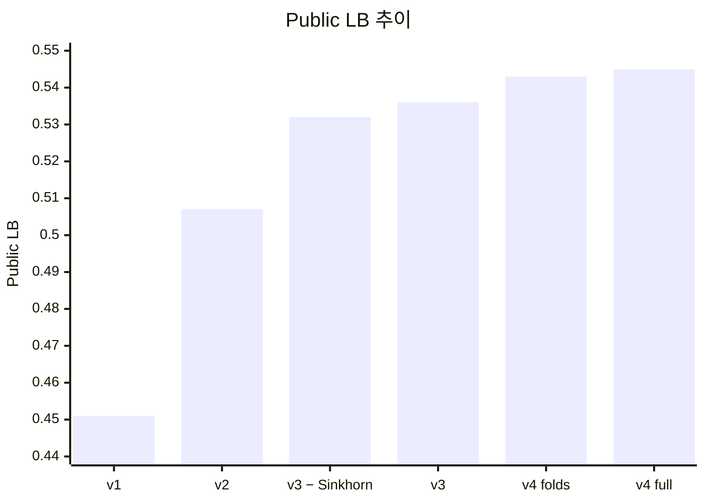
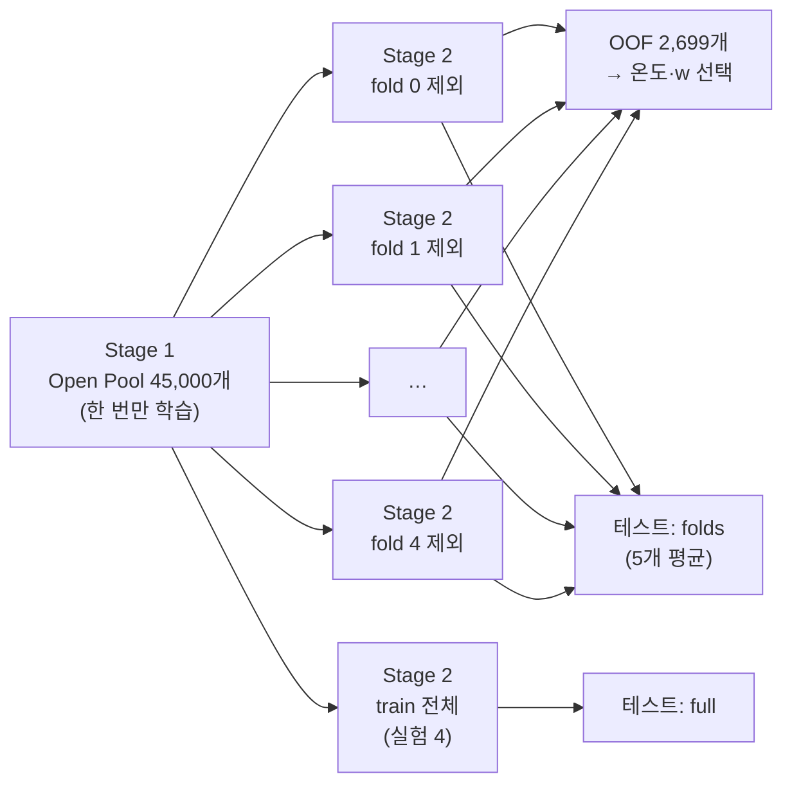

# Name That LLM 실험 기록

18개 LLM 중 어느 모델이 지문을 썼는지 맞히는 문제입니다. 지표는 balanced accuracy(BA)입니다.

- 검증은 `prompt_id` 단위 5-fold로 나눕니다. 테스트 프롬프트는 train에 없기 때문입니다.
- 홀드아웃은 fold 0(프롬프트 30개, 지문 540개)입니다. 지문 하나가 BA를 약 0.002 움직입니다.
- OOF는 2,699개 전체에 대한 fold 밖 예측입니다.

> [!NOTE]
> **수치 기준** · 이 문서의 검증 수치는 모두 **LB 점수를 낸 제출 커널(Kaggle T4, fp16) 로그**에서 가져왔습니다. LoRA를 학습한 Colab L4(bf16) 실행과는 LoRA 출력이 조금 달라서 지문 1~2개(BA 0.002~0.004) 차이가 납니다. 노트북에 저장된 출력은 Colab 학습 때 실행이라 이 문서와 숫자가 다를 수 있습니다.

## 한눈에 보기 (11/17~18)

| | 실험 | 바꾼 것 | 핵심 결과 | Public LB |
|:-:|---|---|---|:-:|
| **1** | v3 | n-gram train 가중치 12, Sinkhorn, `w` = 0.6 고정, LoRA 재학습 | 홀드아웃은 −0.0055인데 LB는 +0.029 | 0.507 → **0.536** |
| **2** | v3 − Sinkhorn | Sinkhorn만 끔 | Sinkhorn 기여는 +0.004뿐 | 0.532 |
| **3** | v4 | echo 입력 + LoRA 5-fold | OOF 블렌드 0.5749. echo 효과는 fold 0에서 안 보임 | (실험 4에서 제출) |
| **4** | v4 테스트 방식 | fold 5개 평균 vs 전체 학습 1개 | full이 0.002 높지만 차이가 작음 | 0.543 / **0.545** |

---

## 저번 주까지의 모델 구조 (11/10 제출 기준)

| 구성 | 내용 |
|---|---|
| 데이터 | `train.csv` 2,699행 + Open Pool(`crtproduction/name-that-llm-open-pool`)에서 라벨당 2,500개(45,000개) 추출 |
| A. n-gram | 4뷰 TF-IDF(char 3-5, word 1-2, shape, 기능어) → LinearSVC(C=0.1). train 행과 풀 행 가중치는 모두 1 |
| B. LoRA | Qwen3-4B-Base 앞 18층, 깊이 7곳(2,4,…,18) 평균 풀링 + 층별 LayerNorm → 선형 헤드. q/k/v/o에 LoRA r=16 |
| B 학습 | Stage 1: Open Pool 45,000개, 1 epoch, lr 2e-4 → Stage 2: train 중 fold 0 제외, 2 epochs, lr 5e-5 |
| 블렌딩 | 두 모델을 각각 온도 조정해 log 확률로 바꾼 뒤 `w·LoRA + (1−w)·n-gram`. `w`와 LoRA 온도는 fold 0 홀드아웃에서 최고값 선택 |
| 후처리 | 테스트 지문을 주제 TF-IDF로 묶고, 묶음 평균의 0.5배를 뺌(프롬프트 중심화) |

| 제출 | 노트북 | n-gram OOF | LoRA fold 0 | 블렌드 fold 0 | Public LB |
|---|---|:-:|:-:|:-:|:-:|
| v1: LoRA(train만) + n-gram | [name_that_llm_v1.ipynb](name_that_llm_v1.ipynb) | 0.3663 | 0.4278 | 0.4407 (`w` = 0.5) | 0.451 |
| v2: LoRA(Open Pool Stage 1 + Stage 2) + n-gram | [name_that_llm_v2.ipynb](name_that_llm_v2.ipynb) | 0.4667 | 0.5222 | 0.5444 (`w` = 0.5) | **0.507** |

- v1은 Open Pool을 전혀 쓰지 않아서 LoRA는 Stage 2만, n-gram은 train만으로 학습했습니다.

---

## 실험 1. v3: n-gram train 가중치, Sinkhorn, 블렌드 가중치 고정

> [!NOTE]
> **요약** · 세 가지를 한꺼번에 바꿨습니다. 홀드아웃은 0.0055 떨어졌는데 LB는 **0.507 → 0.536 (+0.029)** 으로 올랐습니다.

### 변한 점
1. **n-gram train 가중치**: SVC에서 train 행 가중치 후보 {1, 4, 12}를 5-fold OOF로 비교해 고릅니다. 결과는 **12**였습니다.
2. **Sinkhorn**: 최종 argmax 직전에 Target-Shrunk Damped Sinkhorn을 추가했습니다. 클래스별 예측 비율을 균등 쪽으로 35% 옮기고, 테스트가 200행 이상일 때만 적용합니다.
3. **블렌드 가중치 고정**: `w = 0.6`으로 고정했습니다. 홀드아웃 최고값을 고르니 실행마다 0.5와 1.0을 오가서입니다.
4. **LoRA 재학습**: Open Pool이 갱신돼서(223,840 → 226,191행) 다시 학습했습니다.

### 실험 세팅
| 단계 | 환경 | 시간 |
|---|---|---|
| LoRA 학습 | Colab L4, bf16, 배치 8 | Stage 1 31분, Stage 2 3분 |
| 제출 | Kaggle T4, 저장된 가중치로 추론만 (커널 `name-that-llm-lora` 버전 3) | - |

노트북: [name_that_llm_v3.ipynb](name_that_llm_v3.ipynb)

### 결과
| 항목 | v2 | v3 | 변화 |
|---|:-:|:-:|:-:|
| n-gram OOF BA | 0.4667 (가중치 1) | **0.4745** (가중치 12) | 🟢 +0.0078 |
| LoRA 홀드아웃 BA | 0.5222 | 0.5407 | 🟢 +0.0185 |
| 블렌드 홀드아웃 BA | 0.5444 (`w` = 0.5 선택) | 0.5389 (`w` = 0.6 고정) | 🔴 −0.0055 |
| **Public LB** | 0.507 | **0.536** | 🟢 **+0.029** |

n-gram train 가중치별 OOF BA (v3 풀 기준):

| 가중치 | 1 | 4 | 12 |
|:-:|:-:|:-:|:-:|
| OOF BA | 0.4675 | 0.4697 | **0.4745** |

v3 홀드아웃의 `w`별 블렌드 BA:

| `w` | 0.5 | 0.6 | 0.7 | 0.8 | 0.9 | 1.0 |
|:-:|:-:|:-:|:-:|:-:|:-:|:-:|
| 블렌드 BA | 0.5315 | 0.5389 | 0.5333 | 0.5389 | **0.5463** | 0.5407 |

### 해석
- 홀드아웃은 조금 떨어졌는데 LB는 0.029 올랐습니다. 540개 홀드아웃으로는 차이를 가리기 어렵습니다.
- `w`별 BA가 0.53~0.55 사이에서 들쭉날쭉합니다. 홀드아웃 최고값(0.9)을 따르지 않고 0.6으로 고정한 이유입니다.

---

## 실험 2. v3에서 Sinkhorn만 끄기 (비교 제출)

> [!NOTE]
> **요약** · Sinkhorn의 기여는 **+0.004**입니다. 실험 1의 개선분 +0.029 중 대부분은 다른 변경에서 왔습니다.

### 변한 점
- `use_sinkhorn=False` 한 줄만 바꿨습니다. 가중치와 나머지 설정은 v3와 같습니다.

### 실험 세팅
- Kaggle 커널 `name-that-llm-lora` 버전 4로, 같은 가중치 데이터셋을 씁니다.
- Sinkhorn은 테스트에서만 켜지기 때문에 제출 점수는 LB로만 비교할 수 있습니다. 로그에는 같은 보정을 홀드아웃에 적용해 본 점검 결과가 함께 찍힙니다.

### 결과
| 제출 | 블렌드 홀드아웃 BA (점검용) | Public LB | 변화 |
|---|:-:|:-:|:-:|
| v3 − Sinkhorn | 0.5389 | 0.532 | 기준 |
| v3 (Sinkhorn 켬, ρ = 0.35) | 0.5407 | **0.536** | 🟢 +0.004 |

### 해석
실험 1의 LB 개선 +0.029를 나누면 다음과 같습니다.

| 출처 | 기여 |
|---|:-:|
| 새 LoRA 가중치 + n-gram 가중치 12 + `w` 고정 | **+0.025** |
| Sinkhorn | +0.004 |

- 홀드아웃 점검에서도 Sinkhorn은 +0.0018(지문 1개)로 작습니다.

---

## 실험 3. v4: Qwen echo 입력 + LoRA 5-fold

> [!NOTE]
> **요약** · OOF 블렌드 BA **0.5749**. 다만 LoRA 단독 fold 0 점수가 v3와 지문 1개 차이라 **echo 효과는 확인되지 않았습니다.**

### 변한 점
1. **echo 입력**: Qwen에 `지문 + "\n\n" + 지문`을 넣고 두 번째 사본만 풀링합니다. causal attention이라 앞 토큰이 뒤 문맥을 못 보는 문제를 우회하려는 것입니다(Springer et al., ICLR 2025). 공개 상위 솔루션 12개를 확인했는데 이 방법을 쓴 곳은 없었습니다.
2. **LoRA 5-fold**: Stage 1은 train을 쓰지 않으므로 한 번만 학습합니다. 그다음 fold마다 Stage 1 가중치에서 다시 시작해 Stage 2를 학습합니다. 그래서 LoRA도 2,699개 OOF가 생기고, 테스트 예측은 fold 5개 평균입니다.
3. **OOF로 튜닝**: 블렌딩 온도와 가중치 비교, Sinkhorn 비교를 모두 2,699개 OOF로 합니다(v3는 540개).
4. **배치**: 입력이 두 배라 마이크로 배치 4 × 누적 2(실효 배치 8, v3와 같음)를 씁니다.

### 실험 세팅
| 단계 | 환경 | 비고 |
|---|---|---|
| Stage 1 | Colab T4(fp16) → L4(bf16) | 3,259/5,625 스텝에서 중단하고 상태(가중치, Adam, 스케줄러)를 저장한 뒤 L4로 옮겨 이어 학습. 이 때문에 v3와 GPU 및 수치 정밀도가 다름 |
| Stage 2 | L4 | fold당 약 7분 |
| n-gram | - | 가중치 12로 고정(실험 1에서 고른 값) |
| 제출 | Kaggle T4, 저장된 가중치로 추론만 | 커널 `name-that-llm-v4-echo`, `name-that-llm-v4-echo-full` |
| 검증 | - | 저장 가중치로 다시 계산한 OOF가 L4 학습 때와 100% 일치 |

노트북: [name_that_llm_v4.ipynb](name_that_llm_v4.ipynb)

### 결과
| 항목 | v3 | v4 | 변화 |
|---|:-:|:-:|:-:|
| LoRA 단독, fold 0 | 0.5407 | 0.5426 | ⚪ +0.0019 (지문 1개) |
| LoRA 단독, OOF 2,699개 | - | 0.5631 | |
| 블렌드(`w` = 0.6), fold 0 | 0.5389 | 0.5593 | 🟢 +0.0204 |
| 블렌드(`w` = 0.6), OOF | - | **0.5749** | |
| 블렌드 + Sinkhorn(ρ = 0.35), OOF | - | 0.5764 | |

OOF 기준 `w`별 블렌드 BA:

| `w` | 0.4 | 0.5 | 0.6 | 0.7 | 0.8 | 0.9 | 1.0 |
|:-:|:-:|:-:|:-:|:-:|:-:|:-:|:-:|
| 블렌드 BA | 0.5645 | 0.5723 | 0.5749 | 0.5749 | **0.5760** | 0.5705 | 0.5631 |

### 해석
> [!IMPORTANT]
> **echo 효과는 fold 0에서 보이지 않습니다.** LoRA 단독 점수가 v3와 지문 1개 차이입니다. L4 학습 때는 v3와 v4 모두 0.5426으로 같았습니다.

- fold 0 블렌드가 오른 건 LoRA 온도를 2,699개 OOF로 고른 덕으로 보입니다(추정).
- `w`에 따른 BA 변화가 실험 1의 홀드아웃(540개)보다 훨씬 매끄럽습니다. 0.6~0.8이 거의 같습니다.

---

## 실험 4. v4 테스트 예측 방식: fold 평균 vs 전체 학습

> [!NOTE]
> **요약** · 두 방식 모두 v3보다 LB가 올랐습니다(**+0.007 / +0.009**). folds와 full의 차이는 0.002라 우열을 가리기 어렵습니다.

### 변한 점
`CFG["lora_test"]`로 테스트 로짓을 만드는 방식을 고릅니다.

| 방식 | 테스트 로짓 | 각 모델이 본 train |
|---|---|:-:|
| `folds` | fold 모델 5개 평균 | 80% |
| `full` | Stage 1 가중치에서 train 전체 2,699개로 Stage 2를 한 번 더 학습한 모델 1개 | 100% |

온도와 블렌드 가중치는 두 방식 모두 fold OOF에서 정한 값을 씁니다. 그래서 두 커널의 검증 수치는 같습니다.

### 실험 세팅
- 전체 학습은 L4에서 676스텝, 8.4분 걸렸습니다.
- Kaggle 커널은 `name-that-llm-v4-echo`(folds)와 `name-that-llm-v4-echo-full`(full)입니다.
- 가중치 데이터셋은 `ntl-lora-weights-v4-echo-cv`(fold 5개 + full)입니다.

### 결과
| 제출 | OOF 블렌드 BA | Public LB | v3 대비 |
|---|:-:|:-:|:-:|
| v3 (비교용) | - | 0.536 | 기준 |
| v4 folds | 0.5749 | 0.543 | 🟢 +0.007 |
| v4 full | 0.5749 | **0.545** | 🟢 +0.009 |

### 해석
- v4는 v3보다 LB가 +0.007~0.009 올랐습니다. 다만 LoRA 단독 fold 0 점수가 v3와 거의 같아서, 이 개선을 echo 덕으로 볼 근거는 약합니다. 5-fold로 바뀐 점(OOF 2,699개로 고른 온도, 테스트 예측 앙상블 또는 전체 학습)의 효과로 보는 게 더 자연스럽습니다(추정).
- folds와 full의 차이(0.002)는 작아서 어느 쪽이 낫다고 단정하기 어렵습니다.

> [!TIP]
> **다음 할 일** · echo만의 효과를 확인하려면 echo를 끈 5-fold 실행이 필요합니다.

---

## 정리

| 제출 | 핵심 변경 | 검증 BA | Public LB |
|---|---|:-:|:-:|
| v1 | LoRA(train만) + n-gram | 0.4407 (fold 0) | 0.451 |
| v2 (11/10) | Open Pool Stage 1 + n-gram 블렌드 | 0.5444 (fold 0) | 0.507 |
| v3 − Sinkhorn | n-gram 가중치 12, `w` = 0.6, LoRA 재학습 | 0.5389 (fold 0) | 0.532 |
| v3 | + Sinkhorn | 0.5389 (fold 0) | 0.536 |
| v4 folds | + echo 입력, LoRA 5-fold, 테스트 = fold 5개 평균 | 0.5749 (OOF) | 0.543 |
| v4 full | + echo 입력, LoRA 5-fold, 테스트 = 전체 학습 모델 | 0.5749 (OOF) | **0.545** |

- 검증 BA는 Sinkhorn을 적용하기 전 값입니다. v4의 fold 0만 보면 0.5593입니다.

## 재현용 파일

- 노트북: [v1](name_that_llm_v1.ipynb), [v2](name_that_llm_v2.ipynb), [v3](name_that_llm_v3.ipynb), [v4](name_that_llm_v4.ipynb)
- 가중치는 `weights_v4/`, `ntl_lora_v*.pt`(git 제외)와 Kaggle 데이터셋에 있습니다.
  - v1: `ntl-lora-weights`
  - v2: `ntl-lora-weights-pool`
  - v3: `ntl-lora-weights-v3`
  - v4: `ntl-lora-weights-v4-echo-cv`
- Kaggle 커널: `name-that-llm-lora`(버전 1 = v1, 버전 2 = v2, 버전 3 = v3, 버전 4 = v3 − Sinkhorn), `name-that-llm-v4-echo`, `name-that-llm-v4-echo-full`
