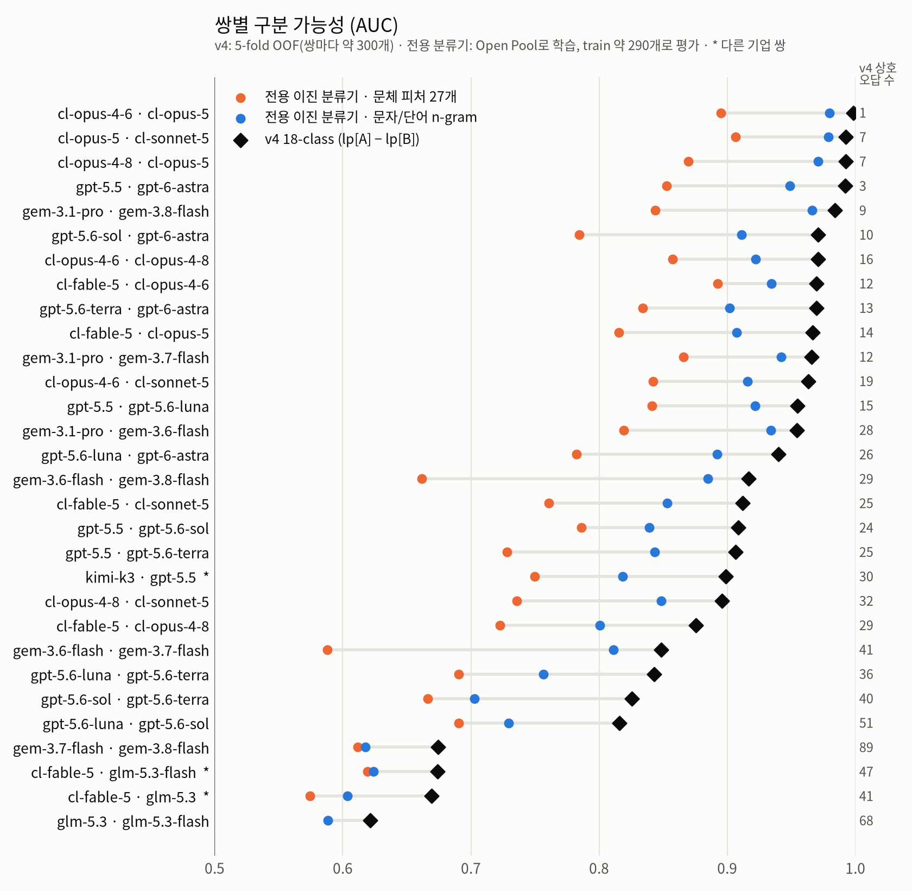
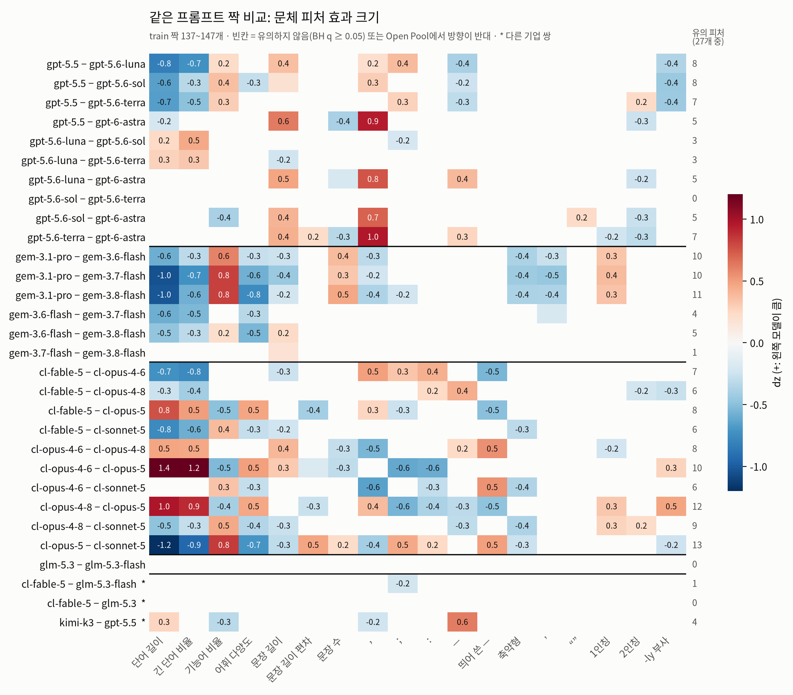

# 같은 기업 모델 사이의 차이

같은 기업 모델끼리 무엇이 다르고, v4가 헷갈리는 쌍은 왜 헷갈리는지 봅니다. 결론은 네 가지입니다.

1. v4가 많이 헷갈리는 쌍은 **문체 피처로도 거의 차이가 나지 않는 쌍**입니다. glm-5.3과 glm-5.3-flash, claude-fable-5와 GLM 두 모델, gemini-3.7-flash와 3.8-flash, gpt-5.6-sol과 terra가 그렇습니다.
2. 두 모델만 가르는 전용 이진 분류기를 만들어도 **30쌍 중 29쌍에서 v4보다 AUC가 낮고**, GLM 쌍만 비슷합니다(0.622 vs 0.621). 지금 모델이 쌍 구분에 쓸 수 있는 표면 신호를 놓치고 있다는 증거는 없습니다.
3. 같은 프롬프트에 대한 두 답을 나란히 놓으면 GPT 5.6 세 모델과 Gemini flash 쌍은 더 잘 구분됩니다(sol·terra AUC 0.826 → 짝 정확도 0.887). 주제가 두 답을 같은 쪽으로 움직이기 때문으로 보입니다(추정). GLM 쌍은 짝을 지어도 0.600입니다.
4. 구분이 잘 되는 쌍은 설명할 수 있는 차이가 뚜렷합니다. 띄어 쓴 em dash(` — `)는 Claude 중 opus-4-6과 opus-5만 씁니다. gpt-6-astra는 쉼표가 적고 문장이 짧습니다. gemini-3.1-pro는 기능어가 많고 단어가 짧습니다.

## 데이터와 방법

- **train 지문**: 이 서버에서 Kaggle에 접속되지 않아 Hugging Face 미러(`HLDKNotFound/name-that-llm-dataset`)의 `official_gold` 행을 썼습니다. 2,699개 중 2,625개(97%)를 찾았습니다. `oof_v4.npz`의 `prompt_id`, 정답과 1:1로 맞췄고, 맞춘 예측으로 다시 낸 fold 0 BA가 0.5593으로 보고서와 같습니다.
- **Open Pool**: 같은 미러의 풀 지문 49,050개(모델당 2,725개)입니다. train과 겹치는 지문은 없습니다.
- **기준 예측**: v4 블렌드(`eval_lp`)의 5-fold OOF 2,699개(모델당 약 150개)입니다. 모델당 30개인 fold 0보다 흔들림이 작아서 이 문서는 OOF 전체를 씁니다. 텍스트가 필요 없는 v4 지표는 2,699개를 모두 씁니다.
- **짝 비교**: train은 프롬프트 하나에 18개 모델이 한 번씩 답했습니다. 그래서 같은 프롬프트의 두 답을 짝지어 비교하면 주제 영향이 빠집니다. 효과 크기는 dz(짝 차이 평균 / 짝 차이 표준편차)이고, BH 보정 q < 0.05이면서 Open Pool에서도 방향이 같은 피처만 "유의"로 셉니다.

## 쌍별 구분 가능성

- 검은 마름모는 v4 블렌드 점수 차이 `lp[A] − lp[B]`로 A, B 지문을 줄 세운 AUC입니다. 파란 점과 주황 점은 Open Pool의 A, B 지문만으로 학습한 로지스틱 회귀를 train 지문으로 평가한 AUC입니다.
- **29쌍에서 v4가 가장 높습니다.** 전용 n-gram 분류기와의 차이는 0.02\~0.12입니다. GLM 쌍만 문체 분류기(0.622)가 v4(0.621)와 같습니다. 다만 전용 분류기는 풀만 쓴 단순 모델이라 상한은 아닙니다.
- 쌍은 세 무리로 나뉩니다.

| 무리 | 쌍 | v4 AUC | v4 짝 정확도 | 유의 피처(27개 중) |
|---|---|:-:|:-:|:-:|
| 거의 구분 안 됨 | glm-5.3 · glm-5.3-flash | 0.621 | 0.600 | 0 |
| | claude-fable-5 · glm-5.3 | 0.669 | 0.738 | 0 |
| | claude-fable-5 · glm-5.3-flash | 0.674 | 0.752 | 1 |
| | gemini-3.7-flash · 3.8-flash | 0.674 | 0.727 | 1 |
| 중간 | gpt-5.6-luna · sol | 0.816 | 0.860 | 3 |
| | gpt-5.6-sol · terra | 0.826 | 0.887 | 0 |
| | gpt-5.6-luna · terra | 0.843 | 0.880 | 3 |
| | gemini-3.6-flash · 3.7-flash | 0.848 | 0.920 | 4 |
| 잘 구분됨 | 나머지 22쌍 | 0.876\~0.998 | 0.907\~1.000 | 4\~15 |

- 짝 정확도는 같은 프롬프트에 대한 A, B 답 두 개 중 A를 고르는 비율입니다. 무작위면 0.5입니다.
- v4 상호 오답(쌍 지문 약 300개 중)은 "거의 구분 안 됨" 41\~89개, "중간" 36\~51개, "잘 구분됨" 1\~32개입니다.

## 같은 프롬프트 짝 비교

값은 dz이고, 빨강은 왼쪽 모델이 크다는 뜻입니다. 피처 정의는 `features.py`의 `FEATURES`에 있습니다. 아래 수치는 train 짝 평균이고, 모든 항목이 Open Pool에서도 방향이 같습니다.

### GPT

- **gpt-6-astra**: 쉼표가 100단어당 7.8개로 나머지 넷(10.0\~11.0)보다 적고, 문장이 짧습니다(21.3단어, 나머지 23.9\~26.7). you/your가 많습니다(0.68, 나머지 0.16\~0.35).
- **gpt-5.5**: 단어가 가장 짧습니다(5.15글자, 5.6 계열 5.38\~5.48). -ly 단어와 em dash가 적고(em dash 0.14, 5.6 계열 0.34\~0.48), 세미콜론이 많습니다(0.77).
- **5.6 세 모델**: 차이가 작습니다.
  - luna는 단어가 조금 길고(긴 단어 비율 0.147, sol 0.126), em dash(지문 37%, sol 28%)와 괄호(5%, sol 1%)를 더 씁니다.
  - sol은 세미콜론(지문 62%, luna 43%)과 곱은 큰따옴표(15%, terra 8%)를 더 씁니다.
  - **sol과 terra는 유의한 피처가 하나도 없습니다.** 어휘에서도 차이가 작습니다(`can`, `in`이 terra 쪽으로 몇 %p).

### Gemini

- **gemini-3.1-pro**: flash 셋보다 기능어가 많고(0.33, flash 0.29\~0.30) 단어가 짧으며(5.50, flash 5.71\~5.92) 문장 수가 많습니다. 축약형(0.16, flash 0.45\~0.49)과 곱은 아포스트로피가 적고, 1인칭이 많습니다(1.55, flash 0.88\~0.97).
- **flash 3.6 → 3.7 / 3.8**: 버전이 오를수록 단어가 길어지고(5.71 → 5.92 / 5.88) 어휘 다양도가 오릅니다.
- **3.7과 3.8은 문장 길이 하나만 유의합니다**(24.0 vs 22.8단어, dz 0.18).

### Claude

- **띄어 쓴 em dash**(` — `)는 opus-4-6(100단어당 0.38)과 opus-5(0.30)만 씁니다. train에서 이 표기가 나온 지문은 opus-4-6 40개, opus-5 36개이고 fable-5, opus-4-8, sonnet-5는 0개입니다(GLM은 3\~5개). 그래서 이 둘과 나머지 셋 사이의 짝에서는 방향이 100% 같습니다.
- **opus-5**: 단어가 가장 짧고(5.03) 기능어가 가장 많으며(0.35), 문장 길이가 가장 들쭉날쭉합니다(표준편차 8.6, 나머지 6.1\~7.3). 세미콜론과 콜론도 많습니다.
- **opus-4-6**: 쉼표가 적고(7.8) 문장이 깁니다(27.5단어).
- **sonnet-5**: 축약형이 가장 많습니다(1.44, 나머지 0.90\~1.01). `it's`, `isn't`, `just`가 많습니다.
- **opus-4-8**: `you`, `your`, `imagine`, `the`가 많습니다(you 지문 21%, sonnet-5 12%).
- **fable-5**: em dash(지문 83%, opus-4-8 62%), 콜론(59%, 48%), 세미콜론을 opus-4-8보다 많이 씁니다. opus-4-8은 `to`, `that`, `how`, `this`를 더 씁니다.

### GLM과 claude-fable-5

- **glm-5.3과 glm-5.3-flash는 유의한 피처가 없습니다.** 어휘에서는 glm-5.3이 `i`, `my`를 조금 더 쓰고(지문 7% vs 3%), flash가 세미콜론(49% vs 34%)과 `we`를 더 씁니다.
- **claude-fable-5와 GLM 두 모델도 피처가 거의 같습니다.**
  - em dash는 100단어당 1.36(fable-5)과 1.51, 1.38(GLM)이고, 곧은 아포스트로피는 1.03과 1.07, 1.11입니다.
  - 곱은 따옴표는 셋 다 0입니다.
  - 기업 단위에서 Claude를 다른 기업과 가르는 표지(em dash, 곧은 따옴표)를 GLM도 그대로 가지고 있습니다. 그래서 fable-5는 Claude 안에서도 GLM 쪽으로 새기 쉽습니다(추정).
- 어휘 차이도 작습니다. GLM-flash가 `we`, 세미콜론, 큰따옴표를 더 쓰는 정도입니다.

### kimi-k3와 gpt-5.5 (다른 기업)

- em dash로 꽤 갈립니다(지문 52% vs 12%). 그런데도 kimi-k3 오답의 행선지가 gpt-5.5(0.13), claude-fable-5, qwen 등으로 흩어집니다. 오답의 점수 차이도 큽니다(아래 표, 중앙값 1.33). 같은 기업 문제라기보다 kimi-k3 자체의 특징이 약한 쪽으로 보입니다(추정).

## v4 오답의 모양

OOF recall이 0.5 안팎 이하인 모델들입니다. "점수 차"는 오답 지문에서 예측 모델과 정답 모델의 블렌드 log 확률 차이입니다.

| 모델 | recall | top-2 | top-3 | 점수 차 < 1인 오답 | 점수 차 중앙값 | 주 오답 행선지 |
|---|:-:|:-:|:-:|:-:|:-:|---|
| claude-fable-5 | 0.262 | 0.510 | 0.725 | 56% | 0.85 | glm-5.3-flash 0.17, glm-5.3 0.13, opus-4-8 0.13 |
| glm-5.3 | 0.267 | 0.627 | 0.793 | 60% | 0.78 | glm-5.3-flash 0.23, fable-5 0.15 |
| glm-5.3-flash | 0.327 | 0.507 | 0.747 | 62% | 0.75 | glm-5.3 0.23, fable-5 0.15 |
| gpt-5.6-sol | 0.367 | 0.673 | 0.867 | 66% | 0.65 | luna 0.21, terra 0.16, 5.5 0.10 |
| gemini-3.7-flash | 0.407 | 0.767 | 0.920 | 57% | 0.82 | 3.8-flash 0.37, 3.6-flash 0.16 |
| kimi-k3 | 0.480 | 0.620 | 0.673 | 35% | 1.33 | gpt-5.5 0.13, fable-5 0.07 |
| gpt-5.6-terra | 0.487 | 0.767 | 0.887 | 61% | 0.71 | luna 0.15, sol 0.11, 5.5 0.10 |
| gpt-5.6-luna | 0.513 | 0.747 | 0.867 | 59% | 0.81 | sol 0.13, astra 0.11 |
| gemini-3.8-flash | 0.627 | 0.873 | 0.947 | 64% | 0.74 | 3.7-flash 0.23, 3.6-flash 0.11 |

- kimi-k3를 빼면 오답의 56\~66%가 점수 차 1 안쪽입니다. 정답도 top-2 안에 51\~87% 들어 있습니다. 경계에 붙은 오답이 많다는 뜻입니다.
- 짧은 지문이 어렵습니다. 단어 수 3분위로 나누면 전체 정확도가 0.474(중앙 55단어) → 0.597 → 0.662(중앙 185단어)이고, 위 모델들만 보면 0.350 → 0.436 → 0.464입니다.

## Open Pool의 주제 쏠림

- 풀에서 단어별 log-odds를 구하면 gemini-3.7과 3.8-flash 사이에 |z| > 3인 단어가 213개나 나옵니다. 하지만 상위 40개 중 train에서 방향이 같은 것은 57%뿐입니다.
- 3.7 쪽 상위 단어가 `evolutionary`, `quantum`, `spatial`, `non` 같은 주제어입니다. 풀은 모델마다 생성한 프롬프트 묶음이 달라서, 모델과 주제가 섞여 있습니다(추정).
- 같은 계산에서 train 재현율은 GLM 쌍 48%, sol·terra 65%이고, opus-4-8·sonnet-5 92%, luna·terra 85%입니다. 차이가 실제로 큰 쌍일수록 풀 결과가 train에서도 재현됩니다.
- 쌍 구분 손실을 풀 지문으로 학습하면 이 주제 차이를 지름길로 배울 위험이 있습니다. 실험 계획에서 같은 프롬프트 짝을 쓰자는 이유입니다.

## 한계

- train 지문 74개(2.7%)가 없어 텍스트 기반 분석은 2,625개로 했습니다. 빠진 지문은 모델마다 1\~7개입니다.
- 전용 분류기는 풀만으로 학습한 로지스틱 회귀입니다. 더 강한 분류기(예: LoRA 이진 헤드)라면 결과가 다를 수 있습니다.
- 문체 피처 27개는 손으로 고른 것이라, 피처가 유의하지 않다는 것이 차이가 없다는 뜻은 아닙니다. 다만 v4 AUC도 같은 쌍에서 낮아서 두 결과가 서로 맞습니다.

## 파일

- `fetch_data.py`: HF 미러 parquet로 `data/train_recovered.csv`, `data/pool_hf.parquet`을 만듭니다(`data/`는 git 제외).
- `features.py`: 데이터 로딩, 문체 피처 27개
- `paired.py` → `out/paired.csv`: 같은 프롬프트 짝 비교
- `separability.py` → `out/separability.csv`: 쌍별 AUC, 짝 정확도
- `lexical.py` → `out/lexical.csv`: 헷갈리는 10쌍의 어휘 log-odds
- `plot.py` → `figures/separability.png`, `figures/paired_heatmap.png`
- 실행 순서: `python fetch_data.py <parquet 폴더>` → `python paired.py` → `python separability.py` → `python lexical.py` → `python plot.py`
- 실험 계획: [experiment_plan.md](experiment_plan.md)
