# 전체 모델별 정확도와 같은 기업 모델간 비교

## 전체 BA

validation 점수와 캐글 퍼블릭 점수입니다. validation은 네 버전 모두 fold 0 지문 540개(모델당 30개)로 쟀습니다. fold 0은 모든 버전에서 학습에 쓰지 않은 같은 지문입니다. n-gram과 LoRA를 나눈 점수는 [부록](#부록-버전별-모델-점수)에 있습니다.

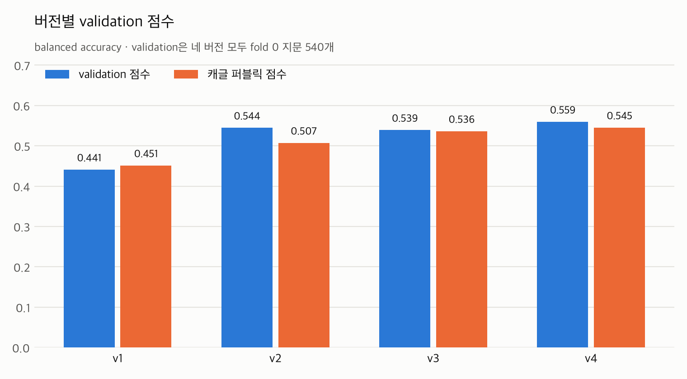

validation 점수는 fold 0을 학습에서 뺀 모델로 쟀고, 캐글 퍼블릭 점수는 fold 0까지 학습에 넣은 제출용 모델로 냈습니다.

## 모델별 recall

모델별 validation recall입니다. v4 순서로 정렬했고, 테두리 친 칸이 네 버전 중 가장 높은 값입니다.

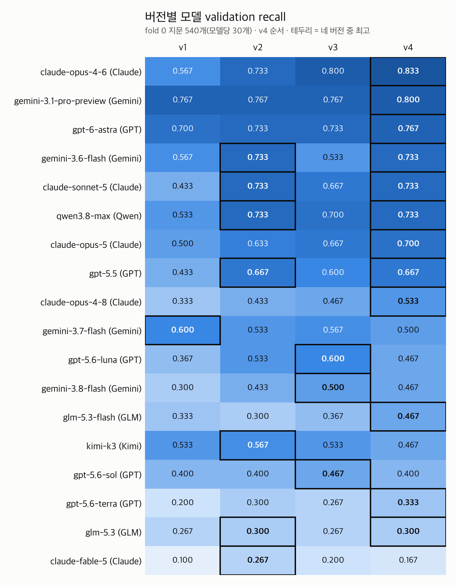

- 모델당 지문이 30개라 지문 하나가 recall 0.033입니다.
- v4가 가장 높은 모델(동점 포함)은 18개 중 12개입니다. gemini-3.7-flash는 반대로 v1(0.600)이 가장 높고 v4(0.500)가 가장 낮습니다.
- v4 하위 3개(claude-fable-5, glm-5.3, gpt-5.6-terra)는 네 버전 모두 0.34 이하입니다.

## 기업 단위

네 버전 모두 fold 0 지문 540개로 쟀습니다.

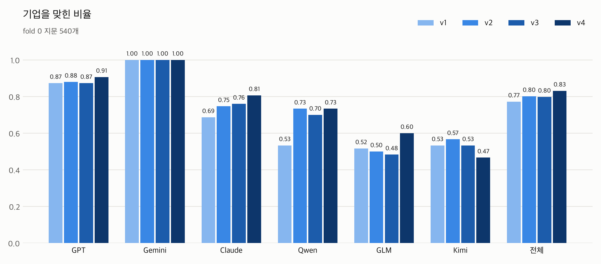

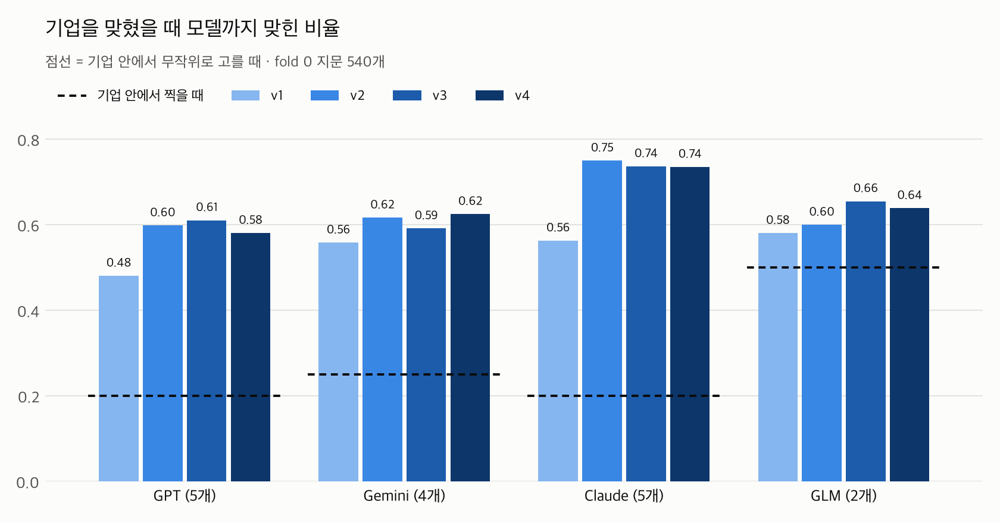

점선은 기업 안에서 무작위로 고를 때의 값입니다.

- Gemini는 네 버전 모두 기업을 1.000 맞히지만, 그 안에서는 0.56~0.63만 맞힙니다.
- 모델이 여럿인 기업 중 기업 정확도가 가장 많이 오른 곳은 Claude입니다(0.687 → 0.807).
- GLM은 기업 정확도가 0.48~0.60이고, 맞혀도 두 모델을 잘 구분하지 못합니다(찍을 때 0.5 대비 0.58~0.66).
- 모델이 하나뿐인 Qwen, Kimi는 기업 정확도가 곧 모델 recall입니다.
- 오답 중 같은 기업의 다른 모델로 틀린 비율은 네 버전 모두 56~62%입니다.

## 기업 내부 혼동 행렬 (v4)

v4 validation(fold 0 지문 540개) 기준입니다. 행은 정답, 열은 예측입니다. 값은 행 비율이고, 테두리 친 칸이 정답(대각)입니다. '외부'는 다른 기업 모델로 예측한 비율입니다.

### GPT

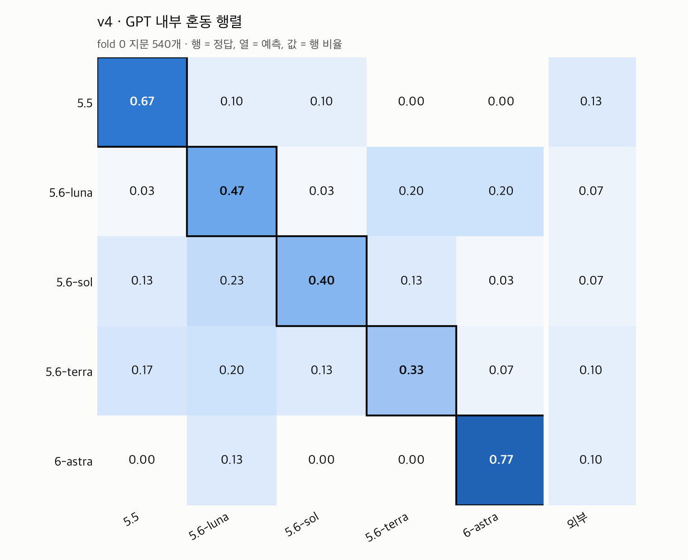

- 5.6 세 모델(luna, sol, terra)끼리 섞입니다. sol은 luna로 0.23, terra는 luna로 0.20, luna는 terra로 0.20이 갑니다.
- luna는 6-astra로도 0.20이 갑니다. 6-astra 자체는 0.77로 잘 분리됩니다.
- 5.5는 0.67이고, 외부로 새는 0.13 중 qwen3.8-max가 0.10입니다.

### Gemini

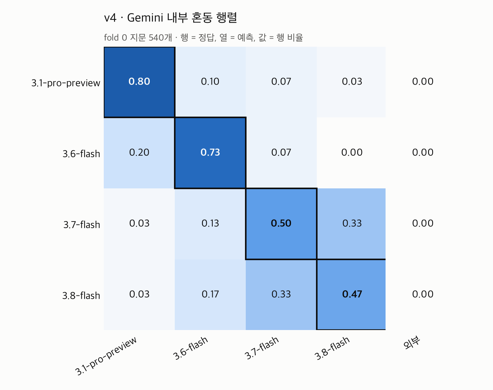

- 3.7-flash와 3.8-flash가 서로 0.33씩 갑니다. 정답 비율(0.50, 0.47)과 큰 차이가 없습니다.
- 3.6-flash는 3.1-pro-preview로 0.20이 갑니다. 3.1-pro-preview는 0.80으로 잘 구분됩니다.
- 외부로는 하나도 새지 않습니다(네 모델 모두 0.00).

### Claude

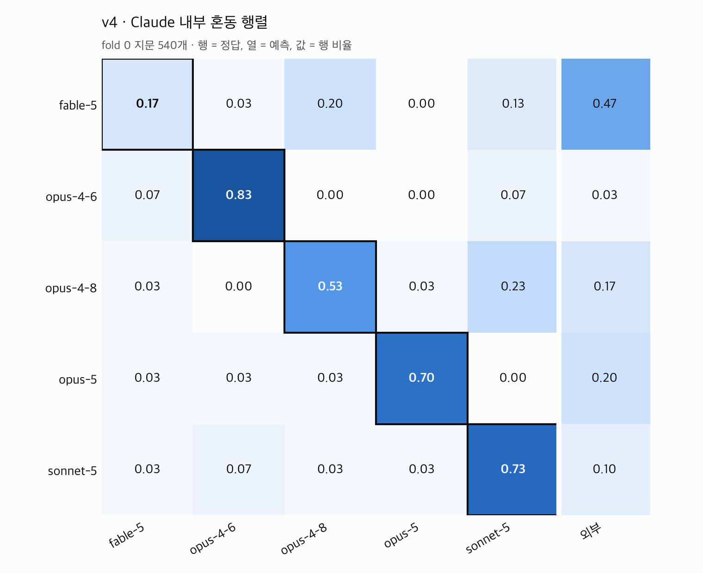

- opus-4-6(0.83), sonnet-5(0.73), opus-5(0.70)는 잘 구분됩니다. opus-5는 외부로 0.20이 새는데 절반 이상이 GLM입니다.
- opus-4-8은 sonnet-5로 0.23이 갑니다.
- fable-5는 정답이 0.17뿐이고 외부로 0.47이 새는데, 대부분 GLM입니다(glm-5.3-flash 0.30, glm-5.3 0.17).

### GLM

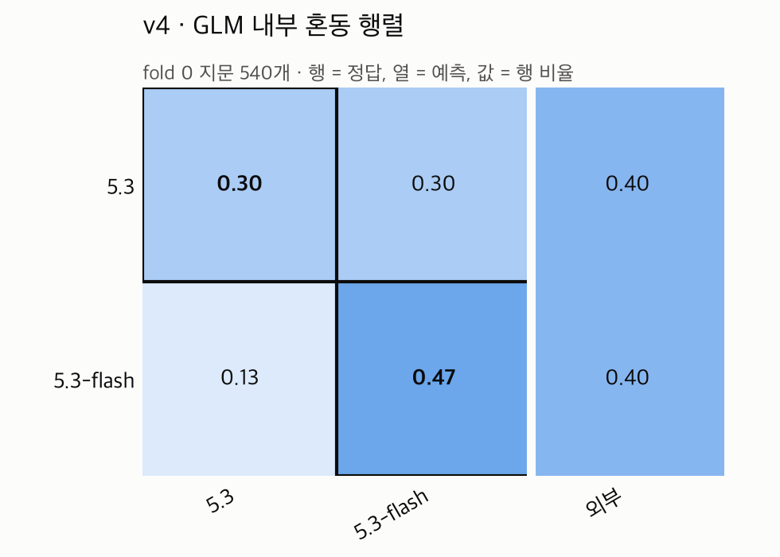

- glm-5.3은 정답과 glm-5.3-flash로 가는 비율이 0.30으로 같습니다. glm-5.3-flash는 0.47로 조금 낫습니다.
- 두 모델 모두 외부로 0.40(12개)이 새고, 그중 9개가 Claude 모델입니다(claude-fable-5 0.10씩, glm-5.3-flash → claude-sonnet-5 0.10).

## 약한 모델은 어디로 틀리나 (v4)

v4 validation(fold 0 지문 540개)에서 recall이 낮은 8개 모델의 예측 비율 상위 4개입니다. 7위가 동점(0.467) 4개라 8개를 넣었습니다. 파란 막대가 정답으로 예측한 비율(recall)입니다.

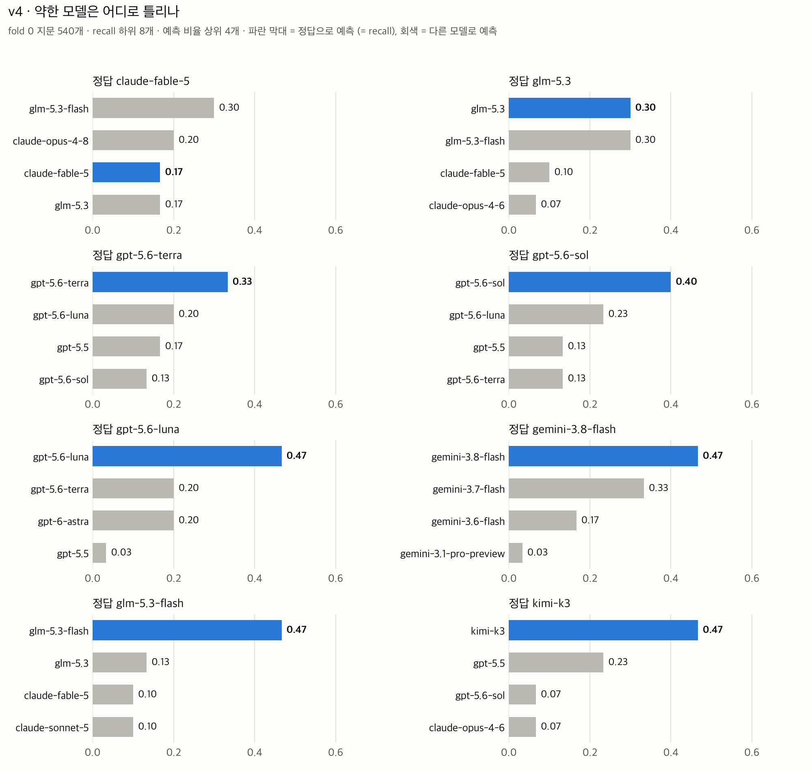

- claude-fable-5는 정답(0.17)보다 glm-5.3-flash(0.30)와 claude-opus-4-8(0.20)로 더 많이 갑니다. glm-5.3과 glm-5.3-flash도 claude-fable-5로 0.10씩 갑니다. 기업이 달라도 하나의 묶음처럼 보입니다.
- GPT 5.6 세 모델(terra, sol, luna)이 모두 하위 8개에 듭니다. terra와 sol의 가장 큰 오답 행선지는 luna이고, luna는 terra와 6-astra로 0.20씩 갑니다.
- kimi-k3는 gpt-5.5로 0.23이 갑니다.

## 가장 많이 헷갈린 쌍 Top 12 (v4)

v4 validation(fold 0 지문 540개)에서 정답 지문이 다른 모델로 예측된 비율이 높은 쌍입니다. 12위(0.200)와 13위(0.167) 사이에 동점이 없습니다.

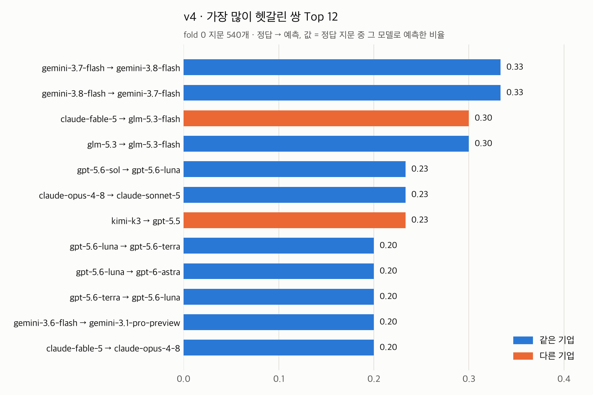

12개 중 10개가 같은 기업 쌍입니다. 다른 기업 쌍 2개는 claude-fable-5 → glm-5.3-flash(0.30)와 kimi-k3 → gpt-5.5(0.23)입니다.

## 파일

- `oof_v4.npz`: v4 5-fold 예측. `y`, `fold`, `oof_ng`, `lora_oof`, `eval_lp`(블렌드 log 확률), 온도, `blend_w`, `labels`. 이 보고서는 `fold == 0`인 540개만 씁니다.
- `oof_v1.npz` ~ `oof_v3.npz`: v1~v3를 저장된 가중치로 Colab T4에서 다시 돌린 예측. `eval_idx`(fold 0 지문 540개), `eval_lp`(블렌드 log 확률), `holdout_logits`, `oof_ng`. 점수가 제출 커널 로그와 같습니다.
- `common.py`: 네 버전의 fold 0 예측을 같은 순서로 읽는 함수. 아래 그림 스크립트가 모두 이것을 씁니다.
- `figures/scores*.png`, `figures/recall_*.png`, `figures/org_*.png`, `plot_tables.py`: 점수·recall·기업 단위 그래프(`python3 plot_tables.py . figures`)
- `figures/cm_*.png`, `plot_confusion.py`: 기업 내부 혼동 행렬(`python3 plot_confusion.py figures`)
- `figures/weak_models_v4.png`, `plot_weak.py`: 약한 모델의 예측 행선지(`python3 plot_weak.py figures`)
- `figures/top_pairs_v4.png`, `plot_top_pairs.py`: 가장 많이 헷갈린 쌍 Top 12(`python3 plot_top_pairs.py figures`)
- `figures/architecture_v4.png`, `plot_architecture.py`: 부록의 v4 모델 구조(`python3 plot_architecture.py figures`)
- `v4_oof_colab_executed.ipynb`: Colab 실행 노트북. recall 그래프와 혼동 행렬 그림이 들어 있습니다.
- `run.log`: nbconvert 실행 로그

## 부록: v4 모델 구조

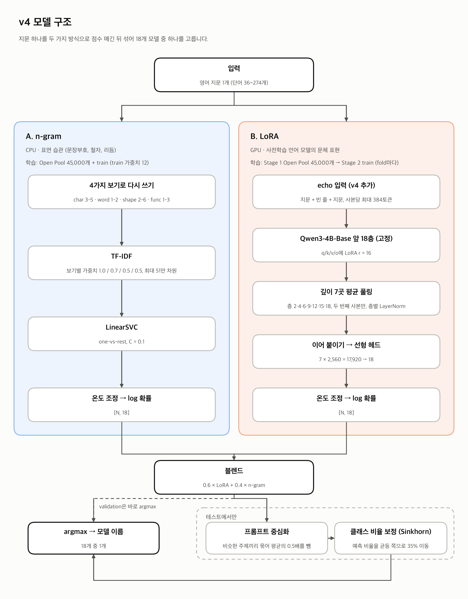

- n-gram과 LoRA는 따로 학습하고, 각각 온도를 맞춘 log 확률을 0.6 : 0.4(LoRA : n-gram)로 섞습니다.
- v4에서 바뀐 것은 LoRA 입력(echo)과 LoRA를 5-fold로 학습한 점입니다. 나머지는 v3과 같습니다.
- 프롬프트 중심화와 Sinkhorn은 테스트 예측에만 쓰고, 본문의 validation 점수에는 들어가지 않습니다.

## 부록: 버전별 모델 점수

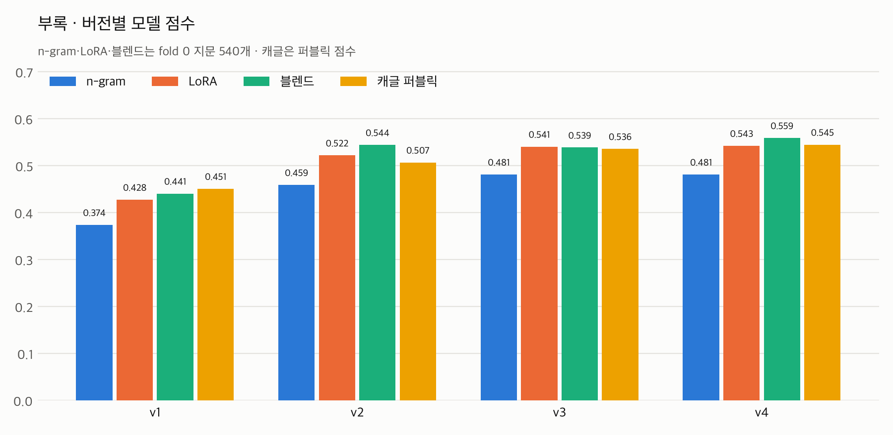

- n-gram, LoRA, 블렌드 모두 fold 0 지문 540개로 쟀습니다.
- v3 캐글 퍼블릭 점수는 Sinkhorn을 켠 제출(끈 제출 0.532), v4 점수는 train 전체로 학습한 모델의 제출(모델 5개 평균 제출 0.543)입니다.

## 부록: v4 방식별 모델 recall

v4의 n-gram, LoRA, 블렌드 recall입니다(fold 0 지문 540개). 블렌드 recall 순서이고, 테두리 친 칸이 세 방식 중 가장 높은 값입니다.

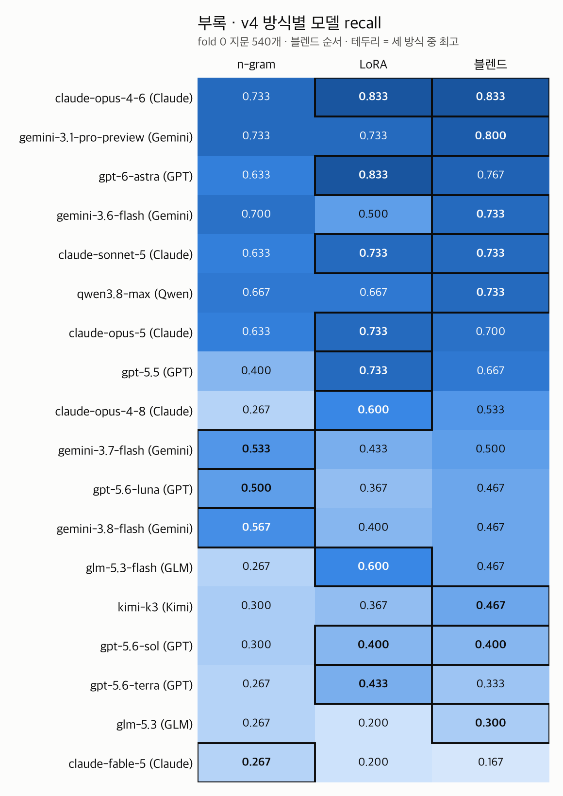

- LoRA가 n-gram보다 낮은 모델은 6개입니다(gpt-5.6-luna, gemini-3.6/3.7/3.8-flash, claude-fable-5, glm-5.3). gemini-3.1-pro-preview와 qwen3.8-max는 둘이 같습니다.
- 블렌드가 가장 높은 모델(동점 포함)은 18개 중 8개입니다. 단독보다 크게 낮은 것은 glm-5.3-flash(LoRA 0.600 → 0.467), claude-fable-5(n-gram 0.267 → 0.167), gemini-3.8-flash(n-gram 0.567 → 0.467)입니다.
