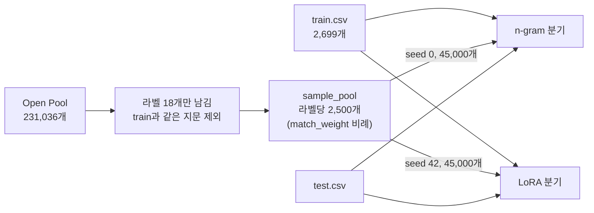

# 1. 사용 데이터셋 (v1~v7 공통)

[← 전체 문서](README.md)

이 대회에서 쓴 데이터는 두 가지입니다. 대회가 준 `train.csv`(지문 2,699개, 모델 18개)와 커뮤니티가 만든 외부 데이터 **Open Pool**(같은 18개 모델의 지문 약 23만 개)입니다. 데이터를 읽는 코드 셀은 v1~v7 노트북 7개에서 글자 하나까지 같습니다. 이 문서는 각 데이터의 구조와 크기, 학습에 넣기 전의 거르기와 표본 추출, 써 보고 넣지 않기로 한 외부 데이터, 분석용 부가 파일을 정리합니다.

- fold를 어떻게 나누는지는 [02_fold_split.md](02_fold_split.md), 데이터가 들어가는 모델은 [03_model_architecture.md](03_model_architecture.md), 실행 환경과 절차는 [04_experiment_method.md](04_experiment_method.md), 버전마다 달라진 점은 [05_version_history.md](05_version_history.md)에 있습니다.
- 수치는 2026-11-25에 로컬 파일(`data/`, git 제외)을 직접 읽어 확인한 값입니다. 다른 문서에서 가져온 값에는 출처를 적었습니다.

## 한눈에 보기

| 데이터 | 출처 | 크기 | 쓰임 |
|---|---|---|---|
| `train.csv` | 대회 `name-that-llm` | 2,699행, 프롬프트 150개 × 모델 18개 | 학습과 검증(라벨 있음) |
| `test.csv` | 대회 | 공개 3행, 제출 때는 숨겨진 약 4,000행 | 예측 대상(라벨 없음) |
| `sample_submission.parquet` | 대회 | 3행 | 제출 형식 |
| `ntl_open_pool.parquet` (Open Pool) | Kaggle 데이터셋 `crtproduction/name-that-llm-open-pool` | 231,036행(11/18 내려받은 판) | 라벨당 2,500개를 뽑아 추가 학습 데이터로 사용. 선택 입력 |
| Response Corpus | Kaggle 데이터셋 `olegzholobov/name-that-llm-response-corpus` | short 뷰 24,025셀 | 검토만 하고 **넣지 않음** |



## 1. 대회 데이터

### 1.1 train.csv

| 열 | 내용 | 예 |
|---|---|---|
| `id` | 지문 id. 16진수 12자리이고 중복이 없습니다 | `0018b3765972` |
| `prompt_id` | 지문을 만든 프롬프트의 id. `p000` ~ `p149` | `p081` |
| `text` | 영어 지문 한 문단 | `When a language dies, a particular astronomy dims: …` |
| `model` | 지문을 쓴 모델(정답 라벨) | `claude-opus-5` |

- **구조**: 프롬프트 150개에 모델 18개가 한 번씩 답했습니다. 150 × 18 = 2,700에서 1개가 빠져 **2,699행**입니다. 빠진 것은 `p002`의 `claude-fable-5` 답입니다. 그래서 `claude-fable-5`만 149개이고 나머지 17개 모델은 150개씩입니다.
- **프롬프트 문구는 없습니다.** `prompt_id`만 있고, 어떤 질문이었는지는 주어지지 않습니다.
- **중복 없음**: 같은 `(prompt_id, model)` 쌍과 같은 지문은 0개입니다. 빈 지문도 없습니다.
- **형식**: 줄바꿈이 들어간 지문은 0개입니다. 모두 한 문단짜리 산문입니다. 지문의 58%에 ASCII가 아닌 문자(em dash `—`, 둥근 따옴표 등)가 있고, 이 문장부호가 모델을 가르는 단서가 됩니다.

**지문 길이** (공백으로 나눈 단어 수와 문자 수)

| | 최소 | 5% | 25% | 중앙값 | 75% | 95% | 최대 | 평균 |
|---|:-:|:-:|:-:|:-:|:-:|:-:|:-:|:-:|
| 단어 수 | 36 | 44 | 64 | 101 | 157 | 224 | 274 | 114.7 |
| 문자 수 | 230 | - | 429 | 670 | 1,027 | - | 1,900 | 755.3 |

- 모델별 단어 수 중앙값은 84(`gemini-3.8-flash`) ~ 116.5(`claude-opus-5`)입니다. 길이만으로는 모델을 거의 가릴 수 없습니다([EXPERIMENTS.md](../EXPERIMENTS.md) 실험 5의 길이 점검: 길이 피처 두 개만으로 BA 0.088, 무작위 0.056).
- 모델당 지문이 150개뿐이라는 점이 이 대회의 데이터 제약입니다. Open Pool을 쓰는 이유입니다.

### 1.2 test.csv

| 열 | 내용 |
|---|---|
| `id` | 지문 id (train과 같은 형식. 공개된 3행은 train의 id와 겹치지 않음) |
| `text` | 영어 지문 |

- 내려받은 파일에는 **3행**만 있습니다. 코드 대회라서, 제출하면 노트북이 **숨겨진 테스트(약 4,000행, 노트북 설명 기준)** 로 처음부터 다시 실행됩니다. 로컬과 Kaggle "Save Version" 실행에서 보이는 테스트 예측은 이 3행에 대한 것입니다.
- `prompt_id`와 정답이 없습니다. **테스트 지문의 프롬프트는 train에 나오지 않습니다.** 주제가 아니라 문체로 맞혀야 하는 이유이고, 검증을 프롬프트 단위로 나누는 이유입니다([02_fold_split.md](02_fold_split.md)).
- 테스트에 같은 프롬프트의 지문이 여러 개 들어 있을 것으로 보고(추정), 테스트 지문을 주제로 묶어 쓰는 후처리가 있습니다([03_model_architecture.md](03_model_architecture.md)).

### 1.3 제출 형식

`sample_submission.parquet`은 `id`, `model` 두 열이고, 3행 모두 `gpt-5.5`로 채워져 있습니다. 노트북은 같은 두 열로 `submission.parquet`을 만듭니다. 마지막 셀은 7개 버전 모두 다음을 확인하고 저장합니다.

```python
submission = pd.DataFrame({"id": test["id"].values, "model": [LABELS[i] for i in final_lp.argmax(1)]})
assert submission["id"].is_unique and submission.notna().all().all()
assert set(submission["id"]) == set(test["id"]) and submission.model.isin(LABELS).all()
submission.to_parquet(WORK_DIR / "submission.parquet", index=False)
```

평가 지표는 balanced accuracy(클래스별 recall의 평균)이고, 무작위 추측은 1/18 ≈ 0.056입니다.

## 2. 라벨 18개

노트북의 `LABELS` 순서 그대로입니다. 이 순서가 클래스 번호(0~17)입니다.

| 회사(계열) | 모델 수 | 라벨 | Open Pool의 `lab` 값 |
|---|:-:|---|---|
| OpenAI (GPT) | 5 | `gpt-5.5`, `gpt-5.6-luna`, `gpt-5.6-sol`, `gpt-5.6-terra`, `gpt-6-astra` | `openai` |
| Google (Gemini) | 4 | `gemini-3.1-pro-preview`, `gemini-3.6-flash`, `gemini-3.7-flash`, `gemini-3.8-flash` | `google` |
| Anthropic (Claude) | 5 | `claude-fable-5`, `claude-opus-4-6`, `claude-opus-4-8`, `claude-opus-5`, `claude-sonnet-5` | `anthropic` |
| Qwen | 1 | `qwen3.8-max` | `qwen` |
| Z.ai (GLM) | 2 | `glm-5.3`, `glm-5.3-flash` | `zai` |
| Moonshot (Kimi) | 1 | `kimi-k3` | `moonshot` |

- 노트북은 읽자마자 `assert set(train.model) == set(LABELS)`로 라벨 집합을 확인합니다.
- 회사 묶음은 라벨 이름의 앞부분으로 정합니다. 노트북의 오답 분석(`same_lab`)은 첫 `-` 앞 글자에서 숫자와 점을 뗀 값(`gpt`, `gemini`, `claude`, `qwen`, `glm`, `kimi`)이 같으면 같은 회사로 봅니다.
- 같은 회사 모델끼리 문체가 비슷해서 오답의 절반 이상이 회사 안에서 납니다(v5 커널 로그: 오답 중 58.5%). 모델이 둘 이상인 회사는 GPT, Gemini, Claude, GLM 네 곳입니다.

## 3. Open Pool

대회 참가자(Kaggle 사용자 `crtproduction`)가 공개한 외부 데이터셋 `crtproduction/name-that-llm-open-pool`의 `ntl_open_pool.parquet`입니다. 여러 참가자가 같은 18개 모델로 직접 생성해 공개한 지문을 한데 모은 것입니다. 로컬 판(11/18 내려받음, 115MB)을 기준으로 적습니다.

### 3.1 구성

- **231,036행, 31열.** `id`(`ntlop_000000` 형식)와 지문은 모두 중복이 없습니다.
- 라벨은 대회의 18개와 정확히 같습니다. 다른 라벨의 행은 없습니다.
- 출처 데이터셋은 66개입니다(`source_dataset`). 가장 큰 것이 `drjcfmd/ntl-generated-v2`(20,400행), `harshitkmr/ntl-google-gen-v1`(17,798행), `trnhip/ntl-api-gen`(16,818행)입니다.
- 라이선스(`source_license`)는 CC BY 4.0 계열 190,313행, CC-BY-SA-4.0 31,062행, CC0-1.0 9,661행입니다.
- 지문 형식은 train과 같습니다. 줄바꿈이 있는 지문이 0개이고, 단어 수는 36~275(중앙값 102, 평균 113.0)로 train의 36~274(중앙값 101)와 거의 같은 범위입니다.

**라벨별 행 수.** train과 달리 고르지 않습니다. 가장 적은 라벨과 많은 라벨이 6.6배 차이입니다.

| 회사 | 행 수 | 라벨별 행 수 |
|---|:-:|---|
| OpenAI | 75,489 | luna 18,894 · terra 15,719 · sol 14,720 · gpt-5.5 14,315 · astra 11,841 |
| Anthropic | 59,227 | sonnet-5 13,248 · fable-5 12,773 · opus-4-8 12,158 · opus-4-6 11,168 · opus-5 9,880 |
| Google | 56,043 | 3.8-flash 23,542 · 3.6-flash 18,447 · 3.1-pro 10,513 · **3.7-flash 3,541** |
| Z.ai | 25,195 | glm-5.3-flash 12,745 · glm-5.3 12,450 |
| Moonshot | 10,516 | kimi-k3 10,516 |
| Qwen | 4,566 | qwen3.8-max 4,566 |

### 3.2 열

노트북이 읽는 열은 `text`, `model`, `match_weight` **세 개뿐**입니다. 나머지는 데이터셋 제작자가 붙인 출처와 품질 정보입니다.

| 열 | 내용 |
|---|---|
| `id`, `text`, `model`, `lab` | 지문 id, 지문, 라벨, 회사 |
| `match_weight` | 표본 추출 가중치(3.3절) |
| `source_dataset`, `source_file`, `source_license`, `origin_hint` | 원래 실려 있던 데이터셋과 파일, 라이선스 |
| `also_in`, `n_sources` | 같은 지문이 실린 다른 데이터셋 목록과 그 개수(1~19) |
| `prompt_group`, `prompt_canon`, `prompt_evidence`, `panel_labels` | 프롬프트 묶음 id와 그 근거, 같은 프롬프트에 답한 라벨 수(1~18) |
| `n_words`, `style_score` | 단어 수, 제작자가 계산한 문체 점수 |
| `max_cos_train`, `max_sim_train_prompt` | train 지문·프롬프트와의 최대 유사도. 최댓값이 각각 0.3, 0.4라서 제작자가 train과 가까운 지문을 미리 걸러낸 것으로 보입니다(추정) |
| `flag_kb_proxy`, `flag_kb_proxy_after_ruling`, `flag_gemini37_routing_risk`, `flag_near_train_prompt`, `flag_train_prompt_regen` | 품질 표시. 뒤의 세 개는 전 행이 False입니다 |
| `gen_reasoning*`, `gen_route`, `gen_served_model`, `gen_date` | 생성 설정(추론 강도, 경로, 실제 응답 모델, 날짜). 비어 있는 행이 많습니다 |

- 풀은 모델마다 생성에 쓴 프롬프트 묶음이 달라서 모델과 주제가 섞여 있습니다. 풀에서만 보이는 단어 차이가 train에서 재현되지 않는 쌍이 있습니다([analysis_intra_org/report.md](../analysis_intra_org/report.md)의 "Open Pool의 주제 쏠림").
- 이 저장소는 `prompt_group`을 쓰지 않습니다. 풀은 검증 fold에 들어가지 않고 학습에만 들어가기 때문입니다.

### 3.3 match_weight

노트북의 설명으로는 "풀의 문장부호 분포를 대회 지문과 비슷하게 맞추는 표본 추출 가중치"입니다. 값은 0.02~50, 중앙값 0.77이고, **라벨마다 평균이 1.0**이 되도록 맞춰져 있습니다. 결측이나 0 이하인 값은 없습니다.

직접 확인하면 가중치를 준 쪽이 train에 더 가깝습니다. 해당 기호가 들어간 지문의 비율입니다.

| 기호 | 풀 (가중치 없음) | 풀 (`match_weight` 가중) | train |
|---|:-:|:-:|:-:|
| em dash `—` | 0.351 | 0.380 | 0.390 |
| 둥근 아포스트로피 `’` | 0.286 | 0.225 | 0.210 |
| 둥근 따옴표 `“` | 0.077 | 0.042 | 0.034 |
| 세미콜론 `;` | 0.298 | 0.390 | 0.387 |
| 콜론 `:` | 0.456 | 0.519 | 0.521 |

> [!NOTE]
> `match_weight`는 제작자가 **train 전체**로 계산한 값입니다. 검증 fold의 지문도 그 계산에 들어갔으므로, 풀을 쓴 검증 점수는 약간 높게 나올 수 있습니다(노트북 3장의 설명). 가중치를 정확히 어떻게 계산했는지는 데이터셋 설명을 확인하지 못했습니다.

### 3.4 학습에 넣기 전: 거르기와 표본 추출

**1) 읽기와 거르기** (데이터 셀, 7개 버전 동일)

```python
pool = pd.read_parquet(pool_path, columns=["text", "model", "match_weight"])
pool = pool[pool.model.isin(LABELS)].reset_index(drop=True)
# 검증 누수 방지: train과 같은 지문은 풀에서 제외
norm = lambda s: re.sub(r"\W+", " ", s.lower()).strip()
pool = pool[~pool.text.map(norm).isin(set(train.text.map(norm)))].reset_index(drop=True)
```

- 정규화는 소문자로 바꾸고, 글자·숫자·밑줄이 아닌 문자의 연속을 공백 하나로 바꾸는 것입니다. 문장부호와 띄어쓰기만 다른 지문도 같은 지문으로 봅니다.
- 이 정규화는 **중복 판정에만** 씁니다. 학습에는 원문 그대로 들어갑니다.
- 지금 판에서는 이 단계에서 **빠지는 지문이 0개**입니다(231,036 → 231,036). 노트북이 출력하는 "Open Pool: N개 지문"은 거른 뒤의 수입니다.

**2) 표본 추출** (`sample_pool`, 7개 버전 동일)

```python
def sample_pool(n_per_label, seed=0):
    """라벨당 최대 n개를 match_weight에 비례해 비복원 추출합니다."""
    if pool is None:
        return None
    rng = np.random.default_rng(seed)
    picks = []
    for _, g in pool.groupby("model"):
        w = g.match_weight.fillna(0).to_numpy(dtype=float)
        k = min(n_per_label, int((w > 0).sum()))
        picks.append(g.index.to_numpy()[rng.choice(len(g), k, replace=False, p=w / w.sum())])
    return pool.loc[np.concatenate(picks)].reset_index(drop=True)
```

- 라벨마다 2,500개를 `match_weight`에 비례하는 확률로 **비복원** 추출합니다. 가장 적은 라벨도 3,541개라서 모든 라벨이 2,500개를 채우고, 표본은 **45,000개**(18 × 2,500)로 라벨이 균등합니다. 풀 전체의 약 19%입니다.
- 가중치는 **뽑을 확률**로만 쓰입니다. 뽑힌 뒤에는 학습에서 지문마다 같은 무게입니다.
- 두 분기가 표본을 따로 뽑습니다. n-gram 분기는 `seed=0`(`ngram_pool_per_label`), LoRA 분기는 `seed=42`(`lora_pool_per_label`)라서 서로 다른 45,000개입니다.
- 풀 파일이 입력에 없으면 `pool = None`이 되고, 두 분기 모두 train만으로 학습합니다. 풀은 필수 입력이 아닙니다.

### 3.5 갱신 이력

데이터셋이 계속 갱신되어 실행 시점마다 행 수가 다릅니다. 풀이 바뀌면 같은 코드의 검증 점수도 바뀌므로, 버전 사이의 수치를 비교할 때는 풀의 크기를 함께 봐야 합니다.

| 거른 뒤 행 수 | 확인한 곳 |
|:-:|---|
| 223,840 | [v2 노트북](../name_that_llm_v2.ipynb)에 저장된 출력 |
| 226,191 | [v3 노트북](../name_that_llm_v3.ipynb)에 저장된 출력, [EXPERIMENTS.md](../EXPERIMENTS.md) 실험 1 |
| 231,036 | v5 제출 커널 로그, 로컬 파일(11/18 내려받음) |

[name_that_llm_high_scorers_report.md](../name_that_llm_high_scorers_report.md)는 이보다 앞선 판을 198k~211k행으로 적고 있습니다(이 저장소에서 쓴 적은 없음).

## 4. 검토했지만 넣지 않은 데이터: Response Corpus

`olegzholobov/name-that-llm-response-corpus`는 같은 18개 모델의 공개 응답을 모은 외부 데이터셋입니다(2026-10-15 스냅숏). 전체 135,171개 응답 중 40~250단어 후보인 short 뷰를 n-gram 분기의 학습 풀에 더해 봤고, **넣지 않기로 했습니다.** 코드와 로그는 [analysis_corpus/](../analysis_corpus/)에 있습니다(커밋 `b90b614`).

| 항목 | 값 |
|---|---|
| 검토 대상 | short 뷰 24,025셀, 중복을 뺀 24,014개. 라벨 약한 `quarantine_luna_*` 파일은 읽지 않음 |
| train·Open Pool과의 중복 | 정규화 텍스트가 같은 셀 0개 |
| 라벨별 개수 | 71(`gemini-3.8-flash`) ~ 4,911(`claude-opus-4-6`)로 매우 고르지 않음 |
| 길이 | 단어 수 중앙값 158 (train 101) |
| 장르 | 줄바꿈 있음 94%, 마크다운·목록·코드 55%, 거절로 시작 28% (train과 Open Pool은 모두 0%) |
| 출처 | speechmap 8,658, eqbench4 7,221 등. 도메인은 민감한 주제, 감정 상담 대화, 코딩 에이전트 기록이 대부분 |

- **장르가 다릅니다.** corpus는 대화, 거절, 코딩 응답이고 train은 한 문단짜리 설명문입니다. 문체 피처 27개만으로 corpus와 train을 AUC 0.99로 가를 수 있고, corpus만으로 학습해 train을 예측하면 BA 0.12입니다(같은 개수의 Open Pool은 0.34).
- **점수가 오르지 않았습니다.** 블렌드 OOF(`w` = 0.6) 기준선 0.5738에 비해 corpus를 더한 네 가지 실행은 −0.0007 ~ −0.0022이고, 95% 구간이 모두 0을 포함합니다. 같은 개수의 Open Pool 행을 더한 대조군은 +0.0015였습니다([analysis_corpus/logs/evaluate.log](../analysis_corpus/logs/evaluate.log)).

## 5. 분석용 부가 파일

같은 회사 모델 사이의 차이를 분석할 때([analysis_intra_org/](../analysis_intra_org/)) 만든 파일입니다. 당시 서버에서 Kaggle에 접속할 수 없어서 Hugging Face 미러 `HLDKNotFound/name-that-llm-dataset`에서 지문을 받았습니다. **학습과 제출에는 쓰지 않습니다.**

| 파일 (`data/`, git 제외) | 내용 | 만드는 스크립트 |
|---|---|---|
| `train_recovered.csv` | 미러의 `official_gold` 행으로 되찾은 train. 2,699행 중 **2,625행**(97%)에 지문이 있고 74행은 `text`가 비어 있음. 행 순서는 `analysis_v4/oof_v4.npz`와 같음 | [analysis_intra_org/fetch_data.py](../analysis_intra_org/fetch_data.py) |
| `pool_hf.parquet` | 미러의 `open_pool` 행. **49,050개, 모델당 2,725개**로 균등. 열은 `id`, `prompt_id`, `text`, `model`. train과 겹치는 지문 없음 | 같은 스크립트 |
| `pool_feats.parquet` | `pool_hf.parquet`의 문체 피처 27개 + `model` (49,050 × 28). 계산이 1분쯤 걸려 캐시로 저장 | [analysis_intra_org/features.py](../analysis_intra_org/features.py)의 `pool_features()` |

- 미러의 풀은 Kaggle의 Open Pool과 **다른 표본**입니다(49,050개 대 231,036개, `match_weight` 열 없음). 이 파일로 낸 수치는 제출 노트북의 풀 수치와 바로 비교할 수 없습니다. [analysis_v6/report.md](../analysis_v6/report.md)의 회사 전용 SVC 실험도 이 미러 풀을 썼습니다.
- 지금은 서버에 원본 `train.csv`가 있으므로(`data/name-that-llm/`), 새 분석에는 원본을 쓰면 됩니다.

## 6. 읽기와 전처리 (v1~v7 공통)

### 6.1 경로 찾기

데이터 위치는 환경 변수 `NTL_INPUT`(기본값 `/kaggle/input`)으로 정합니다. 그 아래에서 파일을 찾는 함수가 두 개입니다.

| 함수 | 찾는 방법 |
|---|---|
| `locate_competition_dir()` | `<NTL_INPUT>/competitions/name-that-llm`, `<NTL_INPUT>/name-that-llm` 순서로 `train.csv`가 있는지 봅니다. 없으면 `<NTL_INPUT>` 아래를 모두 뒤져 `sample_submission.parquet`이 있는 폴더를 씁니다. 그래도 없으면 오류를 냅니다 |
| `find_optional(name)` | `<NTL_INPUT>` 아래를 모두 뒤져 이름이 같은 파일 중 경로순 첫 번째를 돌려줍니다. 없으면 `None`입니다. Open Pool(`ntl_open_pool.parquet`)과 저장된 가중치 파일을 이 함수로 찾습니다 |

파일이 **있으면 쓰고 없으면 건너뛰는** 방식이라, 같은 노트북이 입력에 무엇을 붙였는지에 따라 다르게 동작합니다. Kaggle에서는 "Add Input"으로 붙인 것이 모두 `/kaggle/input` 아래에 놓입니다.

| 환경 | `NTL_INPUT` | 대회 파일 위치 |
|---|---|---|
| Kaggle 커널 | `/kaggle/input` (기본값) | 자동 |
| Colab (노트북 첫 셀) | `/content/data` | `/content/data/name-that-llm/`에 직접 올림 |
| Colab ([colab_setup.py](../colab_setup.py), 풀 없이 돌릴 때) | `/content/input` | `/content/input/name-that-llm/` |
| 서버 로컬 | `./data` | `data/name-that-llm/` |

서버의 `data/` 폴더는 git에서 제외되어 있습니다. 아래 명령으로 지금 서버의 폴더 배치(`data/name-that-llm/`, `data/open-pool/`)대로 다시 받을 수 있습니다. zip 안에는 폴더 없이 파일 세 개만 있습니다.

```bash
kaggle competitions download -c name-that-llm -p data && unzip -o data/name-that-llm.zip -d data/name-that-llm
kaggle datasets download crtproduction/name-that-llm-open-pool -f ntl_open_pool.parquet -p data/open-pool
```

### 6.2 전처리

지문을 **거의 손대지 않습니다.** 대소문자, 문장부호, 띄어쓰기가 모두 문체 단서이기 때문입니다.

```python
train["text"] = train["text"].astype(str)
test["text"] = test["text"].fillna("").astype(str)   # 숨겨진 테스트에 빈 지문이 있어도 죽지 않게
y = train.model.map(L2I).values                       # 라벨 → 0~17
groups = train.prompt_id.values                       # fold를 나눌 묶음
```

- 소문자 변환, 문장부호 제거, 유니코드 정규화, 불용어 제거를 하지 않습니다. n-gram 분기의 TF-IDF도 `lowercase=False`입니다.
- 지문을 다른 모양으로 바꾸는 것은 모델 안에서 하는 일입니다(n-gram 분기의 `shape`·`func` 뷰, LoRA 분기의 토큰화와 길이 자르기). [03_model_architecture.md](03_model_architecture.md)에 있습니다.
- 데이터 증강(문장 섞기, 역번역 등)은 하지 않습니다.

## 7. 산출물로 만든 Kaggle 데이터셋

제출 커널은 Internet Off라서, 미리 학습한 가중치를 Kaggle 데이터셋으로 올려 입력에 붙입니다. `find_optional`이 파일 이름으로 찾아 불러오고, 있으면 재학습을 건너뜁니다.

| 데이터셋 | 내용 | 쓰는 버전 |
|---|---|---|
| `ntl-lora-weights` | LoRA 가중치 | v1 |
| `ntl-lora-weights-pool` | LoRA 가중치 | v2 |
| `ntl-lora-weights-v3` | LoRA 가중치 | v3 |
| `blkbeansoymilk/ntl-lora-weights-v4-echo-cv` | `ntl_lora_fold0.pt` ~ `fold4.pt`, `ntl_lora_full.pt` (개당 약 25MB). 서버의 `data/weights_v4/`와 같은 파일 | v4, v5, v6, v7 |
| `blkbeansoymilk/ntl-deberta-v7` | DeBERTa OOF와 가중치, 토크나이저 | v7 |

함께 붙이는 사전학습 모델은 Kaggle 모델 `qwen-lm/qwen-3`(Transformers, `4b-base`)이고, Colab에서는 Hugging Face의 `Qwen/Qwen3-4B-Base`를 받습니다. 데이터셋 이름은 [EXPERIMENTS.md](../EXPERIMENTS.md)의 "재현용 파일"과 커널 메타데이터([analysis_v6/kernel/kernel-metadata.json](../analysis_v6/kernel/kernel-metadata.json))에서 가져왔습니다.

## 버전마다 다른 점

데이터를 읽고 거르고 뽑는 **코드는 7개 버전이 같습니다.** 달라진 것은 입력에 무엇을 붙였는지와 그 시점의 풀입니다. 자세한 내용은 [05_version_history.md](05_version_history.md)에 있습니다.

- **v1**: Open Pool을 입력에 붙이지 않아 train만으로 학습했습니다.
- **v2**: Open Pool을 처음 썼습니다(223,840개).
- **v3, v4**: 풀이 226,191개로 갱신된 뒤 실행했습니다.
- **v5**: 풀이 231,036개로 갱신된 뒤 실행해서, v4와 비교할 기준선을 새 풀로 다시 쟀습니다.
- **v6**: 제출 전 분석은 옛 풀(226,191개) 시점의 v4 OOF로 했고, 제출 커널은 새 풀(231,036개)에서 돌았습니다.
- **v7**: Open Pool 표본을 세 번째 분기(DeBERTa)의 Stage 1에도 씁니다(`deb_pool_per_label`, LoRA와 같은 seed라 같은 표본).
- **train 행 가중치**: n-gram 분기에서 train 지문과 풀 지문의 무게를 다르게 주는 것은 v3부터입니다.
- **Response Corpus**: v5의 n-gram 설정 위에서 시험했고 어느 버전에도 넣지 않았습니다.
