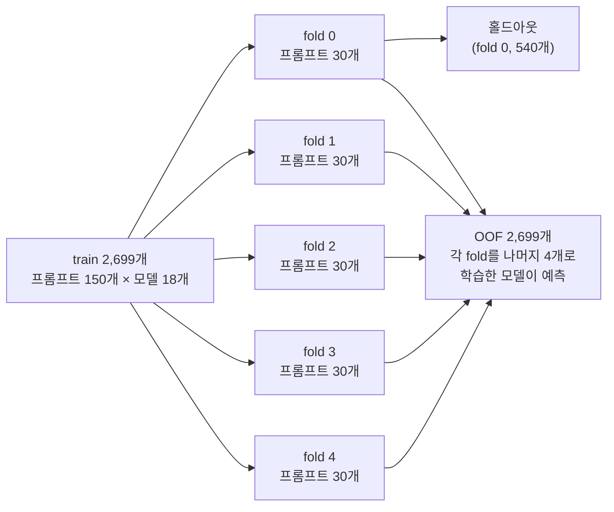

# 2. 학습 fold와 검증 fold 분할 (v1~v7 공통)

[← 전체 문서](README.md)

train 2,699개 지문을 **프롬프트(`prompt_id`) 150개 단위로 묶어 5개 fold**로 나눕니다. 한 프롬프트에 딸린 지문 18개는 항상 같은 fold에 들어가므로, 검증 fold의 프롬프트는 학습 때 한 번도 보지 못한 프롬프트입니다. 분할 코드는 v1~v7 노트북 7개에서 글자 하나 다르지 않고(`StratifiedGroupKFold`, 5-fold, seed 42), 모든 검증 수치(fold 0 홀드아웃 540개, OOF 2,699개)가 이 분할 위에서 나옵니다. 이 문서는 분할 방법, 용어, fold마다 학습에 들어가는 것과 빠지는 것, 누수와 환경 차이에 관한 주의점을 정리합니다.

- 데이터 자체는 [01_datasets.md](01_datasets.md), 모델은 [03_model_architecture.md](03_model_architecture.md), 실험 절차는 [04_experiment_method.md](04_experiment_method.md), 버전별 변경은 [05_version_history.md](05_version_history.md)에 있습니다.

## 1. 왜 프롬프트 단위로 나누는가

train은 프롬프트 150개에 18개 모델이 각각 답한 지문으로 이루어져 있습니다(프롬프트당 18개, 한 프롬프트만 17개). 테스트의 프롬프트는 train에 없습니다. 검증도 같은 조건이어야 하므로, 검증 fold의 프롬프트가 학습 쪽에 하나도 남지 않게 나눕니다.

노트북은 분할 직후에 작은 모델(char_wb 2~4-gram TF-IDF + LinearSVC, C = 0.3)로 두 분할을 비교합니다.

| 분할 | BA |
|---|:-:|
| 프롬프트 그룹 KFold (`StratifiedGroupKFold`) | 0.3145 |
| 일반 KFold (`StratifiedKFold`, 프롬프트 무시) | 0.1530 |
| 무작위 추측 (1/18) | 0.0556 |

- 수치는 v5 제출 커널 로그와 [v2](../name_that_llm_v2.ipynb)·[v3](../name_that_llm_v3.ipynb) 노트북에 저장된 출력에서 같은 값으로 확인했습니다.
- **일반 KFold는 낙관적인 것이 아니라 오히려 크게 낮게 나옵니다.** 일반 KFold에서는 프롬프트 150개 모두가 4개 이상의 fold에 걸칩니다(5개 fold 전부에 걸친 프롬프트 140개, 4개에 걸친 프롬프트 10개. 직접 세어 확인). 검증 지문과 같은 프롬프트의 지문이 학습 쪽에 남는데, 그 지문들은 모두 **다른 모델**이 쓴 것입니다. 분류기가 그 주제를 "정답이 아닌 모델"과 연결하기 때문으로 보입니다(노트북 2장의 설명, 추정).
- 어느 쪽이든 일반 KFold의 점수는 테스트 조건(처음 보는 프롬프트)과 다르므로 쓰지 않습니다.

## 2. 분할 방법

분할 코드는 노트북 "2. 검증" 장의 코드 셀 첫 줄입니다. v1~v7에서 이 셀 전체가 같습니다(셀 내용의 해시가 7개 모두 일치).

```python
CFG = dict(seed=42, n_folds=5, ...)

y = train.model.map(L2I).values        # 18개 모델 라벨
groups = train.prompt_id.values        # 그룹 = 프롬프트

cv_folds = list(StratifiedGroupKFold(CFG["n_folds"], shuffle=True,
                                     random_state=CFG["seed"]).split(train, y, groups))
```

| 항목 | 값 |
|---|---|
| 분할기 | `sklearn.model_selection.StratifiedGroupKFold` |
| fold 수 | 5 (`CFG["n_folds"]`) |
| 그룹 | `prompt_id` (150개) |
| 층화 기준 | `model` (18개 라벨) |
| 섞기 / 시드 | `shuffle=True`, `random_state=42` (`CFG["seed"]`) |
| 결과 | `cv_folds[k] = (학습 행 번호, 검증 행 번호)`, k = 0~4 |



### fold별 구성

제출 커널의 분할([analysis_v4/oof_v4.npz](../analysis_v4/oof_v4.npz)의 `fold`)을 `train.csv`와 맞춰 직접 센 결과입니다.

| fold | 프롬프트 | 지문 | 라벨별 지문 수 |
|:-:|:-:|:-:|:-:|
| 0 | 30 | 540 | 모두 30 |
| 1 | 30 | 540 | 모두 30 |
| 2 | 30 | 540 | 모두 30 |
| 3 | 30 | 539 | 30 (`claude-fable-5`만 29) |
| 4 | 30 | 540 | 모두 30 |
| 합계 | 150 | 2,699 | 150 (`claude-fable-5`만 149) |

- 두 fold에 걸친 프롬프트는 0개입니다.
- 프롬프트마다 18개 모델이 한 번씩 답했기 때문에, 프롬프트를 30개씩 나누면 라벨 균형은 저절로 맞습니다. 예외는 `claude-fable-5` 지문이 빠진 프롬프트 `p002` 하나이고, 커널 분할에서는 fold 3에 있습니다.
- 학습 쪽은 fold마다 프롬프트 120개, 지문 2,159~2,160개입니다.

## 3. 용어

| 용어 | 뜻 |
|---|---|
| **학습 fold** | 어떤 fold k를 검증할 때, 나머지 4개 fold(프롬프트 120개). `cv_folds[k][0]` |
| **검증 fold** | 그때 학습에서 뺀 fold k(프롬프트 30개). `cv_folds[k][1]` |
| **홀드아웃** | fold 0의 검증 fold. 프롬프트 30개, 지문 540개. 노트북의 `holdout_idx = cv_folds[0][1]` |
| **OOF** (out-of-fold) | fold 5개를 돌아가며 검증 fold로 써서, 지문 2,699개 각각을 "그 지문을 학습에 넣지 않은 모델"이 예측한 값 |
| **full** | 검증 없이 train 2,699개 전체로 학습한 모델. 테스트 예측에 씁니다 |

- 홀드아웃은 OOF의 부분집합입니다. OOF에서 fold 0에 해당하는 540개가 곧 홀드아웃 예측입니다.
- **지문 1개의 무게**: 지표가 클래스별 recall의 평균이므로, 지문 하나의 정오가 바뀌면 BA는 `1 / (18 × 그 라벨의 지문 수)`만큼 움직입니다.

| 평가 범위 | 라벨당 지문 | 지문 1개 = BA |
|---|:-:|:-:|
| 홀드아웃 (540개) | 30 | 0.00185 (약 0.002) |
| OOF (2,699개) | 150 | 0.00037 (0.002 ≈ 지문 5개) |

홀드아웃에서는 지문 한두 개 차이가 곧 0.002~0.004입니다. 실험 기록에서 홀드아웃 수치의 작은 차이를 "지문 n개"로 풀어 적는 이유입니다.

## 4. fold마다 학습에 들어가는 것과 빠지는 것

fold k를 검증할 때의 규칙입니다. 코드에서 n-gram 분기의 `fit_svc(train_idx)`가 이 규칙을 그대로 보여 줍니다.

| 재료 | fold k 검증 때 | 설명 |
|---|---|---|
| train의 학습 fold (프롬프트 120개) | 학습에 들어감 | 라벨과 함께 |
| train의 검증 fold (프롬프트 30개) | **학습에서 빠짐**, 예측만 함 | 이 예측이 OOF의 fold k 부분 |
| Open Pool 표본 | fold와 무관하게 **전부** 들어감 | 풀은 train과 별개의 데이터라 fold에 속하지 않습니다. 표본은 fold를 돌기 전에 한 번만 뽑아 5개 fold가 같은 표본을 씁니다 |
| TF-IDF 어휘와 IDF | fold마다 다시 맞추지 않음 | 아래 참고 |
| 테스트 지문 | 학습에 쓰지 않음 | |

- **TF-IDF는 한 번만 맞춥니다.** Open Pool이 입력에 있으면 풀 표본에만 맞추고(`fit_transform(ng_pool.text)`), train과 테스트는 변환만 합니다. 라벨을 쓰지 않고 train 지문도 쓰지 않으므로 검증 프롬프트의 정보가 들어가지 않습니다. 풀이 없으면 train 전체(검증 fold 포함)에 라벨 없이 맞춥니다.
- **테스트 예측용 n-gram 모델은 train 전체로 다시 학습합니다**(`fit_svc(np.arange(len(train)))`). fold 모델은 OOF를 만드는 데만 씁니다.
- **풀로만 하는 학습(Stage 1)은 fold와 무관합니다.** train을 쓰지 않으므로 한 번만 학습하고, train을 쓰는 미세 조정(Stage 2)에서만 검증 fold를 뺍니다.

```python
def fit_svc(train_idx):                       # train_idx = 학습 fold의 행 번호
    Xs, ys = [X_train[train_idx]], [y[train_idx]]
    if X_pool is not None:
        Xs.append(X_pool); ys.append(y_pool)  # 풀은 어느 fold에서든 전부
    ...

oof_ng = np.zeros((len(train), K))
for fold, (a, b) in enumerate(cv_folds):
    oof_ng[b] = fit_svc(a).decision_function(X_train[b])   # 검증 fold는 예측만

ng_test = fit_svc(np.arange(len(train))).decision_function(X_test)  # 테스트는 train 전체로
```

(v1·v2 노트북의 코드에서 가중치 인자를 줄여 옮겼습니다. v3부터 `fit_svc`에 인자가 하나 늘지만 fold를 쓰는 방식은 같습니다.)

## 5. 누수와 낙관적인 점수

분할 자체는 프롬프트를 섞지 않지만, 검증 점수가 실제보다 높게 나올 수 있는 길이 몇 가지 남아 있습니다.

| 항목 | 내용 | 대응 |
|---|---|---|
| Open Pool과 train의 겹침 | 풀에 train과 같은 지문이 있으면 검증 fold의 정답이 풀을 통해 학습에 들어갑니다 | 데이터를 읽을 때 제외합니다(아래 코드). 모든 버전 공통 |
| `match_weight` | 풀 표본은 `match_weight`에 비례해 뽑습니다. 이 값은 풀의 문장부호 분포를 대회 지문에 맞추는 가중치인데, **train 전체**(검증 fold 포함)로 계산된 값입니다 | 막지 못합니다. CV 점수가 약간 높게 나올 수 있다고 노트북 3장에 적혀 있습니다. 크기는 재지 않았습니다 |
| 같은 점수로 고르고 재기 | 온도, 블렌드 가중치, train 행 가중치 같은 값을 홀드아웃이나 OOF의 최고점으로 고른 뒤 같은 데이터의 점수를 보고하면 낙관적입니다 | 고르는 값의 개수를 줄이거나 고정하고, 필요하면 nested로 다시 잽니다(6장) |
| 풀이 없을 때의 TF-IDF | train 전체에 맞추므로 검증 지문의 어휘 통계가 들어갑니다(라벨은 쓰지 않음) | 풀이 있으면 해당 없음 |

풀에서 train과 겹치는 지문을 빼는 코드입니다. 소문자로 바꾸고 문자·숫자가 아닌 것을 공백 하나로 줄인 뒤 비교합니다.

```python
# 검증 누수 방지: train과 같은 지문은 풀에서 제외
norm = lambda s: re.sub(r"\W+", " ", s.lower()).strip()
pool = pool[~pool.text.map(norm).isin(set(train.text.map(norm)))].reset_index(drop=True)
```

- 이 비교는 정규화한 텍스트가 **완전히 같은** 경우만 잡습니다. 조금 고친 지문이나 같은 프롬프트에 대한 다른 답은 남습니다. 풀에 train과 같은 프롬프트의 지문이 얼마나 있는지는 확인하지 않았습니다.
- n-gram 분기의 온도는 모든 버전에서 OOF 2,699개 전체의 NLL로 고릅니다(`T_NG = best_temperature(oof_ng, y)`). 후보가 10개뿐인 값 하나라 영향은 작을 것으로 봅니다(추정).

## 6. fold 분할이 환경마다 다릅니다

> [!IMPORTANT]
> 같은 코드, 같은 시드(42)인데 **로컬(scikit-learn 1.9.1)과 제출 커널(Kaggle)의 분할이 다릅니다.** 로컬에서 만든 OOF를 커널 로그의 수치와 비교하려면 커널의 분할을 불러와 써야 합니다.

- 직접 비교한 결과, 로컬 분할과 커널 분할에서 fold 번호가 같은 지문은 2,699개 중 468개뿐입니다. 번호만 바뀐 것도 아닙니다. 커널의 한 fold(프롬프트 30개)와 가장 많이 겹치는 로컬 fold도 8~9개만 겹칩니다. 프롬프트 150개가 전혀 다른 묶음으로 나뉩니다.
- 원인은 scikit-learn 버전 차이로 보입니다(추정, 커널 쪽 버전은 확인하지 않음). Colab(scikit-learn 1.6.1)에서는 커널과 같은 분할이 나왔습니다(v7 Colab 실행 로그의 `StratifiedGroupKFold가 Kaggle 커널 분할과 같은가: True`).
- 분할에 따라 n-gram OOF가 0.005~0.006 달라집니다([EXPERIMENTS.md](../EXPERIMENTS.md) 실험 5). 한 번의 변경으로 기대하는 효과와 같은 크기라서, 분할이 다른 두 수치를 비교하면 효과가 두 배로 보이거나 사라져 보입니다.

**커널 분할의 위치.** [analysis_v4/oof_v4.npz](../analysis_v4/oof_v4.npz)의 `fold` 배열(길이 2,699, 값 0~4)입니다. 행 순서는 `train.csv`와 같습니다(`prompt_id`와 `y`가 일치하는 것을 확인). 값 k는 그 지문이 fold k의 검증 fold에 있다는 뜻입니다.

```python
v4 = np.load("analysis_v4/oof_v4.npz", allow_pickle=True)
cv_folds = [(np.where(v4["fold"] != k)[0], np.where(v4["fold"] == k)[0]) for k in range(5)]
```

[v5_stylo/alpha_sweep.py](../v5_stylo/alpha_sweep.py)가 이렇게 노트북의 `cv_folds`를 바꿔 끼웁니다. [analysis_v6/gate2.py](../analysis_v6/gate2.py), [v5_stylo/compare_oof.py](../v5_stylo/compare_oof.py), [analysis_corpus/evaluate.py](../analysis_corpus/evaluate.py)도 같은 파일의 `fold`를 읽습니다.

**어느 분할인지 확인하는 방법.** 노트북이 맨 처음 출력하는 "프롬프트 그룹 KFold BA"(1장의 표)를 봅니다.

| 출력값 | 분할 |
|:-:|---|
| 0.3145 | 커널과 같은 분할 |
| 0.3115 | 로컬(scikit-learn 1.9.1) 분할 |

**fold 번호를 맞춰야 하는 이유가 하나 더 있습니다.** 저장해 둔 fold별 가중치(`ntl_lora_fold0.pt` ~ `fold4.pt`)는 "커널 분할의 fold k를 빼고 학습한 모델"입니다. 분할이 다른 환경에서 이 가중치로 OOF를 다시 계산하면, 모델이 학습 때 본 지문을 검증 지문으로 예측하게 되어 점수가 부풀려집니다.

## 7. 분할 위에 얹어 쓰는 평가 기법

정의만 적습니다. 언제 어떻게 쓰는지는 [04_experiment_method.md](04_experiment_method.md)에 있습니다.

- **nested 선택**: 어떤 값을 OOF로 고를 때, fold 하나를 빼고 나머지 4개 fold의 OOF로 값을 고른 뒤 뺀 fold에만 적용합니다. 이를 5번 돌려 모은 점수가 nested BA입니다. 값을 고른 데이터와 점수를 잰 데이터가 겹치지 않으므로, 전체 OOF 최고점을 그대로 보고하는 것보다 덜 낙관적입니다.
- **프롬프트 단위 bootstrap**: 두 설정의 OOF 차이가 우연인지 볼 때, 지문이 아니라 **프롬프트 150개**를 복원 추출해(1,000회) BA 차이의 95% 구간을 구합니다. 같은 프롬프트의 지문 18개는 서로 독립이 아니고, 테스트에서 새로 뽑히는 단위도 프롬프트이기 때문입니다.

## 버전마다 다른 점

분할 자체(`cv_folds`)는 모든 버전에서 같습니다. 달라지는 것은 분할을 쓰는 방식이며, 자세한 내용은 [05_version_history.md](05_version_history.md)에 있습니다.

- **LoRA 분기가 쓰는 fold**: v1~v3는 fold 0만 빼고 한 번 학습해 홀드아웃 540개만 예측합니다. v4부터는 fold 5개를 모두 돌려 OOF 2,699개를 만듭니다.
- **LoRA 온도와 블렌드 가중치를 고르는 데이터**: v1~v3는 홀드아웃 540개, v4부터는 OOF 2,699개입니다. 블렌드 가중치는 v3~v6에서 고르지 않고 0.6으로 고정하며(표만 출력), v7의 3분기 가중치는 기본 설정에서 OOF로 고릅니다.
- **최종 검증 BA의 범위**: v1~v3는 홀드아웃, v4부터는 OOF입니다(fold 0만 따로 함께 출력).
- **테스트 예측용 LoRA 모델**: v1~v3는 fold 0을 뺀 모델 그대로, v4부터는 fold 모델 5개 평균(`folds`) 또는 train 전체로 학습한 모델(`full`)입니다.
- **Open Pool 사용 여부**: v1은 풀 없이 실행해 TF-IDF를 train 전체에 맞췄고, v2부터는 풀 표본에 맞춥니다.
- **n-gram train 행 가중치**: v3부터 후보별 5-fold OOF를 만들어 고릅니다.
- **문체 피처의 표준화**: v5는 문체 피처 27개의 평균·표준편차를 fold마다 학습 fold의 train 지문으로만 구합니다.
- **회사 게이트**: v6·v7은 회사별 분류기도 같은 `cv_folds`로 fold 밖에서 학습해 OOF를 만듭니다.
- **DeBERTa 분기와 3분기 블렌드**: v7은 DeBERTa도 같은 `cv_folds`로 5-fold OOF를 만들고, 블렌드 가중치의 nested BA를 함께 출력합니다.
- **OOF 저장**: v6은 실행한 환경의 `fold`를 OOF와 함께 `oof_v6.npz`로 저장합니다. v7의 `oof_v7.npz`에는 분기별 OOF 로짓과 지문 id만 있고 `fold`는 없습니다.
