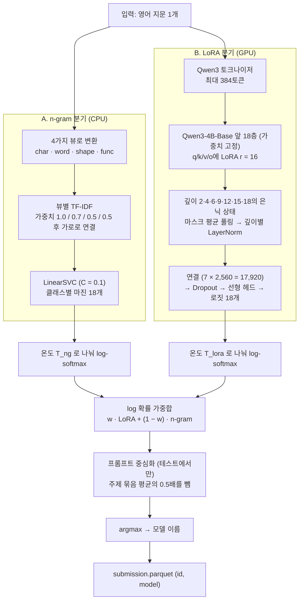

# 3. 모델 구조 (v1~v7 공통)

[← 전체 문서](README.md)

v1부터 v7까지 모든 노트북이 공유하는 뼈대는 하나입니다. 지문 하나를 **n-gram 분기**(4뷰 TF-IDF + LinearSVC, CPU)와 **LoRA 분기**(Qwen3-4B-Base 앞 18층 + 직접 구현한 LoRA + 여러 깊이 풀링, GPU)가 따로 점수 매기고, 각 점수를 온도 조정한 log 확률로 바꿔 가중합한 뒤, 테스트에서만 프롬프트 중심화를 거쳐 argmax로 18개 모델 중 하나를 고릅니다. 이 문서는 그 공통 뼈대를 코드 수준으로 설명합니다. 버전마다 추가되거나 바뀐 것은 [9. 버전마다 다른 점](#9-버전마다-다른-점)에 이름만 적고, 내용은 [5. v1 → v7 변경과 개선 분석](05_version_history.md)에 있습니다.

> [!NOTE]
> **"공통"의 기준** · 7개 노트북의 코드 셀에서 함수·클래스 정의를 뽑아 버전끼리 비교했습니다. 이 문서에 인용한 코드는 7개 노트북에서 글자 하나까지 같은 부분입니다. 표의 기본값도 7개 노트북의 `CFG`에서 값이 같은 키만 실었습니다.

## 1. 전체 파이프라인



| 단계 | 입력 → 출력 | 노트북의 변수 |
|---|---|---|
| A. n-gram | 지문 N개 → 마진 `[N, 18]` | `oof_ng`(train의 fold 밖 점수), `ng_test` |
| B. LoRA | 지문 N개 → 로짓 `[N, 18]` | `lora_test`와, 검증용 로짓 |
| 온도 조정 | 점수 `[N, 18]` → log 확률 `[N, 18]` | `ng_oof_lp`, `ng_test_lp`, `lora_lp` |
| 블렌드 | log 확률 두 개 → `[N, 18]` | `eval_lp`(검증), `test_lp`(테스트) |
| 중심화 | `test_lp` → `final_lp` | `final_lp` |
| 제출 | `final_lp.argmax(1)` → 라벨 | `submission` |

- 18개 클래스의 순서는 노트북의 `LABELS` 목록 순서이고(`K = 18`), 두 분기의 출력 열이 이 순서를 따릅니다. 라벨 목록은 [1. 사용 데이터셋](01_datasets.md)에 있습니다.
- 검증 점수는 train 지문의 블렌드 log 확률 `eval_lp`의 argmax로 잽니다. 중심화는 테스트에만 적용하므로 검증 수치에는 들어 있지 않습니다. 어떤 지문이 검증에 쓰이는지는 [2. 학습 fold와 검증 fold 분할](02_fold_split.md)에 있습니다.
- 두 분기는 서로 독립입니다. LoRA 분기를 실행하지 못하면 n-gram 분기만으로 제출 파일을 만듭니다([7장](#7-lora를-실행하지-못할-때)).

## 2. A. n-gram 분기

문장부호, 철자, 문장 구조 같은 표면 습관을 잡는 분기입니다. 테스트 프롬프트는 train에 없으므로 주제 단어에 끌려가지 않게 같은 지문을 4가지로 바꿔 봅니다.

### 2.1 4개의 뷰

| 뷰 | 전처리 | analyzer | n-gram | `max_features` | 가중치 | 잡으려는 것 |
|---|---|---|:-:|:-:|:-:|---|
| `char` | 없음(원문) | `char` | 3~5 | 250,000 | 1.0 | 문장부호와 철자 습관 |
| `word` | 없음(원문) | `word`, `token_pattern=r"\w+\|[^\w\s]"` | 1~2 | 150,000 | 0.7 | 단어와 문장부호의 연쇄 |
| `shape` | `to_shape` | `char` | 2~6 | 60,000 | 0.5 | 글자 형태. 주제 단어가 사라짐 |
| `func` | `to_function` | `word`, `token_pattern=r"\S+"` | 1~3 | 50,000 | 0.5 | 기능어와 문장부호의 배열(문장 구조) |

- 네 벡터라이저 모두 `TfidfVectorizer(lowercase=False, sublinear_tf=True, min_df=2, dtype=np.float32)`를 씁니다. 대소문자를 유지하고, tf는 `1 + log(tf)`로 누르고, 문서 2개 미만에만 나오는 항은 버립니다.
- `word` 뷰의 토큰 패턴은 단어(`\w+`)와 문장부호 한 글자(`[^\w\s]`)를 각각 토큰으로 봅니다. 문장부호가 버려지지 않습니다.
- `max_features`의 합은 510,000입니다. `min_df=2` 때문에 실제 열 수는 이보다 적고, 학습에 쓴 지문에 따라 달라집니다(저장된 실행 출력에서는 46만 2천~46만 3천 개).

전처리 함수는 다음과 같습니다.

```python
def to_shape(s):
    return re.sub(r"[^\W\d_]+", lambda m: "X" if m[0].isupper() else "x", s)


def to_function(s):
    return " ".join(w.lower() if w.lower() in FUNCTION_WORDS or not w.isalnum() else "_"
                    for w in re.findall(r"\w+|[^\w\s]", s))
```

- `to_shape`: 연속된 글자 묶음 하나를 `x` 한 글자로 바꿉니다. 묶음 전체가 대문자일 때만(`I`, `NASA` 등) `X`가 됩니다. 숫자, 문장부호, 공백은 그대로 남습니다.
- `to_function`: 지문을 단어와 문장부호로 쪼갠 뒤, 기능어(`FUNCTION_WORDS` 89개: 관사, 접속사, 대명사, 전치사, 조동사 등)는 소문자로 남기고, 문장부호는 그대로 두고, 나머지 단어는 `_`로 바꿉니다.

같은 문장을 넣어 본 결과입니다(함수를 직접 실행한 값).

| | 결과 |
|---|---|
| 원문 | `Hello, the NASA team didn't wait — it's 3pm; I left.` |
| `to_shape` | `x, x X x x'x x — x'x 3x; X x.` |
| `to_function` | `_ , the _ _ _ ' _ _ — it ' _ _ ; i _ .` |

> [!NOTE]
> 노트북의 설명 셀에는 `shape` 뷰가 "Hello → X, the → x"라고 적혀 있지만, 코드는 `m[0].isupper()`로 묶음 **전체**가 대문자인지 봅니다. 그래서 `Hello`는 `x`가 됩니다. 문장 첫 글자의 대문자 여부는 이 뷰에 남지 않습니다.

### 2.2 뷰를 연결하는 방법

```python
class MultiViewVectorizer:
    def fit_transform(self, texts):
        out = []
        for _, fn, opts, weight in VIEWS:
            v = TfidfVectorizer(lowercase=False, sublinear_tf=True, min_df=2, dtype=np.float32, **opts)
            out.append(v.fit_transform(self._prep(fn, texts)) * weight)
            self.parts.append((v, fn, weight))
        return sparse.hstack(out).tocsr()

    def transform(self, texts):
        return sparse.hstack([v.transform(self._prep(fn, texts)) * w for v, fn, w in self.parts]).tocsr()
```

- 뷰마다 TF-IDF 행렬을 따로 만들고, 뷰 가중치를 곱한 뒤 가로로 이어 붙여(`sparse.hstack`) 희소 행렬 하나로 만듭니다.
- `TfidfVectorizer`는 기본으로 행을 L2 정규화합니다. 그래서 뷰 하나의 행 노름은 뷰 가중치와 같고, 연결한 행의 L2 노름은 √(1.0² + 0.7² + 0.5² + 0.5²) ≈ 1.4입니다. 뷰 가중치는 선형 분류기에서 각 뷰가 차지하는 몫을 정합니다.
- 벡터라이저는 라벨 없이 한 번만 맞춥니다(`fit_transform`). 외부 지문 풀이 입력에 있으면 그 표본에, 없으면 train 전체에 맞춥니다. 나머지 지문(train, 테스트)은 `transform`만 합니다.

### 2.3 분류기와 점수

```python
model = LinearSVC(C=CFG["svc_c"])
model.fit(sparse.vstack(Xs).tocsr(), np.concatenate(ys), sample_weight=np.concatenate(ws))
```

- 분류기는 scikit-learn의 `LinearSVC(C=0.1)`입니다. 나머지 인자는 기본값이라 18개 클래스를 one-vs-rest로 학습합니다.
- 학습 행은 train 지문(학습 fold)과 외부 풀 지문을 세로로 쌓은 것이고, 지문마다 `sample_weight`를 하나씩 붙입니다. 풀 지문의 가중치는 1입니다. train 지문의 가중치는 버전마다 다릅니다([9장](#9-버전마다-다른-점)).
- 점수는 `decision_function`이 돌려주는 클래스별 마진 `[N, 18]`입니다. 확률이 아닙니다.
- 검증용 점수 `oof_ng`는 fold마다 나머지 fold로 학습한 모델이 자기 fold를 예측한 값이고, 테스트 점수 `ng_test`는 train 전체로 다시 학습한 모델 하나가 냅니다.
- **확률로 바꾸는 방법**: 마진을 온도 `T`로 나눈 뒤 log-softmax를 적용합니다. 별도의 확률 보정 모델(Platt scaling 등)은 쓰지 않습니다. `T`를 고르는 방법은 [4장](#4-온도-조정과-블렌딩)에 있습니다.

## 3. B. LoRA 분기

사전학습 언어 모델이 이미 가진 문체 표현을 쓰는 분기입니다. 노트북 설명에 따르면, 대회 공개 토론의 실험에서 작성 스타일 정보가 Qwen3의 마지막 층보다 앞쪽 층에 더 많이 남아 있었습니다. 그래서 앞쪽 층만 쓰고 여러 깊이를 함께 봅니다.

### 3.1 본체: Qwen3-4B-Base의 앞 18층

```python
mc = AutoConfig.from_pretrained(base_dir)
keep = min(CFG["keep_layers"], mc.num_hidden_layers)
mc.num_hidden_layers, mc.use_cache = keep, False
...
trunk = AutoModel.from_pretrained(base_dir, config=mc, dtype=weights)
trunk.norm = nn.Identity()  # 마지막 정규화는 쓰지 않고 은닉 상태를 그대로 사용
n_lora = add_lora(trunk)
depths = [d for d in CFG["depths"] if d <= keep]
model = StyleClassifier(trunk, depths, K, amp).to(device)
```

- config의 `num_hidden_layers`를 18로 줄인 뒤 `AutoModel.from_pretrained`로 불러옵니다. 19번째 층부터는 메모리에 올라오지 않습니다. LM 헤드가 없는 `AutoModel`이라 은닉 상태만 나옵니다.
- 마지막 정규화 층(`trunk.norm`)은 `nn.Identity()`로 바꿉니다. 은닉 상태를 그대로 쓰고, 정규화는 분류기 쪽의 깊이별 LayerNorm이 맡습니다.
- 본체 가중치의 정밀도는 GPU에 따라 정합니다. compute capability가 8 이상이면 bf16, 아니면(T4 등) fp16, GPU가 아니면 fp32입니다. 순전파는 같은 dtype의 `torch.autocast` 안에서 돕니다.
- 기본 모델 경로는 환경 변수 `NTL_BASE_MODEL`이 있으면 그 값이고, 없으면 입력 폴더에서 `model_type`이 `qwen3`인 `config.json`을 찾아 `base_preference` 순서(`4b-base` → `8b-base` → `1.7b-base` → `0.6b-base`)로 고릅니다. 실제 실행은 모두 4B-Base였습니다.

### 3.2 LoRA: `peft` 없이 직접 구현

```python
class LoRALinear(nn.Module):
    def __init__(self, base, r, alpha, dropout):
        super().__init__()
        self.base = base
        self.A = nn.Linear(base.in_features, r, bias=False)
        self.B = nn.Linear(r, base.out_features, bias=False)
        nn.init.kaiming_uniform_(self.A.weight, a=math.sqrt(5))
        nn.init.zeros_(self.B.weight)
        self.scale = alpha / r
        self.drop = nn.Dropout(dropout)

    def forward(self, x):
        delta = self.B(self.A(self.drop(x.to(self.A.weight.dtype))))
        return self.base(x) + (delta * self.scale).to(x.dtype)
```

원래 가중치 $W$는 고정하고 저랭크 행렬 $A$, $B$만 학습합니다.

$$
\text{output} = Wx + \frac{\alpha}{r}\, B A\, \text{dropout}(x)
$$

| 항목 | 값 | 설정 키 |
|---|---|---|
| 붙이는 곳 | 어텐션의 `q_proj`, `k_proj`, `v_proj`, `o_proj` (이름이 일치하는 `nn.Linear`) | `add_lora`의 `targets` |
| rank $r$ | 16 | `lora_r` |
| $\alpha$ | 32 (배율 $\alpha / r$ = 2) | `lora_alpha` |
| dropout | 0.05 (LoRA 경로의 입력에만) | `lora_dropout` |
| 초기화 | $A$: Kaiming uniform(`a=√5`), $B$: 0 | - |
| LoRA 층 수 | 72개 (18층 × 4곳, 실행 로그) | - |

- `add_lora`는 먼저 본체의 모든 파라미터를 `requires_grad_(False)`로 고정하고, 대상 층을 `LoRALinear`로 바꿉니다. MLP 층에는 붙이지 않습니다.
- $B$가 0에서 시작하므로 학습 시작 시점의 출력은 원래 모델과 같습니다.
- 본체는 fp16 또는 bf16이지만 $A$, $B$는 fp32로 만들어집니다. 그래서 입력을 fp32로 올려 LoRA 경로를 계산하고, 결과를 다시 입력의 dtype으로 내려 더합니다.
- `peft`를 쓰지 않은 이유는 제출 커널이 인터넷 없이 돌기 때문입니다(노트북 설명).

### 3.3 풀링과 분류 헤드

```python
class StyleClassifier(nn.Module):
    def __init__(self, trunk, depths, n_classes, amp_dtype):
        super().__init__()
        self.trunk, self.depths, self.amp_dtype = trunk, depths, amp_dtype
        hidden = trunk.config.hidden_size
        self.norms = nn.ModuleList(nn.LayerNorm(hidden) for _ in depths)
        self.drop = nn.Dropout(0.1)
        self.head = nn.Linear(hidden * len(depths), n_classes)
```

`forward`의 풀링 부분입니다. `mask`는 풀링에 넣을 토큰 위치가 1인 `[B, T, 1]` 텐서입니다.

```python
feats = []
for depth, norm in zip(self.depths, self.norms):
    pooled = (out.hidden_states[depth].float() * mask).sum(1) / mask.sum(1).clamp(min=1)
    feats.append(norm(pooled))
return self.head(self.drop(torch.cat(feats, dim=-1)))
```

| 단계 | 텐서 모양 | 설명 |
|---|---|---|
| 토큰 id | `[B, T]` | 오른쪽 패딩 |
| 본체 출력 `hidden_states` | 19개 × `[B, T, 2560]` | 0번은 임베딩 출력, `d`번은 `d`번째 층의 출력 |
| 깊이 7곳 선택 | 7 × `[B, T, 2560]` | `depths = [2, 4, 6, 9, 12, 15, 18]` |
| 마스크 평균 풀링 | 7 × `[B, 2560]` | 마스크가 1인 토큰만 평균. fp32로 올려서 계산 |
| 깊이별 LayerNorm | 7 × `[B, 2560]` | 깊이마다 따로 둔 `nn.LayerNorm(2560)` |
| 연결 | `[B, 17920]` | 7 × 2,560 |
| Dropout(0.1) → 선형 헤드 | `[B, 18]` | `nn.Linear(17920, 18)` |

- 깊이마다 은닉 상태의 크기 분포가 다르므로, 연결하기 전에 깊이별 LayerNorm으로 맞춥니다.
- 풀링은 패딩을 뺀 평균입니다. 마지막 토큰 하나만 쓰지 않습니다.
- 학습되는 파라미터는 **6,256,658개**입니다(실행 로그의 `LoRA 층 72개, 학습 파라미터 6,256,658개`). 은닉 크기 2,560([v4 구조도](../analysis_v4/figures/architecture_v4.png)의 값)으로 LayerNorm과 헤드를 계산하면 358,418개이고, 나머지가 LoRA 행렬입니다.

| 구성 | 계산 | 파라미터 수 |
|---|---|:-:|
| 깊이별 LayerNorm 7개 | 7 × (2,560 + 2,560) | 35,840 |
| 선형 헤드 | 17,920 × 18 + 18 | 322,578 |
| LoRA $A$, $B$ (72개 층) | 로그의 합계에서 위 둘을 뺀 값. 트랜스포머 층 하나당 327,680 | 5,898,240 |
| 합계 (실행 로그) | | **6,256,658** |

- 저장하는 가중치는 학습되는 파라미터뿐입니다(`trainable_state`). 파일 하나가 약 25MB이고, `{"state", "cfg", "labels"}`를 담습니다. 불러올 때는 원래 Qwen3 가중치 위에 `load_state_dict(..., strict=False)`로 덮어씁니다.

### 3.4 토크나이즈와 배치

| 항목 | 값 |
|---|---|
| 토크나이저 | 기본 모델의 `AutoTokenizer`, `padding_side="right"`. pad 토큰이 없으면 EOS를 pad로 사용 |
| 특수 토큰 | 붙이지 않음(`add_special_tokens=False`). 채팅 템플릿이나 지시문도 없음 |
| 최대 길이 | 지문 하나당 384토큰에서 자름(`max_len`) |
| 빈 지문 | pad 토큰 하나로 대체 |
| 학습 배치 | 섞은 뒤 `batch_size × 50`개 단위로 길이순 정렬해 배치를 만들고, 배치 순서를 다시 섞음(패딩 낭비 줄이기) |
| 추론 배치 | 전체를 길이순으로 정렬, 크기는 `batch_size × 2` |
| 비정상 로짓 | NaN/inf가 나온 지문의 로짓은 0으로 바꿈. 이 지문은 n-gram 쪽 예측을 따르게 됨 |

`batch_size`의 기본값은 7개 노트북 모두 16이지만, 실제 학습에서는 GPU 메모리에 맞춰 `NTL_CFG`로 더 작은 값을 덮어썼습니다. 실행별 값은 [5. v1 → v7 변경과 개선 분석](05_version_history.md)에 있습니다.

### 3.5 학습 단계 함수 `train_stage`

LoRA 분기의 학습은 `train_stage(model, tok, device, texts, labels, epochs, lr, budget_h, name)` 한 함수를 데이터만 바꿔 여러 번 부르는 방식입니다. 어떤 데이터로 몇 번 부르는지는 버전마다 다르고([9장](#9-버전마다-다른-점)), 함수 안의 학습 설정 중 아래 항목은 모든 버전에서 같습니다.

| 항목 | 값 |
|---|---|
| 손실 | cross entropy, label smoothing 0.05 |
| 옵티마이저 | AdamW, weight decay 0.01 |
| 학습률 그룹 | LoRA 행렬은 `lr`, 헤드와 깊이별 LayerNorm은 `lr × head_lr_mult`(5배) |
| 스케줄 | 선형 warmup(전체 스텝의 1/20) × 코사인 감쇠(끝에서 0) |
| gradient clipping | 노름 1.0 |
| 정밀도 | 본체와 같은 dtype의 autocast. fp16일 때만 `GradScaler` 사용 |
| 비정상 손실 | 손실이 유한하지 않은 배치는 역전파하지 않고 건너뜀(횟수를 로그에 출력) |
| 시간 예산 | `budget_h`시간을 넘기면 그 자리에서 끊고 다음 단계로 넘어감 |
| 배치 섞기 시드 | `seed + epoch` |

`CFG`의 단계별 기본값은 7개 노트북에서 같습니다. Stage 1(외부 풀)은 1 epoch · lr 2e-4 · 예산 3시간, Stage 2(train)는 2 epochs · lr 5e-5 · 예산 1시간입니다. 다만 Stage 1은 외부 풀이 입력에 있을 때만 실행되고, 실행에 따라 `NTL_CFG`로 값을 덮어쓴 경우가 있습니다.

## 4. 온도 조정과 블렌딩

n-gram의 마진과 LoRA의 로짓은 스케일이 다릅니다. 그대로 더하면 스케일이 큰 쪽이 결과를 좌우하므로, 분기마다 온도 `T`로 나눠 같은 기준의 log 확률로 맞춘 뒤 섞습니다.

```python
def log_softmax_np(x, temperature=1.0):
    x = x / temperature
    x = x - x.max(1, keepdims=True)
    return x - np.log(np.exp(x).sum(1, keepdims=True))


def best_temperature(scores, labels, grid=(0.05, 0.1, 0.2, 0.3, 0.5, 0.75, 1, 1.5, 2, 3)):
    nll = [-log_softmax_np(scores, t)[np.arange(len(labels)), labels].mean() for t in grid]
    return grid[int(np.argmin(nll))]
```

- **온도 선택**: 후보 10개(0.05~3) 중, 정답 라벨의 평균 음의 로그 우도(NLL)가 가장 작은 값을 고릅니다. 분기마다 따로 고릅니다.

$$
T^{*} = \arg\min_{T \in \text{grid}} \; -\frac{1}{N} \sum_{n=1}^{N} \log \text{softmax}\!\left(\frac{s_n}{T}\right)_{y_n}
$$

- 온도는 한 분기 안에서 argmax를 바꾸지 않습니다. 확률이 얼마나 뾰족한지만 바꾸고, 그 결과 블렌드에서 그 분기가 얼마나 강하게 주장하는지가 달라집니다.
- n-gram 온도 `T_NG`는 train 전체의 fold 밖 점수(`oof_ng`, 2,699개)로 고릅니다. 저장된 실행 출력에서는 0.2였습니다. LoRA 온도 `T_LORA`는 LoRA가 학습에 쓰지 않은 train 지문의 로짓으로 고르는데, 그 지문의 범위는 버전마다 다릅니다([2. 학습 fold와 검증 fold 분할](02_fold_split.md)).
- 검증에서 고른 온도를 테스트 점수에도 그대로 씁니다.

**블렌드**는 두 log 확률의 가중합입니다. `w`는 LoRA 쪽 가중치입니다.

$$
LP_{\text{blend}} = w \cdot \log p_{\text{LoRA}} + (1 - w) \cdot \log p_{\text{n-gram}}
$$

```python
test_lp = blend_w * log_softmax_np(lora_test, T_LORA) + (1 - blend_w) * ng_test_lp
```

- log 확률을 더하므로 확률의 가중 기하평균에 해당합니다. 합이 1이 되도록 다시 정규화하지 않습니다. argmax만 쓰기 때문입니다.
- 가중치 후보는 0.1 간격이고, 노트북은 후보별 검증 BA를 출력합니다. 가중치를 정하는 규칙(검증 최고값 선택, 고정값)과 분기 수는 버전마다 다릅니다([9장](#9-버전마다-다른-점)).

## 5. 프롬프트 중심화 (테스트 후처리)

같은 프롬프트에 답한 지문들은 주제를 공유합니다. 그 주제 때문에 묶음 전체의 점수가 특정 클래스 쪽으로 함께 쏠릴 수 있습니다. 묶음의 평균 점수를 빼면 주제에서 온 공통 성분이 줄고, 묶음 안에서 지문끼리 다른 부분(문체)이 남습니다. 테스트에는 `prompt_id`가 없으므로 주제 단어로 지문을 직접 묶습니다. 노트북 설명에 따르면, 대회 주최 측은 테스트 지문 간 관계를 활용해도 된다고 토론에서 답했습니다.

```python
def topic_clusters(texts, distance):
    if len(texts) < 2:
        return np.zeros(len(texts), dtype=int)
    X = TfidfVectorizer(stop_words="english", sublinear_tf=True, dtype=np.float32).fit_transform(texts).toarray()
    return AgglomerativeClustering(n_clusters=None, metric="cosine", linkage="average",
                                   distance_threshold=distance).fit_predict(X)


def center_by_cluster(lp, clusters, strength):
    out = lp.copy()
    for c in np.unique(clusters):
        idx = np.where(clusters == c)[0]
        if 2 <= len(idx) <= 18:
            out[idx] = lp[idx] - strength * lp[idx].mean(0)
    return out
```

1. **묶기**: 테스트 지문 전체에 단어 TF-IDF(영어 불용어 제거, sublinear tf)를 맞춥니다. 분류용 4뷰와는 별개의 벡터라이저이고, 여기서는 반대로 주제 단어만 남깁니다. 그 벡터를 코사인 거리, 평균 연결의 병합 군집화로 묶습니다. 군집 수는 정하지 않고 거리 0.9(`cluster_distance`)에서 병합을 멈춥니다.
2. **빼기**: 크기가 2~18인 묶음에서만, 묶음 안 지문들의 log 확률을 클래스별로 평균해 그 0.5배(`center_strength`)를 각 지문에서 뺍니다.

$$
LP'_{n} = LP_{n} - 0.5 \cdot \frac{1}{|C|} \sum_{m \in C} LP_{m} \qquad (n \in C,\; 2 \le |C| \le 18)
$$

- 크기 1인 묶음은 건드리지 않습니다. 자기 자신을 빼는 셈이 되기 때문입니다. 상한 18은 모델 수와 같습니다. 프롬프트 하나에 답한 지문은 모델당 하나씩 최대 18개이므로, 그보다 큰 묶음은 여러 프롬프트가 합쳐진 것으로 보고 건너뛰는 것으로 보입니다(추정, 코드에 이유가 적혀 있지 않음).
- 테스트 지문이 2개 미만이면 묶지 않습니다. 인터랙티브 실행(테스트 3행)에서는 중심화 대상이 0개였습니다(저장된 출력: `테스트 묶음 3개, 중심화 대상 지문 0개 / 3개`).
- 중심화는 블렌드한 테스트 log 확률에 적용합니다. train의 검증 점수에는 적용하지 않습니다.

노트북에는 n-gram OOF로 한 시뮬레이션 결과가 실려 있습니다(외부 풀 라벨당 1,000개, 강도 0.5, 묶음 거리 0.9, 5회 평균).

| 프롬프트당 지문 수 | 중심화 전 | 중심화 후 |
|:-:|:-:|:-:|
| 1 | 0.429 | 0.420 |
| 2 | 0.450 | 0.453 |
| 4 | 0.428 | 0.451 |
| 8 | 0.432 | 0.461 |

- 프롬프트당 지문이 많을수록 이득이 크고, 1개뿐이면 오히려 손해입니다.
- 실제 테스트에서 프롬프트당 지문이 몇 개인지는 공개되지 않았습니다. LoRA까지 섞은 블렌드에서의 효과도 측정하지 않았습니다(노트북 설명).

## 6. 제출 파일

```python
submission = pd.DataFrame({"id": test["id"].values, "model": [LABELS[i] for i in final_lp.argmax(1)]})
submission.to_parquet(WORK_DIR / "submission.parquet", index=False)
```

`final_lp`의 argmax를 라벨 이름으로 바꿔 `id`, `model` 두 열의 `submission.parquet`으로 저장합니다. 저장 전에 `id`가 테스트와 일치하고 중복이 없는지, 라벨이 18개 안에 있는지 `assert`로 확인합니다. 제출 절차는 [4. 실험 방법](04_experiment_method.md)에 있습니다.

## 7. LoRA를 실행하지 못할 때

```python
run_lora = CFG["use_lora"] and base_dir is not None and (device.type == "cuda" or CFG["force_lora"])
```

| 조건 | 동작 |
|---|---|
| `use_lora=False` | LoRA 분기를 건너뜀 |
| Qwen3 가중치를 찾지 못함(`base_dir is None`) | LoRA 분기를 건너뜀 |
| CUDA GPU가 없고 `force_lora=False` | LoRA 분기를 건너뜀 |
| CUDA GPU가 없지만 `force_lora=True` | MPS가 있으면 MPS, 없으면 CPU에서 fp32로 실행(동작 점검용) |

- 건너뛰면 `LoRA를 건너뜁니다. … n-gram만으로 제출 파일을 만듭니다.`를 출력하고, 블렌드 가중치를 0으로 둔 것과 같게 `test_lp = ng_test_lp`가 됩니다. 검증 점수도 n-gram OOF 2,699개로 잽니다. 중심화와 제출은 그대로 진행합니다.
- 이 경로 덕분에 GPU 없이 `NTL_CFG='{"use_lora": false}'`로 n-gram 분기만 빠르게 돌릴 수 있고, 로컬 CPU 비교 실험이 이 방식을 씁니다.
- 저장된 LoRA 가중치 파일이 입력에 있으면 학습하지 않고 불러와 추론만 합니다. 파일 이름과 개수는 버전마다 다릅니다.

## 8. 설정 키와 기본값

하이퍼파라미터는 노트북 앞쪽의 `CFG` 딕셔너리에 모여 있고, 환경 변수 `NTL_CFG`(JSON)로 일부를 덮어씁니다. 아래는 7개 노트북에서 키와 기본값이 모두 같은 항목입니다.

| 구성 | 키 | 기본값 | 의미 |
|---|---|:-:|---|
| 공통 | `seed` | 42 | fold 분할과 배치 섞기 등의 시드 |
| | `n_folds` | 5 | 검증 fold 수 |
| n-gram | `ngram_pool_per_label` | 2500 | 외부 풀에서 라벨당 뽑는 지문 수 |
| | `svc_c` | 0.1 | LinearSVC의 `C` |
| LoRA 구조 | `use_lora` | `True` | LoRA 분기 사용 여부 |
| | `force_lora` | `False` | GPU가 없어도 실행(동작 점검용) |
| | `base_preference` | `["4b-base", "8b-base", "1.7b-base", "0.6b-base"]` | 기본 모델을 찾는 우선순위 |
| | `keep_layers` | 18 | Qwen3에서 쓸 앞쪽 층 수 |
| | `depths` | `[2, 4, 6, 9, 12, 15, 18]` | 풀링할 은닉 상태의 깊이 |
| | `lora_r` / `lora_alpha` / `lora_dropout` | 16 / 32 / 0.05 | LoRA rank, 배율 분자, dropout |
| LoRA 학습 | `head_lr_mult` | 5 | 헤드와 LayerNorm의 학습률 배수 |
| | `max_len` | 384 | 지문 하나의 최대 토큰 수 |
| | `batch_size` | 16 | 학습 배치 크기(추론은 2배). 실행 때 덮어쓴 값은 다름 |
| | `lora_pool_per_label` | 2500 | Stage 1용으로 외부 풀에서 라벨당 뽑는 지문 수 |
| | `stage1_epochs` / `stage1_lr` / `stage1_budget_h` | 1 / 2e-4 / 3.0 | 외부 풀 학습 단계 |
| | `stage2_epochs` / `stage2_lr` / `stage2_budget_h` | 2 / 5e-5 / 1.0 | train 미세 조정 단계 |
| 중심화 | `use_centering` | `True` | 프롬프트 중심화 사용 여부 |
| | `center_strength` | 0.5 | 묶음 평균을 빼는 비율 |
| | `cluster_distance` | 0.9 | 병합 군집화를 멈추는 코사인 거리 |

`CFG`에 없고 코드에 고정된 값도 있습니다. 4개 뷰의 정의와 가중치(`VIEWS`), 기능어 목록(`FUNCTION_WORDS`), LoRA를 붙이는 층 이름, 헤드 앞 Dropout 0.1, label smoothing 0.05, weight decay 0.01, warmup 비율 1/20, gradient clipping 1.0, 온도 후보 10개, 중심화의 묶음 크기 조건 2~18입니다.

## 9. 버전마다 다른 점

아래 항목은 일부 버전에만 있거나 버전마다 값이 다릅니다. 내용과 효과는 모두 [5. v1 → v7 변경과 개선 분석](05_version_history.md)에 있고, 버전별 구조 그림은 [7. 버전별 모델 구조 다이어그램](07_architecture_by_version.md)에 있습니다.

- **외부 풀과 2단계 학습**: v1은 외부 풀 없이 train만으로 학습했습니다. v2부터 n-gram이 풀 표본을 함께 쓰고, LoRA는 풀로 Stage 1을 학습한 뒤 train으로 Stage 2를 학습합니다. (v1과 v2는 코드가 같고 커널에 붙인 입력이 다릅니다.)
- **n-gram의 train 지문 가중치**: v1·v2는 1, v3부터는 후보 {1, 4, 12}를 OOF로 비교해 고릅니다.
- **블렌드 가중치를 정하는 방법**: v1·v2는 검증 BA가 가장 높은 `w`, v3부터는 `w` = 0.6 고정(`blend_w`)입니다.
- **Sinkhorn 클래스 비율 보정**: v3부터 중심화 다음, argmax 앞에 들어갑니다.
- **echo 입력**: v4부터 Qwen에 지문을 두 번 이어 넣고 두 번째 사본의 토큰만 풀링합니다. 풀링 마스크가 `attention_mask`에서 `pool_mask`로 바뀌고, gradient 누적(`grad_accum`)이 생겼습니다.
- **LoRA 5-fold와 테스트 방식**: v1~v3은 fold 0만 빼고 한 번 학습합니다. v4부터는 fold마다 Stage 2를 따로 학습해 LoRA도 OOF를 만들고, 테스트 로짓은 fold 5개 평균 또는 train 전체 학습 모델에서 가져옵니다(`lora_test`).
- **문체 피처 27개**: v5만, n-gram 행렬 옆에 연속 문체 피처 블록을 붙입니다(`stylo_alpha`).
- **회사 게이트**: v6·v7은 블렌드와 중심화 사이에서 회사 안 분포를 회사 전용 로지스틱 회귀 쪽으로 옮깁니다(`use_gate`).
- **DeBERTa-v3-large 분기와 3분기 블렌드**: v7은 세 번째 분기를 더하고 가중치 세 개의 블렌드를 씁니다(`use_deberta`, `blend3`).

참고로 v4 시점의 구조를 한 장으로 그린 그림이 [analysis_v4/figures/architecture_v4.png](../analysis_v4/figures/architecture_v4.png)에 있습니다. 이 그림에는 위 항목 중 v4까지의 변경(외부 풀, train 가중치 12, echo 입력, `w` = 0.6, Sinkhorn)이 함께 들어 있습니다.

## 10. 근거 파일

- 노트북: [v1](../name_that_llm_v1.ipynb), [v2](../name_that_llm_v2.ipynb), [v3](../name_that_llm_v3.ipynb), [v4](../name_that_llm_v4.ipynb), [v5](../name_that_llm_v5.ipynb), [v6](../name_that_llm_v6.ipynb), [v7](../name_that_llm_v7.ipynb). 구조 설명은 각 노트북의 "3. n-gram 모델", "4. LoRA 분류기", "5. 블렌딩", "6. 프롬프트 중심화" 절에 있습니다.
- 7개 노트북에서 정의가 완전히 같은 것: `VIEWS`, `FUNCTION_WORDS`, `LABELS`, `to_shape`, `to_function`, `MultiViewVectorizer`, `sample_pool`, `LoRALinear`, `add_lora`, `build_classifier`, `find_base_model`, `pick_device`, `make_batches`, `trainable_state`, `log_softmax_np`, `best_temperature`, `topic_clusters`, `center_by_cluster`, 그리고 데이터 읽기 셀, fold 분할 셀, 중심화 셀, 제출 셀 전체.
- v4에서 한 번 바뀐 것: `StyleClassifier.forward`(풀링 마스크 인자), `tokenize_all`, `collate`, `train_stage`, `predict_logits`. `StyleClassifier.__init__`과 풀링 루프는 그대로입니다.
- 실행 로그의 수치(LoRA 층 72개, 학습 파라미터 6,256,658개, 특성 수, n-gram 온도 0.2)는 v2·v3 노트북에 저장된 출력과 v5 제출 커널 로그에서 확인했습니다.
