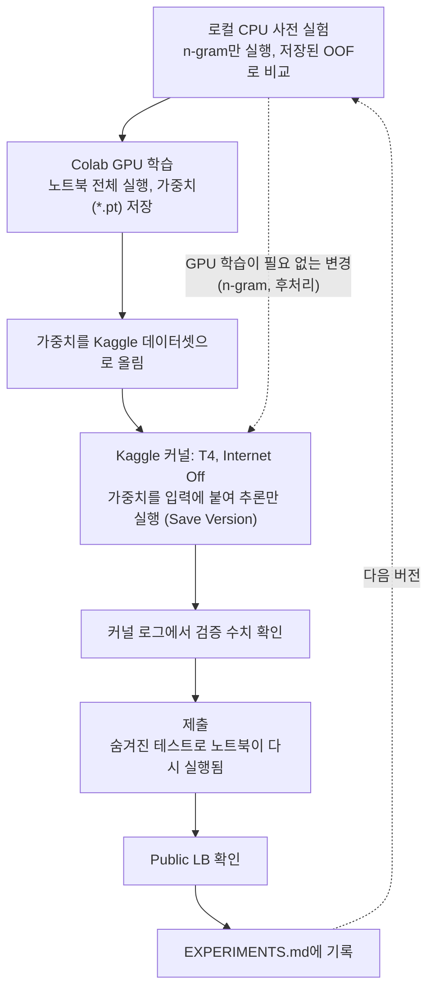

# 4. 실험 방법 (v1~v9 공통)

[← 전체 문서](README.md)

이 문서는 실험 하나를 어떤 절차로 돌리고, 무엇으로 재고, 어떻게 비교·기록·제출했는지를 정리합니다. v1부터 v9까지 노트북 9개에 공통으로 들어 있는 방법만 본문에 적었습니다. 요약하면 **노트북 하나가 버전 하나**이고, 학습은 Colab GPU에서, 제출은 저장한 가중치를 Kaggle 커널(T4, Internet Off)에 붙여 추론만 하는 방식입니다. 검증은 프롬프트 단위 5-fold이고, 문서에 적는 검증 수치는 LB 점수를 낸 제출 커널의 로그에서 가져옵니다.

데이터는 [01_datasets.md](01_datasets.md), fold 분할은 [02_fold_split.md](02_fold_split.md), 모델 구조는 [03_model_architecture.md](03_model_architecture.md), 버전별 변경과 효과는 [05_version_history.md](05_version_history.md)에 있습니다.

## 1. 문제와 지표

- **문제**: 짧은 영어 지문 하나를 보고 18개 LLM 중 어느 모델이 썼는지 맞힙니다.
- **지표**: balanced accuracy(BA)입니다. 클래스별 recall을 구한 뒤 18개를 단순 평균합니다. 노트북은 `sklearn.metrics.balanced_accuracy_score`로 계산합니다.

$$
\text{BA} = \frac{1}{18}\sum_{k=1}^{18} \frac{\text{모델 } k \text{의 지문 중 맞힌 수}}{\text{모델 } k \text{의 지문 수}}
$$

- **무작위 수준**: 1/18 ≈ 0.056입니다. 노트북 2장의 셀이 매번 `무작위 추측 BA : 0.0556`을 출력합니다.
- **점수의 눈금**: 검증 집합이 작아서 지문 몇 개가 점수를 움직입니다. 수치를 읽을 때는 BA 차이를 "지문 몇 개"로 바꿔 봅니다.

| 검증 집합 | 지문 수 | 모델당 지문 | 지문 1개가 움직이는 BA |
|---|:-:|:-:|:-:|
| fold 0 홀드아웃 | 540 | 30 | 1 / (18 × 30) ≈ 0.0019 (약 0.002) |
| OOF 전체 | 2,699 | 약 150 | 1 / (18 × 150) ≈ 0.0004 |

[EXPERIMENTS.md](../EXPERIMENTS.md)에 "+0.0019 (지문 1개)", "+0.0018 (지문 5개쯤)"처럼 적힌 환산이 이 눈금을 따른 것입니다.

## 2. 실험 한 번의 흐름



- 같은 노트북 파일을 세 환경(로컬, Colab, Kaggle)에서 그대로 씁니다. 환경에 따라 달라지는 것은 경로와 일부 설정뿐이고, 이는 환경 변수로 넘깁니다(4장).
- 가중치를 다시 학습할 필요가 없는 변경은 Colab 단계를 건너뛰고, 기존 가중치 데이터셋을 붙인 커널만 새로 만듭니다.
- 사전 실험과 사후 분석은 GPU 없이 합니다. n-gram 분기는 CPU만으로 돌고, LoRA 분기는 저장해 둔 OOF 로짓을 불러와 블렌드합니다(7장).

## 3. 실행 환경

### 코드 대회의 제약

제출물은 예측 파일이 아니라 **노트북(커널)**입니다.

- 커널은 GPU T4, Internet Off로 실행합니다. 인터넷이 꺼져 있으므로 기반 모델(Qwen3-4B-Base), Open Pool, 학습한 가중치를 모두 **Add Input**으로 붙여야 합니다.
- **Save Version** 실행에서는 `test.csv`가 3행뿐입니다. 제출하면 숨겨진 테스트(약 4,000개)로 노트북이 처음부터 다시 실행되고, 그 실행이 만든 `submission.parquet`이 채점됩니다.
- 따라서 커널 로그에 찍히는 검증 수치는 train에 대한 값이고(Save Version 실행), 테스트 지문 수에 따라 달라지는 후처리는 로그로 확인할 수 없습니다. 예를 들어 프롬프트 중심화는 Save Version 로그에 항상 `중심화 대상 지문 0개 / 3개`로 찍힙니다. 이런 후처리의 효과는 LB로만 볼 수 있습니다.

### 환경별 역할

| 환경 | 하는 일 | GPU, 정밀도 |
|---|---|---|
| 로컬 서버 (CPU) | n-gram 분기만 실행, 저장된 OOF로 블렌드·후처리 비교, 분석 스크립트 | 없음 |
| Colab | 신경망 분기(LoRA, DeBERTa) 학습. 결과 가중치를 `/content/out`에 저장 | v4까지 주로 L4 (bf16). v7부터는 L4가 배정되지 않아 T4 |
| Kaggle 커널 | 저장된 가중치로 추론만 하고 제출 파일 생성 | T4 (fp16) |

### 정밀도 차이

노트북의 `build_classifier`는 GPU의 compute capability를 보고 정밀도를 고릅니다. 9개 노트북 모두 같은 줄입니다.

```python
# T4(compute capability 7.5)는 bf16 연산이 에뮬레이션이라 느리므로 fp16을 씁니다.
weights = torch.bfloat16 if torch.cuda.get_device_capability(0)[0] >= 8 else torch.float16
```

- L4에서는 bf16, T4에서는 fp16으로 돕니다. fp16일 때만 `GradScaler`를 켭니다.
- 같은 가중치라도 두 환경의 LoRA 출력이 조금 다릅니다. 홀드아웃에서 지문 1~2개(BA 0.002~0.004)가 달라집니다([EXPERIMENTS.md](../EXPERIMENTS.md) 머리의 NOTE).
- 이 차이 때문에 6장의 수치 기준 규칙이 생겼습니다.

### 실행 시간 (기록된 값)

| 단계 | 환경 | 시간 | 출처 |
|---|---|---|---|
| LoRA Stage 1 (Open Pool 45,000개, 1 epoch) | Colab L4 | 31분 | EXPERIMENTS.md 실험 1 |
| LoRA Stage 2 (train, 2 epochs) | Colab L4 | 3분 | EXPERIMENTS.md 실험 1 |
| 제출 커널 전체 (추론만) | Kaggle T4 | 34.6분 (v5), 32.5분 (v6), 19.0분 (v7), 33.9분 (v8) | 각 버전의 커널 로그, [EXPERIMENTS.md](../EXPERIMENTS.md) 실험 5~8 |
| DeBERTa 학습 (Stage 1 + Stage 2 fold 5개 + 전체) | Colab T4, fp32 | 198.4분 | EXPERIMENTS.md 실험 7 |
| n-gram 5-fold 한 번 (TF-IDF 맞추기 포함) | 로컬 CPU | 약 15분 | [v5_stylo/alpha_sweep_run.log](../v5_stylo/alpha_sweep_run.log) |

제출 커널의 시간 대부분은 GPU 추론이 아니라 CPU에서 도는 n-gram 5-fold입니다. v5 커널 로그에서 n-gram이 약 28분, LoRA 추론이 약 4분입니다. v7은 n-gram train 가중치 후보를 12 하나로 줄여 n-gram 구간이 12.2분이었고, v8은 풀 표본을 두 배로 늘려 28.5분이 됐습니다.

## 4. 설정 체계

### 노트북 하나가 버전 하나

- `name_that_llm_v1.ipynb` ~ `name_that_llm_v9.ipynb`가 각각 한 버전입니다. 새 버전은 앞 버전 노트북을 복사해 필요한 셀만 고칩니다. v8부터는 손으로 고치지 않고 변환 스크립트로 만듭니다([analysis_v8/make_v8.py](../analysis_v8/make_v8.py), [analysis_v9/make_v9.py](../analysis_v9/make_v9.py)). v5도 같은 방식이었습니다([v5_stylo/make_v5.py](../v5_stylo/make_v5.py)).
- 첫 마크다운 셀에 그 버전이 무엇을 바꿨는지 적습니다.
- 노트북의 장 구성은 9개 모두 같습니다: 데이터 → 검증 → n-gram 모델 → LoRA 분류기 → 블렌딩 → 프롬프트 중심화 → 제출 파일. 뒤 버전은 이 사이에 장을 끼워 넣습니다.

### `CFG` 딕셔너리

하이퍼파라미터는 설정 셀의 `CFG` 딕셔너리 하나에 모여 있습니다. 새 기능은 `CFG`에 켜고 끄는 키를 추가하는 방식으로 넣어서, 값을 바꾸면 앞 버전과 같은 동작으로 되돌릴 수 있습니다. 실험 운영과 관련된 공통 키는 다음과 같습니다(9개 노트북 모두에 있음).

| 키 | 기본값 | 의미 |
|---|:-:|---|
| `seed` | 42 | fold 분할, 풀 표본 추출, 배치 섞기에 쓰는 시드 |
| `n_folds` | 5 | 프롬프트 단위 fold 수 |
| `use_lora` | `True` | `False`면 LoRA 분기를 건너뛰고 n-gram만 실행 |
| `force_lora` | `False` | GPU가 없어도 LoRA를 실행(동작 점검용) |
| `stage1_budget_h`, `stage2_budget_h` | 3.0, 1.0 | 학습 단계별 시간 예산. 넘으면 그 스텝에서 학습을 멈추고 다음으로 넘어감. v9는 Stage 1이 풀 전체라 14.0 |
| `use_centering` | `True` | 프롬프트 중심화 후처리 사용 여부 |

모델 쪽 하이퍼파라미터는 [03_model_architecture.md](03_model_architecture.md)에 있습니다.

### 환경 변수

경로와 설정 덮어쓰기는 환경 변수 4개로 합니다. 9개 노트북 모두 같은 이름을 씁니다.

| 변수 | 의미 | 기본값 |
|---|---|---|
| `NTL_INPUT` | 입력을 찾는 루트 폴더. 대회 데이터, Open Pool, 기반 모델, 저장된 가중치를 이 아래에서 재귀적으로 찾음 | `/kaggle/input` |
| `NTL_BASE_MODEL` | Qwen3 모델 경로를 직접 지정. 없으면 `NTL_INPUT` 아래에서 `model_type`이 `qwen3`인 `config.json`을 찾음 | 없음 |
| `NTL_WORK` | 결과(`submission.parquet`, 가중치)를 쓰는 폴더 | `.` |
| `NTL_CFG` | `CFG` 일부를 덮어쓰는 JSON. 예: `'{"use_lora": false}'` | `{}` |

```python
CFG.update(json.loads(os.environ.get("NTL_CFG", "{}")))
np.random.seed(CFG["seed"])
```

Kaggle 커널에서는 환경 변수를 주지 않으므로 기본값으로 돕니다. 즉 **노트북에 적힌 `CFG`가 곧 제출 설정**입니다. Colab과 로컬에서는 환경 변수로 경로와 배치 크기 같은 값만 바꿉니다.

### 입력 탐색과 대체 동작

- `locate_competition_dir()`가 `NTL_INPUT` 아래에서 `train.csv`나 `sample_submission.parquet`을 찾아 대회 폴더를 정합니다.
- `find_optional(name)`이 `NTL_INPUT` 아래에서 파일 이름으로 선택 입력(Open Pool, 저장된 가중치)을 찾습니다. 없으면 `None`을 돌려주고, 노트북은 그 입력 없이 계속 실행합니다.
- LoRA 실행 조건은 `CFG["use_lora"]`이고, Qwen3 모델을 찾았고, GPU가 있는(또는 `force_lora`인) 경우입니다. 하나라도 빠지면 `LoRA를 건너뜁니다`를 출력하고 n-gram만으로 제출 파일을 만듭니다.

### 저장된 가중치가 있으면 재학습하지 않음

LoRA 셀은 학습 전에 `find_optional`로 저장된 가중치 파일을 찾습니다. 있으면 `저장된 … 가중치를 사용합니다`를 출력하고 불러오기만 하며, 없으면 학습한 뒤 `NTL_WORK`에 저장합니다. Colab에서 학습한 파일을 Kaggle 데이터셋으로 올려 커널 입력에 붙이면 커널은 추론만 하게 됩니다.

- 저장 내용은 `{"state", "cfg", "labels"}`입니다. `state`에는 학습 가능한 파라미터(LoRA 행렬, 층별 LayerNorm, 분류 헤드)만 들어 있어서 파일 하나가 약 25MB입니다(v4 가중치 파일 기준). 기반 모델은 Kaggle 모델 입력에서 따로 읽습니다.
- `*.pt` 파일은 git에 올리지 않습니다([.gitignore](../.gitignore)). Kaggle 데이터셋이 보관 장소입니다.

### Colab 준비

- 노트북의 첫 코드 셀 두 개는 Colab에서만 실행됩니다(Kaggle에서는 조건문으로 건너뜀). 기반 모델을 Hugging Face에서 받고, `NTL_*` 환경 변수를 설정하고, Google Drive를 연결합니다. 마지막 셀은 `NTL_WORK`의 결과 파일을 Drive의 `ntl/` 폴더로 복사합니다.
- [colab_setup.py](../colab_setup.py)는 Colab CLI 세션에서 같은 준비를 하는 스크립트입니다(`colab exec -s ntl -f colab_setup.py --timeout 0`). Open Pool 없이 돌리는 설정을 `NTL_CFG`에 넣습니다.
- 긴 학습은 VM 안에서 `nohup`으로 돌리고 결과를 `/content/out`에 남깁니다. 랩탑 연결이 끊겨도 끝까지 돌게 하기 위해서입니다.

### 시드와 재현성

- `CFG["seed"]`(42)는 `np.random.seed`, fold 분할의 `random_state`, LoRA용 풀 표본 추출, 학습 배치 섞기(`seed + epoch`)에 쓰입니다. n-gram용 풀 표본 추출은 고정 시드 0을 씁니다.
- **`torch.manual_seed`는 어느 노트북에도 없습니다.** LoRA 초기값과 dropout이 실행마다 달라서, LoRA를 다시 학습하면 같은 가중치가 나오지 않습니다. LoRA 결과의 재현은 저장한 가중치 파일로 합니다. 저장 가중치로 다시 계산한 OOF가 학습 때와 100% 일치함은 확인했습니다([EXPERIMENTS.md](../EXPERIMENTS.md) 실험 3).
- `LinearSVC`에도 `random_state`가 없지만 영향은 없습니다. 시드를 바꿔 다시 돌려도 예측이 바뀐 지문이 0개였습니다([EXPERIMENTS.md](../EXPERIMENTS.md) 실험 5).
- fold 분할은 같은 시드여도 scikit-learn 버전에 따라 달라집니다. 자세한 내용은 [02_fold_split.md](02_fold_split.md)에 있습니다.

## 5. 검증 수치를 재는 방법

분할은 `prompt_id`를 그룹으로 한 `StratifiedGroupKFold` 5-fold입니다(시드 42). 분할의 세부는 [02_fold_split.md](02_fold_split.md)에 있고, 여기서는 그 분할로 어떤 수치를 재는지만 적습니다.

| 수치 | 재는 방법 | 범위 |
|---|---|---|
| 분할 점검 | 2장 셀이 간단한 문자 TF-IDF + LinearSVC로 `프롬프트 그룹 KFold BA`, `일반 KFold BA`, `무작위 추측 BA`를 출력 | train 전체 |
| n-gram BA | fold마다 나머지 4개 fold(+ 있으면 풀 표본)로 학습해 남은 fold를 예측한 OOF 점수 | OOF 2,699개 |
| LoRA BA | 검증 지문을 학습에서 뺀 모델로 그 지문을 예측 | 버전에 따라 fold 0 또는 OOF |
| 블렌드 BA | 두 분기의 log 확률을 가중합한 예측. 로그의 `최종 검증 BA (… n=…)` 줄 | LoRA 검증 범위와 같음 |

- **분할 점검의 뜻**: 일반 KFold는 같은 프롬프트의 지문이 학습과 검증에 나뉘어 들어가서 테스트 조건(처음 보는 프롬프트)과 다릅니다. 점수도 프롬프트 그룹 KFold(0.3145)와 크게 다르게 나옵니다(0.1530, [02_fold_split.md](02_fold_split.md) 1장). 두 점수를 나란히 출력해 프롬프트 단위로 나눠야 하는 이유를 매 실행마다 확인합니다. 이 점검은 train만 쓰므로, 로컬 실행이 제출 커널과 같은 분할인지 확인하는 용도로도 씁니다([02_fold_split.md](02_fold_split.md)).
- **n-gram 테스트 예측**은 OOF와 별도로, train 전체로 한 번 더 학습한 모델로 만듭니다.

### 온도

분기마다 점수의 크기가 다르므로(SVC의 decision function, 신경망의 로짓), 블렌드 전에 온도로 나눠 log 확률로 바꿉니다.

```python
def best_temperature(scores, labels, grid=(0.05, 0.1, 0.2, 0.3, 0.5, 0.75, 1, 1.5, 2, 3)):
    nll = [-log_softmax_np(scores, t)[np.arange(len(labels)), labels].mean() for t in grid]
    return grid[int(np.argmin(nll))]
```

- 후보 10개 중 **검증 예측의 NLL이 가장 낮은 값**을 고릅니다. 9개 노트북 모두 같은 함수와 같은 후보를 씁니다.
- n-gram 온도는 OOF 2,699개로 고릅니다. LoRA 온도는 LoRA의 검증 예측으로 고릅니다.
- 고른 온도는 테스트 예측에 그대로 적용합니다.

### 블렌드 가중치

- 블렌드는 `w · LoRA log 확률 + (1 − w) · n-gram log 확률`입니다.
- 노트북은 `w`를 0.1 간격으로 바꿔 가며 검증 BA 표를 출력합니다. 기준은 NLL이 아니라 **BA**입니다.
- 표에서 최고값을 그대로 쓸지, 고정값을 쓸지는 버전에 따라 다릅니다([05_version_history.md](05_version_history.md)).

> [!NOTE]
> 온도와 블렌드 가중치를 고른 지문으로 블렌드 점수를 다시 재므로, 블렌드 검증 BA는 조금 낙관적입니다. [README.md](../README.md)의 평가 방식 절에 같은 주의가 있습니다. 풀 표본을 뽑는 `match_weight`가 train 전체로 계산된 값이라는 점도 같은 방향의 요인입니다([01_datasets.md](01_datasets.md)).

## 6. 수치 기준

> [!IMPORTANT]
> 문서에 적는 검증 수치는 **LB 점수를 낸 제출 커널(Kaggle T4, fp16)의 로그**에서 가져옵니다.

- 이유는 3장의 정밀도 차이입니다. LoRA를 학습한 Colab L4(bf16) 실행과 제출 커널의 LoRA 출력이 지문 1~2개만큼 다르므로, LB 점수와 짝이 맞는 쪽을 기준으로 삼았습니다.
- **노트북에 저장된 셀 출력은 Colab 학습 때의 것**이라 문서 수치와 다를 수 있습니다. 예를 들어 v2의 LoRA 홀드아웃 BA는 노트북 출력(Colab)이 0.5204, 제출 커널이 0.5222입니다([README.md](../README.md) 결과 절).
- 제출 커널이 아닌 곳에서 잰 수치는 어디서 쟀는지를 함께 적습니다(예: "로컬 CPU", "L4 학습 때").
- 직접 확인하지 못한 추론에는 "(추정)"을 붙입니다.

이 규칙은 v1~v4를 정리하면서 정했고(커밋 `cca4e3b`), [EXPERIMENTS.md](../EXPERIMENTS.md) 머리의 NOTE에 적혀 있습니다.

## 7. 비교 규칙

실험을 거듭하면서 정립한 규칙입니다. 지금은 모든 비교에 적용합니다.

### 같은 조건끼리 비교

- **같은 Open Pool, 같은 fold 분할**에서 잰 수치끼리만 비교합니다. 풀은 대회 기간에 갱신되고, fold 분할은 scikit-learn 버전에 따라 달라집니다. 둘 중 하나만 달라도 n-gram OOF가 0.005쯤 움직입니다. v5에서 이 문제를 겪고 정립했습니다.
- 조건이 달라졌으면 **앞 버전의 코드를 새 조건에서 다시 돌려 기준선을 새로 만듭니다.** 문서에 남은 옛 수치와 직접 비교하지 않습니다.
- 로컬에서 OOF를 잴 때는 제출 커널의 fold 분할을 불러와 씁니다. [analysis_v4/oof_v4.npz](../analysis_v4/oof_v4.npz)에 커널의 `fold`, `y`, `prompt_id`와 분기별 OOF가 저장되어 있습니다.

### 로컬 실험은 노트북 코드를 그대로 실행

로컬 비교 스크립트는 노트북의 코드 셀을 복사하지 않고 **그대로 실행한 뒤 바꾸려는 부분만 다시 돌립니다**([v5_stylo/alpha_sweep.py](../v5_stylo/alpha_sweep.py), [analysis_corpus/corpus_oof.py](../analysis_corpus/corpus_oof.py)). 노트북과 스크립트가 어긋나는 것을 막기 위해서입니다.

- 블렌드는 [v5_stylo/blend.py](../v5_stylo/blend.py)가 로컬 n-gram OOF와 저장된 LoRA OOF로 노트북과 같은 온도 선택·가중합을 계산합니다.
- 새 수치를 믿기 전에 **이미 아는 수치가 재현되는지** 먼저 확인합니다. `blend.py`에 커널의 n-gram OOF를 넣으면 커널 로그의 수치가 그대로 나오고, `corpus_oof.py`의 `check` 실행은 fold 0 점수가 기준선과 같은지 봅니다.

### 한 번에 하나만 바꾼 비교

- 여러 가지를 함께 바꾼 버전은 **하나만 끈 비교 제출**로 기여를 나눕니다. v3에서 Sinkhorn만 끈 제출이 그 예입니다([EXPERIMENTS.md](../EXPERIMENTS.md) 실험 2).
- 새 데이터를 더하는 실험에는 **대조군**을 둡니다. Response Corpus 실험은 corpus 대신 Open Pool에서 같은 개수를 더 뽑아 넣은 실행과 비교했습니다([analysis_corpus/](../analysis_corpus/)).
- 함께 바뀌어 나눌 수 없는 경우에는 나눌 수 없다고 적습니다(v5의 문체 블록과 풀 갱신).

### 차이의 구간: 프롬프트 단위 bootstrap

- 두 예측의 BA 차이에는 **프롬프트 150개 단위 paired bootstrap 1,000회**로 95% 구간을 붙입니다. 프롬프트를 복원 추출하고, 뽑힌 프롬프트의 지문 전체로 두 예측의 BA 차이를 계산합니다([v5_stylo/compare_oof.py](../v5_stylo/compare_oof.py), [analysis_v6/gate2.py](../analysis_v6/gate2.py), [analysis_corpus/evaluate.py](../analysis_corpus/evaluate.py)).
- 지문이 아니라 프롬프트를 뽑는 이유는 같은 프롬프트의 지문 18개가 서로 독립이 아니기 때문입니다.
- 구간과 함께 "예측이 바뀐 지문 수"를 적습니다.
- v5·v6 분석(11/24)부터 썼습니다.

### 선택한 값의 점수는 nested로

- 어떤 값을 OOF로 고른 뒤 같은 OOF로 점수를 재면 낙관적입니다. 이럴 때는 **fold 하나를 빼고 나머지 4개로 값을 골라 뺀 fold에 적용한 nested 점수**를 함께 냅니다.
- v6의 회사 게이트 분석에서 정립했습니다([analysis_v6/report.md](../analysis_v6/report.md)). 문서에는 nested 값을 주 수치로 적고, 같은 OOF로 고른 값은 "낙관적"이라고 밝힙니다.

### OOF로 가릴 수 있는 차이의 크기

| 흔들림의 원인 | 크기 | 출처 |
|---|:-:|---|
| LinearSVC 시드 | 예측이 바뀐 지문 0개, 점수 차이 최대 2 × 10⁻⁵ | EXPERIMENTS.md 실험 5 |
| 제출 커널 대 로컬 재현 (같은 fold, 같은 풀) | 0 ~ 0.0015 | EXPERIMENTS.md 실험 5 |
| Colab L4(bf16) 대 Kaggle T4(fp16) | 홀드아웃 0.002 ~ 0.004 | EXPERIMENTS.md 머리 NOTE |
| fold 분할 차이 | n-gram OOF 0.005 ~ 0.006 | EXPERIMENTS.md 실험 5 |
| Open Pool 갱신 | n-gram OOF −0.0055, 블렌드 OOF −0.0033 | EXPERIMENTS.md 실험 5 |

**OOF로 가릴 수 있는 차이는 0.005쯤입니다.** 그보다 작은 차이로는 순서를 정하지 않습니다.

### OOF와 LB가 어긋난 사례와 판단 기준

| 사례 | 검증 | Public LB |
|---|---|---|
| v2 → v3 | 블렌드 홀드아웃 −0.0055 | +0.029 |
| v4 folds 대 full | OOF 수치 같음 | 0.002 차이 |
| v4 full → v5 | 블렌드 OOF 0.5749 → 0.5734 (풀이 다름) | +0.005 |
| v6 → v7 | 게이트 뒤 OOF +0.0096 | +0.004 |
| v7 → v8 | 게이트 뒤 OOF +0.0141 | +0.007 |

여기서 얻은 판단 기준은 다음과 같습니다.

- **540개 홀드아웃으로는 블렌드 가중치 같은 값을 고르지 않습니다.** `w`별 BA가 0.53~0.55 사이에서 들쭉날쭉했습니다. 2,699개 OOF로 보면 훨씬 매끄럽습니다.
- **OOF 0.002~0.003 차이로는 LB의 방향을 맞히지 못합니다.**
- **LB 0.002 차이는 우열이 아닙니다.** 검증 수치가 같은 두 제출이 그만큼 달랐습니다.
- **OOF 차이의 절반쯤을 LB 기대치로 잡습니다.** v7과 v8에서 LB 오름폭이 OOF 오름폭의 절반이었고, 가중치를 fold 밖에서 고른 nested 차이가 LB에 더 가까웠습니다. 두 번의 관찰에서 나온 경험칙입니다(v8에서 정립).
- **OOF 절댓값을 LB 예상치로 읽지 않습니다.** 게이트 뒤 OOF와 Public LB의 간격이 v6 0.027, v7 0.032, v8 0.039로 벌어졌습니다. OOF를 보고 정한 값이 쌓인 것과, 풀에 train 프롬프트와 주제가 가까운 지문이 있는 것이 후보입니다(추정, [02_fold_split.md](02_fold_split.md) 5장).
- 그래서 채택 여부는 한 숫자가 아니라 여러 근거로 정합니다: 다른 fold 분할에서도 같은 방향인지, bootstrap 구간이 0을 벗어나는지, fold 5개에서 모두 오르는지, 블렌드에서 손해가 없는지.

## 8. 제출 절차

### 커널 메타데이터

커널 설정은 `kernel-metadata.json`에 적습니다. [v5_stylo/kernel/](../v5_stylo/kernel/kernel-metadata.json), [analysis_v6/kernel/](../analysis_v6/kernel/kernel-metadata.json)에 있고, v7용은 원본 체크아웃의 `analysis_v7/kernel/`에 있습니다(아직 커밋되지 않음). 새 커널은 기존 파일을 복사해 `id`, `title`, `code_file`과 입력 목록만 바꿉니다.

| 항목 | 값 |
|---|---|
| `competition_sources` | `name-that-llm` |
| `dataset_sources` | Open Pool(`crtproduction/name-that-llm-open-pool`)과 그 버전의 가중치 데이터셋 |
| `model_sources` | `qwen-lm/qwen-3/Transformers/4b-base/1` |
| `enable_gpu`, `machine_shape` | `true`, `NvidiaTeslaT4` |
| `enable_internet` | `false` |
| `is_private` | `true` |
| `docker_image` | 이미지 해시로 고정 |

### 명령

```bash
# 1) 커널 폴더에 노트북을 code_file 이름으로 복사한 뒤 푸시 (전체 실행이 시작됨)
kaggle kernels push -p <커널 폴더>

# 2) 상태 확인, 끝나면 로그와 submission.parquet 받기
kaggle kernels status <계정>/<커널 이름>
kaggle kernels output <계정>/<커널 이름> -p out/<버전>

# 3) 로그의 검증 수치를 확인한 뒤, 커널 버전을 지정해 제출
kaggle competitions submit -c name-that-llm -k <계정>/<커널 이름> -v <커널 버전> \
  -f submission.parquet -m "<버전>: <바꾼 것>, <검증 BA>"

# 4) 점수 확인
kaggle competitions submissions -c name-that-llm
```

- 제출 설명에는 버전, 바꾼 것, 검증 BA를 적습니다. 나중에 제출 목록만 보고도 어느 실험인지 알 수 있게 하기 위해서입니다.
- Kaggle 웹에서 하는 방법은 노트북 "5. 실행 방법" 셀에 있습니다(Add Input → GPU T4, Internet Off → Save Version → Submit).
- Kaggle 인증은 `~/.kaggle/credentials.json`을 쓰고, 로그인은 사용자가 직접 합니다.

### 제출 전에 로그에서 확인할 줄

9개 노트북 모두가 출력하는 줄입니다.

| 로그 줄 | 확인할 것 |
|---|---|
| `train (2699, 4), 프롬프트 150개, test (3, 2)` | 대회 데이터를 제대로 읽었는지 |
| `Open Pool: …개 지문` | 풀이 붙었는지, 몇 개인지(풀 갱신 여부) |
| `프롬프트 그룹 KFold BA: …` | fold 분할이 기준과 같은지 |
| `device=cuda:0, base=…, LoRA 실행=True` | GPU와 기반 모델을 찾았는지. `False`면 n-gram만으로 제출 파일이 만들어짐 |
| `저장된 … 가중치를 사용합니다: …` | 의도한 가중치 데이터셋을 불러왔는지(없으면 커널 안에서 학습을 시작함) |
| `n-gram 온도: …` | 온도 선택 결과 |
| `최종 검증 BA (… n=…): …` | 문서에 적을 검증 수치 |
| `테스트 묶음 …개, 중심화 대상 지문 …` | 중심화 셀이 돌았는지 |
| `submission.parquet 저장 완료: … \| 총 …분` | 끝까지 실행됐는지, 걸린 시간 |

분기별 BA와 블렌드 가중치 표의 줄 이름은 버전마다 조금 다릅니다.

## 9. 기록 규칙

### EXPERIMENTS.md

실험 기록은 [EXPERIMENTS.md](../EXPERIMENTS.md) 한 파일에 이어서 씁니다. 실험 하나의 형식은 다음과 같습니다.

1. **요약** (NOTE 상자): 바꾼 것과 핵심 수치 한두 문장
2. **변한 점**: 앞 버전과 달라진 것의 목록
3. **실험 세팅**: 단계별 환경(GPU, 정밀도), 시간, 커널 이름, 노트북 링크
4. **결과**: 앞 버전과 나란히 놓은 표. 변화량에 🟢(개선), 🔴(악화), ⚪(오차 범위) 표시와 지문 수 환산
5. **해석**: 수치가 뜻하는 것, 원인을 나눌 수 있는지, 다음 할 일

문서 앞의 "한눈에 보기" 표와 뒤의 "정리" 표에도 행을 추가하고, "재현용 파일" 절에 노트북, 가중치 데이터셋, 커널 이름을 적습니다.

### 그 밖의 문서와 폴더

| 위치 | 역할 |
|---|---|
| [README.md](../README.md) | 접근, 평가 방식, 실행 방법 |
| [analysis_v4/](../analysis_v4/) | v1~v4 예측 비교(모델별 recall, 기업 단위 정확도, 혼동 행렬). `oof_v1.npz` ~ `oof_v4.npz` 보관. `oof_v4.npz`는 이후 로컬 비교의 기준 fold와 LoRA OOF로 쓰임 |
| [analysis_intra_org/](../analysis_intra_org/) | 같은 기업 모델 사이의 차이 분석(문체 피처, 쌍별 구분 가능성, 어휘)과 쌍 구분 손실 실험 계획 |
| [v5_stylo/](../v5_stylo/) | 문체 피처 실험의 스크립트, 실행 로그, n-gram OOF, 커널 메타데이터 |
| [analysis_v6/](../analysis_v6/) | 회사 게이트 방식 비교 스크립트, 로그, 보고서, 커널 메타데이터 |
| [analysis_corpus/](../analysis_corpus/) | 외부 Response Corpus를 학습에 넣는 실험(채택하지 않음)의 스크립트와 로그 |
| [stylometric_features.md](../stylometric_features.md), [name_that_llm_high_scorers_report.md](../name_that_llm_high_scorers_report.md) | 문체 피처 후보 조사, 상위권 참가자 접근 조사 |

분석 폴더는 스크립트와 그 실행 로그(또는 `report.md`)를 함께 둡니다. 문서의 수치를 로그에서 다시 찾을 수 있게 하기 위해서입니다.

### 저장소 규칙

- 브랜치를 만들지 않고 main에 바로 커밋하고 푸시합니다.
- `data/`, `out/`, `*.pt`는 git에 올리지 않습니다. 데이터는 Kaggle에서 다시 받고, 가중치는 Kaggle 데이터셋에 둡니다.
- 채택하지 않은 실험도 기록합니다. 무엇을 해 봤고 왜 넣지 않았는지를 남깁니다.

## 10. 재현 방법 요약

### 로컬 (n-gram만, CPU)

```bash
# 데이터 준비 (data/는 git 제외)
kaggle competitions download -c name-that-llm -p data && unzip -o data/name-that-llm.zip -d data/name-that-llm
kaggle datasets download crtproduction/name-that-llm-open-pool -f ntl_open_pool.parquet -p data/open-pool

# n-gram만 실행
NTL_INPUT=./data NTL_CFG='{"use_lora": false}' \
  jupyter nbconvert --to notebook --execute name_that_llm_v<N>.ipynb
```

- `pyarrow`가 필요합니다. LoRA 셀이 `torch`를 import하므로 torch가 없으면 LoRA 셀 앞에서 끊어 실행합니다.
- 제출 커널과 수치를 맞추려면 fold 분할을 커널 것으로 바꿔야 합니다([02_fold_split.md](02_fold_split.md)).

### Colab (LoRA 학습)

1. 대회 파일을 `NTL_INPUT` 아래에 둡니다.
2. 노트북을 처음부터 실행합니다. 첫 셀이 기반 모델을 받고 환경 변수를 설정합니다. CLI 세션이라면 [colab_setup.py](../colab_setup.py)를 먼저 실행합니다.
3. 끝나면 `/content/out`(과 Drive의 `ntl/`)에 가중치와 `submission.parquet`이 남습니다.
4. 가중치를 Kaggle 데이터셋으로 올립니다.

### Kaggle (제출)

1. 입력에 대회 `name-that-llm`, Open Pool 데이터셋, 모델 `qwen-lm/qwen-3`(Transformers, `4b-base`), 그 버전의 가중치 데이터셋을 붙입니다.
2. GPU T4, Internet Off로 전체 실행합니다.
3. 로그를 확인하고 제출합니다(8장).

버전별 노트북, 가중치 데이터셋, 커널 이름은 [EXPERIMENTS.md](../EXPERIMENTS.md)의 "재현용 파일" 절에 있습니다.

## 11. 버전마다 다른 점

아래는 버전에 따라 달라진 절차입니다. 자세한 내용은 [05_version_history.md](05_version_history.md)에 있습니다.

- **LoRA 검증 범위**: v1~v3는 fold 0 홀드아웃 540개로 재고, v4부터는 5-fold OOF 2,699개로 잽니다. LoRA 온도와 블렌드 표도 같은 범위를 따릅니다.
- **블렌드 가중치 선택**: v1·v2는 홀드아웃 최고값을 쓰고, v3부터는 고정값을 씁니다. v7부터는 3분기 조합을 저장된 OOF로 로컬에서 고르고 nested 점수를 확인한 뒤 고정합니다.
- **n-gram train 가중치**: v3부터 후보를 OOF로 비교해 고릅니다.
- **Open Pool 사용**: v1은 풀 없이 train만으로 학습했고, Colab 설정(`NTL_CFG`)도 그에 맞춰 다릅니다.
- **풀 갱신과 기준선 재측정**: 풀 크기가 버전 사이에 바뀌었고, v5에서는 새 풀과 커널 fold로 기준선을 로컬에서 다시 쟀습니다.
- **가중치 파일 구성**: v1~v3는 `ntl_lora.pt` 하나, v4부터는 fold별 파일 5개와 전체 학습 파일입니다. v7은 DeBERTa 가중치와 OOF 파일이 추가됩니다. v9는 LoRA 파일 이름이 `ntl_lora_v9_*.pt`로 바뀌고, 저장된 가중치의 `lora_pool_mode`가 다르면 멈춥니다(v4 가중치를 잘못 불러오지 않게).
- **테스트 예측 방식**: v4부터 fold 모델 평균과 전체 학습 모델 중에서 고릅니다.
- **학습 중단 후 이어 학습**: v4의 Stage 1은 T4에서 시작해 L4로 옮겨 이어 학습했습니다. v7부터는 Colab VM이 실행 중에 회수되는 일이 잦아, 새로 학습하는 분기만 돌리는 실행 사본을 만들고 10분마다 체크포인트를 서버로 받아 둡니다([analysis_v7/colab/](../analysis_v7/colab/), [analysis_v9/colab/](../analysis_v9/colab/)). v9는 이어 하기를 노트북의 `train_stage` 안에 넣었습니다.
- **Colab에서는 새 분기만 학습**: v7부터 Colab에서는 그 버전에서 새로 학습하는 분기만 돌리고, 블렌드 가중치는 서버에서 저장된 OOF로 고른 뒤, 세 분기를 처음으로 함께 돌리는 것은 제출 커널입니다.
- **노트북 점검**: v8부터 노트북의 셀을 로컬에서 그대로 실행해, 미리 잰 실험의 OOF와 비트 단위로 같은지 확인한 뒤 커널을 올립니다([analysis_v8/verify_v8.py](../analysis_v8/verify_v8.py)).
- **테스트에만 적용되는 보정의 점검**: v3부터 Sinkhorn을 검증 예측에 적용해 본 점검 결과를 로그에 함께 출력합니다.
- **후처리 값의 nested 선택**: v6의 회사 게이트에서 썼습니다.
- **OOF 저장**: v6부터 분기별 OOF를 npz로 저장하는 셀이 있습니다(`oof_v6.npz` ~ `oof_v8.npz`, v9는 LoRA OOF `ntl_lora_v9_oof.npz`).
- **시간 예산을 줄인 통과 점검**: v7에서 긴 학습 전에 예산을 작게 줘 끝까지 도는지 먼저 확인합니다.
- **제출 상태**: v1~v8을 제출했습니다(v6 Public LB 0.552, v7 0.556, v8 0.563). v9는 Colab에서 LoRA Stage 1을 학습하는 중입니다.
