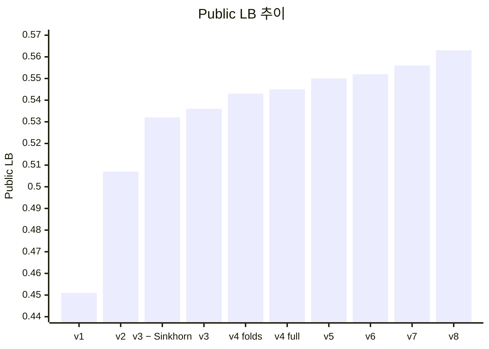
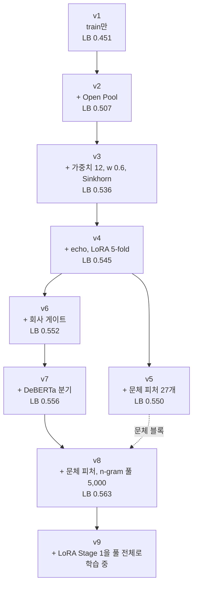

# 5. v1 → v9 변경과 개선 분석

[← 전체 문서](README.md)

v1부터 v9까지 버전마다 무엇을 바꿨고, 그 변경이 검증 점수와 Public LB를 얼마나 움직였는지 정리합니다. Public LB는 v1의 0.451에서 v8의 0.563까지 +0.112 올랐습니다. 그중 절반인 +0.056이 v2의 Open Pool 도입 하나에서 나왔고, v3의 묶음 변경이 +0.025를 더했습니다. 그 뒤 v4~v8은 제출마다 +0.002~0.009씩 올렸습니다. v6(회사 게이트), v7(DeBERTa 분기), v8(n-gram 풀 표본 5,000개)은 한 번에 분기 하나만 바꿔서 원인을 앞선 버전보다 좁게 짚을 수 있습니다. v9(LoRA Stage 1을 Open Pool 전체로 재학습)는 Colab에서 학습하는 중입니다.

모든 버전에 공통인 구조는 이 문서에서 반복하지 않습니다. 데이터는 [01_datasets.md](01_datasets.md), fold 분할은 [02_fold_split.md](02_fold_split.md), 모델 구조는 [03_model_architecture.md](03_model_architecture.md), 실험 방법은 [04_experiment_method.md](04_experiment_method.md)에 있습니다. 버전별 구조 그림은 [07_architecture_by_version.md](07_architecture_by_version.md), 실험마다의 자세한 표는 [EXPERIMENTS.md](../EXPERIMENTS.md)에 있습니다.

> [!NOTE]
> **수치 기준**
> - 2026-11-26 00:42 KST 기준입니다. v8까지 제출했고 v9는 학습 중입니다.
> - 검증 수치는 따로 적지 않으면 [EXPERIMENTS.md](../EXPERIMENTS.md)와 같은 **제출 커널(Kaggle T4) 로그** 기준입니다. "로컬"이라고 적은 값은 서버 CPU에서 저장된 OOF로 계산한 값입니다.
> - **fold 0**은 프롬프트 30개, 지문 540개인 홀드아웃이고 지문 하나가 BA 약 0.002입니다. **OOF**는 2,699개 전체의 fold 밖 예측이고 지문 하나가 BA 약 0.0004입니다.
> - **옛 풀**은 Open Pool 226,191개 시점(v3, v4), **새 풀**은 231,036개 시점(v5~v9)입니다. 풀이 다른 수치는 서로 직접 비교하지 않습니다.
> - "(추정)"은 측정으로 확인하지 않은 해석입니다.

## 1. 한눈에 보기

| 버전 | 직전(계보) 대비 바꾼 것 | n-gram OOF | 신경망 분기 단독 | 블렌드 검증 BA | Public LB | 제출 |
|:-:|---|:-:|:-:|:-:|:-:|:-:|
| [**v1**](../name_that_llm_v1.ipynb) | (출발점) LoRA는 train만으로 학습, n-gram도 train만 | 0.3663 | LoRA 0.4278 (fold 0) | 0.4407 (fold 0, `w` = 0.5 선택) | 0.451 | 11/10 |
| [**v2**](../name_that_llm_v2.ipynb) | Open Pool 도입: LoRA Stage 1, n-gram 학습 풀 | 0.4667 | LoRA 0.5222 (fold 0) | 0.5444 (fold 0, `w` = 0.5 선택) | 0.507 | 11/10 |
| [**v3**](../name_that_llm_v3.ipynb) | n-gram train 가중치 12, `w` = 0.6 고정, Sinkhorn, LoRA 재학습(풀 갱신) | 0.4745 | LoRA 0.5407 (fold 0) | 0.5389 (fold 0) | 0.536 (Sinkhorn 끔 0.532) | 11/17 |
| [**v4**](../name_that_llm_v4.ipynb) | LoRA echo 입력, LoRA 5-fold, 온도·가중치 비교를 OOF로 | 0.4745 | LoRA 0.5631 (OOF) | 0.5749 (OOF, 옛 풀) | 0.543 (folds) / 0.545 (full) | 11/17 |
| [**v5**](../name_that_llm_v5.ipynb) | v4 full + n-gram에 문체 피처 27개. 풀도 갱신됨 | 0.4749 | (v4 가중치) | 0.5734 (OOF). 같은 풀 기준선 0.5716 | 0.550 | 11/24 |
| [**v6**](../name_that_llm_v6.ipynb) | v4 full + 블렌드 뒤 회사 게이트 (문체 블록 없음) | 0.4693 | (v4 가중치) | 0.5719 → 게이트 0.5786 (OOF), nested +0.0044 | 0.552 | 11/25 |
| [**v7**](../name_that_llm_v7.ipynb) | v6 + DeBERTa-v3-large 세 번째 분기, 3분기 블렌드 | 0.4693 | DeBERTa 0.5053 (OOF) | 0.5868 → 게이트 0.5882 (OOF), 가중치 nested 0.5827 | 0.556 | 11/25 |
| [**v8**](../name_that_llm_v8.ipynb) | v7의 n-gram에 문체 피처 27개 + 풀 표본 라벨당 5,000개(라벨 균형) | **0.5016** | (v4·v7 가중치) | 0.5982 → 게이트 **0.6023** (OOF), 가중치 nested 0.5920 | **0.563** | 11/25 |
| [**v9**](../name_that_llm_v9.ipynb) | v8 + LoRA Stage 1을 Open Pool 전체(230,950행)로 재학습 | (v8과 같음) | LoRA 학습 중 | 측정값 없음 ([7장](#7-현재-상태)) | - | 학습 중 |

버전은 한 줄로 이어지지 않습니다. v5와 v6은 둘 다 v4에서 갈라졌고, v7은 v6 위에, v8은 v7 위에 올렸습니다. v5의 문체 블록은 v6·v7에는 없고 v8에서 다시 들어갑니다.

## 2. 버전 × 구성요소 변경 매트릭스

직전 버전(계보 기준: v5와 v6은 v4, v7은 v6, v8은 v7, v9는 v8)에서 **바뀐 칸은 굵게** 적었습니다. "〃"는 왼쪽 칸과 같다는 뜻입니다. 제출한 설정 기준이고, 제출 때 `CFG`를 덮어쓴 경우는 3장에 적었습니다.

| 구성요소 | v1 | v2 | v3 | v4 | v5 | v6 | v7 | v8 | v9 |
|---|---|---|---|---|---|---|---|---|---|
| Open Pool | 안 씀 | **씀** (223,840개) | **갱신** (226,191개) | 〃 | **갱신** (231,036개) | 231,036개 | 〃 | 〃 | 〃 (11/25 판 238,750개는 안 씀) |
| n-gram 학습 데이터 | train | **train + 풀 45,000개** | 〃 | 〃 | 〃 | 〃 | 〃 | **train + 풀 88,107개 (라벨당 5,000, 라벨 균형 가중치)** | 〃 |
| n-gram train 가중치 | 1 | 1 | **{1, 4, 12} 중 OOF 최고 → 12** | 〃 | 〃 | 〃 | **후보 12 하나** | 〃 | 〃 |
| n-gram 피처 | 4뷰 TF-IDF | 〃 | 〃 | 〃 | **+ 문체 27개 (α = 0.2)** | 4뷰 TF-IDF (v4와 같음) | 〃 | **+ 문체 27개 (α = 0.2)** | 〃 |
| LoRA 입력 | 지문 1회 | 〃 | 〃 | **echo (지문 2회, 두 번째만 풀링)** | 〃 | 〃 | 〃 | 〃 | 〃 |
| LoRA 학습 | Stage 2만 (lr 2e-4, 4 epochs) | **Stage 1(풀 45,000) → Stage 2 (lr 5e-5, 2 epochs)** | 〃 (새 풀로 재학습) | **Stage 1 한 번 → Stage 2를 fold 5개 + 전체** | v4 가중치 | v4 가중치 | v4 가중치 | v4 가중치 | **Stage 1을 풀 전체 230,950행(라벨 균형 손실)으로 재학습 → Stage 2 fold 5개 + 전체** |
| LoRA 검증 | fold 0 홀드아웃 (540개) | 〃 | 〃 | **5-fold OOF (2,699개)** | 〃 | 〃 | 〃 | 〃 | 〃 |
| 추가 분기 | - | - | - | - | - | - | **DeBERTa-v3-large (Stage 1 → fold별 Stage 2, Colab T4)** | v7 가중치 | v7 가중치 |
| 분기 온도 선택 | fold 0 NLL | 〃 | 〃 | **OOF NLL** | 〃 | 〃 | 〃 (DeBERTa도 OOF NLL) | 〃 | 〃 |
| 블렌드 가중치 | fold 0 BA 최고 (0.5) | 〃 (0.5) | **0.6 고정** | 〃 (비교 표만 OOF로) | 〃 | 〃 | **3분기 lora 0.6 / deb 0.2 / ng 0.2 고정 (저장 OOF로 로컬에서 선택)** | 〃 | 〃 (학습 뒤 다시 고를 예정) |
| 블렌드 뒤 보정 | - | - | - | - | - | **회사 게이트 (입력: n-gram, LoRA)** | **게이트 입력에 DeBERTa 추가** | 〃 | 〃 |
| 프롬프트 중심화 | 강도 0.5 | 〃 | 〃 | 〃 | 〃 | 〃 | 〃 | 〃 | 〃 |
| Sinkhorn | - | - | **ρ = 0.35 (테스트 200행 이상)** | 〃 | 〃 | 〃 | 〃 | 〃 | 〃 |
| 테스트 LoRA 예측 | fold 0을 뺀 모델 1개 | 〃 | 〃 | **fold 5개 평균(`folds`) 또는 전체 학습 1개(`full`)** | **`full`** | `full` | `full` | `full` | `full` (v9 가중치) |
| 최종 검증 범위 | fold 0 | 〃 | 〃 | **OOF** (fold 0도 함께 출력) | 〃 | **OOF + nested** | 〃 (블렌드 가중치 nested 포함) | 〃 | 〃 |

- n-gram의 온도는 모든 버전에서 n-gram OOF 2,699개의 NLL로 고릅니다.
- v1~v3의 테스트 LoRA는 노트북 코드상 fold 0을 뺀 80%로 학습한 모델입니다(Stage 2를 `fit_idx`로 학습하고 그 모델로 테스트를 예측). n-gram은 모든 버전에서 train 전체로 다시 학습해 테스트를 예측합니다.
- v7의 n-gram train 가중치 후보를 12 하나로 줄인 것은 v3~v6에서 매번 12가 뽑혔기 때문입니다. 제출 커널의 n-gram 구간이 그만큼 짧아집니다.

## 3. 버전별 변경과 효과

### v1 → v2: Open Pool 도입

**바뀐 것**
- 두 노트북의 코드는 Colab 전용 부분만 다릅니다(준비 셀 cell 6의 내용, 그리고 Colab인지 판별하는 조건문 세 곳). v2는 준비 셀에서 Open Pool을 받고, `NTL_CFG`를 `{"batch_size": 8}`로 줄입니다. v1은 `{"stage2_lr": 2e-4, "stage2_epochs": 4, "stage2_budget_h": 1.0, "batch_size": 8}`로 Stage 2를 처음부터 학습합니다.
- 제출 커널에서는 **입력에 Open Pool 데이터셋을 붙였는지**가 유일한 차이입니다. 풀이 없으면 노트북이 LoRA Stage 1을 건너뛰고 n-gram도 train만으로 학습합니다.
- 풀이 들어오면서 두 분기가 모두 바뀝니다. LoRA는 Stage 1(풀 45,000개, 1 epoch, lr 2e-4) 뒤에 Stage 2(2 epochs, lr 5e-5)로 미세 조정하고, n-gram은 TF-IDF를 풀에 맞추고 풀 45,000개를 학습 행으로 더합니다.

**동기**: 모델당 train 지문이 약 150개뿐이라 데이터가 부족했습니다.

**효과**

| 항목 | v1 | v2 | 변화 |
|---|:-:|:-:|:-:|
| n-gram OOF | 0.3663 | 0.4667 | +0.1004 |
| LoRA fold 0 | 0.4278 | 0.5222 | +0.0944 |
| 블렌드 fold 0 | 0.4407 | 0.5444 | +0.1037 |
| Public LB | 0.451 | 0.507 | **+0.056** |

**얼마나 이 변경 덕인가**: 전체 과정에서 가장 큰 개선이고, 검증과 LB가 같은 방향으로 크게 움직였습니다. 풀 도입 말고 바뀐 것은 Stage 2 설정(lr, epoch 수)뿐인데, 이것은 Stage 1이 생기면서 따라 바뀐 것이라 따로 떼어 볼 변경이 아닙니다. 확신도는 높습니다.

**남은 의문**: LB 상승(+0.056)이 fold 0 상승(+0.104)의 절반쯤입니다. v2의 fold 0 수치는 LoRA 온도와 `w`를 같은 540개로 고른 값이라 낙관적입니다. v2는 검증이 LB보다 0.037 높고, v1은 반대로 LB가 0.010 높습니다. n-gram과 LoRA 중 어느 쪽이 LB에 더 기여했는지는 나눠 제출한 적이 없어 알 수 없습니다.

### v2 → v3: n-gram train 가중치, 블렌드 가중치 고정, Sinkhorn

**바뀐 것** ([EXPERIMENTS.md](../EXPERIMENTS.md) 실험 1, 2)
1. `CFG["ngram_train_weight"] = 1.0`이 `CFG["ngram_train_weights"] = [1.0, 4.0, 12.0]`로 바뀌었습니다. n-gram 셀(cell 16)의 `fit_svc`가 가중치를 인자로 받고, 후보마다 5-fold OOF를 만들어 가장 높은 값을 고릅니다. 결과는 12였습니다.
2. `CFG["blend_w"] = 0.6`이 생겼습니다. `None`이면 예전처럼 홀드아웃 최고값을 고릅니다.
3. Sinkhorn 셀(cell 27)과 `use_sinkhorn`, `sinkhorn_rho`(0.35), `sinkhorn_iters`(10), `sinkhorn_damping`(0.5), `sinkhorn_min_rows`(200)가 생겼습니다. 같은 보정을 홀드아웃 블렌드와 n-gram OOF에 적용해 보는 점검 출력도 이 셀에 있습니다.
4. LoRA 코드는 v2와 같습니다. 다만 Open Pool이 갱신돼(223,840 → 226,191개) 다시 학습했습니다.

**동기**: 가중치가 1이면 n-gram 학습에서 train이 차지하는 몫이 6%도 안 됩니다. `w`는 홀드아웃 최고값을 고르면 실행마다 0.5와 1.0을 오갔습니다. 가중치 상향과 Sinkhorn은 [상위권 조사 보고서](../name_that_llm_high_scorers_report.md) 8장의 권고(2번, 6번)와 같은 내용입니다.

**효과**

| 항목 | v2 | v3 | 변화 |
|---|:-:|:-:|:-:|
| n-gram OOF | 0.4667 (가중치 1) | 0.4745 (가중치 12) | +0.0078 |
| LoRA fold 0 | 0.5222 | 0.5407 | +0.0185 |
| 블렌드 fold 0 | 0.5444 (`w` = 0.5 선택) | 0.5389 (`w` = 0.6 고정) | −0.0055 |
| Public LB | 0.507 | 0.536 | **+0.029** |

- 같은 풀 안에서 가중치만 비교하면 n-gram OOF가 1 → 0.4675, 4 → 0.4697, 12 → 0.4745입니다. 가중치의 효과는 +0.0070이고, 나머지 +0.0008은 풀 갱신 몫입니다.
- Sinkhorn만 끈 제출(실험 2)이 0.532라서, Sinkhorn의 LB 기여는 +0.004이고 나머지 세 변경의 합이 +0.025입니다.

**얼마나 이 변경 덕인가**: Sinkhorn은 한 줄만 바꾼 비교 제출이 있어 분리됩니다. 나머지 +0.025는 n-gram 가중치 12, `w` 고정, 새 LoRA 가중치가 묶여 있어 나눌 수 없습니다.
- LoRA 코드는 그대로인데 fold 0 점수가 지문 10개(+0.0185)만큼 올랐습니다. 풀 갱신으로 Stage 1 표본이 달라진 것과 재학습 자체의 흔들림이 섞여 있습니다(추정). 재학습만으로 fold 0이 이만큼 움직일 수 있다면, v2와 v3의 LB 차이 중 일부는 변경의 효과가 아닐 수 있습니다(추정).

**남은 의문**
- 가중치 12는 후보 중 가장 큰 값입니다. 20, 30은 시험하지 않았습니다.
- 홀드아웃이 떨어졌는데 LB가 오른 이유는 확인하지 못했습니다. v3 홀드아웃의 `w`별 BA는 0.5315~0.5463에서 들쭉날쭉해서, 540개로는 이 크기의 차이를 가릴 수 없다는 것만 분명합니다.

### v3 → v4: echo 입력과 LoRA 5-fold

**바뀐 것** ([EXPERIMENTS.md](../EXPERIMENTS.md) 실험 3, 4)
1. `CFG["echo_input"] = True`. `tokenize_all`이 `지문 + "\n\n" + 지문`을 만들고 두 번째 사본의 시작 위치를 돌려줍니다. 모델의 `forward`가 `pool_mask`를 받아 두 번째 사본만 평균 풀링합니다(cell 18).
2. `CFG["grad_accum"]`이 생겼습니다. 입력이 두 배라 Colab에서 마이크로 배치 4 × 누적 2(실효 배치 8)로 돌립니다.
3. LoRA 실행 셀(cell 19)이 fold 0 홀드아웃에서 5-fold로 바뀌었습니다. `cv_after_stage1`이 Stage 1 가중치를 저장한 뒤 fold마다 그 가중치에서 Stage 2를 다시 학습하고, `cv_from_saved`가 저장된 fold 가중치로 OOF와 테스트 로짓만 계산합니다.
4. `CFG["lora_test"]`가 생겼습니다. `"folds"`는 fold 모델 5개 평균, `"full"`은 train 전체로 Stage 2를 한 번 더 학습한 모델 1개입니다.
5. 블렌드 셀(cell 21)이 LoRA 온도와 `w` 비교 표를 fold 0 대신 OOF 2,699개로 계산합니다. Sinkhorn 점검도 "블렌드 OOF"로 바뀌었습니다.

EXPERIMENTS.md에 없는 변경도 있습니다.
- 가중치 파일 이름이 `ntl_lora.pt` 하나에서 `ntl_lora_fold0.pt` ~ `ntl_lora_fold4.pt`, `ntl_lora_full.pt`, `ntl_lora_stage1.pt`로 바뀌었습니다. 가중치를 읽는 `load_lora`는 저장된 `echo_input`이 현재 설정과 다르면 멈춥니다.
- 비정상 손실이 나왔을 때 v4부터는 그 마이크로 배치만 빼고 누적을 이어 갑니다.
- 노트북의 `ngram_train_weights`는 여전히 `[1, 4, 12]`입니다. 12로 고정한 것이 아니라 매번 OOF로 다시 고르고, 지금까지 매번 12가 뽑혔습니다.

**동기**: Qwen은 causal attention이라 앞 토큰이 뒤 문맥을 보지 못합니다. 지문을 두 번 넣으면 두 번째 사본의 토큰은 지문 전체를 본 상태가 됩니다. 5-fold는 540개 홀드아웃으로 `w`와 온도를 고를 수 없다는 v3의 경험에서 나왔습니다.

**효과**

| 항목 | v3 | v4 | 변화 |
|---|:-:|:-:|:-:|
| LoRA fold 0 | 0.5407 | 0.5426 | +0.0019 (지문 1개) |
| LoRA OOF | - | 0.5631 | |
| 블렌드 fold 0 (`w` = 0.6) | 0.5389 | 0.5593 | +0.0204 |
| 블렌드 OOF (`w` = 0.6) | - | 0.5749 | |
| 블렌드 + Sinkhorn OOF | - | 0.5764 | |
| Public LB | 0.536 | 0.543 (folds) / 0.545 (full) | **+0.007 / +0.009** |

**얼마나 이 변경 덕인가**
- **echo의 효과는 확인되지 않았습니다.** LoRA 단독 fold 0이 v3와 지문 1개 차이이고, Colab L4 학습 때는 두 버전이 0.5426으로 같았습니다. echo를 끈 5-fold 실행이 없어서 OOF로도 비교할 수 없습니다.
- LoRA 단독이 그대로인데 블렌드 fold 0이 0.0204 오른 것은 LoRA 온도를 2,699개로 고른 덕으로 보입니다(추정).
- LB +0.007~0.009에는 테스트 LoRA가 바뀐 효과도 섞여 있습니다. v3까지는 fold 0을 뺀 모델 1개였고, v4는 그런 모델 5개의 평균이거나 train 전체를 본 모델입니다. 이 개선을 echo 덕으로 볼 근거는 약합니다(추정).
- `folds`와 `full`의 LB 차이는 0.002입니다. 온도와 `w`를 같은 OOF에서 정하므로 두 커널의 검증 수치는 같고, 차이는 LB로만 보입니다.

**남은 의문**
- echo는 입력 길이를 두 배로 만들어 학습과 추론 비용을 올립니다. 효과가 없다면 빼는 편이 낫지만, 확인 실행(echo 끈 5-fold)을 아직 하지 않았습니다. v5~v8이 모두 v4의 echo 가중치를 재사용하고 v9도 echo를 켠 채 다시 학습해서, 이 의문은 뒤 버전에도 그대로 남아 있습니다.
- Kaggle 제출 설명에는 v4의 두 제출 모두 "OOF blend BA 0.5757"로 적혀 있습니다. 저장소의 로그와 문서에는 이 값이 없고(커널 로그 기준 0.5749, Sinkhorn 점검 0.5764), 어디서 나온 값인지 확인하지 못했습니다.

### v4 → v5: n-gram 분기에 문체 피처 27개

**바뀐 것** ([EXPERIMENTS.md](../EXPERIMENTS.md) 실험 5)
- n-gram 셀(cell 16)에 `stylo_feats`, `stylo_raw`, `stylo_block`, `with_stylo`가 들어갔습니다. 4뷰 TF-IDF 행렬 옆에 문체 피처 27개를 이어 붙입니다. `log1p` → fold의 train 지문으로 표준화 → ±4에서 자름 → `α / √27` 곱하기 순서입니다.
- `CFG["stylo_alpha"] = 0.2`(0이면 v4와 같음), `CFG["lora_test"] = "full"`.
- LoRA, 블렌드, 중심화, Sinkhorn 코드는 v4와 같고 LoRA 가중치도 v4 것입니다. v4 → v5 변환은 [v5_stylo/make_v5.py](../v5_stylo/make_v5.py)에 스크립트로 남아 있습니다.
- 코드와 무관하게 **Open Pool이 226,191개에서 231,036개로 갱신**됐습니다.

**동기**: [analysis_intra_org/report.md](../analysis_intra_org/report.md)에서 잘 구분되는 쌍은 구두점, 문장 길이, 기능어 비율 같은 문체 통계의 차이가 뚜렷했습니다. 그 분석에 쓴 27개 피처([analysis_intra_org/features.py](../analysis_intra_org/features.py))를 그대로 n-gram 분기에 넣었습니다.

**효과** (같은 새 풀, 커널 fold 분할 기준)

| 항목 | 새 풀 기준선 (α = 0, 로컬) | v5 (α = 0.2, 커널) | 변화 |
|---|:-:|:-:|:-:|
| n-gram OOF | 0.4690 | 0.4749 | +0.0059 |
| 블렌드 OOF (`w` = 0.6) | 0.5716 | 0.5734 | +0.0018 (지문 5개쯤) |
| 블렌드 OOF (`w` = 0.8) | 0.5775 | 0.5768 | −0.0007 |

| 항목 | v4 full (옛 풀) | v5 (새 풀) | 변화 |
|---|:-:|:-:|:-:|
| Public LB | 0.545 | 0.550 | **+0.005** |

- 로컬에서 α = 0과 0.2를 직접 비교한 bootstrap 95% 구간은 n-gram 단독 [−0.001, +0.014], 블렌드 `w` = 0.6 [−0.003, +0.008]입니다. 둘 다 0을 포함합니다.
- 풀 갱신만의 영향은 n-gram 0.4745 → 0.4690(−0.0055), 블렌드 0.5749 → 0.5716(−0.0033)입니다.

**얼마나 이 변경 덕인가**: n-gram 단독으로는 두 fold 분할에서 모두 +0.006으로 같은 방향입니다. 블렌드에서는 효과가 확인되지 않습니다. LB +0.005에는 문체 블록과 풀 갱신이 함께 들어 있어 나눌 수 없습니다. OOF로는 풀 갱신이 −0.0033, 문체 블록이 +0.0018이라 v5 블렌드가 v4보다 낮아야 하는데 LB는 올랐습니다.

**남은 의문**: 문체 블록만의 LB 효과를 알려면 새 풀에서 α = 0으로 한 번 더 제출해야 합니다. 문체 피처가 n-gram에 더한 정보의 대부분을 LoRA가 이미 갖고 있는 것으로 보입니다(추정).

### v4 → v6: 회사 게이트

**바뀐 것** ([EXPERIMENTS.md](../EXPERIMENTS.md) 실험 6, [analysis_v6/report.md](../analysis_v6/report.md))
- 블렌드 셀 뒤에 "5-1. 회사 게이트" 셀이 들어갔습니다. `CFG["use_gate"]`, `CFG["gate_c"]`(1.0), `CFG["gate_alpha"]`(GPT 0.75, Gemini 0.25, Claude 0.5, GLM 1.0)가 생겼습니다.
- 회사마다 n-gram과 LoRA의 회사 열 log 확률을 입력으로 회사 안 모델을 맞히는 로지스틱 회귀를 학습합니다. 블렌드 1순위가 그 회사 안인 지문만, 회사 확률 합은 그대로 두고 회사 안 분포를 `gate_alpha`만큼 LR 쪽으로 옮깁니다. LR은 커널 안에서 그 커널의 OOF로 다시 학습하고, `gate_alpha`와 C는 옛 풀의 v4 OOF에서 고른 값을 그대로 씁니다.
- 게이트 뒤에 분석용 OOF를 `oof_v6.npz`로 저장하는 셀이 있습니다. `CFG["lora_test"]`는 `"full"`입니다.
- v4에서 갈라졌으므로 v5의 문체 블록은 없습니다.

**동기**: v4 OOF 오답 1,147개 중 681개(59%)가 같은 회사 모델끼리 헷갈린 것입니다. 정답 회사를 알려 주면 BA가 0.5749에서 0.694까지 오르므로, 회사 안 구분에 남은 여지가 큽니다.

**효과**

| 항목 | 옛 풀 (v4 OOF, 로컬) | 새 풀 (v6 커널) |
|---|:-:|:-:|
| 게이트 전 블렌드 | 0.5749 | 0.5719 |
| 고정 α 게이트 | 0.5882 (+0.0133, α를 이 OOF에서 고름) | **0.5786** (+0.0067, 95% 구간 [−0.001, +0.015]) |
| nested α | 0.5864 (+0.0115, [+0.003, +0.020]) | 0.5764 (+0.0044, [−0.002, +0.011]) |
| Public LB | - | **0.552** (v4 full 0.545 대비 +0.007) |

- fold 5개 모두에서 올랐습니다(새 풀 +0.004 ~ +0.011). 이득은 GPT(+0.0041)와 GLM(+0.0022)에서 나오고 Gemini는 0, Claude는 −0.0004입니다.
- 많이 오른 라벨은 gpt-5.6-terra(+0.067), glm-5.3-flash(+0.060), gpt-5.6-sol(+0.033)이고, glm-5.3은 −0.053 떨어졌습니다. GLM 안에서 한쪽으로 옮긴 결과입니다.

**얼마나 이 변경 덕인가**: 바뀐 것이 셀 하나이고 같은 OOF 위에서 계산했으므로, 같은 풀 안의 검증 차이는 전부 게이트에서 나옵니다. 다만 새 풀에서는 이득이 옛 풀의 절반으로 줄었고 두 구간 모두 0을 포함합니다. LB +0.007에는 풀 갱신(OOF로는 −0.0033)도 함께 들어 있어 나눌 수 없습니다. v5(0.550)와 v6(0.552)은 같은 새 풀이지만 서로 다른 변경이라, 그 0.002 차이도 우열로 읽지 않습니다.

**남은 의문**: 새 OOF에서 가장 좋은 α 조합(+0.0104)이 nested로는 +0.0044로 줄어서, α를 고르는 일 자체가 잡음을 따라갑니다. α는 v7·v8·v9에서도 다시 고르지 않았습니다.

### v6 → v7: DeBERTa-v3-large 분기

**바뀐 것** ([EXPERIMENTS.md](../EXPERIMENTS.md) 실험 7, 커밋 `4f2251a`, `02a40e0`, `cb659b4`)
- "4-2. DeBERTa 분류기" 셀 둘이 들어갔습니다. `microsoft/deberta-v3-large` 전체(4.34억 개)를 학습합니다. 입력은 지문 그대로(최대 512토큰), 마지막 층 토큰 평균 → `Dropout(0.1) → Linear(1024 → 18)`입니다.
- 학습은 LoRA와 같은 2단계입니다. Stage 1은 Open Pool 45,000개(LoRA와 같은 표본) 1 epoch(lr 2e-5), Stage 2는 fold마다 Stage 1 가중치에서 다시 시작해 2 epochs(lr 1e-5)입니다. 헤드 lr 20배, warmup 10%, 실효 배치 16입니다. 테스트 로짓은 train 전체로 Stage 2를 한 번 더 학습한 모델에서 냅니다.
- 블렌드가 3분기가 됐습니다(`LP = w_lora·LP_lora + w_deb·LP_deb + w_ng·LP_ng`). 0.1 간격 66개 조합을 저장된 OOF로 로컬에서 비교해 `CFG["blend3"] = dict(ng=0.2, lora=0.6, deb=0.2)`로 고정했습니다. 같은 실행에서 v6 가중치(LoRA 0.6, n-gram 0.4)의 OOF BA도 함께 출력해 비교 기준으로 씁니다.
- 게이트의 특화 LR 입력에 DeBERTa의 회사 열 log 확률이 더해졌습니다. `gate_alpha`는 v6 값 그대로입니다.
- n-gram train 가중치 후보를 `[12.0]` 하나로 줄였습니다(v3~v6에서 매번 12가 뽑힘).
- 세 분기의 OOF 로짓을 `oof_v7.npz`로 저장합니다.
- 커밋 `02a40e0`: Colab(transformers 5.x)에서 저장한 토크나이저를 4.x가 못 읽으면 `tokenizer.json`을 직접 읽습니다. 제출 커널에서는 이 우회 없이 읽혔습니다.

**동기**: 양방향 인코더는 causal LLM과 다른 방식으로 문맥을 봅니다. [상위권 조사 보고서](../name_that_llm_high_scorers_report.md)가 "가장 큰 단일 성능 향상"으로 꼽은 것이 backbone 추가와 DeBERTa-v3-large였습니다(8장 1번).

**효과**

| 항목 | v6 가중치 (lora 0.6 / ng 0.4) | v7 (lora 0.6 / deb 0.2 / ng 0.2) | 차이 |
|---|:-:|:-:|:-:|
| 블렌드 OOF BA | 0.5719 | **0.5868** | +0.0149, [+0.005, +0.025] |
| nested BA (가중치를 fold 밖에서 선택, 로컬) | - | 0.5827 | +0.0108, [−0.000, +0.022] |
| 게이트 뒤 OOF BA | 0.5786 (v6 커널) | **0.5882** | +0.0096 |
| Public LB | 0.552 (v6) | **0.556** | **+0.004** |

- DeBERTa 단독 OOF는 0.5053으로 n-gram(0.4693)과 LoRA(0.5631) 사이입니다. 그런데 LoRA와 1순위가 다른 지문이 41.5%이고, 둘 중 하나라도 맞힌 지문은 66.5%입니다. 블렌드 이득은 여기서 나온 것으로 보입니다(추정).
- 블렌드는 n-gram 몫의 절반을 DeBERTa로 옮겼습니다. LoRA 가중치는 v3부터 써 온 0.6 그대로입니다.
- 게이트가 더하는 양은 +0.0014로 줄었습니다(같은 OOF에서 v6은 +0.0074). DeBERTa가 들어간 블렌드가 이미 회사 안 정확도를 올려서(GPT 0.631 → 0.663, GLM 0.600 → 0.627) 특화 LR이 고칠 것이 줄었습니다.

**얼마나 이 변경 덕인가**: v6과 v7은 같은 풀, 같은 LoRA 가중치, 같은 게이트 α를 씁니다. 그래서 LB 차이의 원인이 DeBERTa 분기와 그에 따른 가중치 변화로 좁혀집니다. 이 저장소에서 분기 하나만 바꾼 첫 제출입니다. 다만 +0.004는 실험 4에서 OOF가 같은 두 제출이 보인 0.002의 두 배일 뿐입니다.

**남은 의문**
- **Stage 2가 거의 아무것도 하지 않았습니다.** DeBERTa fold 0 BA가 Stage 1 직후 0.4981, Stage 2 뒤 0.5000(지문 1개)입니다. 0.5053은 사실상 Open Pool만으로 학습한 모델의 점수입니다.
- **설계한 학습 환경으로 돌리지 못했습니다.** L4를 30번 넘게, A100을 4번 요청했지만 배정되지 않아 T4(fp32, gradient checkpointing)에서 198분 걸려 학습했습니다. VM이 실행 중에 두 번 사라져, DeBERTa만 학습하는 실행 사본과 10분 체크포인트로 끝까지 돌렸습니다. 세 분기를 처음 함께 돌린 것은 제출 커널입니다.

### v7 → v8: n-gram 풀 표본 5,000개와 문체 블록

**바뀐 것** ([EXPERIMENTS.md](../EXPERIMENTS.md) 실험 8, [analysis_v8/](../analysis_v8/))
- **n-gram 분기만 바꿨습니다.** LoRA(v4 가중치)와 DeBERTa(v7 가중치)는 추론만 하고, `blend3`, `gate_alpha`, 중심화, Sinkhorn도 v7과 같습니다.
- **문체 블록**: v5의 문체 피처 27개(`stylo_alpha` = 0.2)를 v7의 n-gram 셀에 넣었습니다. 코드는 v5와 같습니다.
- **풀 표본 크기**: `ngram_pool_per_label`을 2,500에서 5,000으로 올렸습니다. gemini-3.7-flash(3,541개)와 qwen3.8-max(4,566개)는 풀이 모자라 표본은 88,107행입니다. TF-IDF 특성 수가 463,103에서 493,279로 늘었습니다.
- **라벨 균형 가중치**: `ngram_pool_balance = True`. 라벨마다 풀 가중치 합이 같아지게 풀 행에 0.979 ~ 1.382를 줍니다.
- `fit_svc`가 fit 전에 사본을 놓아 주게 해 메모리를 줄였습니다(값은 같음). 노트북은 [analysis_v8/make_v8.py](../analysis_v8/make_v8.py)로 v7에서 만들었습니다.

**동기**: v7 뒤에 저장된 OOF로 "n-gram만 바꾸면 3분기 블렌드에 얼마나 남는가"를 미리 계산했습니다([analysis_v7/whatif_ngram.py](../analysis_v7/whatif_ngram.py)). 그리고 [analysis_pool/](../analysis_pool/)에서 n-gram의 풀 표본 크기를 2,500 / 3,500 / 5,000 / 7,500으로 바꿔 비교했습니다. 5,000개에서 2분기 블렌드 이득의 구간이 처음으로 0을 벗어났고(+0.0152 [+0.004, +0.027]), 7,500개는 n-gram만 더 오르고 블렌드는 그대로였습니다.

**효과**

| 항목 | v7 커널 | v8 커널 | 차이 [95% 구간] |
|---|:-:|:-:|:-:|
| n-gram OOF | 0.4693 | **0.5016** | +0.0322 [+0.017, +0.049] |
| 3분기 블렌드 (고정 가중치) | 0.5868 | 0.5982 | +0.0115 [+0.002, +0.020] |
| nested (로컬) | 0.5827 | 0.5920 | +0.0093 [−0.000, +0.019] |
| 게이트 뒤 | 0.5882 | **0.6023** | +0.0141 |
| Public LB | 0.556 | **0.563** | **+0.007** |

- OOF로 나누면 블렌드 이득 +0.0115 중 풀 크기(라벨 균형 포함)가 +0.0096 [+0.002, +0.017], 문체 블록이 +0.0018 [−0.002, +0.006]입니다. 문체 블록의 몫은 v5의 2분기 블렌드에서 잰 값(+0.0018)과 같은 크기입니다.
- n-gram은 다섯 fold 모두, 블렌드는 네 fold에서 올랐습니다(fold 0만 −0.0056).
- 커널 수치는 제출 전에 로컬에서 계산한 예상(n-gram 0.5012, 블렌드 0.5982, 게이트 뒤 0.6020)과 지문 1개 이내로 맞았습니다.
- 강해진 n-gram과 DeBERTa가 같은 지문을 고치는 부분이 있어서, DeBERTa가 보태는 양이 줄었습니다(v6 가중치 대비 +0.0148 → +0.0078).

**얼마나 이 변경 덕인가**: n-gram 분기 하나만 바꿨으므로 LB +0.007의 원인은 그 분기의 두 변경으로 좁혀집니다. 둘을 LB로 나누지는 못했고, OOF로는 대부분이 풀 크기입니다(LB도 그럴 것으로 추정). 풀 표본을 늘린 이득은 검증 프롬프트와 주제가 가까운 풀 행을 빼고 다시 재도 그대로여서, 주제 누수 때문이 아닙니다([02_fold_split.md](02_fold_split.md) 5장).

**남은 의문**
- **LB가 OOF의 절반만 올랐습니다**(게이트 뒤 OOF +0.0141, LB +0.007). v7에서도 같았습니다(+0.0096, +0.004). 표본 크기 5,000을 이 OOF를 보고 고른 점도 OOF를 낙관적으로 만듭니다.
- **gemini-3.7-flash**: 풀이 3,541개뿐이라 다른 Gemini 모델의 표본만 늘어나면서 이 라벨이 밀립니다. 라벨 균형 가중치로 n-gram recall을 0.260에서 0.367까지 되돌렸지만 2,500개 때의 0.420에는 못 미칩니다.
- 커널 실행이 19.0분에서 33.9분으로 늘었고, 84%가 n-gram 구간입니다.

### v8 → v9: LoRA Stage 1을 Open Pool 전체로 (학습 중)

**바뀐 것** ([name_that_llm_v9.ipynb](../name_that_llm_v9.ipynb) 첫 셀, [analysis_v9/make_v9.py](../analysis_v9/make_v9.py))
- **LoRA 분기만 바꿨습니다.** Stage 1 데이터를 라벨당 2,500개 표본(45,000개, 풀의 19%)에서 **Open Pool 전체**로 늘렸습니다(`lora_pool_mode = "full"`). 출처의 프롬프트 id가 train `prompt_id`와 같은 풀 행 86개를 빼서 230,950행입니다(`lora_drop_train_prompt_ids`).
- 라벨마다 개수가 3,541 ~ 23,537개로 달라서, 손실에 라벨 균형 가중치(0.545 ~ 3.623, 평균 1)를 줍니다(`lora_pool_balance`). `match_weight`는 손실에 쓰지 않습니다.
- Stage 1이 28,869스텝으로 v4(5,625스텝)의 5배라, 시간 예산을 14시간으로 늘리고 10분마다 체크포인트를 남겨 끊긴 자리에서 이어 하게 했습니다(`stage1_ckpt_min`). Stage 2는 fold 파일이 이미 있으면 건너뜁니다.
- 가중치 파일 이름이 `ntl_lora_v9_*.pt`로 바뀌고, 저장된 가중치의 `lora_pool_mode`가 다르면 멈춥니다. LoRA OOF를 셀 끝에서 `ntl_lora_v9_oof.npz`로 바로 저장합니다.
- n-gram(v8), DeBERTa(v7 가중치), 게이트, 중심화, Sinkhorn은 v8과 같습니다. **`blend3`은 아직 v7 값이고**, LoRA OOF가 나오면 다시 고릅니다([analysis_v9/eval_v9.py](../analysis_v9/eval_v9.py)).

**동기**: v8에서 n-gram의 풀 표본을 두 배로 늘린 것이 게이트 뒤 OOF로 v4 이후 가장 큰 이득(+0.0141)을 냈습니다. 실험 8의 다음 할 일 첫 번째가 "신경망 분기의 Stage 1 표본도 늘리기"였고, 블렌드에서 가중치가 가장 큰 LoRA부터 시험합니다.

**효과**: 아직 측정값이 없습니다. 진행 상황은 [7장](#7-현재-상태)에 있습니다.

**볼 것**: LoRA 단독 OOF가 v4 가중치(0.5631)보다 얼마나 오르는지, 그리고 그 이득이 3분기 블렌드에 얼마나 남는지입니다. v8에서 n-gram 단독 +0.032가 블렌드에서는 +0.0115였던 것처럼, 분기 단독 이득이 그대로 남지는 않을 것으로 봅니다(추정). echo 입력은 v9에서도 켜져 있어서, echo의 효과는 이번에도 따로 확인되지 않습니다.

## 4. 개선 기여 분해

Public LB 0.451 → 0.563의 +0.112를 제출 사이의 차이로 나눴습니다. 계보를 따라 v1 → v2 → v3 → v4 → v6 → v7 → v8로 잇고, 곁가지인 v5는 따로 적었습니다.

| 구간 | LB 변화 | 들어 있는 변경 | 분리 | 확신도 |
|---|:-:|---|:-:|---|
| v1 → v2 | **+0.056** | Open Pool 도입 (LoRA Stage 1, n-gram 풀) | 풀 도입 단독. LoRA와 n-gram 몫은 나눌 수 없음 | 높음. 검증도 +0.10으로 같은 방향 |
| v2 → v3 − Sinkhorn | +0.025 | n-gram 가중치 12, `w` 0.6 고정, 새 풀로 재학습한 LoRA | 묶음. 분리 불가 | 중간. 홀드아웃은 −0.0055로 반대 방향 |
| v3 − Sinkhorn → v3 | +0.004 | Sinkhorn (ρ = 0.35) | **단독** (한 줄만 바꾼 비교 제출) | 낮음. 크기가 작고 검증 이득도 지문 1~4개 |
| v3 → v4 folds | +0.007 | echo, LoRA 5-fold, OOF로 고른 온도, 테스트 = fold 5개 평균 | 묶음. 분리 불가 | 중간. echo 몫은 미확인 |
| v4 folds → v4 full | +0.002 | 테스트 = 전체 학습 모델 1개 | **단독** | 낮음. 검증 수치는 두 제출이 같음 |
| v4 full → v6 | +0.007 | 회사 게이트, Open Pool 갱신 | 묶음. 분리 불가 | 중간. 같은 풀 안에서 게이트 OOF +0.0067, 풀 갱신 OOF −0.0033 |
| v6 → v7 | +0.004 | DeBERTa 분기와 3분기 가중치 | **분기 하나** | 중간. nested +0.011, 구간 아래쪽이 0에 닿음 |
| v7 → v8 | +0.007 | n-gram 풀 표본 5,000 + 라벨 균형, 문체 블록 | **분기 하나** (그 안에 두 변경) | 중간~높음. OOF 구간이 0을 벗어남. OOF로는 대부분 풀 크기 |
| 합계 | **+0.112** | | | |
| (곁가지) v4 full → v5 | +0.005 | 문체 피처 27개, Open Pool 갱신 | 묶음. 분리 불가 | 낮음. 블렌드 OOF 차이는 오차 범위 |

- 전체 개선의 50%가 Open Pool 도입 하나입니다. v3 묶음까지 더하면 72%입니다.
- v3 이후의 +0.027(0.536 → 0.563)은 제출 다섯 번에 +0.002 ~ +0.007씩 나뉩니다. 그중 v6 → v7과 v7 → v8은 분기 하나만 바꿔서, 원인을 그 분기로 좁힐 수 있습니다.
- "데이터를 더 쓰는 변경"이 두 번 크게 통했습니다. v2의 Open Pool 도입(+0.056)과 v8의 n-gram 풀 표본 두 배(LB +0.007, 게이트 뒤 OOF로는 v4 이후 가장 큰 +0.0141)입니다. v9는 같은 생각을 LoRA에 적용합니다.
- LB 0.002~0.007 차이가 얼마나 확실한지는 알 수 없습니다. 숨겨진 테스트는 약 4,000행이고, 그중 Public에 쓰이는 비율은 확인하지 못했습니다. 전부 쓰인다고 해도 지문 하나가 BA 약 0.00025이므로 0.004는 지문 16개쯤입니다(추정).

검증과 LB가 같은 방향이었는지도 구간마다 다릅니다.

| 구간 | 검증 변화 | 검증 기준 | LB 변화 | 방향 |
|---|:-:|---|:-:|:-:|
| v1 → v2 | +0.1037 | 블렌드 fold 0 | +0.056 | 같음 |
| v2 → v3 | −0.0055 | 블렌드 fold 0 | +0.029 | **반대** |
| v3 → v4 | +0.0204 | 블렌드 fold 0 | +0.007 / +0.009 | 같음 |
| v4 → v5 | +0.0018 | 블렌드 OOF (같은 새 풀 기준선 대비) | +0.005 | 같음. 풀 갱신까지 넣으면 0.5749 → 0.5734로 반대 |
| v4 → v6 | +0.0067 | 게이트 전 → 뒤 OOF (같은 새 풀) | +0.007 | 같음 |
| v6 → v7 | +0.0096 | 게이트 뒤 OOF | +0.004 | 같음. LB는 OOF의 절반 |
| v7 → v8 | +0.0141 | 게이트 뒤 OOF | +0.007 | 같음. LB는 OOF의 절반 |

- v4 이후로는 방향이 모두 맞았습니다. 홀드아웃(540개)을 버리고 OOF(2,699개)로 바꾼 뒤입니다.
- 게이트 뒤 OOF와 Public LB의 간격은 v6 0.027, v7 0.032, v8 0.039로 벌어지고 있습니다. OOF를 보고 정한 값(게이트 α, `blend3`, 표본 크기)이 쌓인 것과, 풀에 train 프롬프트와 주제가 가까운 지문이 있어 n-gram OOF 절댓값이 높게 나오는 것이 후보입니다(추정). OOF에는 테스트에만 적용하는 중심화와 Sinkhorn이 빠져 있어서, 간격 전부가 과적합은 아닙니다.

## 5. 효과가 없었거나 채택하지 않은 것

**넣었지만 효과가 확인되지 않은 것**

| 시도 | 근거 수치 | 상태 | 출처 |
|---|---|---|---|
| echo 입력 | LoRA fold 0: 0.5407 → 0.5426(지문 1개). L4 학습 때는 둘 다 0.5426 | v4~v9에 켜져 있음. echo 끈 5-fold와 비교한 적 없음 | [EXPERIMENTS.md](../EXPERIMENTS.md) 실험 3 |
| Sinkhorn | LB +0.004. OOF로는 v4 +0.0015, v5 0, v6 −0.0004, v7 +0.0037, v8 −0.0007 | v3~v9에 켜져 있음. 테스트가 200행 이상일 때만 작동 | 실험 2, 3, 5~8 |
| 문체 피처 27개 | 블렌드 몫이 v5(2분기)와 v8(3분기) 모두 +0.0018. 구간이 0을 포함 | v5, v8, v9에 있음. 비용은 피처 계산 약 25초 | 실험 5, 8 |
| 회사 게이트 (DeBERTa 위에서) | 새 풀 nested +0.0044(구간 0 포함). 게이트가 더하는 양이 v6 +0.0067 → v7 +0.0014 → v8 +0.0041 | v6~v9에 켜져 있음 | 실험 6~8 |
| DeBERTa Stage 2 | fold 0 BA 0.4981 → 0.5000(지문 1개) | v7 가중치를 v8·v9에서도 씀 | 실험 7 |

**비교해 보고 채택하지 않은 것**

| 시도 | 결과 | 출처 |
|---|---|---|
| 블렌드 가중치를 홀드아웃 최고값으로 선택 | 실행마다 0.5와 1.0을 오감. v3 홀드아웃 최고는 0.9인데 `w`별 BA가 0.5315~0.5463에서 들쭉날쭉 | 실험 1 |
| 2분기 블렌드 가중치를 OOF 최고값(0.8)으로 | 옛 풀 0.5760(0.6은 0.5749), 새 풀 0.5775(0.6은 0.5716). 0.001~0.006 높지만 0.6 유지 | 실험 3, 5 |
| 3분기 가중치를 OOF 최고값(lora 0.4 / deb 0.3 / ng 0.3)으로 | v8에서 고정값보다 +0.0015. fold 밖에서 고르면 fold마다 다른 조합이 뽑혀 0.5920으로 고정값(0.5982)보다 낮음 | 실험 8 |
| 게이트 α를 새 풀 OOF로 다시 고르기 | 최고 조합 +0.0104가 nested로는 +0.0044 | 실험 6 |
| 문체 피처 α를 0.2 말고 다른 값으로 | α = 0.1 / 0.3 / 0.4의 n-gram OOF 0.4738 / 0.4738 / 0.4708(0.2는 0.4756). fold 분할을 바꾸면 순서가 뒤집힘 | 실험 5 |
| 문체 피처를 분위수 구간 one-hot으로, 또는 일부만 | 0.3749, 0.3801 / 0.3741(27개 전부 0.3826, train만) | 실험 5 |
| 길이 피처(`n_words`, `n_sents`) 제외 | n-gram 0.4756 → 0.4753, 블렌드 `w` = 0.6에서 −0.0011 | 실험 5 |
| n-gram 풀 표본 3,500개 | 2분기 블렌드 +0.0030 [−0.009, +0.015] | 실험 8 |
| n-gram 풀 표본 7,500개 | n-gram은 5,000개보다 +0.010 더 오르지만 3분기 블렌드는 같거나 낮음(0.5979, 라벨 균형 0.5942). 시간·메모리 1.5배 | 실험 8 |
| n-gram train 가중치를 23.5로 (풀 크기에 맞춤) | n-gram −0.0030, 블렌드 +0.0015, 둘 다 구간 0 포함 | 실험 8 |
| 딱딱한 2단계 분류 (회사 먼저 고르기) | OOF 0.567(v4 대비 −0.008). GLM의 회사 단위 recall이 0.44라 첫 단계부터 틀림 | [analysis_v6/report.md](../analysis_v6/report.md) |
| V40A (모든 지문에 잔차, 회사 질량 보존) / 질량 보존 없는 잔차 | nested +0.0004 / −0.0011 | 같은 문서 |
| 게이트 입력에 회사 전용 n-gram SVC 추가 | nested +0.0052(넣지 않은 쪽 +0.0115보다 낮음) | 같은 문서 |
| 게이트 입력을 train 텍스트 TF-IDF 분류기로 / 묶음을 혼동 기준으로 / C = 0.1 | nested +0.0011 / +0.0052 / +0.0078 | 같은 문서 |
| 두 모델만 가르는 전용 이진 분류기 | 30쌍 중 29쌍에서 v4 블렌드보다 AUC가 낮음 | [analysis_intra_org/report.md](../analysis_intra_org/report.md) |
| 외부 Response Corpus를 n-gram 학습 풀에 추가 | 블렌드 OOF −0.0007 ~ −0.0022(4가지 설정). 같은 개수의 Open Pool을 더한 대조군만 +0.0015 | [analysis_corpus/](../analysis_corpus/), 실험 8 |

- Response Corpus는 대화·거절·코딩 응답이라 train과 장르가 다릅니다. 문체 27개로 train과 구별하는 AUC가 0.988(Open Pool은 0.696)이고, corpus만으로 학습해 train을 맞히면 BA 0.12(같은 개수의 Open Pool은 0.34)입니다. 외부 데이터는 개수보다 train과 같은 종류의 글인지가 먼저입니다.

**계획만 있고 실행하지 않은 것**
- 헷갈리는 쌍 손실과 KL 규제: [analysis_intra_org/experiment_plan.md](../analysis_intra_org/experiment_plan.md). 0단계(쌍별 bias)도 돌리지 않았습니다.
- GLM과 Claude를 가르기 위한 외부 데이터 수집: [외부데이터_수집.md](외부데이터_수집.md)(11/25 작성). 수집하거나 학습에 넣은 기록은 아직 없습니다.
- echo를 끈 LoRA 5-fold, `stylo_alpha = 0`으로 v8을 다시 내는 비교 제출, DeBERTa Stage 2 설정 비교, bf16 경로(L4, A100).
- 상위권 보고서의 권고 중 Adaptive Centered Twins(3번), 묶음 크기에 따른 중심화 강도(5번), 더 큰 backbone(1번의 일부).

## 6. 버전 사이의 분석 작업

| 시기 | 분석 | 알아낸 것 | 다음 버전에 준 영향 |
|---|---|---|---|
| v2 뒤 (추정) | [상위권 조사 보고서](../name_that_llm_high_scorers_report.md) | 공개 상위 솔루션의 구조와 후처리. v2 시점의 코드를 진단하고 6가지를 권고 | 권고 2번(n-gram 가중치 8~12)과 6번(Sinkhorn)이 v3. 4번(형제 모델 타이브레이커)은 v6에서 게이트로. 1번(DeBERTa 추가)은 v7 |
| v4 뒤 | [analysis_v4/report.md](../analysis_v4/report.md) | v1~v4를 같은 fold 0으로 비교. 오답의 56~62%가 같은 기업 안. 12개 혼동 쌍 중 10개가 같은 기업 | 회사 안 혼동이 다음 목표가 됨 → analysis_intra_org, v6 |
| v4 뒤 | [stylometric_features.md](../stylometric_features.md), [analysis_intra_org/report.md](../analysis_intra_org/report.md) | 문체 피처 후보. 헷갈리는 쌍은 문체 피처로도 차이가 없음. 전용 분류기도 v4보다 낮음 | 피처 27개 → v5, v8. [쌍 손실 계획](../analysis_intra_org/experiment_plan.md) |
| v6 | [analysis_v6/report.md](../analysis_v6/report.md), [analysis_v6/newpool/](../analysis_v6/newpool/) | 게이트, V40A, free 비교. 새 풀에서는 게이트 이득이 절반, nested 구간 0 포함 | `gate_alpha`, C 확정. 다시 고르지 않음 → v7~v9 |
| v5 뒤 | [analysis_corpus/](../analysis_corpus/) | 외부 Response Corpus는 장르가 달라 도움이 되지 않음 | 넣지 않기로 함 |
| v7 | [analysis_v7/](../analysis_v7/) | DeBERTa만 학습하는 Colab 실행 도구. 저장된 OOF로 3분기 가중치 선택(`blend3_local.py`)과 n-gram what-if(`whatif_ngram.py`) | v7 `blend3` 고정. n-gram을 바꾸면 3분기에 얼마 남는지 → v8 |
| v7 뒤 | [analysis_pool/](../analysis_pool/) | n-gram 풀 표본 크기, 누수 통제, 라벨 균형과 gemini-3.7-flash | 풀 표본 5,000개 + 라벨 균형 → v8 |
| v7 뒤 | [6. 회사별 혼동 행렬](06_company_confusion.md) | v4 대 v7: 오답의 60%가 같은 회사인 구조는 그대로. claude-fable-5 ↔ GLM, Gemini flash 세 모델이 남음 | 같은 문제를 [외부 데이터 수집 계획](외부데이터_수집.md)이 다룸(GLM 대 Claude) |
| v8 | [analysis_v8/](../analysis_v8/) | 노트북의 n-gram 셀이 실험과 비트 단위로 같은지 점검, v7과 라벨별 비교 | v8 제출 |
| v8 뒤 | [analysis_v9/](../analysis_v9/) | Colab T4 통과 점검(체크포인트 저장, 이어 하기, fold 건너뛰기), Stage 1 loss 그림 | v9 학습 |

- v4 뒤의 분석들은 "틀리는 곳은 같은 회사 안이고, 가장 어려운 쌍은 표면 신호로 구분되지 않는다"로 모였습니다. v5(새 피처)가 블렌드에서 이득이 없고 v6(기존 점수의 재조합)이 이득을 낸 것과 맞았습니다.
- v7 이후의 이득은 다른 종류의 모델(DeBERTa)과 더 많은 풀 데이터(n-gram 풀 5,000개)에서 왔습니다. 6번 문서에서 보듯 그래도 회사 안 혼동의 비율은 줄지 않았습니다.

## 7. 현재 상태

2026-11-26 00:42 KST 기준입니다.

### 제출한 버전 (v6~v8)

| 버전 | 커널 | 실행 시간 | Public LB | 기록 |
|---|---|:-:|:-:|---|
| v6 | `name-that-llm-v6-gate` 버전 1 | 32.5분 | 0.552 | 실험 6, [analysis_v6/newpool/](../analysis_v6/newpool/) |
| v7 | `name-that-llm-v7-deberta` 버전 1 | 19.0분 | 0.556 | 실험 7, [analysis_v7/](../analysis_v7/) |
| v8 | `name-that-llm-v8-pool` 버전 1 | 33.9분 | **0.563** | 실험 8, [analysis_v8/](../analysis_v8/) |

- 세 커널 모두 Open Pool 231,036행 판을 썼습니다. 11/25에 받은 238,750행 판은 아직 어느 제출에도 쓰지 않았습니다.
- 세 커널의 "프롬프트 그룹 KFold BA"는 0.3145, LoRA OOF BA는 0.5631로 v4·v5와 같은 분할, 같은 LoRA 가중치입니다.

### v9 (학습 중)

v9의 LoRA를 Colab에서 학습하고 있습니다. 서버의 `out/v9/`(git 제외)에 로그가 있습니다.

| 항목 | 로그에서 확인한 내용 |
|---|---|
| 실행 | LoRA만 학습하는 실행 사본(`v9_lora.ipynb`, [analysis_v9/colab/make_lora_run.py](../analysis_v9/colab/make_lora_run.py)) |
| GPU | Tesla T4, fp16 + GradScaler |
| 데이터 | train 2,699개, Open Pool 231,036행 판. Stage 1은 86행을 빼고 230,950행, 라벨당 3,541 ~ 23,537행 |
| fold 분할 | "StratifiedGroupKFold가 Kaggle 커널 분할과 같은가: True"(scikit-learn 1.6.1), 프롬프트 그룹 KFold BA 0.3145 |
| 첫 실행 | 11/25에 시작해 Stage 1 16,156 / 28,869스텝(420.8분)에서 끊김 |
| 두 번째 실행 | 11/25 판 풀(238,750행)로 이어 하려다, 행 수가 체크포인트와 달라 바로 멈춤(`v9_run2_failed_newpool.log`) |
| 세 번째 실행 | 231,036행 판으로 16,155스텝부터 이어 함. 11/26 00:42 기준 24,999 / 28,869스텝(이 실행에서 260.5분), 최근 loss 1.26 ~ 1.42 |
| 남은 것 | Stage 1 약 3,900스텝, Stage 2 fold 5개와 전체, LoRA OOF(`ntl_lora_v9_oof.npz`), `blend3` 다시 고르기, Kaggle 데이터셋과 제출 커널 |

- 세 번째 실행의 속도(약 34스텝/분)면 Stage 1은 2시간쯤 더 걸립니다(추정).
- Stage 1 loss 그림은 [analysis_v9/loss_v9.png](../analysis_v9/loss_v9.png)에 있습니다.

## 8. 전체에서 배운 점

**1. 가장 큰 개선은 데이터에서 나왔습니다.** Open Pool 도입이 LB +0.056으로 전체의 50%입니다. 그 뒤에도 v8의 n-gram 풀 표본 두 배가 게이트 뒤 OOF로 v4 이후 가장 큰 이득(+0.0141)을 냈고, LB로도 v4 이후 가장 큰 폭(+0.007, v6과 같음)으로 올랐습니다. 반대로 장르가 다른 외부 데이터(Response Corpus)는 도움이 되지 않았습니다. 데이터는 양보다 train과 같은 종류인지가 먼저입니다.

**2. 540개 홀드아웃은 0.01 아래의 차이를 가리지 못했습니다.** v3는 홀드아웃이 0.0055 떨어졌는데 LB는 0.029 올랐습니다. v4에서 OOF 2,699개로 바꾼 뒤로는 검증과 LB의 방향이 모두 맞았습니다.

**3. OOF로 가릴 수 있는 차이도 0.005쯤입니다.** fold 분할만 바꿔도 n-gram OOF가 0.005~0.006 움직였습니다. 구간이 0을 벗어난 변경은 DeBERTa의 고정 가중치(+0.0149 [+0.005, +0.025])와 n-gram 풀 5,000개(+0.0115 [+0.002, +0.020]) 정도이고, 게이트는 옛 풀에서만 그랬습니다.

**4. 같은 코드와 같은 시드가 같은 fold를 보장하지 않았습니다.** `StratifiedGroupKFold(shuffle=True, random_state=42)`가 로컬(scikit-learn 1.9.1)과 제출 커널에서 다른 분할을 냈습니다. Colab(1.6.1)은 커널과 같았습니다. 그 뒤로는 커널의 `fold`를 저장해 쓰고, Colab 실행은 분할이 커널과 같은지부터 출력합니다([02_fold_split.md](02_fold_split.md)).

**5. 외부 데이터가 갱신되면 기준선이 움직입니다.** Open Pool은 223,840 → 226,191 → 231,036 → 238,750행으로 바뀌었습니다. 231,036행 판으로의 갱신만으로 같은 코드의 블렌드 OOF가 −0.0033 움직였고, v5의 LB +0.005를 문체 블록과 풀 갱신으로 나눌 수 없게 됐습니다. v9의 이어 하기는 판이 바뀌어 한 번 멈췄습니다. 비교할 때는 같은 판으로 다시 잰 기준선이 필요합니다.

**6. 한 번에 하나씩 바꾼 제출만 원인을 알려 줍니다.** v3~v5는 한 제출에 두세 가지가 들어가서 단독 효과를 LB로 확인한 것은 Sinkhorn(+0.004)과 테스트 방식(+0.002)뿐입니다. v6 → v7, v7 → v8은 분기 하나만 바꿔 원인을 좁혔습니다. 그래도 v8 안의 두 변경(풀 크기, 문체 블록)은 LB로 나누지 못했습니다. echo는 v4의 핵심 변경이었지만 효과를 확인하지 못한 채 v5~v9가 모두 그 위에 있습니다.

**7. 표면 피처는 포화됐고, 다른 모델과 더 많은 데이터가 이득을 냈습니다.** v4 시점에는 새 피처(문체 블록, 회사 전용 SVC, 쌍 전용 분류기)가 블렌드에서 이득이 없고 기존 점수의 재조합(게이트)이 이득을 냈습니다. 그 뒤로는 반대로, 다른 방식으로 문맥을 보는 DeBERTa(LoRA와 1순위가 41.5% 다름)와 n-gram 풀 표본 두 배가 이득을 냈고, 게이트가 더하는 양은 DeBERTa가 들어간 뒤 +0.0014 ~ +0.0041로 줄었습니다. 문체 블록은 두 번 모두 +0.0018입니다.

**8. 틀리는 곳은 처음부터 끝까지 같았습니다.** 오답 중 같은 회사 안의 비율은 v1~v4 56~62%, v7 60.5%, v8 60.0%입니다. claude-fable-5와 GLM 두 모델은 회사 경계를 넘어 서로 섞이고, Gemini flash 세 모델은 회사를 다 맞히는데 안에서 못 가릅니다([06_company_confusion.md](06_company_confusion.md)). 게이트는 회사 안에서만 작동해 앞의 문제를 고치지 못합니다.

**9. OOF를 보고 정한 값은 고정하는 편이 나았습니다.** 블렌드 가중치(`w` 0.6, `blend3`)와 게이트 α는 OOF 최고값과 0.001~0.006 차이였지만, fold 밖에서 다시 고르면 매번 낮아졌습니다(α nested +0.0104 → +0.0044, v8 가중치 nested 0.5920 < 고정 0.5982). 고르는 값이 늘수록 OOF가 낙관적이 됩니다.

**10. LB는 OOF 차이의 절반쯤 움직였습니다.** v7(OOF +0.0096, LB +0.004)과 v8(+0.0141, +0.007)에서 같았고, nested 차이가 LB에 더 가까웠습니다. 게이트 뒤 OOF와 LB의 간격은 0.027 → 0.032 → 0.039로 벌어지고 있습니다. OOF 절댓값은 LB 예상치로 읽지 않고, 차이도 절반쯤으로 기대하는 편이 안전합니다(경험칙, 두 번의 관찰).

**11. 상위권과의 거리는 아직 설명하지 못했습니다.** [상위권 조사 보고서](../name_that_llm_high_scorers_report.md)는 지금과 비슷한 구성의 점수대를 0.66~0.684로, Public LB 1위를 0.771로 적고 있습니다. 지금 최고점은 0.563입니다. 보고서의 점수대가 같은 조건인지 확인하지 못했고, 이 차이가 어디서 오는지(backbone 크기, 풀 사용량, 학습량 등) 분석한 기록도 없습니다. v9가 풀 사용량 쪽을 시험합니다.
