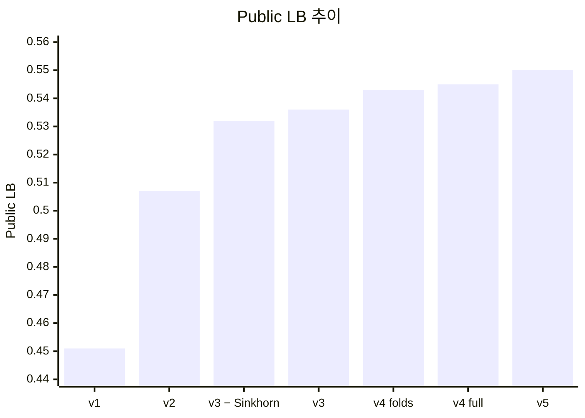
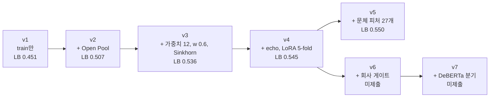

# 5. v1 → v7 변경과 개선 분석

[← 전체 문서](README.md)

v1부터 v7까지 버전마다 무엇을 바꿨고, 그 변경이 검증 점수와 Public LB를 얼마나 움직였는지 정리합니다. Public LB는 v1의 0.451에서 v5의 0.550까지 +0.099 올랐습니다. 그중 절반이 넘는 +0.056이 v2의 Open Pool 도입 하나에서 나왔고, 나머지 +0.043은 여러 변경이 묶여 들어간 세 번의 제출(v3, v4, v5)에 나뉘어 있습니다. 단독 효과를 LB로 분리해 확인한 변경은 Sinkhorn(+0.004)과 테스트 예측 방식(+0.002) 둘뿐이고, 둘 다 크기가 작습니다. v6(회사 게이트)과 v7(DeBERTa 분기)은 아직 제출하지 않았습니다.

모든 버전에 공통인 구조는 이 문서에서 반복하지 않습니다. 데이터는 [01_datasets.md](01_datasets.md), fold 분할은 [02_fold_split.md](02_fold_split.md), 모델 구조는 [03_model_architecture.md](03_model_architecture.md), 실험 방법은 [04_experiment_method.md](04_experiment_method.md)에 있습니다.

> [!IMPORTANT]
> **이 문서는 2026-11-25 02:32 KST 시점(v5까지 제출) 기준입니다.** 그 뒤 v6(Public LB 0.552)과 v7(Public LB 0.556)이 제출됐고, 이 문서의 v6·v7 관련 내용("미제출", 7장의 진행 상태, 4장의 기여 분해)에는 아직 반영되지 않았습니다. 제출 결과는 [EXPERIMENTS.md](../EXPERIMENTS.md)의 실험 6·7에, v7 기준 회사별 혼동 행렬은 [06_company_confusion.md](06_company_confusion.md)에 있습니다.

> [!NOTE]
> **수치 기준**
> - 검증 수치는 따로 적지 않으면 [EXPERIMENTS.md](../EXPERIMENTS.md)와 같은 **제출 커널(Kaggle T4) 로그** 기준입니다.
> - **fold 0**은 프롬프트 30개, 지문 540개인 홀드아웃이고 지문 하나가 BA 약 0.002입니다. **OOF**는 2,699개 전체의 fold 밖 예측이고 지문 하나가 BA 약 0.0004입니다.
> - **옛 풀**은 Open Pool 226,191개 시점(v3, v4), **새 풀**은 231,036개 시점(v5 이후)입니다. 풀이 다른 수치는 서로 직접 비교하지 않습니다.
> - "(추정)"은 측정으로 확인하지 않은 해석입니다.

## 1. 한눈에 보기

| 버전 | 직전 대비 바꾼 것 | n-gram OOF | LoRA 단독 | 블렌드 검증 BA | Public LB | 제출 |
|:-:|---|:-:|:-:|:-:|:-:|:-:|
| [**v1**](../name_that_llm_v1.ipynb) | (출발점) LoRA는 train만으로 학습, n-gram도 train만 | 0.3663 | 0.4278 (fold 0) | 0.4407 (fold 0, `w` = 0.5 선택) | 0.451 | 11/10 |
| [**v2**](../name_that_llm_v2.ipynb) | Open Pool 도입: LoRA Stage 1, n-gram 학습 풀 | 0.4667 | 0.5222 (fold 0) | 0.5444 (fold 0, `w` = 0.5 선택) | 0.507 | 11/10 |
| [**v3**](../name_that_llm_v3.ipynb) | n-gram train 가중치 12, `w` = 0.6 고정, Sinkhorn, LoRA 재학습(풀 갱신) | 0.4745 | 0.5407 (fold 0) | 0.5389 (fold 0) | 0.536 (Sinkhorn 끔 0.532) | 11/17 |
| [**v4**](../name_that_llm_v4.ipynb) | LoRA echo 입력, LoRA 5-fold, 온도·가중치 비교를 OOF로 | 0.4745 | 0.5631 (OOF), 0.5426 (fold 0) | 0.5749 (OOF, 옛 풀), 0.5593 (fold 0) | 0.543 (folds) / 0.545 (full) | 11/17 |
| [**v5**](../name_that_llm_v5.ipynb) | v4 full + n-gram에 문체 피처 27개. 풀도 갱신됨 | 0.4749 (새 풀) | v4 가중치 그대로 | 0.5734 (OOF, 새 풀). 같은 풀 기준선 0.5716 | **0.550** | 11/24 |
| [**v6**](../name_that_llm_v6.ipynb) | v4 + 블렌드 뒤 회사 게이트 | (v4와 같음) | v4 가중치 그대로 | 0.5864 (nested OOF, 옛 풀의 v4 OOF로 로컬 계산) | - | 미제출 |
| [**v7**](../name_that_llm_v7.ipynb) | v6 + DeBERTa-v3-large 세 번째 분기, 3분기 블렌드 | (v6과 같음) | v4 가중치 그대로 | 측정값 없음 (Colab 학습 진행 중, [7장](#7-v6v7의-현재-상태)) | - | 미제출 |

버전은 한 줄로 이어지지 않습니다. v5와 v6은 둘 다 v4에서 갈라졌고, v7은 v6 위에 올렸습니다. 그래서 **v6·v7에는 v5의 문체 블록이 없고, v5에는 게이트가 없습니다.**

## 2. 버전 × 구성요소 변경 매트릭스

직전 버전(계보 기준: v5와 v6은 v4, v7은 v6)에서 **바뀐 칸은 굵게** 적었습니다. "〃"는 왼쪽 칸과 같다는 뜻입니다. 노트북 기본값 기준이고, 제출 때 `CFG`를 덮어쓴 경우는 3장에 적었습니다.

| 구성요소 | v1 | v2 | v3 | v4 | v5 | v6 | v7 |
|---|---|---|---|---|---|---|---|
| Open Pool | 안 씀 | **씀** (223,840개) | **갱신** (226,191개) | 〃 | **갱신** (231,036개) | v4와 같은 코드. 실행 시점의 풀을 읽음 | 〃 (Colab 로그 231,036개) |
| n-gram 학습 데이터 | train | **train + 풀 45,000개** | 〃 | 〃 | 〃 | 〃 | 〃 |
| n-gram train 가중치 | 1 | 1 | **{1, 4, 12} 중 OOF 최고 → 12** | 〃 | 〃 | 〃 | 〃 |
| n-gram 피처 | 4뷰 TF-IDF | 〃 | 〃 | 〃 | **+ 문체 27개 (α = 0.2)** | 4뷰 TF-IDF (v4와 같음) | 〃 |
| LoRA 입력 | 지문 1회 | 〃 | 〃 | **echo (지문 2회, 두 번째만 풀링)** | 〃 | 〃 | 〃 |
| LoRA 학습 | Stage 2만 (lr 2e-4, 4 epochs) | **Stage 1(풀) → Stage 2 (lr 5e-5, 2 epochs)** | 〃 (새 풀로 재학습) | **Stage 1 한 번 → Stage 2를 fold 5개 + 전체** | v4 가중치 재사용 | v4 가중치 재사용 | v4 가중치 재사용 |
| LoRA 검증 | fold 0 홀드아웃 (540개) | 〃 | 〃 | **5-fold OOF (2,699개)** | 〃 | 〃 | 〃 |
| 추가 분기 | - | - | - | - | - | - | **DeBERTa-v3-large (Stage 1 → fold별 Stage 2)** |
| LoRA 온도 선택 | fold 0 NLL | 〃 | 〃 | **OOF NLL** | 〃 | 〃 | 〃 (DeBERTa도 OOF NLL) |
| 블렌드 가중치 | fold 0 BA 최고 (0.5) | 〃 (0.5) | **0.6 고정** | 〃 (비교 표만 OOF로) | 〃 | 〃 | **3분기 가중치를 OOF BA로 선택(0.1 간격) 또는 `blend3`로 고정** |
| 블렌드 뒤 보정 | - | - | - | - | - | **회사 게이트 (입력: n-gram, LoRA)** | **게이트 입력에 DeBERTa 추가** |
| 프롬프트 중심화 | 강도 0.5 | 〃 | 〃 | 〃 | 〃 | 〃 | 〃 |
| Sinkhorn | - | - | **ρ = 0.35 (테스트 200행 이상)** | 〃 | 〃 | 〃 | 〃 |
| 테스트 LoRA 예측 | fold 0을 뺀 모델 1개 | 〃 | 〃 | **fold 5개 평균(`folds`) 또는 전체 학습 1개(`full`)** | **`full`** | **`full`** | `folds` (v7 노트북 기본값) |
| 최종 검증 범위 | fold 0 | 〃 | 〃 | **OOF** (fold 0도 함께 출력) | 〃 | **OOF + nested** | 〃 (블렌드 선택도 nested 출력) |

- n-gram의 온도는 모든 버전에서 n-gram OOF 2,699개의 NLL로 고릅니다. 바뀐 것은 LoRA 쪽 온도뿐입니다.
- v1~v3의 테스트 LoRA는 노트북 코드상 fold 0을 뺀 80%로 학습한 모델입니다(Stage 2를 `fit_idx`로 학습하고 그 모델로 테스트를 예측). n-gram은 모든 버전에서 train 전체로 다시 학습해 테스트를 예측합니다.

## 3. 버전별 변경과 효과

### v1 → v2: Open Pool 도입

**바뀐 것**
- 두 노트북의 코드는 Colab 전용 부분만 다릅니다(준비 셀 cell 6의 내용, 그리고 Colab인지 판별하는 조건문 세 곳). v2는 준비 셀에서 Open Pool을 받고, `NTL_CFG`를 `{"batch_size": 8}`로 줄입니다. v1은 `{"stage2_lr": 2e-4, "stage2_epochs": 4, "stage2_budget_h": 1.0, "batch_size": 8}`로 Stage 2를 처음부터 학습합니다.
- 제출 커널에서는 **입력에 Open Pool 데이터셋을 붙였는지**가 유일한 차이입니다. 풀이 없으면 노트북이 LoRA Stage 1을 건너뛰고 n-gram도 train만으로 학습합니다.
- 풀이 들어오면서 두 분기가 모두 바뀝니다. LoRA는 Stage 1(풀 45,000개, 1 epoch, lr 2e-4) 뒤에 Stage 2(2 epochs, lr 5e-5)로 미세 조정하고, n-gram은 TF-IDF를 풀에 맞추고 풀 45,000개를 학습 행으로 더합니다.

**동기**: 모델당 train 지문이 약 150개뿐이라 데이터가 부족했습니다.

**효과**

| 항목 | v1 | v2 | 변화 |
|---|:-:|:-:|:-:|
| n-gram OOF | 0.3663 | 0.4667 | +0.1004 |
| LoRA fold 0 | 0.4278 | 0.5222 | +0.0944 |
| 블렌드 fold 0 | 0.4407 | 0.5444 | +0.1037 |
| Public LB | 0.451 | 0.507 | **+0.056** |

**얼마나 이 변경 덕인가**: 전체 과정에서 가장 큰 개선이고, 검증과 LB가 같은 방향으로 크게 움직였습니다. 풀 도입 말고 바뀐 것은 Stage 2 설정(lr, epoch 수)뿐인데, 이것은 Stage 1이 생기면서 따라 바뀐 것이라 따로 떼어 볼 변경이 아닙니다. 확신도는 높습니다.

**남은 의문**: LB 상승(+0.056)이 fold 0 상승(+0.104)의 절반쯤입니다. v2의 fold 0 수치는 LoRA 온도와 `w`를 같은 540개로 고른 값이라 낙관적입니다. v2는 검증이 LB보다 0.037 높고, v1은 반대로 LB가 0.010 높습니다. n-gram과 LoRA 중 어느 쪽이 LB에 더 기여했는지는 나눠 제출한 적이 없어 알 수 없습니다.

### v2 → v3: n-gram train 가중치, 블렌드 가중치 고정, Sinkhorn

**바뀐 것** ([EXPERIMENTS.md](../EXPERIMENTS.md) 실험 1, 2)
1. `CFG["ngram_train_weight"] = 1.0`이 `CFG["ngram_train_weights"] = [1.0, 4.0, 12.0]`로 바뀌었습니다. n-gram 셀(cell 16)의 `fit_svc`가 가중치를 인자로 받고, 후보마다 5-fold OOF를 만들어 가장 높은 값을 고릅니다. 결과는 12였습니다.
2. `CFG["blend_w"] = 0.6`이 생겼습니다. `None`이면 예전처럼 홀드아웃 최고값을 고릅니다.
3. Sinkhorn 셀(cell 27)과 `use_sinkhorn`, `sinkhorn_rho`(0.35), `sinkhorn_iters`(10), `sinkhorn_damping`(0.5), `sinkhorn_min_rows`(200)가 생겼습니다. 같은 보정을 홀드아웃 블렌드와 n-gram OOF에 적용해 보는 점검 출력도 이 셀에 있습니다.
4. LoRA 코드는 v2와 같습니다. 다만 Open Pool이 갱신돼(223,840 → 226,191개) 다시 학습했습니다.

**동기**: 가중치가 1이면 n-gram 학습에서 train이 차지하는 몫이 6%도 안 됩니다. `w`는 홀드아웃 최고값을 고르면 실행마다 0.5와 1.0을 오갔습니다. 가중치 상향과 Sinkhorn은 [상위권 조사 보고서](../name_that_llm_high_scorers_report.md) 8장의 권고(2번, 6번)와 같은 내용입니다.

**효과**

| 항목 | v2 | v3 | 변화 |
|---|:-:|:-:|:-:|
| n-gram OOF | 0.4667 (가중치 1) | 0.4745 (가중치 12) | +0.0078 |
| LoRA fold 0 | 0.5222 | 0.5407 | +0.0185 |
| 블렌드 fold 0 | 0.5444 (`w` = 0.5 선택) | 0.5389 (`w` = 0.6 고정) | −0.0055 |
| Public LB | 0.507 | 0.536 | **+0.029** |

- 같은 풀 안에서 가중치만 비교하면 n-gram OOF가 1 → 0.4675, 4 → 0.4697, 12 → 0.4745입니다. 가중치의 효과는 +0.0070이고, 나머지 +0.0008은 풀 갱신 몫입니다.
- Sinkhorn만 끈 제출(실험 2)이 0.532라서, Sinkhorn의 LB 기여는 +0.004이고 나머지 세 변경의 합이 +0.025입니다.

**얼마나 이 변경 덕인가**: Sinkhorn은 한 줄만 바꾼 비교 제출이 있어 분리됩니다. 나머지 +0.025는 n-gram 가중치 12, `w` 고정, 새 LoRA 가중치가 묶여 있어 나눌 수 없습니다.
- LoRA 코드는 그대로인데 fold 0 점수가 지문 10개(+0.0185)만큼 올랐습니다. 풀 갱신으로 Stage 1 표본이 달라진 것과 재학습 자체의 흔들림이 섞여 있습니다(추정). 재학습만으로 fold 0이 이만큼 움직일 수 있다면, v2와 v3의 LB 차이 중 일부는 변경의 효과가 아닐 수 있습니다(추정).

**남은 의문**
- 가중치 12는 후보 중 가장 큰 값입니다. 20, 30은 시험하지 않았습니다.
- 홀드아웃이 떨어졌는데 LB가 오른 이유는 확인하지 못했습니다. v3 홀드아웃의 `w`별 BA는 0.5315~0.5463에서 들쭉날쭉해서, 540개로는 이 크기의 차이를 가릴 수 없다는 것만 분명합니다.

### v3 → v4: echo 입력과 LoRA 5-fold

**바뀐 것** ([EXPERIMENTS.md](../EXPERIMENTS.md) 실험 3, 4)
1. `CFG["echo_input"] = True`. `tokenize_all`이 `지문 + "\n\n" + 지문`을 만들고 두 번째 사본의 시작 위치를 돌려줍니다. 모델의 `forward`가 `pool_mask`를 받아 두 번째 사본만 평균 풀링합니다(cell 18).
2. `CFG["grad_accum"]`이 생겼습니다. 입력이 두 배라 Colab에서 마이크로 배치 4 × 누적 2(실효 배치 8)로 돌립니다.
3. LoRA 실행 셀(cell 19)이 fold 0 홀드아웃에서 5-fold로 바뀌었습니다. `cv_after_stage1`이 Stage 1 가중치를 저장한 뒤 fold마다 그 가중치에서 Stage 2를 다시 학습하고, `cv_from_saved`가 저장된 fold 가중치로 OOF와 테스트 로짓만 계산합니다.
4. `CFG["lora_test"]`가 생겼습니다. `"folds"`는 fold 모델 5개 평균, `"full"`은 train 전체로 Stage 2를 한 번 더 학습한 모델 1개입니다.
5. 블렌드 셀(cell 21)이 LoRA 온도와 `w` 비교 표를 fold 0 대신 OOF 2,699개로 계산합니다. Sinkhorn 점검도 "블렌드 OOF"로 바뀌었습니다.

EXPERIMENTS.md에 없는 변경도 있습니다.
- 가중치 파일 이름이 `ntl_lora.pt` 하나에서 `ntl_lora_fold0.pt` ~ `ntl_lora_fold4.pt`, `ntl_lora_full.pt`, `ntl_lora_stage1.pt`로 바뀌었습니다. 가중치를 읽는 `load_lora`는 저장된 `echo_input`이 현재 설정과 다르면 멈춥니다.
- 비정상 손실이 나왔을 때 v4부터는 그 마이크로 배치만 빼고 누적을 이어 갑니다.
- 노트북의 `ngram_train_weights`는 여전히 `[1, 4, 12]`입니다. 12로 고정한 것이 아니라 매번 OOF로 다시 고르고, 지금까지 매번 12가 뽑혔습니다.

**동기**: Qwen은 causal attention이라 앞 토큰이 뒤 문맥을 보지 못합니다. 지문을 두 번 넣으면 두 번째 사본의 토큰은 지문 전체를 본 상태가 됩니다. 5-fold는 540개 홀드아웃으로 `w`와 온도를 고를 수 없다는 v3의 경험에서 나왔습니다.

**효과**

| 항목 | v3 | v4 | 변화 |
|---|:-:|:-:|:-:|
| LoRA fold 0 | 0.5407 | 0.5426 | +0.0019 (지문 1개) |
| LoRA OOF | - | 0.5631 | |
| 블렌드 fold 0 (`w` = 0.6) | 0.5389 | 0.5593 | +0.0204 |
| 블렌드 OOF (`w` = 0.6) | - | 0.5749 | |
| 블렌드 + Sinkhorn OOF | - | 0.5764 | |
| Public LB | 0.536 | 0.543 (folds) / 0.545 (full) | **+0.007 / +0.009** |

**얼마나 이 변경 덕인가**
- **echo의 효과는 확인되지 않았습니다.** LoRA 단독 fold 0이 v3와 지문 1개 차이이고, Colab L4 학습 때는 두 버전이 0.5426으로 같았습니다. echo를 끈 5-fold 실행이 없어서 OOF로도 비교할 수 없습니다.
- LoRA 단독이 그대로인데 블렌드 fold 0이 0.0204 오른 것은 LoRA 온도를 2,699개로 고른 덕으로 보입니다(추정).
- LB +0.007~0.009에는 테스트 LoRA가 바뀐 효과도 섞여 있습니다. v3까지는 fold 0을 뺀 모델 1개였고, v4는 그런 모델 5개의 평균이거나 train 전체를 본 모델입니다. 이 개선을 echo 덕으로 볼 근거는 약합니다(추정).
- `folds`와 `full`의 LB 차이는 0.002입니다. 온도와 `w`를 같은 OOF에서 정하므로 두 커널의 검증 수치는 같고, 차이는 LB로만 보입니다.

**남은 의문**
- echo는 입력 길이를 두 배로 만들어 학습과 추론 비용을 올립니다. 효과가 없다면 빼는 편이 낫지만, 확인 실행(echo 끈 5-fold)을 아직 하지 않았습니다. v5~v7이 모두 v4의 echo 가중치를 재사용하고 있어서, 이 의문은 뒤 버전에도 그대로 남아 있습니다.
- Kaggle 제출 설명에는 v4의 두 제출 모두 "OOF blend BA 0.5757"로 적혀 있습니다. 저장소의 로그와 문서에는 이 값이 없고(커널 로그 기준 0.5749, Sinkhorn 점검 0.5764), 어디서 나온 값인지 확인하지 못했습니다.

### v4 → v5: n-gram 분기에 문체 피처 27개

**바뀐 것** ([EXPERIMENTS.md](../EXPERIMENTS.md) 실험 5)
- n-gram 셀(cell 16)에 `stylo_feats`, `stylo_raw`, `stylo_block`, `with_stylo`가 들어갔습니다. 4뷰 TF-IDF 행렬 옆에 문체 피처 27개를 이어 붙입니다. `log1p` → fold의 train 지문으로 표준화 → ±4에서 자름 → `α / √27` 곱하기 순서입니다.
- `CFG["stylo_alpha"] = 0.2`(0이면 v4와 같음), `CFG["lora_test"] = "full"`.
- LoRA, 블렌드, 중심화, Sinkhorn 코드는 v4와 같고 LoRA 가중치도 v4 것입니다. v4 → v5 변환은 [v5_stylo/make_v5.py](../v5_stylo/make_v5.py)에 스크립트로 남아 있습니다.
- 코드와 무관하게 **Open Pool이 226,191개에서 231,036개로 갱신**됐습니다.

**동기**: [analysis_intra_org/report.md](../analysis_intra_org/report.md)에서 잘 구분되는 쌍은 구두점, 문장 길이, 기능어 비율 같은 문체 통계의 차이가 뚜렷했습니다. 그 분석에 쓴 27개 피처([analysis_intra_org/features.py](../analysis_intra_org/features.py))를 그대로 n-gram 분기에 넣었습니다.

**효과** (같은 새 풀, 커널 fold 분할 기준)

| 항목 | 새 풀 기준선 (α = 0, 로컬) | v5 (α = 0.2, 커널) | 변화 |
|---|:-:|:-:|:-:|
| n-gram OOF | 0.4690 | 0.4749 | +0.0059 |
| 블렌드 OOF (`w` = 0.6) | 0.5716 | 0.5734 | +0.0018 (지문 5개쯤) |
| 블렌드 OOF (`w` = 0.8) | 0.5775 | 0.5768 | −0.0007 |

| 항목 | v4 full (옛 풀) | v5 (새 풀) | 변화 |
|---|:-:|:-:|:-:|
| Public LB | 0.545 | 0.550 | **+0.005** |

- 로컬에서 α = 0과 0.2를 직접 비교한 bootstrap 95% 구간은 n-gram 단독 [−0.001, +0.014], 블렌드 `w` = 0.6 [−0.003, +0.008]입니다. 둘 다 0을 포함합니다.
- 풀 갱신만의 영향은 n-gram 0.4745 → 0.4690(−0.0055), 블렌드 0.5749 → 0.5716(−0.0033)입니다.

**얼마나 이 변경 덕인가**: n-gram 단독으로는 두 fold 분할에서 모두 +0.006으로 같은 방향입니다. 블렌드에서는 효과가 확인되지 않습니다. LB +0.005에는 문체 블록과 풀 갱신이 함께 들어 있어 나눌 수 없습니다. OOF로는 풀 갱신이 −0.0033, 문체 블록이 +0.0018이라 v5 블렌드가 v4보다 낮아야 하는데 LB는 올랐습니다.

**남은 의문**: 문체 블록만의 LB 효과를 알려면 새 풀에서 α = 0으로 한 번 더 제출해야 합니다. 문체 피처가 n-gram에 더한 정보의 대부분을 LoRA가 이미 갖고 있는 것으로 보입니다(추정).

### v4 → v6: 회사 게이트

**바뀐 것** ([EXPERIMENTS.md](../EXPERIMENTS.md) 실험 6, [analysis_v6/report.md](../analysis_v6/report.md))
- 블렌드 셀 뒤에 "5-1. 회사 게이트" 셀(cell 23)이 들어갔습니다. `CFG["use_gate"]`, `CFG["gate_c"]`(1.0), `CFG["gate_alpha"]`(GPT 0.75, Gemini 0.25, Claude 0.5, GLM 1.0)가 생겼습니다.
- 회사마다 n-gram과 LoRA의 회사 열 log 확률을 입력으로 회사 안 모델을 맞히는 로지스틱 회귀를 학습합니다. 블렌드 1순위가 그 회사 안인 지문만, 회사 확률 합은 그대로 두고 회사 안 분포를 `gate_alpha`만큼 LR 쪽으로 옮깁니다.
- 게이트 뒤에 분석용 OOF를 `oof_v6.npz`로 저장하는 셀(cell 24)이 있습니다. [analysis_v4/oof_v4.npz](../analysis_v4/oof_v4.npz)와 같은 키에 게이트 뒤 log 확률과 지문 id를 더한 파일입니다.
- `CFG["lora_test"]`는 `"full"`입니다(커밋 `e61471d`에서 바꿈).
- v4에서 갈라졌으므로 v5의 문체 블록은 없습니다.

**동기**: v4 OOF 오답 1,147개 중 681개(59%)가 같은 회사 모델끼리 헷갈린 것입니다. 정답 회사를 알려 주면 BA가 0.5749에서 0.694까지 오르므로, 회사 안 구분에 남은 여지가 큽니다.

**효과** (옛 풀의 v4 OOF로 GPU 없이 계산)

| 항목 | v4 | v6 게이트 | 변화 |
|---|:-:|:-:|:-:|
| 블렌드 OOF, α를 fold 밖에서 선택 (nested) | 0.5749 | 0.5864 | +0.0115, 95% 구간 [+0.003, +0.020] |
| 블렌드 OOF, α를 같은 OOF로 선택 (노트북 출력) | 0.5749 | 0.5882 | +0.0133 (낙관적) |
| fold별 BA | 0.5593 / 0.6037 / 0.5889 / 0.5598 / 0.5630 | 0.5852 / 0.6130 / 0.6037 / 0.5653 / 0.5741 | 5개 모두 상승 |
| Public LB | 0.545 (full) | 미제출 | - |

**얼마나 이 변경 덕인가**: 바뀐 것이 셀 하나이고 같은 OOF 위에서 계산했으므로, 검증 수치의 차이는 전부 게이트에서 나옵니다. bootstrap 구간을 잰 변경(문체 피처, Response Corpus, 게이트) 중 구간이 0을 넘은 것은 이것뿐입니다. 다만 LB로는 확인하지 않았습니다.

**남은 의문**
- `gate_alpha`와 C는 옛 풀의 v4 OOF에서 고른 값입니다. 새 풀에서 n-gram이 달라지면 이득의 크기가 달라질 수 있습니다(추정). 게이트의 LR은 커널 안에서 그 커널의 OOF로 다시 학습합니다.
- LR은 OOF 로짓으로 학습하고 테스트 로짓에 적용합니다. 테스트 로짓은 train 전체로 학습한 모델에서 나오므로 OOF와 스케일이 조금 다를 수 있습니다([analysis_v6/report.md](../analysis_v6/report.md)의 한계).
- LoRA와 게이트를 함께 켠 실행은 아직 없습니다.

### v6 → v7: DeBERTa-v3-large 분기

**바뀐 것** (커밋 `4f2251a`, `02a40e0`)
- "4-2. DeBERTa 분류기" 셀 둘(cell 21 정의, cell 22 실행)이 들어갔습니다. DeBERTa-v3-large 전체(약 4.3억 개 파라미터)를 학습합니다. LoRA 분기와 같은 2단계입니다: Stage 1은 Open Pool 45,000개(LoRA와 같은 표본) 1 epoch(lr 2e-5), Stage 2는 fold마다 Stage 1 가중치에서 다시 시작해 2 epochs(lr 1e-5)입니다. 마지막 층 토큰 평균 풀링, 실효 배치 16, 분류 헤드 lr 20배, warmup 10%입니다.
- `CFG`에 `use_deberta`와 `deb_*` 키들(길이, 배치, 풀링, 단계별 lr·epoch·시간 예산, 테스트 방식 등), `blend3`가 생겼습니다.
- 블렌드 셀(cell 24)이 3분기용으로 바뀌었습니다. 가중치 조합을 0.1 간격으로 모두 OOF BA로 비교하고, 같은 실행 안의 비교 기준으로 v6 가중치(LoRA 0.6, DeBERTa 0, n-gram 0.4)의 OOF BA를 함께 출력합니다. `blend3`가 `None`이면 OOF 최고 조합을 고르고, fold 밖에서 고른 nested BA도 출력합니다.
- 게이트 셀(cell 26)의 입력에 DeBERTa의 회사 열 log 확률이 더해졌습니다. `gate_alpha`가 `None`이면 회사마다 OOF 최고값을 고릅니다.
- 세 분기의 OOF 로짓을 `oof_v7.npz`로 저장합니다. v6의 `oof_v6.npz` 저장 셀은 v7에 없습니다.
- `CFG["lora_test"]`는 `"folds"`입니다. v7이 갈라진 시점의 v6 값이고, v6은 그 뒤 `"full"`로 바뀌었습니다.
- Colab 준비 셀이 n-gram 가중치 후보를 `[12.0]`만 쓰도록 덮어씁니다(약 18분 절약). 제출 커널의 기본값은 여전히 `[1, 4, 12]`입니다.
- 커밋 `02a40e0`: 학습(Colab)과 추론(Kaggle)의 transformers 버전이 달라 저장된 토크나이저 설정을 못 읽을 때 `tokenizer.json`을 직접 읽습니다. DeBERTa 구간의 GPU 메모리 최대 사용량도 출력합니다.

**동기**: 양방향 인코더는 causal LLM과 다른 방식으로 문맥을 봅니다. [상위권 조사 보고서](../name_that_llm_high_scorers_report.md)가 "가장 큰 단일 성능 향상"으로 꼽은 것이 backbone 추가와 DeBERTa-v3-large였습니다(8장 1번).

**효과**: 아직 측정값이 없습니다. 진행 상황은 [7장](#7-v6v7의-현재-상태)에 있습니다.

**남은 의문**
- v7 결과는 새 풀 기준이라 v4(0.5749)나 v6 nested(0.5864)와 직접 비교할 수 없습니다. 같은 실행이 출력하는 v6 가중치 줄과 "블렌드 → 게이트" 줄로 비교해야 합니다.
- 분기가 셋이 되면 블렌드 가중치 후보가 66개로 늘어납니다. OOF 최고값을 그대로 쓰면 낙관적이므로 nested BA로 판단해야 합니다.

## 4. 개선 기여 분해

Public LB 0.451 → 0.550의 +0.099를 제출 사이의 차이로 나눴습니다.

| 구간 | LB 변화 | 들어 있는 변경 | 분리 | 확신도 |
|---|:-:|---|:-:|---|
| v1 → v2 | **+0.056** | Open Pool 도입 (LoRA Stage 1, n-gram 풀) | 풀 도입 단독. LoRA와 n-gram 몫은 나눌 수 없음 | 높음. 검증도 +0.10으로 같은 방향 |
| v2 → v3 − Sinkhorn | +0.025 | n-gram 가중치 12, `w` 0.6 고정, 새 풀로 재학습한 LoRA | 묶음. 분리 불가 | 중간. 홀드아웃은 −0.0055로 반대 방향 |
| v3 − Sinkhorn → v3 | +0.004 | Sinkhorn (ρ = 0.35) | **단독** (한 줄만 바꾼 비교 제출) | 낮음. 크기가 작고 검증 이득도 지문 1~4개 |
| v3 → v4 folds | +0.007 | echo, LoRA 5-fold, OOF로 고른 온도, 테스트 = fold 5개 평균 | 묶음. 분리 불가 | 중간. echo 몫은 미확인 |
| v4 folds → v4 full | +0.002 | 테스트 = 전체 학습 모델 1개 | **단독** | 낮음. 검증 수치는 두 제출이 같음 |
| v4 full → v5 | +0.005 | 문체 피처 27개, Open Pool 갱신 | 묶음. 분리 불가 | 낮음. 블렌드 OOF 차이는 오차 범위 |
| 합계 | **+0.099** | | | |

- 전체 개선의 57%가 Open Pool 도입 하나입니다. v3 묶음까지 더하면 82%입니다.
- LB로 단독 효과를 확인한 변경은 Sinkhorn과 테스트 예측 방식 둘뿐이고 합쳐서 +0.006입니다.
- v3 이후의 +0.014(0.536 → 0.550) 중 단독으로 확인된 것은 테스트 방식의 +0.002뿐입니다. echo, 5-fold, 문체 피처는 어느 것도 따로 확인되지 않았습니다.
- LB 0.002~0.005 차이가 얼마나 확실한지는 알 수 없습니다. 숨겨진 테스트는 약 4,000행이고, 그중 Public에 쓰이는 비율은 확인하지 못했습니다. 전부 쓰인다고 해도 지문 하나가 BA 약 0.00025이므로 0.004는 지문 16개쯤입니다(추정).

검증과 LB가 같은 방향이었는지도 구간마다 다릅니다.

| 구간 | 검증 변화 | 검증 기준 | LB 변화 | 방향 |
|---|:-:|---|:-:|:-:|
| v1 → v2 | +0.1037 | 블렌드 fold 0 | +0.056 | 같음 |
| v2 → v3 | −0.0055 | 블렌드 fold 0 | +0.029 | **반대** |
| v3 → v4 | +0.0204 | 블렌드 fold 0 | +0.007 / +0.009 | 같음 |
| v4 → v5 | +0.0018 | 블렌드 OOF (같은 새 풀 기준선 대비) | +0.005 | 같음. 풀 갱신까지 넣으면 0.5749 → 0.5734로 반대 |

## 5. 효과가 없었거나 채택하지 않은 것

**넣었지만 효과가 확인되지 않은 것**

| 시도 | 근거 수치 | 상태 | 출처 |
|---|---|---|---|
| echo 입력 | LoRA fold 0: 0.5407 → 0.5426(지문 1개). L4 학습 때는 둘 다 0.5426 | v4~v7에 켜져 있음. echo 끈 5-fold와 비교한 적 없음 | [EXPERIMENTS.md](../EXPERIMENTS.md) 실험 3 |
| Sinkhorn | LB +0.004. 홀드아웃 +0.0018, v4 OOF +0.0015(0.5749 → 0.5764), v5 OOF 0(0.5734 → 0.5734), 게이트 뒤 0(0.5882 → 0.5882) | v3~v7에 켜져 있음. 손해는 관찰되지 않음 | 실험 2, 3, 5, [analysis_v6/report.md](../analysis_v6/report.md) |
| 문체 피처 27개 | n-gram +0.0059, 블렌드 `w` = 0.6에서 +0.0018, `w` = 0.8에서 −0.0007. 구간이 모두 0 포함 | v5에만 있음 | 실험 5 |

**비교해 보고 채택하지 않은 것**

| 시도 | 결과 | 출처 |
|---|---|---|
| 블렌드 가중치를 홀드아웃 최고값으로 선택 | 실행마다 0.5와 1.0을 오감. v3 홀드아웃 최고는 0.9인데 `w`별 BA가 0.5315~0.5463에서 들쭉날쭉 | 실험 1 |
| 블렌드 가중치를 OOF 최고값(0.8)으로 변경 | 옛 풀 0.5760(0.6은 0.5749), 새 풀 기준선 0.5775(0.6은 0.5716), v5 0.5768(0.6은 0.5734). 0.001~0.006 높지만 0.6으로 유지 | 실험 3, 5 |
| 문체 피처 α를 0.2 말고 다른 값으로 | α = 0.1 / 0.3 / 0.4의 n-gram OOF 0.4738 / 0.4738 / 0.4708(0.2는 0.4756). 차이가 0.002 안이고 fold 분할을 바꾸면 순서가 뒤집힘 | 실험 5 |
| 문체 피처를 분위수 구간 one-hot으로 | train만 OOF 0.3749(연속값 α = 0.3은 0.3826) | 실험 5 |
| 문체 피처 일부만 (구조 10개 / 구두점·어휘 17개) | 0.3801 / 0.3741(27개 전부는 0.3826, 모두 α = 0.3) | 실험 5 |
| 길이 피처(`n_words`, `n_sents`) 제외 | n-gram 0.4756 → 0.4753, 블렌드 `w` = 0.6에서 −0.0011. 풀에만 있는 길이 지름길도 보이지 않음 | 실험 5 |
| 딱딱한 2단계 분류 (회사 먼저 고르기) | OOF 0.567(v4 대비 −0.008). GLM의 회사 단위 recall이 0.44라 첫 단계부터 틀림 | [analysis_v6/report.md](../analysis_v6/report.md) |
| V40A (모든 지문에 잔차, 회사 질량 보존) | nested +0.0004 | 같은 문서 |
| 질량 보존 없는 잔차 (free) | nested −0.0011 | 같은 문서 |
| 게이트 입력을 train 텍스트 TF-IDF 분류기로 | nested +0.0011. 회사 안 정확도 0.35~0.54로 v4 블렌드(0.45~0.82)보다 낮음 | 같은 문서 |
| 게이트 입력에 회사 전용 n-gram SVC 추가 | nested +0.0052, 구간 [−0.004, +0.015]. 넣지 않은 쪽(+0.0115)보다 낮음 | 같은 문서 |
| 게이트 묶음을 회사 대신 혼동 기준으로 (fable-5를 GLM과 묶기) | nested +0.0052 | 같은 문서 |
| 게이트 LR의 C = 0.1 | nested +0.0078(C = 1은 +0.0115) | 같은 문서 |
| 두 모델만 가르는 전용 이진 분류기 | 30쌍 중 29쌍에서 v4 블렌드보다 AUC가 낮음 | [analysis_intra_org/report.md](../analysis_intra_org/report.md) |
| 외부 Response Corpus를 n-gram 학습 풀에 추가 | 블렌드 OOF(`w` = 0.6) 기준선 0.5738 대비 −0.0007 ~ −0.0022(4가지 설정). 구간이 모두 0 포함 | [analysis_corpus/logs/evaluate.log](../analysis_corpus/logs/evaluate.log) |

Response Corpus 실험에서 눈여겨볼 것이 두 가지 있습니다.
- corpus는 대화, 거절, 코딩 응답이라 train과 장르가 다릅니다. 문체 27개로 train과 구별하는 AUC가 0.988이고(Open Pool은 0.696), corpus만으로 학습해 train을 맞히면 BA 0.12입니다. 같은 개수의 Open Pool로는 0.34입니다([analysis_corpus/logs/inspect.log](../analysis_corpus/logs/inspect.log)).
- 대조군으로 **Open Pool을 같은 개수(24,014개)만큼 더 넣은 실행**은 n-gram OOF가 +0.0066(0.4756 → 0.4823), 블렌드 `w` = 0.6이 +0.0015였습니다. 구간이 0을 포함해 확인된 효과는 아니지만, corpus보다는 풀을 더 뽑는 쪽이 나은 방향입니다.

**계획만 있고 실행하지 않은 것**
- 헷갈리는 쌍 손실과 KL 규제: [analysis_intra_org/experiment_plan.md](../analysis_intra_org/experiment_plan.md). 0단계(쌍별 bias)도 돌리지 않았습니다.
- echo를 끈 LoRA 5-fold, n-gram train 가중치 20·30, 새 풀에서 α = 0 제출.
- 상위권 보고서의 권고 중 Adaptive Centered Twins(3번), 묶음 크기에 따른 중심화 강도(5번), 더 큰 backbone(1번의 일부).

## 6. 버전 사이의 분석 작업

| 시기 | 분석 | 알아낸 것 | 다음 버전에 준 영향 |
|---|---|---|---|
| v2 뒤 (추정) | [상위권 조사 보고서](../name_that_llm_high_scorers_report.md) | 공개 상위 솔루션의 구조와 후처리. 8장이 `ngram_train_weight = 1.0`인 노트북(v2 시점의 코드)을 진단하고 6가지를 권고. 저장소에는 11/18에 커밋됨 | 권고 2번(n-gram 가중치 8~12)과 6번(Sinkhorn ρ = 0.35)이 v3의 변경과 같은 내용. 4번(형제 모델 타이브레이커)은 v6에서 V40A와 비교한 뒤 게이트로 채택. 1번(DeBERTa 추가)은 v7 |
| v4 뒤 | [analysis_v4/report.md](../analysis_v4/report.md) | v1~v4를 같은 fold 0으로 비교. 오답의 56~62%가 같은 기업 안. claude-fable-5, glm-5.3, gpt-5.6-terra는 네 버전 모두 recall 0.34 이하. 12개 혼동 쌍 중 10개가 같은 기업 | 회사 안 혼동이 다음 목표가 됨 → analysis_intra_org, v6 |
| v4 뒤 | [stylometric_features.md](../stylometric_features.md) | train에서 상호정보량이 큰 문체 피처 후보(대시, 따옴표, 문장 길이 등)와 추천 21개 | 문체 통계가 모델을 가른다는 근거 → analysis_intra_org의 피처 27개, v5 |
| v4 뒤 | [analysis_intra_org/report.md](../analysis_intra_org/report.md) | 헷갈리는 쌍은 문체 피처로도 차이가 없는 쌍(GLM 두 모델, fable-5와 GLM, gemini-3.7·3.8-flash, gpt-5.6-sol·terra). 전용 분류기도 v4보다 낮음. Open Pool은 모델마다 주제가 쏠려 있음 | 피처 27개 → v5. "새 신호가 아니라 재조합"이라는 v6의 결론과 같은 방향. v5에서 문체 통계를 fold의 train으로만 표준화한 이유. [쌍 손실 계획](../analysis_intra_org/experiment_plan.md) |
| v6 | [analysis_v6/report.md](../analysis_v6/report.md) | 게이트, V40A, free 비교. 회사 전용 SVC는 새 정보를 주지 못함 | `gate_alpha`, C 확정 → v6, v7 |
| v5 뒤 | [analysis_corpus/](../analysis_corpus/) | 외부 Response Corpus는 장르가 달라 도움이 되지 않음 | 넣지 않기로 함 |

- v5 제출 전후의 로컬 비교(α 선택, 새 풀 기준선, 길이 피처, fold 분할 차이)는 [v5_stylo/](../v5_stylo/)에 있습니다.
- 네 분석이 같은 결론으로 모입니다. 틀리는 곳은 같은 회사 안이고, 그중 가장 어려운 쌍은 표면 신호로는 구분되지 않습니다. v5(새 피처)가 블렌드에서 이득이 없고 v6(기존 점수의 재조합)이 이득을 낸 것과 맞습니다.

## 7. v6·v7의 현재 상태

2026-11-25 02:32 KST 기준입니다. Kaggle 제출 이력에는 v5(11/24)까지만 있습니다.

### v6

| 항목 | 상태 |
|---|---|
| 노트북 | [name_that_llm_v6.ipynb](../name_that_llm_v6.ipynb). 게이트 셀과 OOF 저장 셀이 들어 있음 |
| 검증한 범위 | 게이트 셀만 v4 OOF로 실행해 0.5882 재현. `use_lora=false`로 노트북 전체를 CPU에서 실행(게이트는 건너뜀) |
| 하지 않은 것 | LoRA와 게이트를 함께 켠 실행, 새 풀에서의 `gate_alpha` 재확인, 제출 |
| 커널 | 메타데이터 [analysis_v6/kernel/kernel-metadata.json](../analysis_v6/kernel/kernel-metadata.json)(`name-that-llm-v6-gate`)만 저장소에 있음. 커널을 실제로 올렸는지는 확인하지 못함 |
| 재확인 도구 | [analysis_v6/gate2.py](../analysis_v6/gate2.py), [analysis_v6/check_gate.py](../analysis_v6/check_gate.py)가 OOF 경로를 인자로 받음(커밋 `241c956`). 새 풀 커널이 저장한 `oof_v6.npz`를 넣으면 nested ΔBA를 다시 잴 수 있음 |

### v7

v7은 Colab에서 DeBERTa 학습을 시작한 상태입니다. 원본 체크아웃의 `out/v7/colab/`(git 제외)에 로그가 있습니다.

| 항목 | 로그에서 확인한 내용 |
|---|---|
| 실행한 노트북 | `v7_deb.ipynb`. 저장소의 v7 노트북에 `NTL_CFG='{"use_lora": false, "deb_grad_ckpt": true, "deb_stage1_budget_h": 3.5}'`를 주고, Stage 1 체크포인트 저장·이어 하기와 fold 분할 점검 출력을 더한 변형 |
| 시작 | 11/25 02:09 KST (`gpu.log` 첫 줄 17:09 UTC) |
| 데이터 | train 2,699개, Open Pool 231,036개 |
| fold 분할 | "StratifiedGroupKFold가 Kaggle 커널 분할과 같은가: True", scikit-learn 1.6.1 |
| LoRA | **건너뜀** (`use_lora: false`, `LoRA 실행=False`) |
| DeBERTa | 파라미터 434,030,610개 전부 학습, 연산 정밀도 `torch.float32`, 평균 풀링 |
| Stage 1 진행 | 486 / 2,813 스텝, loss 2.028, 20.7분 경과(02:32 기준). 140스텝 때 loss 2.663 |
| GPU | 메모리 약 8.7GB 사용, 사용률 98~100% |
| 체크포인트 | 246스텝과 486스텝에서 저장됨. 02:24에 하나를 서버로 받아 둠(`deb-stage1_ckpt.pt`, 868MB, `fetch.log`). 시각으로 보면 246스텝 것(추정) |
| 받아 둔 산출물 | `ntl_deb_base/`(토크나이저, config) |

- 연산 정밀도가 bf16이 아니라 fp32입니다. 노트북은 GPU가 bf16을 지원할 때만 autocast를 켜므로, 계획한 L4가 아닌 T4급 GPU에서 돌고 있는 것으로 보입니다(추정).
- 지금 속도면 Stage 1이 2시간쯤 걸립니다(2,813스텝 × 20.7분 / 486스텝, 추정). 그 뒤 fold 5개와 전체 학습의 Stage 2가 남아 있습니다.
- **아직 없는 것**: DeBERTa OOF 점수, `ntl_deb_oof.npz`, `ntl_deb_full.pt`, Kaggle 데이터셋 `ntl-deberta-v7`, 제출 커널 실행. 이 Colab 실행은 LoRA를 껐으므로 3분기 블렌드와 3분기 게이트는 이 실행에서 돌지 않습니다. 세 분기를 함께 쓰는 첫 실행은 제출 커널이 됩니다.
- 커널 메타데이터는 원본 체크아웃의 `analysis_v7/kernel/kernel-metadata.json`(`name-that-llm-v7-deberta`)에 있고, 아직 커밋되지 않았습니다.

## 8. 전체에서 배운 점

**1. 가장 큰 개선은 데이터에서 나왔습니다.** Open Pool 도입이 LB +0.056으로 전체의 57%입니다. 그 뒤의 구조·후처리 변경은 한 번에 +0.004~0.025였습니다.

**2. 540개 홀드아웃은 0.01 아래의 차이를 가리지 못했습니다.** v3는 홀드아웃이 0.0055 떨어졌는데 LB는 0.029 올랐습니다. 홀드아웃에서 `w`별 BA는 0.53~0.55 사이를 오갔고, 최고값은 실행마다 바뀌었습니다. v2는 온도와 `w`를 같은 540개로 고른 탓에 검증이 LB보다 0.037 높았습니다. v4에서 LoRA를 5-fold로 바꾼 뒤에야 `w`별 BA 곡선이 매끄러워졌고(0.6~0.8이 거의 같음), 온도를 2,699개로 고를 수 있게 됐습니다.

**3. OOF로 가릴 수 있는 차이도 0.005쯤입니다.** fold 분할만 바꿔도 n-gram OOF가 0.005~0.006 움직였습니다. 문체 피처의 블렌드 효과 +0.0018, Response Corpus의 −0.0007 ~ −0.0022, α 사이의 0.002는 모두 이 아래입니다. 구간이 0을 넘은 변경은 회사 게이트(+0.0115, [+0.003, +0.020])뿐입니다.

**4. 같은 코드와 같은 시드가 같은 fold를 보장하지 않았습니다.** `StratifiedGroupKFold(shuffle=True, random_state=42)`가 로컬(scikit-learn 1.9.1)과 제출 커널에서 다른 분할을 냈습니다. 처음에는 로컬 분할로 잰 기준선을 커널 분할로 잰 v5와 비교해 효과가 두 배(+0.0108)로 보였습니다. 그 뒤로는 [analysis_v4/oof_v4.npz](../analysis_v4/oof_v4.npz)에 저장된 커널의 `fold`를 쓰고, v7 Colab 실행은 분할이 커널과 같은지부터 출력합니다. 자세한 내용은 [02_fold_split.md](02_fold_split.md)에 있습니다.

**5. 외부 데이터가 갱신되면 기준선이 움직입니다.** Open Pool은 223,840 → 226,191 → 231,036개로 두 번 바뀌었습니다. 두 번째 갱신만으로 같은 코드의 n-gram OOF가 −0.0055, 블렌드가 −0.0033 움직였습니다. 버전 사이의 비교에는 매번 같은 풀로 다시 잰 기준선이 필요했습니다. v5의 LB +0.005가 문체 블록 덕인지 풀 갱신 덕인지 나눌 수 없는 것도 이 때문입니다.

**6. 한 번에 하나씩 바꾼 제출만 원인을 알려 줍니다.** v3는 네 가지, v4는 네 가지, v5는 두 가지가 한 제출에 들어갔습니다. 단독으로 확인된 것은 비교 제출을 따로 낸 Sinkhorn(+0.004)과 테스트 방식(+0.002)뿐입니다. echo는 v4의 핵심 변경이었지만 효과를 확인하지 못한 채 v5~v7이 모두 그 가중치 위에 서 있습니다.

**7. 이득은 새 신호보다 기존 신호의 재조합에서 나왔습니다.** v4 이후 검증에서 가장 큰 개선은 회사 게이트이고, 게이트는 이미 있는 n-gram과 LoRA 점수를 회사마다 다르게 다시 섞는 것입니다. 반대로 새 정보를 넣으려던 시도는 블렌드에서 이득이 없었습니다: 문체 피처(+0.0018), 회사 전용 n-gram SVC(게이트 이득이 +0.0115에서 +0.0052로 줄어듦), 쌍 전용 분류기(30쌍 중 29쌍에서 v4보다 낮음), Response Corpus. 표면 통계로 얻을 수 있는 신호는 두 분기가 이미 대부분 쓰고 있는 것으로 보입니다(추정). v7의 DeBERTa는 이 가설을 다른 종류의 모델로 시험하는 셈입니다.

**8. 틀리는 곳은 처음부터 끝까지 같았습니다.** 오답 중 같은 회사 안의 비율은 v1~v4 모두 56~62%이고, claude-fable-5, glm-5.3, gpt-5.6-terra는 네 버전 모두 recall 0.34 이하입니다. 전체 점수는 올랐지만 어려운 모델의 순서는 바뀌지 않았습니다.

**9. 고정한 값이 최적이 아닌 채 남아 있습니다.** `w` = 0.6은 v3의 540개 홀드아웃이 불안정해서 고정한 값입니다. OOF로는 옛 풀과 새 풀 모두 0.8이 최고이고 0.6보다 0.001~0.006 높습니다. n-gram train 가중치 12도 후보의 끝 값입니다. 둘 다 LB로 비교한 적은 없습니다.

**10. 상위권과의 거리는 아직 설명하지 못했습니다.** [상위권 조사 보고서](../name_that_llm_high_scorers_report.md)는 지금과 비슷한 구성(Open Pool + 2단계 LoRA + 4뷰 TF-IDF + 중심화)의 점수대를 0.66~0.684로, Public LB 1위를 0.771로 적고 있습니다. 지금 최고점은 0.550입니다. 보고서의 점수대는 토론과 공개 노트북에서 모은 값이라 같은 조건인지 확인하지 못했고, 이 차이가 어디서 오는지(backbone 크기, 풀 사용량, 학습량 등) 분석한 기록도 없습니다.
