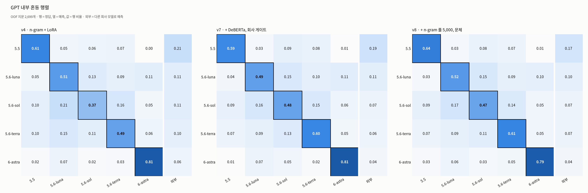
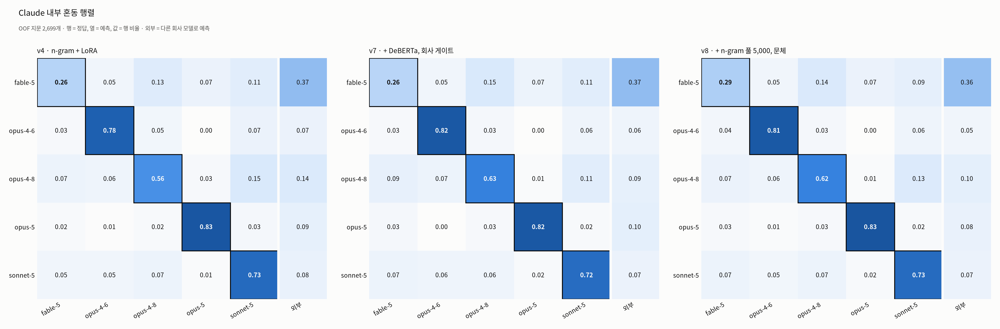

# 6. 회사별 혼동 행렬 (v4, v7, v8)

[← 전체 문서](README.md)

v4 때 [analysis_v4/report.md](../analysis_v4/report.md)에서 그렸던 회사(기업) 내부 혼동 행렬을, 제출한 버전 중 셋(v4, v7, 최신 v8)에 대해 같은 기준으로 다시 그려 나란히 놓았습니다. 전체 BA는 0.5749 → 0.5886 → 0.6023으로 올랐지만 **오답의 60%가 같은 회사 안에서 나는 구조는 그대로**입니다.

- **v4 → v7**: GPT 5.6의 sol·terra, glm-5.3-flash, claude-opus-4-8이 올랐습니다. 회사 게이트가 겨냥한 회사 안 쏠림 오답입니다.
- **v7 → v8**: n-gram 분기만 바꿨는데 gemini-3.6-flash, gpt-5.5, claude-fable-5가 올랐습니다. v7까지 움직이지 않던 Gemini가 처음 나아졌습니다.
- **그대로인 곳**: claude-fable-5와 GLM 두 모델은 회사 경계를 넘어 서로 섞이고, Gemini의 3.7-flash와 3.8-flash는 여전히 서로 헷갈립니다.

> [!NOTE]
> **기준**
> - 세 버전 모두 **OOF 2,699개**(모델당 150개, `claude-fable-5`만 149개)의 fold 밖 예측입니다. 지문 하나가 모델 recall 0.0067입니다. v4 보고서는 fold 0의 540개(모델당 30개)로 그렸으므로, 같은 v4라도 이 문서의 수치와 다릅니다.
> - v4는 n-gram + LoRA 블렌드(`w` = 0.6), v7·v8은 3분기 블렌드(LoRA 0.6, DeBERTa 0.2, n-gram 0.2) 뒤에 회사 게이트를 적용한 예측입니다. 셋 다 Sinkhorn을 적용하기 전의 argmax입니다.
> - v4는 옛 Open Pool(226,191개), v7·v8은 새 풀(231,036개)에서 n-gram을 학습했습니다. v4와 v7의 차이에는 풀 갱신도 섞여 있습니다. v7과 v8은 같은 풀, 같은 LoRA·DeBERTa 가중치, 같은 블렌드 가중치와 게이트 α이고 n-gram 분기만 다릅니다.
> - v7·v8 예측은 제출 커널이 저장한 OOF 로짓([analysis_v7/oof_v7.npz](../analysis_v7/oof_v7.npz), [analysis_v8/oof_v8.npz](../analysis_v8/oof_v8.npz))에 각 노트북의 블렌드 셀과 게이트 셀을 로컬에서 그대로 실행해 만들었습니다. v8은 커널 로그와 같고(블렌드 0.5982, 게이트 뒤 0.6023), v7은 블렌드가 같고 게이트 뒤가 0.5886으로 커널 로그의 0.5882와 **지문 1개가 다릅니다.** 게이트의 로지스틱 회귀가 환경에 따라 조금 다르게 수렴한 것으로 보입니다(추정).

## 1. 한눈에 보기

| | v4 | v7 | v8 |
|---|:-:|:-:|:-:|
| OOF BA | 0.5749 | 0.5886 | **0.6023** |
| 오답 | 1,147개 | 1,110개 | 1,073개 |
| 오답 중 같은 회사의 다른 모델로 틀린 것 | 681개 (59.4%) | 671개 (60.5%) | 644개 (60.0%) |
| 오답 중 다른 회사 모델로 틀린 것 | 466개 | 439개 | 429개 |
| claude-fable-5 → GLM 두 모델 | 0.295 | 0.329 | 0.315 |
| GLM 두 모델 → claude-fable-5 | 0.147 | 0.167 | 0.177 |

- v4 → v7에서 예측이 바뀐 지문은 474개(v7만 맞힘 171, v4만 맞힘 134), v7 → v8에서는 234개(v8만 맞힘 96, v7만 맞힘 59)입니다.
- 두 구간 모두 fold 5개 모두에서 올랐습니다. v7 → v8은 fold별 +0.002 ~ +0.026입니다.
- 오답이 줄어든 만큼 같은 회사 오답과 다른 회사 오답이 비슷한 비율로 함께 줄어서, 같은 회사의 비율은 60% 근처에 머뭅니다.

회사 단위로 보면 다음과 같습니다. "회사 적중"은 정답 회사의 모델 중 하나로 예측한 비율이고, "회사 안 적중"은 회사를 맞혔을 때 모델까지 맞힌 비율입니다.

| 회사 | 모델 수 | 지문 | 회사 적중 v4 → v7 → v8 | 회사 안 적중 v4 → v7 → v8 | 찍을 때 |
|---|:-:|:-:|:-:|:-:|:-:|
| GPT | 5 | 750 | 0.880 → 0.907 → **0.911** | 0.632 → 0.657 → **0.666** | 0.20 |
| Gemini | 4 | 600 | 0.985 → 0.985 → 0.988 | 0.648 → 0.628 → **0.659** | 0.25 |
| Claude | 5 | 749 | 0.849 → 0.861 → **0.868** | 0.745 → 0.753 → **0.757** | 0.20 |
| GLM | 2 | 300 | 0.523 → 0.507 → 0.507 | 0.567 → 0.612 → **0.632** | 0.50 |
| Qwen | 1 | 150 | 0.780 → 0.787 → 0.793 | - | - |
| Kimi | 1 | 150 | 0.480 → 0.493 → 0.487 | - | - |

- GPT와 Claude는 회사 적중과 회사 안 적중이 두 구간 모두 조금씩 올랐습니다.
- Gemini는 회사를 거의 다 맞히고(0.988), 회사 안 적중이 v7에서 내려갔다가 v8에서 v4보다 높아졌습니다.
- GLM은 지문의 절반이 다른 회사로 새는 것이 세 버전 내내 그대로입니다. 남은 절반 안에서는 두 모델을 가르는 비율이 0.567 → 0.632로 올랐습니다.

## 2. 회사별 혼동 행렬

행은 정답, 열은 예측입니다. 값은 행 비율이고, 테두리 친 칸이 정답(대각)입니다. '외부'는 다른 회사 모델로 예측한 비율입니다. 왼쪽부터 v4, v7, v8입니다.

### GPT

- **v4 → v7에서 가장 많이 나아진 회사입니다.** sol이 0.37 → 0.48, terra가 0.49 → 0.60으로 각각 지문 17개씩 올랐고, v8에서도 그 수준(0.47, 0.61)을 지켰습니다. 회사 게이트의 가장 큰 이득이 이 두 모델이라는 [analysis_v6/report.md](../analysis_v6/report.md)의 결과와 같습니다.
- luna로 쏠리던 오답이 줄었습니다. sol → luna가 0.21 → 0.16 → 0.17, terra → luna가 0.15 → 0.09 → 0.09입니다.
- 5.6 세 모델(luna, sol, terra)이 서로 섞이는 모양은 남아 있습니다. 세 모델끼리 주고받는 비율이 v8에서도 0.09 ~ 0.17입니다.
- 5.5는 v8에서 0.59 → 0.64로 올랐고, 외부로 새는 비율이 0.21 → 0.19 → 0.17로 줄었습니다. 행선지는 kimi-k3와 qwen3.8-max입니다. 반대 방향으로 kimi-k3 → gpt-5.5는 0.13 → 0.14 → 0.15로 늘었습니다.
- 6-astra는 세 버전 모두 0.79 ~ 0.81로 잘 분리됩니다.

### Gemini

- **v4 → v7에서는 나아진 것이 없었고, v8에서 처음 움직였습니다.** v7에서는 네 모델의 recall이 모두 같거나 내려갔습니다. v8에서는 3.6-flash가 0.67 → 0.74, 3.1-pro-preview가 0.81 → 0.84, 3.8-flash가 0.59 → 0.61로 올랐습니다. n-gram 분기의 풀 표본을 늘린 효과로 보입니다(실험 8의 라벨별 표에서 n-gram 단독 recall이 3.6-flash +0.093, 3.8-flash +0.107).
- 3.7-flash와 3.8-flash는 세 버전 모두 서로 섞입니다. 3.7 → 3.8이 0.37 → 0.33 → 0.33, 3.8 → 3.7이 0.23 → 0.27 → 0.22입니다. 3.7-flash는 정답(0.42)과 3.8-flash로 가는 비율(0.33)이 크게 다르지 않습니다.
- 3.7-flash는 v8에서도 0.42로 제자리입니다. 풀에 이 모델 지문이 3,541개뿐이라, 다른 Gemini 모델의 표본만 늘어난 v8의 n-gram에서는 오히려 밀렸고(n-gram 단독 0.413 → 0.373), 게이트까지 거쳐 v7과 비슷해졌습니다.
- 외부로는 거의 새지 않습니다(네 모델 모두 0.02 이하).

### Claude

- opus-4-8이 v4 → v7에서 0.56 → 0.63으로 지문 10개만큼 올랐고 v8에서 0.62입니다. sonnet-5로 가던 오답(0.15 → 0.11 → 0.13)과 외부로 새던 오답(0.14 → 0.09 → 0.10)이 함께 줄었습니다.
- opus-4-6(0.81), opus-5(0.83), sonnet-5(0.73)는 세 버전 모두 잘 구분됩니다.
- **fable-5는 0.26 → 0.26 → 0.29로 거의 그대로입니다.** v8에서 지문 5개가 늘었지만 18개 모델 중 여전히 glm-5.3 다음으로 낮습니다. 외부로 0.36이 새고, 행선지는 glm-5.3-flash(0.18)와 glm-5.3(0.13)입니다.
- fable-5의 회사 안 오답은 opus-4-8(0.14)과 sonnet-5(0.09)로 갑니다.

### GLM

- 두 모델의 recall이 반대로 움직였습니다. glm-5.3-flash는 0.33 → 0.40 → 0.40으로 올랐고, glm-5.3은 0.27 → 0.22 → 0.24로 내려갔습니다. 게이트가 GLM 안의 분포를 flash 쪽으로 옮긴 결과입니다(GLM의 `gate_alpha`는 1.0).
- **외부로 새는 비율이 절반입니다**(v8: glm-5.3 0.53, glm-5.3-flash 0.46). 세 버전 내내 줄지 않았습니다. 게이트는 블렌드 1순위가 그 회사 안일 때만 작동하므로, 다른 회사로 간 지문은 건드리지 못합니다.
- 새는 곳은 Claude입니다. v8에서 glm-5.3 → claude-fable-5가 0.19, glm-5.3-flash → claude-fable-5가 0.16입니다. fable-5 쪽에서도 GLM으로 0.32가 오므로, 이 세 모델은 회사가 달라도 한 묶음처럼 섞입니다.

## 3. 가장 많이 헷갈린 쌍

정답 모델의 지문이 다른 모델로 예측된 비율이 높은 순서입니다. v4와 v7은 12위와 13위 사이에 동점이 없고, v8은 12위와 13위가 0.140으로 같습니다(13위는 glm-5.3-flash → glm-5.3).

| 순위 | v4 (정답 → 예측) | 비율 | v7 (정답 → 예측) | 비율 | v8 (정답 → 예측) | 비율 |
|:-:|---|:-:|---|:-:|---|:-:|
| 1 | gemini-3.7-flash → gemini-3.8-flash | 0.367 | gemini-3.7-flash → gemini-3.8-flash | 0.327 | gemini-3.7-flash → gemini-3.8-flash | 0.327 |
| 2 | glm-5.3-flash → glm-5.3 | 0.227 | glm-5.3 → glm-5.3-flash | 0.267 | glm-5.3 → glm-5.3-flash | 0.233 |
| 3 | glm-5.3 → glm-5.3-flash | 0.227 | gemini-3.8-flash → gemini-3.7-flash | 0.267 | gemini-3.8-flash → gemini-3.7-flash | 0.220 |
| 4 | gemini-3.8-flash → gemini-3.7-flash | 0.227 | **claude-fable-5 → glm-5.3-flash** | 0.215 | **glm-5.3 → claude-fable-5** | 0.193 |
| 5 | gpt-5.6-sol → gpt-5.6-luna | 0.213 | gemini-3.7-flash → gemini-3.6-flash | 0.193 | **claude-fable-5 → glm-5.3-flash** | 0.181 |
| 6 | **claude-fable-5 → glm-5.3-flash** | 0.168 | **glm-5.3 → claude-fable-5** | 0.173 | gemini-3.7-flash → gemini-3.6-flash | 0.180 |
| 7 | gpt-5.6-sol → gpt-5.6-terra | 0.160 | gpt-5.6-sol → gpt-5.6-luna | 0.160 | gpt-5.6-sol → gpt-5.6-luna | 0.173 |
| 8 | gemini-3.7-flash → gemini-3.6-flash | 0.160 | **glm-5.3-flash → claude-fable-5** | 0.160 | **glm-5.3-flash → claude-fable-5** | 0.160 |
| 9 | gpt-5.6-terra → gpt-5.6-luna | 0.147 | claude-fable-5 → claude-opus-4-8 | 0.148 | **kimi-k3 → gpt-5.5** | 0.153 |
| 10 | **glm-5.3-flash → claude-fable-5** | 0.147 | gpt-5.6-sol → gpt-5.6-terra | 0.147 | gpt-5.6-luna → gpt-5.6-sol | 0.153 |
| 11 | **glm-5.3 → claude-fable-5** | 0.147 | gpt-5.6-luna → gpt-5.6-sol | 0.147 | claude-fable-5 → claude-opus-4-8 | 0.141 |
| 12 | claude-opus-4-8 → claude-sonnet-5 | 0.147 | **kimi-k3 → gpt-5.5** | 0.140 | gpt-5.6-sol → gpt-5.6-terra | 0.140 |

- 굵게 적은 쌍이 회사가 다른 쌍입니다. v4는 12개 중 3개, v7과 v8은 4개입니다. kimi-k3 → gpt-5.5 말고는 모두 claude-fable-5와 GLM 사이입니다.
- 1위는 세 버전 모두 gemini-3.7-flash → gemini-3.8-flash입니다.
- v8에서는 fable-5 ↔ GLM 쌍 세 개가 모두 8위 안에 있습니다. 다른 쌍이 줄어드는 동안 이 쌍들은 줄지 않아서 순위가 올라왔습니다.

## 4. 모델별 recall

v8 recall이 낮은 순서입니다. 괄호는 지문 수 변화입니다(모델당 150개).

| 모델 | v4 | v7 | v8 | v4 → v8 |
|---|:-:|:-:|:-:|:-:|
| glm-5.3 | 0.267 | 0.220 | 0.240 | −0.027 (−4개) |
| claude-fable-5 | 0.262 | 0.255 | 0.289 | +0.027 (+4개) |
| glm-5.3-flash | 0.327 | 0.400 | 0.400 | +0.073 (+11개) |
| gemini-3.7-flash | 0.407 | 0.407 | 0.420 | +0.013 (+2개) |
| gpt-5.6-sol | 0.367 | 0.480 | 0.473 | **+0.107 (+16개)** |
| kimi-k3 | 0.480 | 0.493 | 0.487 | +0.007 (+1개) |
| gpt-5.6-luna | 0.513 | 0.493 | 0.520 | +0.007 (+1개) |
| gemini-3.8-flash | 0.627 | 0.587 | 0.607 | −0.020 (−3개) |
| gpt-5.6-terra | 0.487 | 0.600 | 0.607 | **+0.120 (+18개)** |
| claude-opus-4-8 | 0.560 | 0.627 | 0.620 | +0.060 (+9개) |
| gpt-5.5 | 0.607 | 0.593 | 0.640 | +0.033 (+5개) |
| claude-sonnet-5 | 0.733 | 0.720 | 0.727 | −0.007 (−1개) |
| gemini-3.6-flash | 0.673 | 0.667 | 0.740 | +0.067 (+10개) |
| gpt-6-astra | 0.807 | 0.813 | 0.793 | −0.013 (−2개) |
| qwen3.8-max | 0.780 | 0.787 | 0.793 | +0.013 (+2개) |
| claude-opus-4-6 | 0.780 | 0.820 | 0.813 | +0.033 (+5개) |
| claude-opus-5 | 0.827 | 0.820 | 0.833 | +0.007 (+1개) |
| gemini-3.1-pro-preview | 0.847 | 0.813 | 0.840 | −0.007 (−1개) |

- **v4 → v7** (+37개): sol, terra, glm-5.3-flash, opus-4-8 네 모델이 +55개였고 나머지 14개 모델은 합쳐서 −18개였습니다.
- **v7 → v8** (+37개): gemini-3.6-flash(+11), gpt-5.5(+7), claude-fable-5(+5), gpt-5.6-luna와 gemini-3.1-pro-preview(각 +4)가 올랐습니다. 내려간 모델은 6-astra(−3) 등 5개이고 폭은 3개 이하입니다. v4 → v7에서 오른 네 모델은 v8에서 그대로입니다.
- 하위 세 모델(glm-5.3, claude-fable-5, glm-5.3-flash)은 세 버전 내내 같습니다. 셋 다 fable-5 ↔ GLM 묶음입니다.

## 5. 정리

- **게이트(v6)와 DeBERTa(v7)가 고친 것**은 회사 안에서 한쪽으로 쏠리던 오답입니다. GPT 5.6의 sol·terra가 luna로, glm-5.3-flash가 glm-5.3으로, opus-4-8이 sonnet-5로 가던 오답이 줄었습니다.
- **n-gram 풀 표본(v8)이 고친 것**은 Gemini(3.6-flash, 3.1-pro-preview)와 gpt-5.5입니다. 같은 회사 안 오답과 다른 회사 오답이 비슷하게 줄었습니다.
- **세 버전 내내 그대로인 것은 두 가지입니다.**
  - claude-fable-5와 GLM 두 모델: 회사 경계를 넘어 서로 섞입니다. 하위 세 모델이 모두 이 묶음이고, v8에서는 이 쌍들이 헷갈린 쌍 순위의 위쪽으로 올라왔습니다. 게이트는 회사 안에서만 작동하므로 이 오답에는 손을 대지 못합니다. 이 묶음을 가르기 위한 외부 데이터 수집 계획이 [외부데이터_수집.md](외부데이터_수집.md)에 있습니다.
  - gemini-3.7-flash와 3.8-flash: 서로 0.2 ~ 0.33씩 주고받습니다. 3.7-flash는 풀 지문이 가장 적은 라벨이라 풀 표본을 늘리는 방법으로는 나아지지 않았습니다.
- v4와 v7·v8 사이에는 풀 갱신도 섞여 있어서, 어느 변경이 어느 칸을 움직였는지는 이 문서만으로 나눌 수 없습니다. v7과 v8 사이는 n-gram 분기만 다르므로 그 구간의 변화는 n-gram 분기에서 온 것입니다. 버전별 변경은 [5. v1 → v9 변경과 개선 분석](05_version_history.md)에 있습니다.

## 6. 파일

- [analysis_confusion/plot_confusion.py](../analysis_confusion/plot_confusion.py): 그림 4장을 그리고, 이 문서의 수치를 모두 출력합니다. `python analysis_confusion/plot_confusion.py`
- [analysis_confusion/run.log](../analysis_confusion/run.log): 위 실행의 출력(재현 확인, 회사 단위 수치, 모델별 recall, 헷갈린 쌍, 혼동 행렬 값)
- [analysis_confusion/figures/](../analysis_confusion/figures/): `cm_gpt.png`, `cm_gemini.png`, `cm_claude.png`, `cm_glm.png`
- 입력: [analysis_v4/oof_v4.npz](../analysis_v4/oof_v4.npz)(v4 블렌드 예측과 커널 fold), [analysis_v7/oof_v7.npz](../analysis_v7/oof_v7.npz)·[analysis_v8/oof_v8.npz](../analysis_v8/oof_v8.npz)(세 분기의 OOF 로짓), [name_that_llm_v7.ipynb](../name_that_llm_v7.ipynb)·[name_that_llm_v8.ipynb](../name_that_llm_v8.ipynb)(블렌드 셀, 게이트 셀)
- v4 때의 원래 그림(fold 0, 540개): [analysis_v4/report.md](../analysis_v4/report.md)의 "기업 내부 혼동 행렬"
- v9는 LoRA OOF가 나오면 같은 스크립트에 추가합니다.
