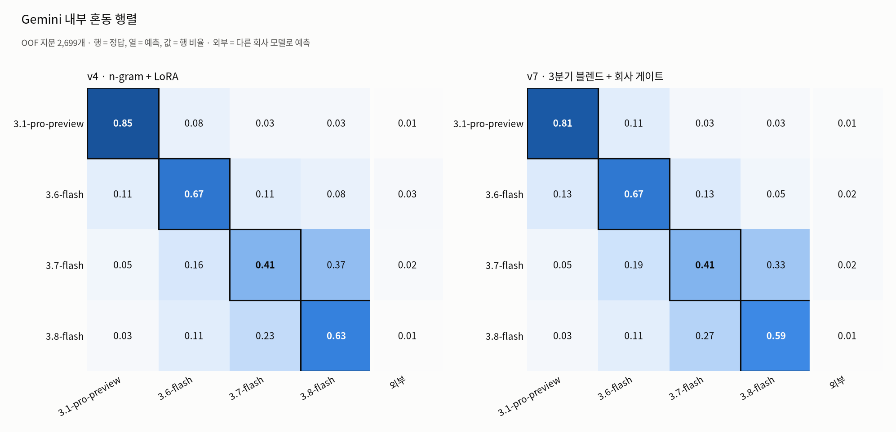
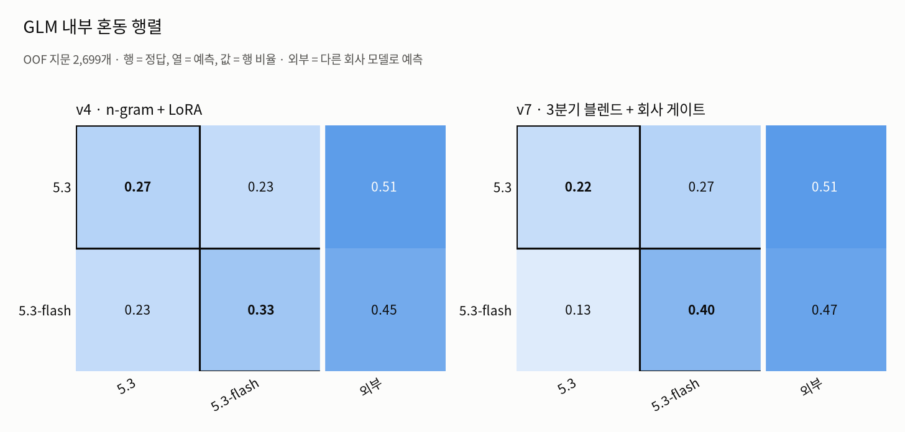

# 6. 회사별 혼동 행렬 (v4와 v7)

[← 전체 문서](README.md)

v4 때 [analysis_v4/report.md](../analysis_v4/report.md)에서 그렸던 회사(기업) 내부 혼동 행렬을, 가장 최근에 제출한 v7(Public LB 0.556) 기준으로 다시 그렸습니다. 비교할 수 있게 v4도 같은 기준으로 다시 그려 나란히 놓았습니다. 전체 BA는 0.5749에서 0.5886으로 올랐지만 **오답의 60%가 같은 회사 안에서 나는 구조는 그대로**입니다. 나아진 곳은 GPT 5.6의 sol·terra, glm-5.3-flash, claude-opus-4-8이고, Gemini 네 모델과 claude-fable-5, glm-5.3은 v4와 같거나 조금 나빠졌습니다.

> [!NOTE]
> **기준**
> - 두 버전 모두 **OOF 2,699개**(모델당 150개, `claude-fable-5`만 149개)의 fold 밖 예측입니다. 지문 하나가 모델 recall 0.0067입니다. v4 보고서는 fold 0의 540개(모델당 30개)로 그렸으므로, 같은 v4라도 이 문서의 수치와 다릅니다.
> - v4는 n-gram + LoRA 블렌드(`w` = 0.6), v7은 3분기 블렌드(LoRA 0.6, DeBERTa 0.2, n-gram 0.2) 뒤에 회사 게이트를 적용한 예측입니다. 둘 다 Sinkhorn을 적용하기 전의 argmax입니다.
> - v4는 옛 Open Pool(226,191개), v7은 새 풀(231,036개)에서 n-gram을 학습했습니다. 두 버전의 차이에는 풀 갱신도 섞여 있습니다.
> - v7 예측은 제출 커널이 저장한 OOF 로짓([analysis_v7/oof_v7.npz](../analysis_v7/oof_v7.npz))에 v7 노트북의 블렌드 셀과 게이트 셀을 로컬에서 그대로 실행해 만들었습니다. 블렌드 OOF BA는 커널 로그와 같고(0.5868), 게이트 뒤는 0.5886으로 커널 로그의 0.5882와 **지문 1개가 다릅니다.** 게이트의 로지스틱 회귀가 환경에 따라 조금 다르게 수렴한 것으로 보입니다(추정).

## 1. 한눈에 보기

| | v4 | v7 | 변화 |
|---|:-:|:-:|:-:|
| OOF BA | 0.5749 | 0.5886 | +0.0137 |
| 오답 | 1,147개 | 1,110개 | −37개 |
| 오답 중 같은 회사의 다른 모델로 틀린 것 | 681개 (59.4%) | 671개 (60.5%) | −10개 |
| 오답 중 다른 회사 모델로 틀린 것 | 466개 | 439개 | −27개 |

- 예측이 바뀐 지문은 474개입니다. v7만 맞힌 지문이 171개, v4만 맞힌 지문이 134개입니다.
- fold 5개 모두에서 올랐습니다(fold별 +0.011 ~ +0.020).

회사 단위로 보면 다음과 같습니다. "회사 적중"은 정답 회사의 모델 중 하나로 예측한 비율이고, "회사 안 적중"은 회사를 맞혔을 때 모델까지 맞힌 비율입니다.

| 회사 | 모델 수 | 지문 | 회사 적중 v4 → v7 | 회사 안 적중 v4 → v7 | 찍을 때 |
|---|:-:|:-:|:-:|:-:|:-:|
| GPT | 5 | 750 | 0.880 → **0.907** | 0.632 → **0.657** | 0.20 |
| Gemini | 4 | 600 | 0.985 → 0.985 | 0.648 → 0.628 | 0.25 |
| Claude | 5 | 749 | 0.849 → **0.861** | 0.745 → **0.753** | 0.20 |
| GLM | 2 | 300 | 0.523 → 0.507 | 0.567 → **0.612** | 0.50 |
| Qwen | 1 | 150 | 0.780 → 0.787 | - | - |
| Kimi | 1 | 150 | 0.480 → 0.493 | - | - |

- Gemini는 회사를 거의 다 맞히지만(0.985), 그 안에서 모델을 가르는 비율은 네 회사 중 GLM 다음으로 낮고 v7에서 오히려 내려갔습니다.
- GLM은 지문의 절반이 다른 회사로 새고, 남은 절반에서도 두 모델을 찍는 것(0.50)보다 조금 나은 정도입니다.

## 2. 회사별 혼동 행렬

행은 정답, 열은 예측입니다. 값은 행 비율이고, 테두리 친 칸이 정답(대각)입니다. '외부'는 다른 회사 모델로 예측한 비율입니다. 왼쪽이 v4, 오른쪽이 v7입니다.

### GPT

- **가장 많이 나아진 회사입니다.** sol이 0.37 → 0.48, terra가 0.49 → 0.60으로 각각 지문 17개씩 올랐습니다. 회사 게이트의 가장 큰 이득이 이 두 모델이라는 [analysis_v6/report.md](../analysis_v6/report.md)의 결과와 같습니다.
- luna로 쏠리던 오답이 줄었습니다. sol → luna가 0.21 → 0.16, terra → luna가 0.15 → 0.09입니다. 대신 luna 자신은 0.51 → 0.49로 조금 내려갔고, luna → sol이 0.13 → 0.15로 늘었습니다.
- 5.6 세 모델(luna, sol, terra)이 서로 섞이는 모양은 남아 있습니다. 세 모델끼리 주고받는 비율이 여전히 0.09~0.16입니다.
- 6-astra는 0.81로 그대로 잘 분리됩니다.
- 5.5는 외부로 새는 비율이 0.19로 GPT 중 가장 큽니다. 행선지는 kimi-k3(0.09)와 qwen3.8-max(0.08)입니다. 반대 방향으로 kimi-k3 → gpt-5.5도 0.14입니다.

### Gemini

- **v4에서 나아진 것이 없습니다.** 네 모델의 recall이 모두 같거나 내려갔습니다(3.1-pro-preview 0.85 → 0.81, 3.6-flash 0.67 → 0.67, 3.7-flash 0.41 → 0.41, 3.8-flash 0.63 → 0.59).
- 3.7-flash와 3.8-flash가 서로 섞입니다. 3.7 → 3.8이 0.33, 3.8 → 3.7이 0.27입니다. 3.7-flash는 정답(0.41)과 3.8-flash로 가는 비율(0.33)이 크게 다르지 않습니다.
- 3.7-flash는 3.6-flash로도 0.19가 갑니다. flash 세 모델이 한 묶음처럼 움직입니다.
- 외부로는 거의 새지 않습니다(네 모델 모두 0.02 이하).
- 게이트의 Gemini 쪽 비율(`gate_alpha` 0.25)은 옛 풀의 v4 OOF에서 고른 값입니다. v7 커널 로그에서는 0.5나 0.75가 OOF BA가 더 높았습니다(0.5849 → 0.5897 / 0.5901, [analysis_v7/logs/kaggle_kernel_v1.log](../analysis_v7/logs/kaggle_kernel_v1.log)). 같은 OOF로 고른 값이라 낙관적이지만, Gemini 안에는 아직 손댈 여지가 있어 보입니다(추정).

### Claude

- opus-4-8이 0.56 → 0.63으로 지문 10개만큼 올랐습니다. sonnet-5로 가던 오답(0.15 → 0.11)과 외부로 새던 오답(0.14 → 0.09)이 함께 줄었습니다.
- opus-4-6(0.82), opus-5(0.82), sonnet-5(0.72)는 잘 구분되고 v4와 거의 같습니다.
- **fable-5는 0.26으로 그대로입니다.** 18개 모델 중 glm-5.3 다음으로 낮습니다. 외부로 0.37이 새는데, 행선지는 glm-5.3-flash(0.21)와 glm-5.3(0.11)입니다. glm-5.3-flash로 가는 비율은 v4(0.17)보다 늘었습니다.
- fable-5의 회사 안 오답은 opus-4-8(0.15)과 sonnet-5(0.11)로 갑니다.

### GLM

- 두 모델의 recall이 반대로 움직였습니다. glm-5.3-flash는 0.33 → 0.40으로 올랐고, glm-5.3은 0.27 → 0.22로 내려갔습니다. 게이트가 GLM 안의 분포를 flash 쪽으로 옮긴 결과입니다(GLM의 `gate_alpha`는 1.0). 두 모델을 합치면 지문 4개가 늘었습니다.
- **외부로 새는 비율이 절반입니다**(glm-5.3 0.51, glm-5.3-flash 0.47). v4와 같거나 조금 늘었습니다. 게이트는 블렌드 1순위가 그 회사 안일 때만 작동하므로, 다른 회사로 간 지문은 건드리지 못합니다.
- 새는 곳은 Claude입니다. glm-5.3 → claude-fable-5가 0.17, glm-5.3-flash → claude-fable-5가 0.16입니다. fable-5 쪽에서도 GLM으로 0.33이 오므로, 이 세 모델은 회사가 달라도 한 묶음처럼 섞입니다.

## 3. 가장 많이 헷갈린 쌍

정답 모델의 지문이 다른 모델로 예측된 비율이 높은 순서입니다. 두 버전 모두 12위와 13위 사이에 동점이 없습니다.

| 순위 | v4 (정답 → 예측) | 비율 | v7 (정답 → 예측) | 비율 |
|:-:|---|:-:|---|:-:|
| 1 | gemini-3.7-flash → gemini-3.8-flash | 0.367 | gemini-3.7-flash → gemini-3.8-flash | 0.327 |
| 2 | glm-5.3-flash → glm-5.3 | 0.227 | glm-5.3 → glm-5.3-flash | 0.267 |
| 3 | glm-5.3 → glm-5.3-flash | 0.227 | gemini-3.8-flash → gemini-3.7-flash | 0.267 |
| 4 | gemini-3.8-flash → gemini-3.7-flash | 0.227 | **claude-fable-5 → glm-5.3-flash** | 0.215 |
| 5 | gpt-5.6-sol → gpt-5.6-luna | 0.213 | gemini-3.7-flash → gemini-3.6-flash | 0.193 |
| 6 | **claude-fable-5 → glm-5.3-flash** | 0.168 | **glm-5.3 → claude-fable-5** | 0.173 |
| 7 | gpt-5.6-sol → gpt-5.6-terra | 0.160 | gpt-5.6-sol → gpt-5.6-luna | 0.160 |
| 8 | gemini-3.7-flash → gemini-3.6-flash | 0.160 | **glm-5.3-flash → claude-fable-5** | 0.160 |
| 9 | gpt-5.6-terra → gpt-5.6-luna | 0.147 | claude-fable-5 → claude-opus-4-8 | 0.148 |
| 10 | **glm-5.3-flash → claude-fable-5** | 0.147 | gpt-5.6-sol → gpt-5.6-terra | 0.147 |
| 11 | **glm-5.3 → claude-fable-5** | 0.147 | gpt-5.6-luna → gpt-5.6-sol | 0.147 |
| 12 | claude-opus-4-8 → claude-sonnet-5 | 0.147 | **kimi-k3 → gpt-5.5** | 0.140 |

- 굵게 적은 쌍이 회사가 다른 쌍입니다. v4는 12개 중 3개, v7은 4개입니다. kimi-k3 → gpt-5.5 말고는 모두 claude-fable-5와 GLM 사이입니다.
- 1위는 두 버전 모두 gemini-3.7-flash → gemini-3.8-flash입니다.
- v4의 12개 중 v7에서 빠진 것은 glm-5.3-flash → glm-5.3(0.227 → 0.127), gpt-5.6-terra → gpt-5.6-luna(0.147 → 0.093), claude-opus-4-8 → claude-sonnet-5(0.147 → 0.113)입니다. 셋 다 같은 회사 쌍입니다.

## 4. 모델별 recall

v7 recall이 낮은 순서입니다. 변화는 지문 수로도 적었습니다(모델당 150개).

| 모델 | v4 | v7 | 변화 |
|---|:-:|:-:|:-:|
| glm-5.3 | 0.267 | 0.220 | −0.047 (−7개) |
| claude-fable-5 | 0.262 | 0.255 | −0.007 (−1개) |
| glm-5.3-flash | 0.327 | 0.400 | +0.073 (+11개) |
| gemini-3.7-flash | 0.407 | 0.407 | 0 |
| gpt-5.6-sol | 0.367 | 0.480 | **+0.113 (+17개)** |
| gpt-5.6-luna | 0.513 | 0.493 | −0.020 (−3개) |
| kimi-k3 | 0.480 | 0.493 | +0.013 (+2개) |
| gemini-3.8-flash | 0.627 | 0.587 | −0.040 (−6개) |
| gpt-5.5 | 0.607 | 0.593 | −0.013 (−2개) |
| gpt-5.6-terra | 0.487 | 0.600 | **+0.113 (+17개)** |
| claude-opus-4-8 | 0.560 | 0.627 | +0.067 (+10개) |
| gemini-3.6-flash | 0.673 | 0.667 | −0.007 (−1개) |
| claude-sonnet-5 | 0.733 | 0.720 | −0.013 (−2개) |
| qwen3.8-max | 0.780 | 0.787 | +0.007 (+1개) |
| gpt-6-astra | 0.807 | 0.813 | +0.007 (+1개) |
| gemini-3.1-pro-preview | 0.847 | 0.813 | −0.033 (−5개) |
| claude-opus-4-6 | 0.780 | 0.820 | +0.040 (+6개) |
| claude-opus-5 | 0.827 | 0.820 | −0.007 (−1개) |

- 오른 모델이 8개, 내린 모델이 9개, 그대로가 1개입니다. 전체 +37개는 **sol, terra, glm-5.3-flash, opus-4-8 네 모델의 +55개**에서 나왔고, 나머지 14개 모델은 합쳐서 −18개입니다.
- 하위 세 모델(glm-5.3, claude-fable-5, glm-5.3-flash)은 v4와 같습니다. recall이 0.5보다 낮은 모델은 두 버전 모두 7개입니다(v7에서 terra가 빠지고 luna가 들어옴).

## 5. 정리

- **나아진 곳은 회사 안에서 한쪽으로 쏠리던 오답입니다.** GPT 5.6의 sol·terra가 luna로, glm-5.3-flash가 glm-5.3으로, opus-4-8이 sonnet-5로 가던 오답이 줄었습니다. 회사 게이트가 겨냥한 종류의 오답입니다.
- **그대로인 곳은 두 가지입니다.**
  - Gemini의 flash 세 모델: 회사는 다 맞히는데 안에서 못 가릅니다. DeBERTa 분기와 게이트를 더해도 움직이지 않았습니다.
  - claude-fable-5와 GLM 두 모델: 회사 경계를 넘어 서로 섞입니다. 게이트는 회사 안에서만 작동하므로 이 오답에는 손을 대지 못합니다.
- 회사가 다른 오답은 466개에서 439개로 줄었지만, fable-5 ↔ GLM은 줄지 않았습니다(fable-5 → GLM 0.30 → 0.33, GLM → fable-5 0.15 → 0.17).
- 이 그림들은 v4와 v7을 같은 OOF로 비교한 것이지만 풀이 다릅니다. 어느 변경(게이트, DeBERTa, 풀 갱신)이 어느 칸을 움직였는지는 이 문서로 나눌 수 없습니다. 버전별 변경은 [5. v1 → v7 변경과 개선 분석](05_version_history.md)에 있습니다.

## 6. 파일

- [analysis_confusion/plot_confusion.py](../analysis_confusion/plot_confusion.py): 그림 4장을 그리고, 이 문서의 수치를 모두 출력합니다. `python analysis_confusion/plot_confusion.py`
- [analysis_confusion/run.log](../analysis_confusion/run.log): 위 실행의 출력(재현 확인, 회사 단위 수치, 모델별 recall, 헷갈린 쌍, 혼동 행렬 값)
- [analysis_confusion/figures/](../analysis_confusion/figures/): `cm_gpt.png`, `cm_gemini.png`, `cm_claude.png`, `cm_glm.png`
- 입력: [analysis_v4/oof_v4.npz](../analysis_v4/oof_v4.npz)(v4 블렌드 예측과 커널 fold), [analysis_v7/oof_v7.npz](../analysis_v7/oof_v7.npz)(v7 세 분기의 OOF 로짓), [name_that_llm_v7.ipynb](../name_that_llm_v7.ipynb)(블렌드 셀, 게이트 셀)
- v4 때의 원래 그림(fold 0, 540개): [analysis_v4/report.md](../analysis_v4/report.md)의 "기업 내부 혼동 행렬"
