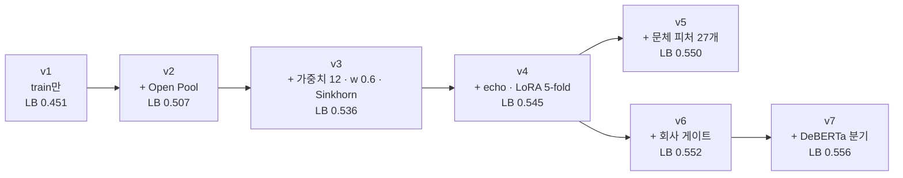
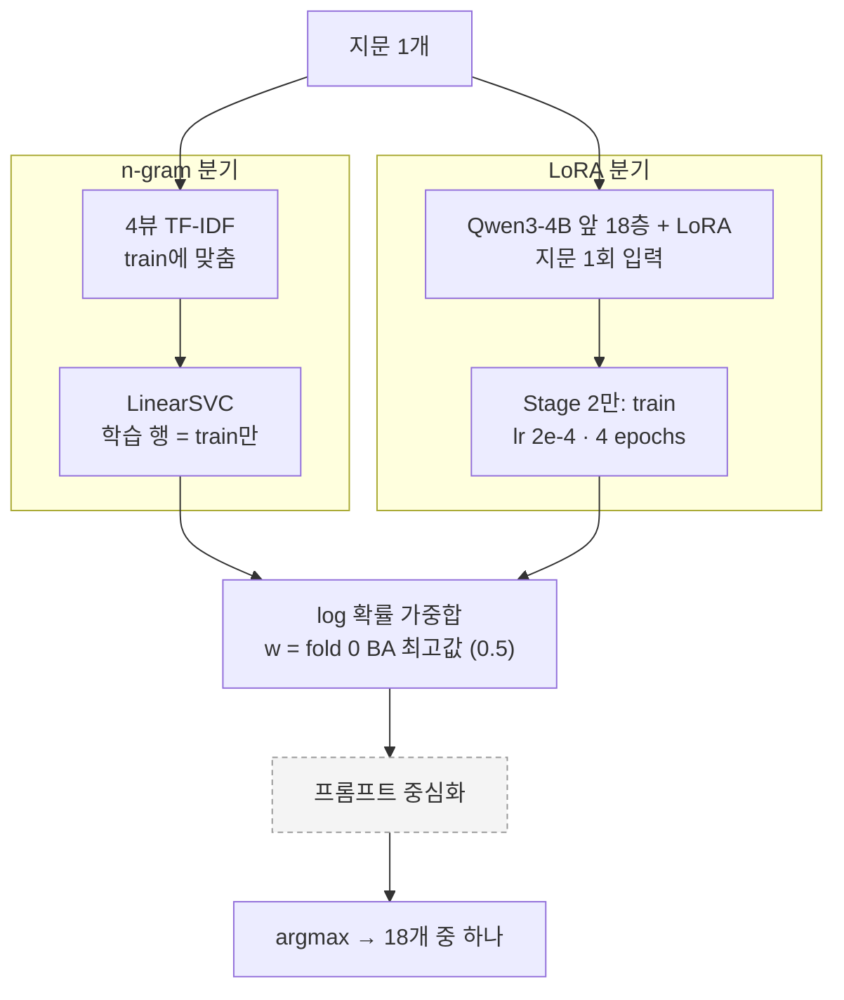
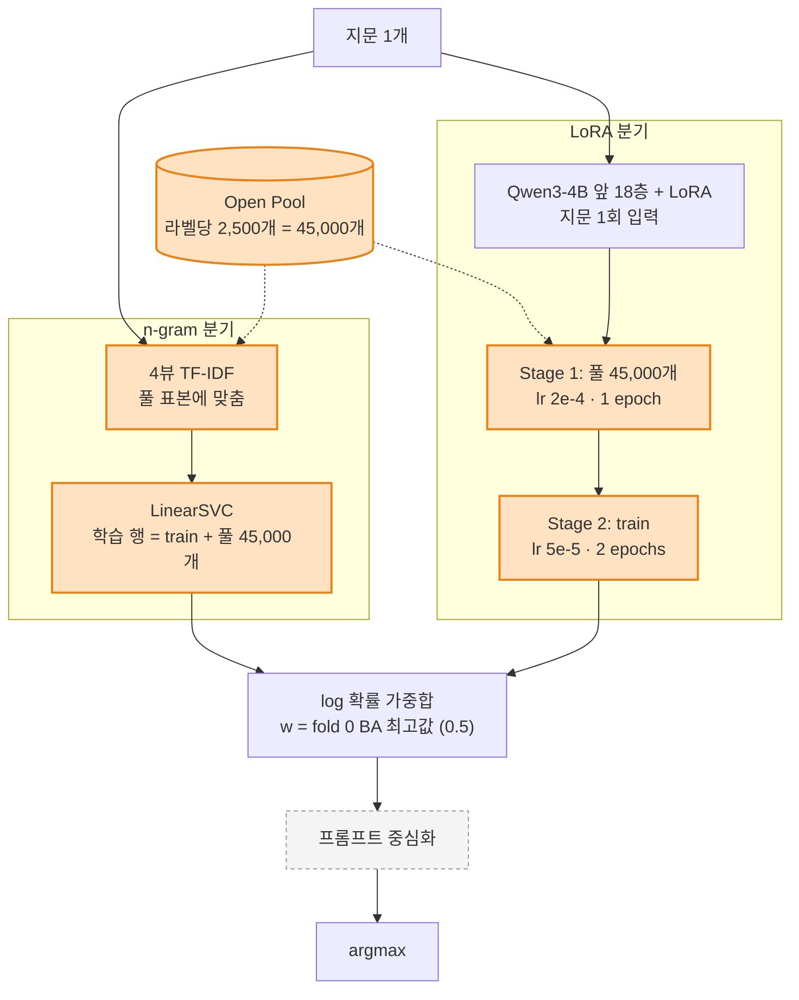
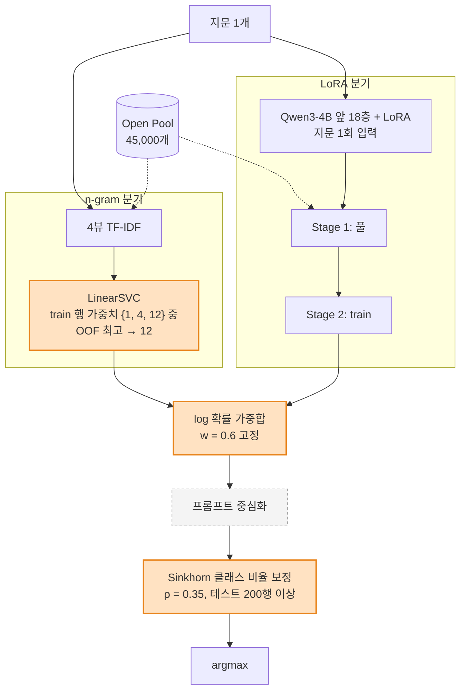
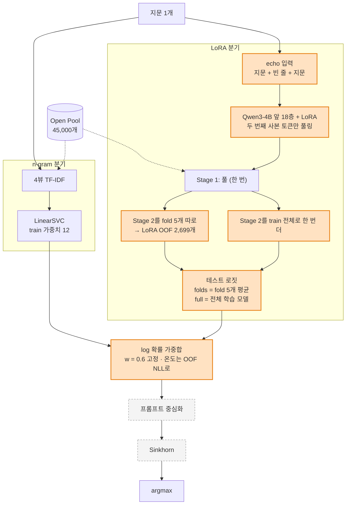
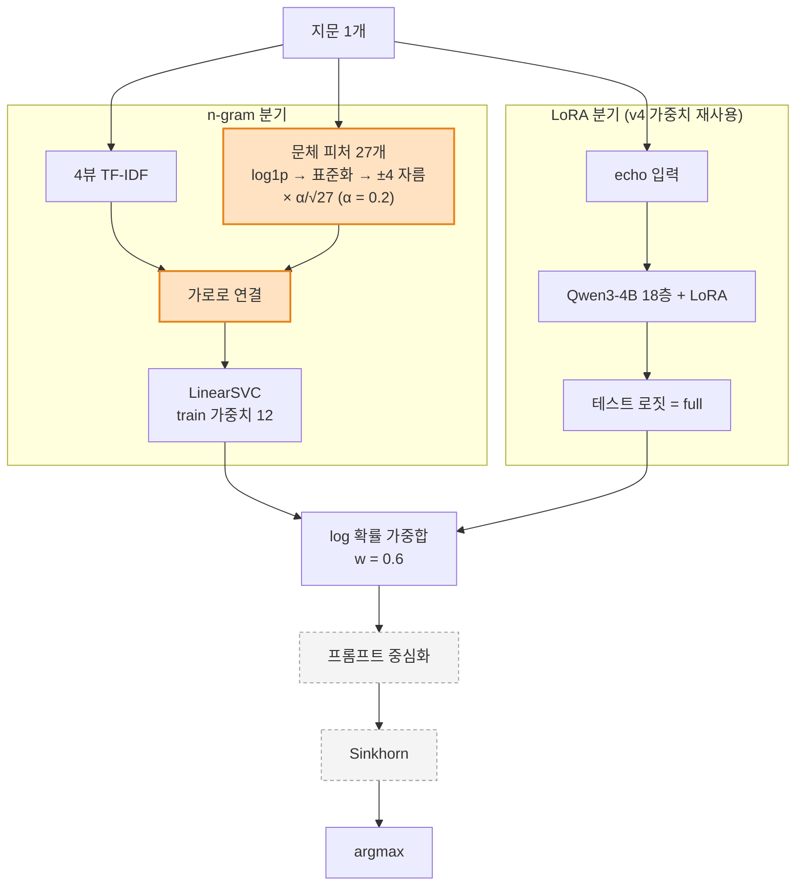
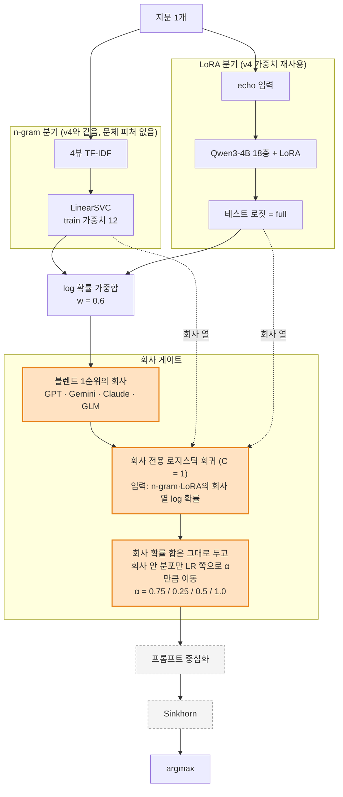
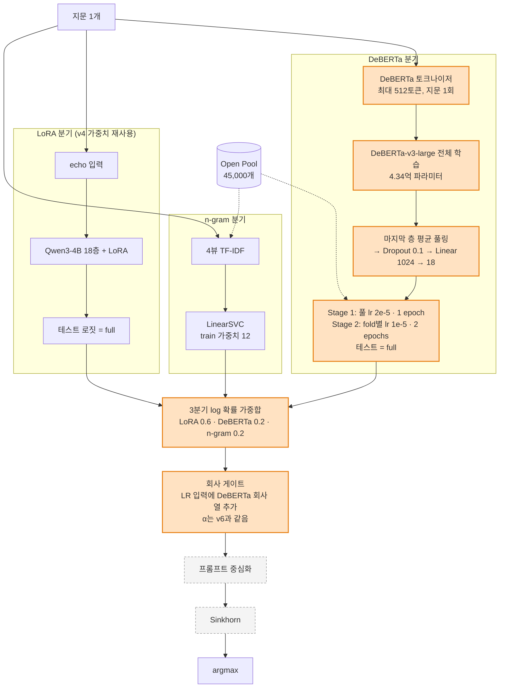

# 7. 버전별 모델 구조 다이어그램 (v1~v7)

[← 전체 문서](README.md)

v1부터 v7까지 각 버전의 모델 구조를 그림 한 장씩으로 정리했습니다. 공통 뼈대의 세부 내용(뷰 정의, LoRA 수식, 텐서 모양)은 [3. 모델 구조](03_model_architecture.md)에, 변경 이유와 효과는 [5. v1 → v7 변경과 개선 분석](05_version_history.md)과 [EXPERIMENTS.md](../EXPERIMENTS.md)에 있습니다.

> [!NOTE]
> **읽는 법**
> - 🟧 주황색 칸은 직전 버전(계보 기준: v5와 v6은 v4, v7은 v6)에서 새로 생기거나 바뀐 곳입니다.
> - 회색 점선 칸은 테스트에만 적용하는 후처리입니다. 검증 BA에는 들어가지 않습니다.
> - LB는 Public LB입니다. 수치는 [EXPERIMENTS.md](../EXPERIMENTS.md)의 제출 커널 로그 기준입니다.

## 0. 계보와 공통 블록

버전은 한 줄로 이어지지 않습니다. v5와 v6은 둘 다 v4에서 갈라졌고, v7은 v6 위에 올렸습니다. 그래서 v6·v7에는 v5의 문체 피처가 없습니다.

아래 그림에서 반복되는 블록의 뜻입니다.

| 블록 | 내용 |
|---|---|
| **n-gram** | char · word · shape · func 4뷰 TF-IDF(가중치 1.0 / 0.7 / 0.5 / 0.5)를 가로로 연결 → `LinearSVC(C = 0.1)` → 마진 18개 |
| **LoRA** | Qwen3-4B-Base 앞 18층(가중치 고정) + q/k/v/o에 LoRA(r = 16, α = 32) → 깊이 2·4·6·9·12·15·18 평균 풀링 + 깊이별 LayerNorm → 연결(17,920) → 선형 헤드 → 로짓 18개 |
| **온도** | 분기마다 NLL이 가장 작은 온도 `T`로 나눠 log-softmax |
| **중심화** | 테스트 지문을 주제 TF-IDF로 묶고(코사인 거리 0.9), 크기 2~18인 묶음에서 평균 log 확률의 0.5배를 뺌 |

## 1. v1: 출발점 (train만)

- 검증: LoRA는 fold 0(지문 540개)을 빼고 한 번 학습해 fold 0으로 잽니다. 테스트 LoRA도 이 모델입니다.
- 결과: 블렌드 fold 0 BA 0.4407, LB **0.451**.

## 2. v2: Open Pool 도입

- 코드는 v1과 같고, 커널 입력에 Open Pool을 붙였는지만 다릅니다. 풀이 있으면 두 분기가 모두 풀을 씁니다.
- 결과: 블렌드 fold 0 BA 0.5444, LB **0.507** (+0.056, 전체 개선 중 가장 큼).

## 3. v3: n-gram 가중치 12, w 고정, Sinkhorn

- LoRA 코드는 v2와 같고, 갱신된 풀(226,191개)로 다시 학습했습니다.
- 결과: 블렌드 fold 0 BA 0.5389, LB **0.536** (Sinkhorn을 끈 제출은 0.532).

## 4. v4: echo 입력과 LoRA 5-fold

- causal attention에서는 앞 토큰이 뒤 문맥을 못 보므로, 지문을 두 번 넣고 두 번째 사본만 풀링합니다. 입력이 두 배라 gradient 누적(`grad_accum`)이 생겼습니다.
- 이 뒤의 v5·v6·v7은 모두 이 버전의 LoRA 가중치를 재학습 없이 그대로 씁니다.
- 결과: 블렌드 OOF BA 0.5749, LB **0.543** (folds) / **0.545** (full).

## 5. v5: n-gram에 문체 피처 27개 (v4에서 갈라짐)

- 문체 피처는 구두점, 문장 길이, 기능어 비율 같은 통계입니다([analysis_intra_org/features.py](../analysis_intra_org/features.py)). 표준화는 fold의 train 지문으로만 합니다.
- 같은 시점에 Open Pool이 231,036개로 갱신됐습니다.
- 결과: 블렌드 OOF BA 0.5734(같은 새 풀 기준선 0.5716), LB **0.550**.

## 6. v6: 회사 게이트 (v4에서 갈라짐)

- v4 OOF 오답의 59%가 같은 회사 모델끼리 헷갈린 것이라, 회사 안 구분만 따로 다시 섞습니다. 게이트 LR은 커널 안에서 그 커널의 OOF로 학습합니다.
- 결과: 블렌드 OOF BA 0.5719 → 게이트 뒤 0.5786(nested 0.5764), LB **0.552**.

## 7. v7: DeBERTa-v3-large 세 번째 분기 (v6 위)

- 3분기 가중치는 0.1 간격 66개 조합을 OOF BA로 비교해 `blend3`로 고정했습니다. n-gram 몫의 절반(0.4 → 0.2)이 DeBERTa로 옮겨 갔습니다.
- DeBERTa는 Colab T4(fp32, gradient checkpointing)에서 따로 학습하고, 제출 커널은 세 분기 모두 추론만 합니다.
- 결과: DeBERTa 단독 OOF 0.5053, 블렌드 0.5868(nested 0.5827), 게이트 뒤 0.5882, LB **0.556**.

## 8. 한 표로 보기

| 버전 | 분기 | n-gram 입력 | LoRA 입력·학습 | 블렌드 | 블렌드 뒤 (테스트) | LB |
|:-:|---|---|---|---|---|:-:|
| v1 | n-gram + LoRA | 4뷰, train만 | 지문 1회, Stage 2만 | `w` = fold 0 최고 | 중심화 | 0.451 |
| v2 | 〃 | + 풀 45,000개 | Stage 1(풀) → Stage 2 | 〃 | 〃 | 0.507 |
| v3 | 〃 | train 가중치 12 | 〃 (재학습) | `w` = 0.6 | 중심화 → Sinkhorn | 0.536 |
| v4 | 〃 | 〃 | echo, Stage 2 × 5 fold + full | 〃 (온도는 OOF로) | 〃 | 0.545 |
| v5 | 〃 | + 문체 27개 | v4 가중치 | 〃 | 〃 | 0.550 |
| v6 | 〃 | v4와 같음 | v4 가중치 | 〃 → 회사 게이트 | 〃 | 0.552 |
| v7 | + DeBERTa | 〃 | v4 가중치 | 0.6 / 0.2 / 0.2 → 회사 게이트(3분기 입력) | 〃 | **0.556** |

## 9. 근거 파일

- 노트북: [v1](../name_that_llm_v1.ipynb), [v2](../name_that_llm_v2.ipynb), [v3](../name_that_llm_v3.ipynb), [v4](../name_that_llm_v4.ipynb), [v5](../name_that_llm_v5.ipynb), [v6](../name_that_llm_v6.ipynb), [v7](../name_that_llm_v7.ipynb). 셀 순서는 v3 이후 "3. n-gram → 4. LoRA → (4-2. DeBERTa) → 5. 블렌딩 → (5-1. 회사 게이트) → 6. 프롬프트 중심화 → 7. Sinkhorn → 8. 제출"입니다.
- 버전별 변경 매트릭스: [5. v1 → v7 변경과 개선 분석](05_version_history.md)의 2장.
- v4 시점 구조를 한 장으로 그린 그림: [analysis_v4/figures/architecture_v4.png](../analysis_v4/figures/architecture_v4.png).
