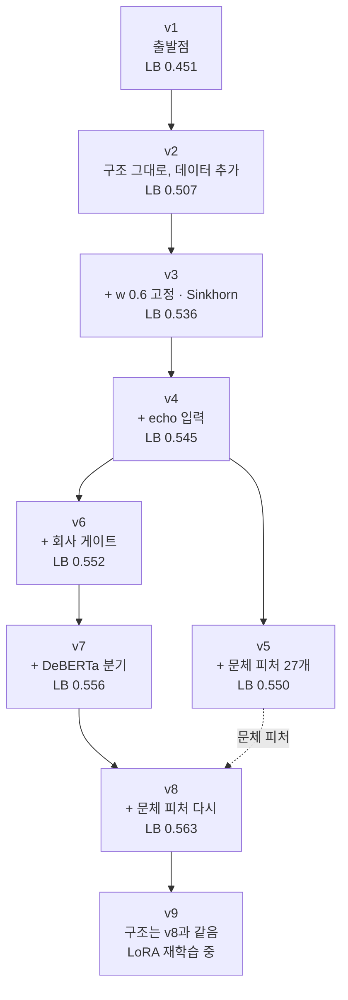
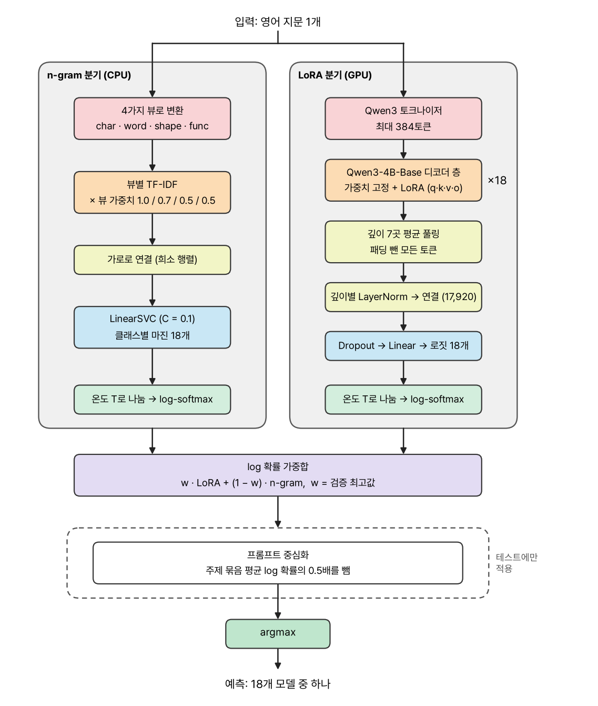
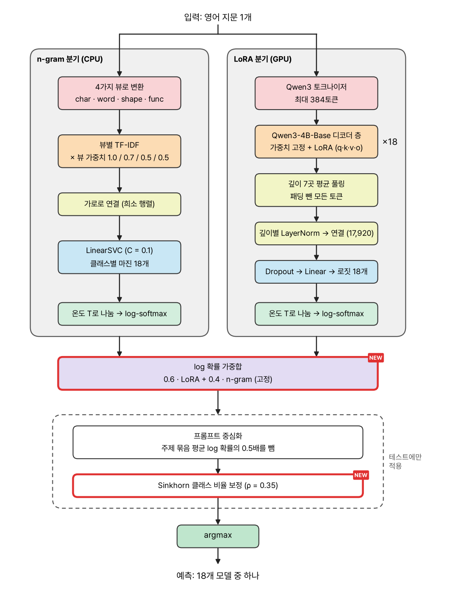
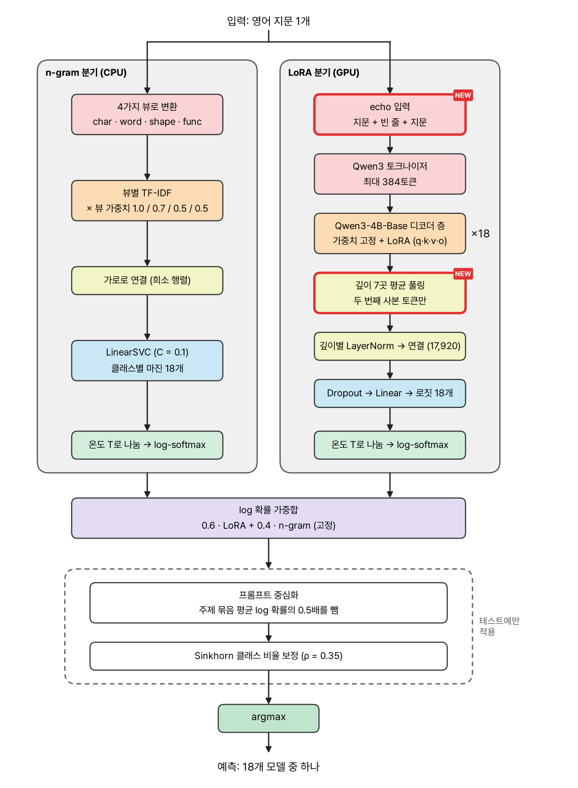
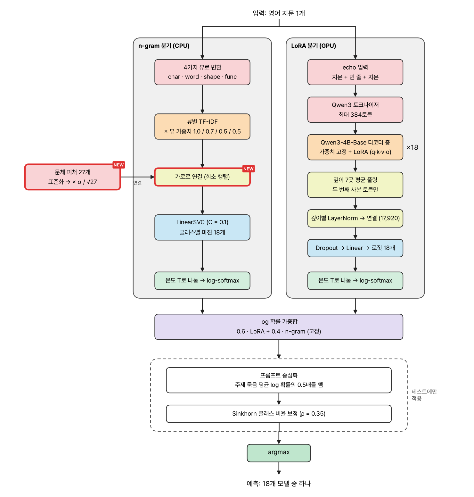
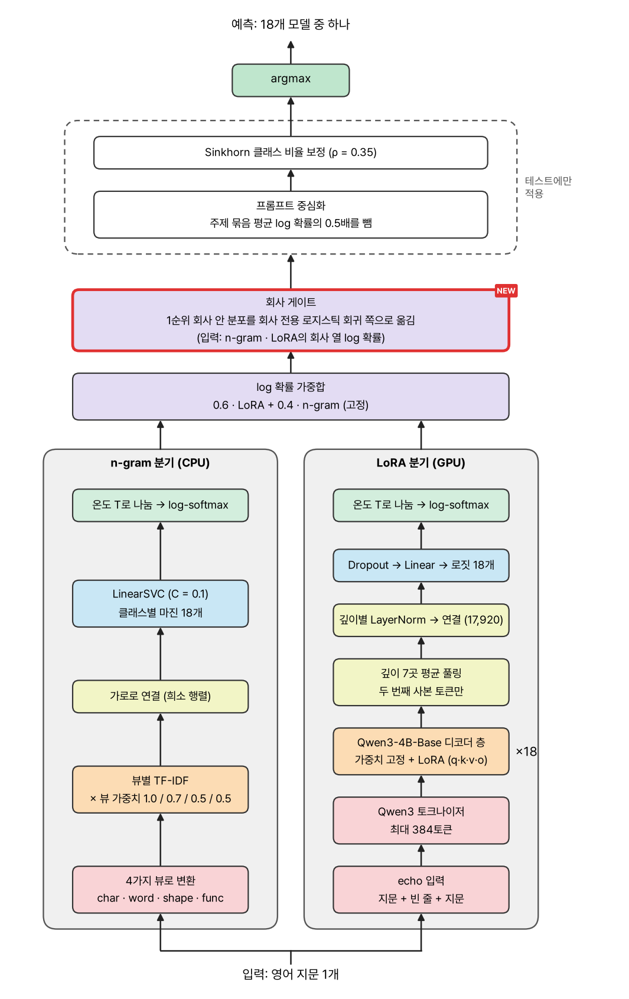
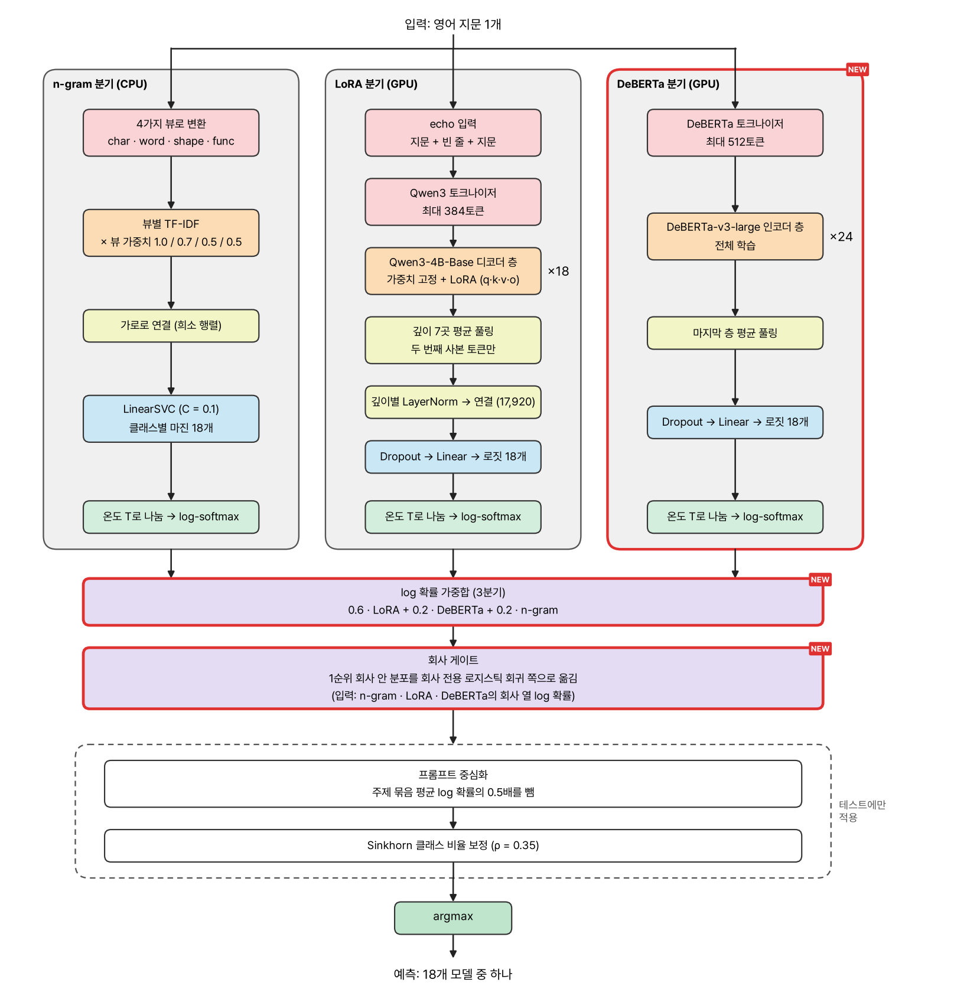
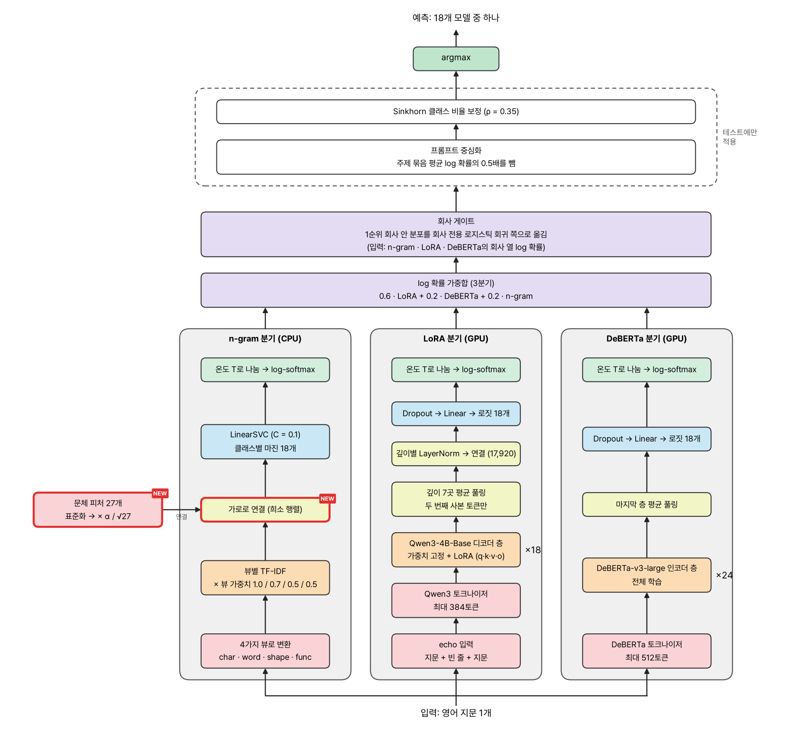

# 7. 버전별 모델 구조 다이어그램 (v1~v9)

[← 전체 문서](README.md)

v1부터 v9까지 각 버전의 모델 구조를 정리했습니다. v1~v8은 그림 한 장씩이고, v9는 예측 구조가 v8과 같아 그림을 따로 두지 않았습니다. 그림에는 지문 하나가 예측이 되기까지 거치는 구조만 넣었습니다. 어떤 데이터로 어떻게 학습했는지는 각 그림 아래 **데이터와 학습**에 적었습니다. 공통 뼈대의 세부 내용(뷰 정의, LoRA 수식, 텐서 모양)은 [3. 모델 구조](03_model_architecture.md)에, 변경 이유와 효과는 [5. v1 → v9 변경과 개선 분석](05_version_history.md)과 [EXPERIMENTS.md](../EXPERIMENTS.md)에 있습니다.

## 0. 그림 읽는 법

그림은 위(입력 지문)에서 아래(예측)로 흐릅니다. 회색 상자 하나가 분기 하나이고, `×18`과 `×24`는 그 층을 몇 번 쌓았는지입니다.

| 색 | 블록 종류 | 예 |
|---|---|---|
| 분홍 | 입력 · 토큰화 | 4가지 뷰 변환, 토크나이저, echo 입력, 문체 피처 |
| 주황 | 특징 추출 | TF-IDF, Qwen3 디코더 층, DeBERTa 인코더 층 |
| 연노랑 | 풀링 · 연결 · 정규화 | 평균 풀링, LayerNorm, 가로 연결 |
| 하늘 | 분류기 | LinearSVC, 선형 헤드 |
| 연두 | 확률로 변환 | 온도로 나눈 뒤 log-softmax |
| 연보라 | 분기 결합 | log 확률 가중합, 회사 게이트 |
| 흰색 + 점선 묶음 | 테스트 후처리 | 프롬프트 중심화, Sinkhorn. 검증 BA에는 들어가지 않음 |
| 초록 | 최종 출력 | argmax |

**빨간 테두리와 NEW**는 직전 버전에서 새로 생기거나 바뀐 블록입니다. 직전 버전은 계보 기준입니다(v5와 v6은 v4, v7은 v6, v8은 v7). LB는 Public LB이고, 수치는 [EXPERIMENTS.md](../EXPERIMENTS.md)의 제출 커널 로그 기준입니다(v8은 [analysis_v8/logs/kaggle_kernel_v1.log](../analysis_v8/logs/kaggle_kernel_v1.log)).

버전은 한 줄로 이어지지 않습니다. v5와 v6은 둘 다 v4에서 갈라졌고, v7은 v6 위에 올렸습니다. 그래서 v6·v7에는 v5의 문체 피처가 없고, v8에서 다시 들어갑니다.

## 1. v1: 출발점

**구조**
- n-gram 분기와 LoRA 분기가 같은 지문을 따로 점수 매기고, 두 log 확률을 가중합합니다.
- 가중치 `w`는 검증 BA가 가장 높은 값을 골랐습니다(0.5).

**데이터와 학습**
- 두 분기 모두 대회 train 지문(2,699개)만 씁니다.
- LoRA는 train으로 한 단계만 학습합니다(lr 2e-4, 4 epochs). fold 0(지문 540개)을 빼고 학습해 fold 0으로 검증하고, 테스트도 이 모델로 예측합니다.

**결과**: 블렌드 fold 0 BA 0.4407, LB **0.451**.

## 2. v2: 구조 그대로, Open Pool 추가

**구조**: v1과 같습니다. 코드도 같고, 커널 입력에 Open Pool을 붙였는지만 다릅니다.

**데이터와 학습**
- 외부 데이터 Open Pool에서 라벨당 2,500개(45,000개)를 뽑아 두 분기에 모두 씁니다.
- n-gram: TF-IDF 어휘를 풀 표본에 맞추고, 학습 행에 풀 45,000개를 더합니다.
- LoRA: Stage 1(풀 45,000개, lr 2e-4, 1 epoch)을 먼저 학습한 뒤, Stage 2(train, lr 5e-5, 2 epochs)로 미세 조정합니다.

**결과**: 블렌드 fold 0 BA 0.5444, LB **0.507** (+0.056, 전체 개선 중 가장 큼).

## 3. v3: 블렌드 가중치 고정, Sinkhorn

**구조**
- 블렌드 가중치를 `w` = 0.6으로 고정했습니다. 홀드아웃 최고값을 고르면 실행마다 0.5와 1.0을 오갔기 때문입니다.
- 중심화 다음에 Sinkhorn 클래스 비율 보정이 생겼습니다. 테스트가 200행 이상일 때만 적용합니다.

**데이터와 학습**
- n-gram 학습에서 train 지문의 가중치를 {1, 4, 12} 중 OOF가 가장 좋은 값으로 고릅니다. 결과는 12였습니다(풀 지문은 1). 가중치가 1이면 train이 학습 행에서 차지하는 몫이 6%도 안 됩니다.
- LoRA 코드는 v2와 같고, 갱신된 풀(226,191개)로 다시 학습했습니다.

**결과**: 블렌드 fold 0 BA 0.5389, LB **0.536** (Sinkhorn을 끈 제출은 0.532).

## 4. v4: echo 입력

**구조**
- LoRA 입력이 `지문 + 빈 줄 + 지문`이 되고, 두 번째 사본의 토큰만 평균 풀링합니다. Qwen은 causal attention이라 앞 토큰이 뒤 문맥을 못 보는데, 두 번째 사본의 토큰은 지문 전체를 본 상태가 됩니다.

**데이터와 학습**
- LoRA Stage 1을 한 번 학습한 뒤, Stage 2를 fold 5개마다 따로 학습해 LoRA도 OOF 2,699개를 만듭니다. LoRA 온도와 블렌드 비교도 이 OOF로 합니다.
- 테스트 로짓은 fold 모델 5개 평균(`folds`)이나, train 전체로 Stage 2를 한 번 더 학습한 모델(`full`)에서 냅니다.
- 입력이 두 배로 길어져 gradient 누적이 생겼습니다(마이크로 배치 4 × 누적 2).
- 이 뒤의 v5~v8은 모두 이 버전의 LoRA 가중치를 재학습 없이 그대로 씁니다.

**결과**: 블렌드 OOF BA 0.5749, LB **0.543** (`folds`) / **0.545** (`full`).

## 5. v5: 문체 피처 27개 (v4에서 갈라짐)

**구조**
- n-gram 분기의 TF-IDF 행렬 옆에 문체 피처 27개(구두점, 문장 길이, 기능어 비율 같은 통계)를 이어 붙입니다.
- 각 피처는 `log1p` → 표준화 → ±4에서 자른 뒤 α / √27(α = 0.2)를 곱합니다. 표준화한 27차원 벡터의 L2 노름은 약 √27 ≈ 5.2라서, 그대로 붙이면 TF-IDF 부분(L2 노름 약 1.4)을 밀어냅니다. 그래서 L2 노름이 약 0.2가 되도록 줄입니다.

**데이터와 학습**
- 문체 피처의 평균·표준편차는 각 fold의 train 지문으로만 계산합니다.
- LoRA는 v4 가중치(`full`)를 그대로 씁니다.
- 같은 시점에 Open Pool이 231,036개로 갱신됐습니다.

**결과**: 블렌드 OOF BA 0.5734(같은 새 풀 기준선 0.5716), LB **0.550**.

## 6. v6: 회사 게이트 (v4에서 갈라짐)

**구조**
- 블렌드 뒤, 중심화 앞에 회사 게이트가 들어갑니다.
- 블렌드의 1순위가 어느 회사(GPT · Gemini · Claude · GLM) 안이면, 회사 확률 합은 그대로 둡니다. 회사 안 분포만 회사 전용 로지스틱 회귀(C = 1) 쪽으로 α만큼 옮깁니다(GPT 0.75, Gemini 0.25, Claude 0.5, GLM 1.0).
- 로지스틱 회귀의 입력은 n-gram과 LoRA의 회사 열 log 확률입니다. v5의 문체 피처는 없습니다.

**데이터와 학습**
- 로지스틱 회귀는 커널 안에서 그 커널의 OOF로 학습합니다. α와 C는 옛 풀의 v4 OOF로 미리 고른 값입니다.
- LoRA는 v4 가중치(`full`)를 그대로 씁니다.
- 동기: v4 OOF 오답의 59%가 같은 회사 모델끼리 헷갈린 것이었습니다.

**결과**: 블렌드 OOF BA 0.5719 → 게이트 뒤 0.5786(nested 0.5764), LB **0.552**.

## 7. v7: DeBERTa-v3-large 세 번째 분기 (v6 위)

**구조**
- 양방향 인코더 DeBERTa-v3-large(24층, 약 4.34억 파라미터)를 세 번째 분기로 붙였습니다. 마지막 층 은닉 상태를 패딩을 뺀 토큰 평균으로 모아 `Dropout(0.1) → Linear(1024 → 18)`에 넣습니다.
- 블렌드가 3분기 가중합이 됩니다(LoRA 0.6 · DeBERTa 0.2 · n-gram 0.2). n-gram 몫의 절반이 DeBERTa로 옮겨 갔습니다.
- 회사 게이트의 로지스틱 회귀 입력에 DeBERTa의 회사 열 log 확률이 더해졌습니다. α는 v6과 같습니다.

**데이터와 학습**
- DeBERTa는 LoRA와 같은 2단계로 학습합니다. Stage 1은 Open Pool 45,000개(lr 2e-5, 1 epoch), Stage 2는 fold마다 train(lr 1e-5, 2 epochs)이고, 테스트는 train 전체로 학습한 모델을 씁니다.
- Colab T4(fp32, gradient checkpointing)에서 DeBERTa만 따로 학습했습니다. 제출 커널은 세 분기 모두 추론만 합니다.
- 3분기 가중치는 0.1 간격 66개 조합을 OOF BA로 비교해 고정했습니다.

**결과**: DeBERTa 단독 OOF 0.5053, 블렌드 0.5868(nested 0.5827), 게이트 뒤 0.5882, LB **0.556**.

## 8. v8: 문체 피처 다시 넣기 (v7 위)

**구조**
- n-gram 분기에 v5의 문체 피처 27개(α = 0.2)를 다시 붙였습니다. 나머지 구조(LoRA, DeBERTa, 블렌드 가중치, 게이트, 후처리)는 v7과 같습니다.

**데이터와 학습**
- n-gram이 학습하는 Open Pool 표본을 라벨당 2,500개에서 최대 5,000개로 늘렸습니다(88,107행). LoRA·DeBERTa Stage 1용 표본은 그대로 라벨당 2,500개입니다.
- 풀 행에 라벨 균형 가중치를 줍니다. 라벨 `L`의 풀 행 가중치는 (풀 행 수 / 18) / (`L`의 풀 행 수)이고, 평균은 1입니다. 풀 지문이 5,000개가 안 되는 두 라벨(gemini-3.7-flash 3,541개, qwen3.8-max 4,566개)은 1.38과 1.07, 나머지 16개는 0.98입니다.
- 신경망은 다시 학습하지 않습니다. LoRA는 v4, DeBERTa는 v7 가중치를 씁니다.
- OOF로 보면 이득의 대부분은 문체 피처보다 풀 표본 확대에서 나옵니다.

**결과**: n-gram OOF 0.5016(v7 0.4693), 3분기 블렌드 0.5982(v7 0.5868), 게이트 뒤 0.6023(v7 0.5882). Public LB 0.563(v7 0.556).

## 9. v9: LoRA Stage 1을 Open Pool 전체로 (v8 위, 학습 중)

**구조**: v8과 같습니다. 그림은 [v8 구조](figures/arch_v8.png)를 보면 됩니다. 블렌드 가중치(`blend3`)는 아직 v7 값이고, LoRA OOF가 나오면 다시 고릅니다.

**데이터와 학습**
- LoRA Stage 1 데이터를 라벨당 2,500개 표본(45,000개)에서 Open Pool 전체로 늘렸습니다. 출처의 프롬프트 id가 train `prompt_id`와 같은 86행을 빼서 230,950행입니다.
- 라벨마다 3,541 ~ 23,537행으로 개수가 달라서, 손실에 라벨 균형 가중치(0.545 ~ 3.623, 평균 1)를 줍니다.
- Stage 1은 28,869스텝이고 10분마다 체크포인트를 남겨 끊긴 자리에서 이어 합니다. Stage 2는 v4와 같이 fold 5개와 전체입니다.
- n-gram은 v8, DeBERTa는 v7 가중치를 그대로 씁니다.

**결과**: 아직 없습니다. 진행 상황은 [5. v1 → v9 변경과 개선 분석](05_version_history.md)의 7장에 있습니다.

## 10. 한 표로 보기

| 버전 | 분기 | n-gram 구조 | LoRA 입력 | 블렌드 | 블렌드 뒤 | LB |
|:-:|---|---|---|---|---|:-:|
| v1 | n-gram + LoRA | 4뷰 TF-IDF | 지문 1회 | `w` = 검증 최고 | 중심화 | 0.451 |
| v2 | 〃 | 〃 | 〃 | 〃 | 〃 | 0.507 |
| v3 | 〃 | 〃 | 〃 | `w` = 0.6 고정 | 중심화 → Sinkhorn | 0.536 |
| v4 | 〃 | 〃 | echo (두 번째 사본만 풀링) | 〃 | 〃 | 0.545 |
| v5 | 〃 | + 문체 피처 27개 | 〃 | 〃 | 〃 | 0.550 |
| v6 | 〃 | 4뷰 TF-IDF | 〃 | 〃 → 회사 게이트 | 〃 | 0.552 |
| v7 | + DeBERTa | 〃 | 〃 | 0.6 / 0.2 / 0.2 → 회사 게이트(3분기 입력) | 〃 | 0.556 |
| v8 | 〃 | + 문체 피처 27개 | 〃 | 〃 | 〃 | 0.563 |
| v9 | 〃 | 〃 | 〃 | 〃 (학습 뒤 다시 고를 예정) | 〃 | 학습 중 |

데이터와 학습 쪽 변화만 따로 모으면 다음과 같습니다.

| 버전 | n-gram 학습 데이터 | LoRA 학습 | DeBERTa 학습 |
|:-:|---|---|---|
| v1 | train | train만 한 단계 | - |
| v2 | train + 풀 45,000개 | Stage 1(풀) → Stage 2(train) | - |
| v3 | 〃, train 가중치 12 | 〃 (새 풀로 재학습) | - |
| v4 | 〃 | Stage 2를 fold 5개 + 전체로 | - |
| v5 | 〃 (풀 갱신 231,036개) | v4 가중치 | - |
| v6 | 〃 | v4 가중치 | - |
| v7 | 〃 | v4 가중치 | Stage 1(풀) → fold별 Stage 2 |
| v8 | train + 풀 88,107개(라벨당 최대 5,000개, 라벨 균형 가중치), train 가중치 12 | v4 가중치 | v7 가중치 |
| v9 | 〃 | Stage 1(풀 전체 230,950행, 라벨 균형 손실 가중치) → Stage 2를 fold 5개 + 전체로 | v7 가중치 |

## 11. 근거 파일

- 그림을 그린 스크립트: [figures/make_architecture.py](figures/make_architecture.py). `python docs/figures/make_architecture.py`로 `figures/arch_v1.png` ~ `arch_v8.png`를 다시 만듭니다.
- 노트북: [v1](../name_that_llm_v1.ipynb), [v2](../name_that_llm_v2.ipynb), [v3](../name_that_llm_v3.ipynb), [v4](../name_that_llm_v4.ipynb), [v5](../name_that_llm_v5.ipynb), [v6](../name_that_llm_v6.ipynb), [v7](../name_that_llm_v7.ipynb), [v8](../name_that_llm_v8.ipynb), [v9](../name_that_llm_v9.ipynb). 셀 순서는 v3 이후 "3. n-gram → 4. LoRA → (4-2. DeBERTa) → 5. 블렌딩 → (5-1. 회사 게이트) → 6. 프롬프트 중심화 → 7. Sinkhorn → 8. 제출"입니다.
- v8 노트북을 만든 스크립트와 점검: [analysis_v8/make_v8.py](../analysis_v8/make_v8.py), [analysis_v8/logs/](../analysis_v8/logs/). v9는 [analysis_v9/make_v9.py](../analysis_v9/make_v9.py).
- 버전별 변경 매트릭스(v9까지): [5. v1 → v9 변경과 개선 분석](05_version_history.md)의 2장.
