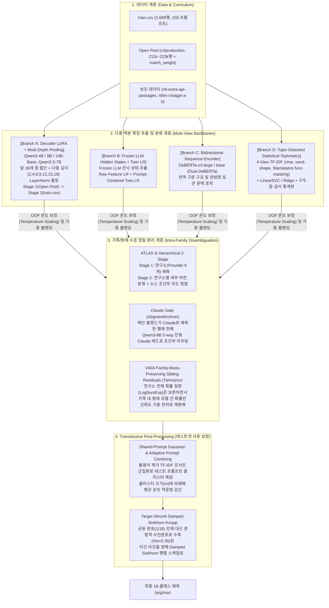

# 🏆 Kaggle "Name That LLM" 고득점자 아키텍처 및 학습 전략 총망라 보고서 (Exhaustive Technical Report)

본 보고서는 Kaggle **[Name That LLM - Identify the Model Behind the Text](https://www.kaggle.com/competitions/name-that-llm/discussion)** 대회의 Discussion 포럼, 상위권 공개 노트북(Code), 외부 SOTA 아티팩트 저장소(Hugging Face 및 연구 로그), 그리고 리더보드 상위권(Gold Tier, `0.741 ~ 0.771+`) 참가자들의 아키텍처 설계와 학습 파이프라인을 빠짐없이(exhaustively) 분석·정리한 기술 문서입니다.

---

## 1. 대회 핵심 구조와 리더보드 지형도

### 1.1 문제 정의 및 3대 핵심 난제
* **과제**: 36~274단어(중앙값 약 101단어) 분량의 짧은 영어 지문(Passage) 하나만 보고, **6개 AI 연구소의 18개 프론티어 LLM** 중 어느 모델이 생성한 텍스트인지 식별하는 18-클래스 저자 식별(Authorship Attribution) 문제입니다.
  * **OpenAI (5)**: `gpt-5.5`, `gpt-5.6-luna`, `gpt-5.6-sol`, `gpt-5.6-terra`, `gpt-6-astra`
  * **Google (4)**: `gemini-3.1-pro-preview`, `gemini-3.6-flash`, `gemini-3.7-flash`, `gemini-3.8-flash`
  * **Anthropic (5)**: `claude-fable-5`, `claude-opus-4-6`, `claude-opus-4-8`, `claude-opus-5`, `claude-sonnet-5`
  * **Qwen (1)**: `qwen3.8-max`
  * **Z.AI (2)**: `glm-5.3`, `glm-5.3-flash`
  * **Moonshot AI (1)**: `kimi-k3`
* **평가지표**: **Balanced Accuracy** (18개 클래스별 Recall의 매크로 평균).
* **고득점을 가로막는 3대 핵심 난제**:
  1. **Unseen Prompts (주제 누수 및 분포 이동)**: 숨겨진 테스트셋(약 4,000개 지문)의 프롬프트(주제)는 `train.csv`(150개 프롬프트 × 18개 모델 = 2,699행)에 단 한 번도 등장하지 않습니다. 따라서 모델이 **"무엇을(Topic/Content) 썼는가"**를 외우면 즉시 과적합되며, 오직 **"어떻게(Style/Syntax/Cadence) 썼는가"**를 추출해야 합니다.
  2. **Intra-Family Sibling Confusion (형제 모델 간 혼동)**: 상위권 분석에 따르면 **전체 오분류의 77% 이상이 동일 연구소(Provider) 내의 형제 모델 간**에 발생합니다(예: `gemini-3.7-flash` vs `gemini-3.8-flash`, `claude-opus-4-6` vs `4-8` vs `5`, `gpt-5.6-luna` vs `sol` vs `terra`).
  3. **Distillation & Routing Quirks (모델 증류 및 API 라우팅 아티팩트)**: Discussion의 유명 스레드(*"My classifier thinks GLM-5.3 is more Claude than GLM"*, `AyoGG`)에서 밝혀졌듯, 9B 분류기조차 Z.AI의 `glm-5.3` 지문 150개 중 다수를 `glm-5.3`보다 Anthropic의 `Claude` 계열로 분류합니다. 이는 데이터 증류(Distillation), 코딩 에이전트용 Anthropic 호환 API 라우팅 래퍼, 혹은 사후 학습(RLHF/DPO) 코퍼스 공유로 인해 이종 연구소 간에도 강한 문체 중첩이 존재함을 뜻합니다.

### 1.2 점수대별(Tier) 아키텍처 진화 단계 및 Top 20 현황
리더보드와 Discussion에서 보고된 점수(Balanced Accuracy)는 파이프라인의 정교함에 따라 명확한 계단식 구조를 보입니다.

| 등급 / 구간 | CV / Public LB 점수대 | 대표적 아키텍처 및 파이프라인 특징 |
| :--- | :---: | :--- |
| **Tier 0: 기본 베이스라인** | `0.310 ~ 0.350` | 단순 Word/Char TF-IDF + `Ridge` 또는 `LogisticRegression` (`train.csv`만 사용) |
| **Tier 1: 단일 모델 (외부 데이터 無)** | `0.580 ~ 0.650` | `train.csv`만으로 학습한 단일 LoRA (`Qwen3-4B/8B`) 또는 `DeBERTa-v3-large` + 기본 TF-IDF 블렌드 |
| **Tier 2: Open Pool + 2-Stage 표준** | `0.660 ~ 0.684` | `Open Pool (211k)` 도입 + 2-Stage LoRA (`Qwen3`) + 4-View TF-IDF `LinearSVC` + 기본 Prompt Centering (예: Roman Tamrazov 초기 *"Who am I?"* 베이스라인, Pengyi Peng의 `0.684` 벤치마크) |
| **Tier 3: 고득점 공개 SOTA 아키텍처** | `0.700 ~ 0.745` | Multi-Backbone (`Qwen3-8B/14B` + `Qwen2.5-7B` + `DeBERTa-v3-large`) + 전문가 게이트(`Claude Gate`, `V40A Sibling Residuals`, `ATLAS`) + `Adaptive Centered Twins` + `Target-Shrunk Damped Sinkhorn` (예: `nlm-v27`, `ntl-ensemble-widened-v1`) |
| **Tier 4: 최상위 Gold Tier (Top 1~20)** | `0.746 ~ 0.771+` | 대규모 자체 정제/합성 풀 + 20개 이상 다중 뷰/다중 백본 스태킹 + 정교한 가족 내 잔차 보정(Intra-family tie-breaking) 및 최적 수송(Optimal Transport) 사후 보정 |

> [!NOTE]
> **Public Leaderboard Top 20 (Gold Medal Tier) 현황**:
> 1위 **NguyenThanhNhan** (`0.771`), 2위 **Meni David Gottesman** (`0.766`), 3위 **James Liebel** (`0.765`), 4위 **Santos x Cantone** (`0.763`), 5위 **Yevhenii Maslov** (`0.757`), 6위 **Søren Ravn Andersen** (`0.757`), 7위 **You're Absolutely Right!** (`0.756`), 8위 **Team Aillis** (`0.756`), 9위 **Takoi** (`0.754`), 10위 **Le Viet** (`0.752`), 11위 **Keanan** (`0.750`), 12위 **Harveen Singh Chadha** (`0.750`), 13위 **kulshekhar** (`0.749`), 14위 **Lian Matsuo** (`0.747`), 15위 **Hod Carriers** (`0.747`), 16위 **吃白饭的大肥鱼** (`0.746`), 17위 **jad kutbi** (`0.743`), 18위 **David Austin** (`0.741`), 19위 **AI Drive** (`0.741`), 20위 **Ngo Dinh Luan** (`0.741`).

---

## 2. 고득점자들의 End-to-End 통합 아키텍처 청사진

고득점자들의 파이프라인은 단일 모델이 아니라 **서로 다른 귀납적 편향(Inductive Bias)을 가진 4가지 특징 추출 브랜치**를 학습한 뒤, **계층적/조건부 전문가 보정(Specialist Gate & Sibling Residuals)**과 **테스트 시점 변환적 사후 처리(Transductive Post-Processing)**를 거치는 구조로 수렴했습니다.

---

## 3. 아키텍처 패러다임별 상세 설계 및 작동 원리

### 3.1 패러다임 1: Decoder LLM 앞단 절단(Truncation) + 다중 깊이 풀링(Multi-Depth Pooling) LoRA
Discussion 스레드(*"Reason for qwen performing so well in classifying :/"*, `Gaurav Rawat` 등)와 상위권 노트북에서 가장 핵심적으로 다루어진 발견은 **"왜 Qwen3-Base 계열의 앞/중간 은닉층을 묶어 쓰는가?"**입니다.

1. **초·중반 은닉층(Early-to-Middle Layers)의 문체 보존성**:
   * 자기회귀(Causal) 디코더 LLM의 **마지막 층(Final layers, 예: 36층 중 30~36층)**은 다음 토큰 예측을 위해 지문의 **의미론적 주제(Semantic topic)** 정보를 강하게 압축합니다. 그러나 이 대회에서 테스트 프롬프트의 주제는 학습 때 본 적이 없으므로 마지막 층만 쓰면 주제에 과적합됩니다.
   * 반면 **초·중반 층(예: 1~18층)**에는 토크나이저 분절 패턴, 기능어 연결 습관, 문장부호 호흡, 구문 리듬 등 **저자 모델 고유의 문체 지문(Stylistic Fingerprint)**이 살아 있습니다.
2. **구체적 네트워크 구조 (`Qwen3-4B-Base`, `Qwen3-8B-Base`, `Qwen3-14B-Base`, `Qwen2.5-7B`)**:
   * **레이어 절단(Layer Truncation)**: 예를 들어 36개 디코더 블록 중 앞쪽 `keep_layers = 18`개 블록만 로드하고 19~36번 블록과 `lm_head`를 완전히 버립니다(`AutoModel` 사용). 이는 문체 특징을 보존할 뿐 아니라 **VRAM 사용량과 학습/추론 시간을 절반으로 줄여** Kaggle T4 GPU 한계 내에서 더 큰 모델(8B/14B)이나 더 많은 배치를 돌릴 수 있게 합니다.
   * **최종 RMSNorm 무력화**: 마지막에 붙는 기본 `norm`을 `nn.Identity()`로 교체하여 순수 잔차 스트림(Raw residual stream)을 추출합니다.
   * **LoRA 어댑터 장착**: 원본 가중치(약 2.2B~8B)는 동결(Frozen, `fp16`/`bf16`)하고, 모든 유지된 블록의 어텐션 프로젝션(`q_proj`, `k_proj`, `v_proj`, `o_proj`)에 `r = 16, alpha = 32 (scaling = 2.0), dropout = 0.05`의 LoRA를 추가합니다(오프라인 제출 호환성을 위해 `peft` 없이 순수 PyTorch로 직접 구현하는 경우가 많음).
   * **Multi-Depth Masked Mean Pooling + Per-Tap LayerNorm**:
     * 단일 층이 아니라 여러 깊이(예: $l \in \{2, 4, 6, 9, 12, 15, 18\}$, 총 $L=7$개 층)의 은닉 상태 $h_l \in \mathbb{R}^{B \times T \times D}$를 동시에 탭핑(Tapping)합니다.
     * 패딩 마스크를 적용해 FP32 정밀도로 평균 풀링(Masked Mean Pooling)을 수행합니다:
       $$\text{pooled}_l = \frac{\sum_{t=1}^T h_{l,t} \cdot \text{mask}_t}{\max\left(1, \sum_{t=1}^T \text{mask}_t\right)} \in \mathbb{R}^{B \times D}$$
     * **Per-Tap LayerNorm의 중요성**: 트랜스포머 잔차 스트림은 층이 깊어질수록 벡터의 L2 Norm이 급격히 커집니다. 그냥 이어붙이면(Concat) 18번 층이 2번·4번 층의 신호를 압도하므로, **각 깊이 $l$마다 독립적인 `nn.LayerNorm(D)`를 통과시켜 스케일을 맞춘 뒤 연결**합니다($z \in \mathbb{R}^{B \times (L \cdot D)}$).
     * 이후 `Dropout(0.1)`과 선형 분류 헤드(`Linear(L*D, 18)`)를 통과시켜 로짓을 산출합니다. 이때 **새로 초기화된 LayerNorm과 분류 헤드의 학습률(LR)은 LoRA 본체보다 5배(`head_lr_mult = 5`) 높게** 설정합니다.

### 3.2 패러다임 2: Frozen LLM Hidden States + Adaptive Centered Twins (`nlm-v27` 아키텍처)
**Dhruv Tibarewal**의 고득점 공개 솔루션(`nlm-v27`)과 이를 확장한 `ntl-ensemble-widened-v1`에서는 LoRA 미세조정 외에도 **다중 오픈웨이트 베이스 모델(`Qwen3-8B-Base`, `Qwen3-14B-Base`, `Qwen2.5-7B`)의 동결(Frozen) 은닉 상태**를 추출해 통계적 분류기와 결합하는 독창적인 구조를 사용했습니다.

* **작동 방식**:
  1. 여러 대형 LLM 백본에서 학습/테스트 지문의 다중 층 Mean-pooled 은닉 벡터 $x_i$를 추출합니다(양자화 및 정밀도 정렬 유지).
  2. 이 특징 벡터 $x_i$ 위에 **쌍둥이 로지스틱 회귀(Adaptive Centered Twins / Dual LR)**를 학습합니다:
     * **Twin 1 (Raw Feature LR)**: 원본 은닉 벡터 $x_i$를 그대로 입력받아 18개 클래스를 분류합니다.
     * **Twin 2 (Prompt-Centered Feature LR)**: 학습 시에는 실제 `prompt_id` 그룹 평균 벡터 $\bar{x}_g$를 뺀 잔차 특징($x_i - \bar{x}_g$)으로 학습하고, 테스트 시에는 추정된 프롬프트 클러스터 평균을 적응형으로 뺀 특징을 입력받아 분류합니다.
  3. 로짓 공간(Output space)에서만 중심화를 수행하는 것을 넘어, **특징 공간(Feature space) 자체에서 프롬프트 주제 성분을 제거한 뒤 선형 분류기를 학습**시킴으로써 주제 불변(Topic-invariant) 문체 결정 경계를 훨씬 날카롭게 만듭니다.

### 3.3 패러다임 3: 양방향 인코더(`DeBERTa-v3-large` / `base`) & Dual-DeBERTa
디코더 기반 Qwen 모델은 Causal Attention($s \le t$) 구조이므로 앞쪽 토큰이 뒤쪽 토큰을 참조하지 못합니다. 이를 보완하기 위해 거의 모든 상위권 앙상블(`zbigniewkirchner`, `yauwes`, `nlm-v27` 등)은 양방향(Bidirectional) 어텐션을 가진 **`DeBERTa-v3-large`**(및 `deberta-v3-base`, `RoBERTa`)를 핵심 축으로 포함합니다.

* **DeBERTa의 강점**: 상대 위치 인코딩(Disentangled Relative Positional Encoding)을 사용하는 DeBERTa는 문장 내 구두점의 상대적 위치, 접속사 배치, 문장 시작과 끝의 구조적 대칭성을 포착하는 데 탁월하여 Qwen LoRA와 블렌딩했을 때 큰 폭의 다양성(Diversity) 이득을 제공합니다.
* **Dual-DeBERTa Sibling Calibration (`yauwes/name-that-llm-sota-artifacts`)**: 서로 다른 시드/뷰 또는 서로 다른 학습 단계(Full-pool vs Clean subset)로 학습된 두 개의 DeBERTa-v3 모델을 결합하고, 형제 모델 간 보정 스윕(Calibration sweep)을 통해 과신(Overconfidence)된 확률을 완화합니다.

### 3.4 패러다임 4: Stamatatos 주제 왜곡(Topic Distortion) 기반 4-View TF-IDF + `LinearSVC`
전통적인 NLP 모델이지만, 상위권 파이프라인(`crtproduction`, `Roman Tamrazov`, `nlm-v27`)에서 딥러닝 모델의 약점을 보완하는 필수 브랜치로 사용됩니다. 핵심은 저자 식별 학계의 고전 기법인 **Stamatatos Topic Masking**을 적용한 **4-View 텍스트 변환**입니다.

| 뷰(View) 이름 | 텍스트 변환 방식 (예시: `"The Cat sat, 42 times."`) | 분석 단위 & n-gram | 최대 특성 수 | 가중치 | 포착하는 스타일 신호 |
| :--- | :--- | :---: | :---: | :---: | :--- |
| **`char`** | 원본 그대로 유지 (`lowercase=False`) | 문자(char) `3~5` | 250,000 | `1.0` | 토크나이저 분절 흔적, 철자법, 하이픈/대시(`—` vs `--`) 및 공백 습관 |
| **`word`** | 단어(`\w+`) 또는 개별 문장부호 토큰화 | 단어(word) `1~2` | 150,000 | `0.7` | 선호하는 어휘 및 연어(Collocation) 빈도 |
| **`shape`** | 영문 대문자로 시작하는 연속 문자열 $\to$ `X`, 소문자 $\to$ `x` (`"X X x, 42 x."`) | 문자(char) `2~6` | 60,000 | `0.5` | 어휘를 완전히 지운 뒤의 대소문자/숫자/문장부호 시각적 리듬 |
| **`func`** | **Stamatatos Topic Distortion**: 최상위 기능어(the, of, and 등)와 문장부호만 남기고 모든 명사/내용어를 `_` 또는 `*`로 마스킹 (`"the _ _ , _ _ ."`) | 공백 토큰 `1~3` | 50,000 | `0.5` | 프롬프트 주제어를 강제로 삭제하여 **순수 통사적 뼈대(Syntactic cadence)**만 추출 |

* **벡터화 및 학습 디테일**:
  * 모든 `TfidfVectorizer`는 `lowercase=False`, `min_df=2`, `sublinear_tf=True`($1 + \log(\text{tf})$) 및 L2 정규화를 사용하며, 검증 누수를 막기 위해 비라벨 Open Pool 또는 학습 폴드에서만 Fit합니다.
  * 4개 뷰의 희소 행렬을 가중 결합(`hstack`, 총 최대 510,000차원)한 뒤, One-vs-Rest **`LinearSVC(C=0.1)`**를 학습합니다.
  * **샘플 가중치 차별화**: Open Pool(약 20만 행)과 대회 원본 `train.csv`(2,699행)를 합쳐서 학습할 때, Open Pool이 모델을 지배하지 못하도록 **원본 `train.csv` 행에 훨씬 높은 소스 가중치(예: `source_weight = 12.0` 또는 가중 오버샘플링)**를 부여하는 설정이 상위권(`crtproduction` / `V40A` 계열)에서 큰 효과를 거두었습니다.
* **CatBoost / GBDT 활용 여부 (*"Can a CatBoost-based approach be competitive?"*, `Maxim Stepanov`)**:
  * 순수 TF-IDF 위에 CatBoost나 LightGBM만 단독으로 올리면 고차원 희소성 때문에 LinearSVC나 Transformer보다 점수가 낮습니다(`~0.50` 이하).
  * 그러나 **명시적 문체 통계량(Stylometric hand-crafted features)**—문장 길이 평균/분산, 구두점 밀도(세미콜론, 줄표, 따옴표 종류별 비율), 불용어 비율, 어휘 풍부도(Type-Token Ratio)—과 각 딥러닝/선형 모델의 OOF Logit을 입력으로 받는 **2차 스태킹 메타 분류기(Stacking Meta-Learner) 또는 Pairwise Verifier(`v34_pairwise.py`)**로 GBDT/로지스틱 회귀를 사용할 때는 유의미한 점수 상승을 만듭니다.

---

## 4. 형제 모델(Sibling Models) 혼동을 해결한 3대 전문가 메커니즘

전체 오류의 77% 이상을 차지하는 **"같은 연구소 내 형제 모델 간 혼동"**을 깨뜨리기 위해 고득점자들은 평면적인(Flat) 18-클래스 분류기를 넘어 다음 3가지 구조적 장치를 고안했습니다.

### 4.1 계층적 2단계 분류(Hierarchical 2-Stage) & `ATLAS` (`mercurydust`, `nlm-v27`)
* **2-Stage 파이프라인**:
  * **Stage 1 (Provider Classifier)**: 18개 모델이 아니라 6개 연구소(`OpenAI`, `Google`, `Anthropic`, `Qwen`, `Z.AI`, `Moonshot`)를 먼저 분류합니다. 연구소 간에는 사전학습 코퍼스와 RLHF 스타일 차이가 뚜렷하여 매우 높은 정확도를 달성합니다.
  * **Stage 2 (Intra-Provider Specialist)**: 각 연구소 내부의 형제 모델들만 구분하도록 학습된 전용 서브 모델(또는 전용 분류 헤드)을 배치합니다.
* **ATLAS (Authorship Tracing via Likelihood-based Attribution of Sources)**:
  * 외부 학술 프레임워크(ATLAS 및 MAABench)에서 착안한 **소스 조건부 우도 정렬(Source-conditioned likelihood alignment)** 기법입니다.
  * `mercurydust`의 `V31 + ATLAS` 및 `nlm-v27` 파이프라인에 통합되어, 모델 버전 업데이트에 따른 분포 이동(Version-OOD)을 추적하고 형제 모델 간 사전 우도 비율을 보정합니다.

### 4.2 Zbigniew Kirchner의 "Claude Gate" (`zbigniewkirchner/ntl-qwen3-8b-lora-claude-head`)
Anthropic의 Claude 패밀리(`claude-fable-5`, `claude-opus-4-6`, `claude-opus-4-8`, `claude-opus-5`, `claude-sonnet-5`)는 무려 5개 모델이 포진해 있고 서로 문체가 극도로 유사합니다.

* **문제 발견**: Claude 구분력을 높이기 위해 외부 API로 추가 생성한 Claude 지문 데이터셋(`ntl-extra-api-passages`)을 메인 18-클래스 분류기 학습에 그대로 섞어 넣었더니, 프롬프트/생성 도메인 차이 때문에 **Claude가 아닌 다른 13개 클래스의 재현율(Recall)이 훼손**되는 현상이 발생했습니다.
* **해결책 (Conditional Routing / Gate 아키텍처)**:
  1. `Qwen3-8B` LoRA 백본 위에 오직 5개의 Claude 모델만 분류하는 **5-Way Claude 전용 분류 헤드(`ntl-qwen3-8b-lora-claude-head`)**를 추가 API 데이터까지 활용해 별도로 정밀 학습합니다.
  2. 추론 시에는 먼저 메인 18-클래스 앙상블로 전체 예측을 수행합니다.
  3. **메인 앙상블의 1순위 예측(argmax)이 5개 Claude 모델 중 하나인 행(Row)에 한해서만 "Claude Gate"를 열어**, 해당 행의 Claude 패밀리 내부 확률 분포를 전용 5-Way 헤드의 예측값으로 대체/블렌딩합니다. 다른 13개 클래스 예측에는 전혀 간섭하지 않으면서 Claude 내부 정답률만 끌어올린 우아한 설계입니다.

### 4.3 Roman Tamrazov의 `V40A` Family-Mass-Preserving Sibling Residuals
Claude뿐 아니라 OpenAI(5개), Google(4개), Z.AI(2개) 등 모든 다중 모델 연구소에서 형제 모델 간 타이브레이킹(Tie-breaking)을 수행하기 위해 **Roman Tamrazov**가 고안하고 상위권(`V40A + V31`, `yauwes` 등)에서 널리 채택된 기법입니다.

* **핵심 수리적 원리 (가족 확률 질량 보존)**:
  * 메인 멀티-백본 앙상블(`V31` 등)은 **어떤 연구소(Family $F$, 예: Gemini 전체)가 썼는지**에 대한 총 확률 질량 $P(F) = \sum_{k \in F} p_k$ (또는 로그 공간에서의 $\text{logsumexp}_{k \in F}(\ell_k)$)는 매우 정확하게 맞춥니다.
  * 반면 가족 $F$ 내부의 형제 모델 간 미세한 문체 차이를 잡아내는 보조 문체 잔차 모델(Stylometric Residual model)은 형제 간 우열은 잘 가리지만 전체 연구소 간 확률 스케일을 흔들 위험이 있습니다.
  * 따라서 가족 $F$에 속하는 각 형제 모델 $k \in F$에 대해, 가족 내부 신뢰도 가중 잔차 $\Delta_{i,k}$를 더하되 **Log-Sum-Exp 정규화를 통해 가족 전체의 확률 질량 $M_{i,F} = \log \sum_{j \in F} \exp(\ell_{i,j})$는 변하지 않도록 강제(Conservation)**합니다:
    $$\tilde{\ell}_{i,k} = \ell_{i,k} + \alpha_F \Delta_{i,k}, \qquad \ell^{\text{new}}_{i,k} = \tilde{\ell}_{i,k} - \log \sum_{j \in F} \exp(\tilde{\ell}_{i,j}) + \log \sum_{j \in F} \exp(\ell_{i,j})$$
  * 이 연산을 거치면 **연구소 간(Cross-family) 예측은 단 1%도 훼손되지 않으면서, 각 연구소 내부 형제 모델 간의 순위(Intra-family ranking)만 정교하게 교정**됩니다.

### 4.4 타깃 모델 직접 실행(GGUF Perplexity / Log-Probabilities) 시도와 한계
* Discussion 스레드(*"Running GLM-5.3 / GLM-5.3-Flash inside the 9h limit — has anyone got the public GGUF segments working?"*, `vishu phalswal`, `Vijay Konda`)에서는 가중치가 공개된 타깃 모델(예: `GLM-5.3`의 분할 GGUF 파일)을 직접 Kaggle 노트북에 올려, 테스트 지문의 **토큰별 Log-Likelihood / Perplexity**를 계산해 저자를 식별하려는 시도가 논의되었습니다(생성 모델은 자신이 생성한 텍스트에 대해 가장 낮은 Perplexity/특정 엔트로피 대역을 보인다는 원리).
* 하지만 9시간의 엄격한 제출 런타임 제약과 Kaggle GPU(T4 × 2, 32GB VRAM) 한계 내에서 거대 GGUF 세그먼트를 병합·로드하고 4,000개 지문을 추론하는 데 심각한 I/O 및 연산 병목이 발생하여, 대부분의 고득점자들은 거대 생성 모델 직접 실행 대신 **8B~14B 규모의 증류된 분류기(LoRA) + 다중 뷰 앙상블**로 선회했습니다.

---

## 5. 데이터 스케일링 및 2-Stage 커리큘럼 학습 전략

### 5.1 외부 데이터 논쟁과 3대 핵심 공개 데이터셋
초기 Discussion 최대 화두는 *"Will the winner just be whoever can get the most amount of extra training data?"* (`CoreyJamesLevinson`)였습니다. `train.csv`가 모델당 150개 지문뿐이어서 유료 API 크레딧을 대량 구매한 팀이 독식할 것이라는 우려가 있었으나, 커뮤니티가 고품질 대규모 공개 풀을 구축하면서 판도가 바뀌었습니다.

1. **`crtproduction/name-that-llm-open-pool` (Carrot Production의 Open Pool v1 ~ v11, ~198k ~ 223,840행)**:
   * 18개 타깃 모델이 생성한 약 20만 개 이상의 정제된 지문 데이터셋입니다.
   * **핵심 설계 (`match_weight`)**: 외부 풀에서 수집된 지문은 대회 원본 지문과 길이 및 문장부호 분포가 조금씩 다릅니다. `crtproduction`은 각 샘플이 대회 원본 분포와 얼마나 부합하는지 나타내는 중요도 가중치 `match_weight` 컬럼을 제공했습니다.
   * **누수 방지 정규화 필터링**: Open Pool에는 `train.csv`와 겹치는 지문이 일부 포함될 수 있으므로, 영숫자 소문자 정규화(`re.sub(r"\W+", " ", s.lower()).strip()`)를 거쳐 **`train.csv`에 존재하는 지문과 일치하는 행을 반드시 제거**한 뒤 학습해야 로컬 CV 누수를 막을 수 있습니다.
2. **`mercurydust/ntllm-chatgpt-a-b` (Rev 03)**:
   * 단순 텍스트를 넘어 약지도(Weak-supervision) 구조화 메타데이터를 제공하는 보조 데이터셋입니다.
   * **Dataset A**: 각 답변의 표현 후보군, 어휘적/구문적/수사학적 특징 및 근거 구간(Evidence spans).
   * **Dataset B**: 답변으로부터 역추적·복원한 프롬프트 구조(Reconstructed prompt structures) 및 도메인/포맷 정보.
3. **`zbigniewkirchner/ntl-extra-api-passages` & Kaggle Benchmarks 쿼터 활용**:
   * 특정 취약 패밀리(Claude, GPT 등)를 보강하기 위한 API 생성 패시지 및 Kaggle Benchmarks의 무료 AI 쿼터를 활용한 동일 프롬프트 다중 모델 응답 코퍼스(Same-prompt passage collections).

### 5.2 표준 2-Stage Curriculum Training 레시피
Mark Barney의 연구 터미널(`markbarney.net`)과 상위권 노트북들에서 검증된 가장 강력한 신경망(LoRA / DeBERTa) 학습 프로토콜은 **2단계 커리큘럼 학습(Two-Stage Curriculum Fine-Tuning)**입니다.

| 구분 | Stage 1: 대규모 문체 표현 사전 미세조정 (Pre-Finetuning) | Stage 2: 대회 분포 도메인 적응 (Domain Adaptation) |
| :--- | :--- | :--- |
| **학습 데이터** | `Open Pool` (라벨당 최대 2,500개 `match_weight` 비례 추출, 또는 Full-pool 1~3 Pass) | 대회 원본 `train.csv` (검증용 Holdout Fold 프롬프트 제외) |
| **목적** | 18개 LLM의 광범위한 어휘·구문·토크나이저 습관 학습 | 대회 고유의 프롬프트 스타일, 길이 분포(36~274단어), 온도 설정에 정밀 정렬 |
| **Epochs & LR** | `1 Epoch` (또는 Full-pool 다중 패스), 비교적 높은 학습률 (`LR = 2e-4`) | `2 Epochs`, 낮은 학습률 (`LR = 5e-5`)로 카타스트로픽 포겟팅 방지 |
| **옵티마이저 & 손실함수** | `AdamW (weight_decay=0.01)`, Head/LN `LR × 5`, 5% Warmup + Cosine Decay, `CrossEntropy (label_smoothing=0.05)` | 좌동 (`grad_clip = 1.0`) |

> [!TIP]
> **Mark Barney 연구 로그의 교훈 (One-Pass vs Three-Pass vs Full-Pool)**:
> 단일 모델(`Qwen3-8B` 또는 `14B` LoRA)만으로도 데이터 정제(Cleaning)와 Full-pool 학습을 결합하면 단독 모델 점수가 `0.58`에서 **`0.68+`**까지 상승합니다. 특히 *One-pass Qwen* 모델과 *Full-pool Qwen* 모델을 서로 앙상블했을 때 단일 체크포인트 대비 큰 검증 점수 향상이 나타났습니다.

### 5.3 검증 전략(Validation Strategy)과 엔지니어링 함정 방어
1. **엄격한 `StratifiedGroupKFold(groups=prompt_id)` (`Pengyi Peng1`, *"From 0.684 toward top 1%"*)**:
   * 같은 프롬프트에 대한 18개 모델의 답변이 학습 폴드와 검증 폴드에 나뉘어 들어가면, 모델이 프롬프트 주제를 컨닝하여 로컬 CV는 높게 나오지만 Public LB에서는 폭락합니다. 반드시 `prompt_id` 단위로 그룹을 묶어 5-Fold 분할을 수행해야 합니다.
   * 또한 블렌딩 가중치($w$)와 온도($T_A, T_B$), 후처리 하이퍼파라미터를 튜닝할 때는 **LoRA Stage 2가 학습에 전혀 사용하지 않은 프롬프트 폴드(Out-of-Fold / Holdout prompts)**에서만 최적화해야 합니다.
2. **Dual T4 분산 학습(`torchrun` + `fp16` Autocast)의 치명적 NaN 함정**:
   * Kaggle의 Dual T4 GPU 환경에서 `fp16` 혼합 정밀도(Mixed Precision)로 LoRA를 분산 학습할 때, 특정 배치에서 활성화 값 오버플로로 인해 **Non-finite / NaN Loss**가 발생할 수 있습니다.
   * 이때 단순 스킵 처리를 잘못하면 멀티 GPU `all_reduce` 과정에서 그래디언트 버퍼가 `NaN`으로 오염되어, **수 시간 동안 돌아간 LoRA 가중치가 모두 깨지고 추론 시 모든 클래스에 동일한 확률(Flat predictions)을 뱉는 침묵의 버그**가 발생합니다. 따라서 역전파 전에 반드시 `torch.isfinite(loss)`를 검사하고 비정상 배치를 안전하게 건너뛰는 방어 로직과 `GradScaler`가 필수입니다.
3. **런타임 최적화 (`/tmp` 캐싱 & 길이 버킷팅 & 경량 커밋 가드)**:
   * **Length Bucketing**: 시퀀스 길이(`max_len = 384`) 차이가 크므로, 50배치 단위로 길이를 정렬한 뒤 배치 순서를 섞어 패딩 토큰 연산 낭비를 최소화합니다.
   * **`/tmp` 복사**: Kaggle Input 마운트(`/kaggle/input`)에서 수 기가바이트의 백본/LoRA 가중치를 반복해서 읽으면 디스크 I/O 병목으로 타임아웃이 발생할 수 있어, 런타임 시작 시 `/tmp`로 복사한 뒤 로드합니다.
   * **Light Commit Wrapper**: `KAGGLE_IS_COMPETITION_RERUN` 환경변수나 `if len(test) < 50:` 조건문을 활용해, 일반 Save Version(테스트 3행) 시에는 빠른 동작 검증만 수행하고 실제 Submit Rerun(약 4,000행) 시에만 전체 멀티-백본 추론을 가동합니다.

---

## 6. 점수를 +0.03~0.06 끌어올린 Transductive Post-Processing

이 대회에서 `0.68` 수준의 모델과 `0.75+` 최상위권 솔루션을 가르는 결정적 차이는 **테스트셋 4,000개 지문 전체의 관계를 활용하는 변환적 사후 보정(Transductive Post-Processing)**에 있습니다.

### 6.1 Shared-Prompt Gaussian 모델링과 적응형 프롬프트 중심화(Adaptive Prompt Centering)
* **수리적 모델 (`nlm-v27` / Discussion 이론)**:
  프롬프트 그룹 $g$에 속하는 지문 $i$(작성 모델 $c$)에서 추출된 특징 또는 로짓 벡터 $x_{gi}$는 다음과 같은 가우시안 혼합 구조로 표현됩니다:
  $$x_{gi} = \mu_c + p_g + \varepsilon_{gi}$$
  * $\mu_c$: 우리가 찾고자 하는 모델 $c$ 고유의 문체 시그니처(Model signature).
  * $p_g \sim \mathcal{N}(0, \Sigma_p)$: **Shared-Prompt Gaussian 효과**. 특정 프롬프트가 예를 들어 "코드처럼 간결하게 써라" 혹은 "목록형으로 설명하라"는 주제를 담고 있으면, 18개 모델 모두 평소보다 특정 모델(예: Claude나 GPT)과 비슷한 로짓 방향으로 일제히 이동($+p_g$)합니다.
  * $\varepsilon_{gi}$: 개별 샘플 노이즈.
* **클러스터 복원 및 중심화(Centering) 알고리즘**:
  1. 테스트셋에는 `prompt_id`가 주어지지 않지만, 같은 프롬프트에 답한 지문들은 동일한 주제어(명사/고유명사)를 공유합니다.
  2. 영어 불용어(Stop words)를 제거한 Word TF-IDF 행렬을 만든 뒤, 코사인 거리 기반 **계층적 군집화(`AgglomerativeClustering`, `average` linkage, 거리 임계값 `~0.9`)**를 수행하여 같은 프롬프트에 대한 답변 클러스터 $c$를 역추적합니다.
  3. 복원된 클러스터 $c$ 내부의 평균 로그 확률(또는 로짓)을 구해 각 멤버에서 빼주면 공통 프롬프트 편향 $p_g$가 상쇄됩니다:
     $$LP'_{i,k} = LP_{i,k} - \gamma(n_c) \cdot \frac{1}{n_c} \sum_{j \in c} LP_{j,k}$$
* **핵심 주의점 (`m=` 서브샘플링 현상과 Adaptive Strength $\gamma(n_c)$)**:
  * Discussion 스레드(*"Test set structure: passages per prompt?"*, `Thierry Nyembo` 등)에서 집중 분석된 문제입니다.
  * `train.csv`에서는 프롬프트당 정확히 $m=18$개의 답변이 모두 존재합니다. 만약 로컬 CV에서 $m=18$ 완전 그룹을 가정하고 강한 중심화($\gamma = 0.8 \sim 1.0$)를 걸면 CV 점수가 폭발적으로 오릅니다.
  * 그러나 **실제 숨겨진 테스트셋에서는 프롬프트당 포함된 답변 개수 $m$이 18개보다 훨씬 적거나($m = 2, 3, 6$ 등) 가변적**일 수 있습니다. 클러스터 크기 $n_c$가 2~3개뿐일 때 강한 모델(LoRA)의 로짓에서 평균을 크게 빼버리면 오히려 정답 모델의 신호가 파괴되어 Public LB 점수가 하락합니다.
  * **해결책**: 클러스터 크기 $n_c \in [2, 18]$에 따라 중심화 강도 $\gamma(n_c)$를 보수적(`0.3 ~ 0.5`)으로 두거나 클러스터 크기가 클 때만 강도를 높이는 **Adaptive Centering (적응형 중심화)**을 적용해야 CV와 LB가 함께 상승합니다.

### 6.2 Target-Shrunk Damped Sinkhorn-Knopp (주변 확률 분포 정렬)
* **왜 Sinkhorn-Knopp이 필요한가? (Marginal Collapse 방지)**:
  신경망과 선형 분류기 앙상블의 원시 확률(Raw probabilities)은 엔트로피가 높고 무난한 문체를 가진 일반론적 모델을 과대 예측(Over-predict)하고, 까다로운 소수 모델을 과소 예측하는 **주변 분포 붕괴(Marginal Collapse)**를 일으킵니다. 평가지표가 클래스별 Recall의 평균인 **Balanced Accuracy**이므로, 특정 클래스를 거의 예측하지 않으면 점수가 크게 깎입니다.
* **단순(Naive) 균등 Sinkhorn의 실패 원인**:
  행렬의 행 합은 1, 열 합은 균등 분포($\frac{N}{18}$)가 되도록 강제하는 표준 Sinkhorn-Knopp 알고리즘을 그대로 적용하면 로컬 균등 CV에서는 좋아 보이지만 **Public LB에서는 오히려 점수가 하락**합니다. 실제 테스트셋의 클래스별 샘플 수(Test class priors)가 엄격한 $\frac{1}{18}$ 균등 분포가 아니기 때문입니다.
* **고득점자의 해법: Target-Shrunk Damped Sinkhorn-Knopp**:
  1. 예측 행렬에서 얻은 경험적 예측 주변 분포 $\pi'_{\text{pred}}$와 학습 데이터의 균등 사전 분포 $\pi_{\text{train}} = \frac{1}{18}$을 **수축 계수(Shrinkage factor) $\rho \approx 0.35$**로 선형 결합하여 유연한 목표 주변 분포(Target marginal $\tau$)를 설정합니다:
     $$\tau_k = (1 - \rho) \pi'_{\text{pred}, k} + \rho \pi_{\text{train}, k}$$
  2. 이 목표 분포 $\tau$를 향해 감쇠 계수(Damping)가 적용된 Sinkhorn 반복 스케일링을 수행합니다.
  3. 이를 통해 실제 테스트셋의 불균형한 클래스 비율을 존중하면서도 특정 클래스가 소멸하는 현상을 막아, Fold 간 분산을 크게 줄이고 OOF 및 LB 점수를 안정적으로 끌어올립니다.

---

## 7. 고득점자 및 핵심 기여자별 아키텍처·전략 비교 요약표

| 참가자 / 팀 (솔루션·리소스명) | 리더보드 / 검증 성과 | 핵심 모델 아키텍처 (Backbones) | 데이터 및 학습 특징 | 결정적 차별화 기법 (Secret Sauce) |
| :--- | :---: | :--- | :--- | :--- |
| **NguyenThanhNhan** **Meni David Gottesman** **James Liebel** | **Public LB 1~3위** (`0.771` / `0.766` / `0.765`, Gold) | 대규모 Multi-Backbone LoRA (`Qwen3-8B/14B`, `DeBERTa-v3-large` 등) + 다중 뷰 통계 모델 대규모 앙상블 | 정제된 대규모 생성 풀 + 엄격한 Prompt-Disjoint OOF 검증 | 다중 백본의 정밀한 로짓 캘리브레이션 + 가족 내 형제 모델 분리 + 테스트 분포 적응형 사후 보정 |
| **Dhruv Tibarewal** (`nlm-v27`) | 고득점 SOTA 공개 베이스라인 (`0.72~0.74+` 기반) | • 2-Stage LoRA (`Qwen3-8B-Base`, `Qwen3-14B-Base`, `Qwen2.5-7B`) • Frozen LLM 은닉 상태 + Dual LR • Multi-view n-gram SVM | Fold-averaged 2-Stage 학습 + Open Pool 결합 | • **Adaptive Centered Twins** (원본 특징 LR + 프롬프트 중심화 특징 LR) • **Shared-Prompt Gaussian** 모델링 • `ATLAS` 우도 정렬 + Sinkhorn 밸런싱 |
| **Roman Tamrazov** (*"Who am I?"* / `V31` / `V40A`) | 초기 `0.66~0.68` 베이스라인 구축 $\to$ 고도화 버전 | • `V31`: 멀티 백본 LoRA + TF-IDF LinearSVC (`source_weight=12`) • `V40A`: 문체 잔차 타이브레이커 | `crtproduction` Open Pool (v1~v11) 적극 활용 | • **`V40A` Family-Mass-Preserving Sibling Residuals**: LogSumExp 보존으로 연구소 확률 질량은 유지한 채 형제 모델 간 순위만 재조정 • **Target-Shrunk Damped Sinkhorn ($\rho=0.35$)** |
| **Zbigniew Kirchner** (`zbigniewkirchner`) | 다수 상위권 솔루션의 핵심 모듈 제공 | • `Qwen3-8B` / `Qwen2.5-7B` 2-Stage LoRA • `DeBERTa-v3-large` • 5-Way Claude 전용 분류 헤드 | `ntl-extra-api-passages` 및 GPT/Claude 보조 생성 데이터셋 공개 | • **The "Claude Gate" (`ntl-qwen3-8b-lora-claude-head`)**: 메인 앙상블이 Claude로 예측한 샘플에만 조건부로 작동하는 5-Way Claude 전문가 헤드 |
| **Carrot Production** (`crtproduction`) | `name-that-llm-open-pool` (211k~223k) 제작자 | • 4-View TF-IDF (`char`, `word`, `shape`, `func`) + `LinearSVC` • `Qwen3-4B/8B-Base` 18-Layer Truncated Multi-Depth LoRA | 22만 개 정제 패시지 + 문장부호 분포 매칭 가중치(`match_weight`) 설계 | • 디코더 앞 18층 절단 + 7개 깊이(`2,4,6,9,12,15,18`) Per-Tap LayerNorm 풀링 • Stamatatos 기능어 마스킹(`func` view) |
| **Erwin Qodariyah** (`yauwes` / `ntl-ensemble-widened-v1`) | SOTA 아티팩트 허브 및 20+ 모델 광역 앙상블 | 20개 이상의 이종 모델 (Multi-stage `DeBERTa-v3-large`, `Qwen`/`RoBERTa` LoRA, Multi-view SVC) | 5-Fold Prompt-Disjoint Split (70/15/15) + 다중 계정 병렬 GPU 워크플로 | • **Convergent Dual-DeBERTa Sibling Calibration** • 광역 모델 블렌딩 가중치 스윕 및 Sinkhorn 보정 |
| **mercurydust** (`ntllm-chatgpt-a-b` / `ATLAS`) | 계층적/약지도 파이프라인 기여 | `V31 + ATLAS` 계층적 구조 + `DeBERTa-v3` + `v34_pairwise.py` | **Dataset A**(표현/수사 특징 스팬) & **Dataset B**(역복원 프롬프트 구조) 제작 | • **ATLAS** 소스 조건부 우도 추적으로 버전 간 분포 이동 보정 • 역복원된 프롬프트 메타데이터 활용 |
| **Mark Barney** (*Research Terminal*) | `0.681 ~ 0.684+` 체계적 어블레이션 로그 | `Qwen3-8B` / `14B` LoRA (One-pass, Three-pass, Full-pool 변형 결합) | 데이터 클리닝 중심의 반복 실험 및 비용/성능 추적 | 동일 아키텍처라도 **One-pass 모델과 Full-pool 모델을 블렌딩**할 때 큰 검증 이득이 발생함을 입증 |

---

## 8. 현재 로컬 노트북([name_that_llm.ipynb](file:///Users/jungwoo/jw/cau/26-2/DL-kaggle/name_that_llm.ipynb)) 진단 및 Top 1% 도약 로드맵

현재 워크스페이스의 [name_that_llm.ipynb](file:///Users/jungwoo/jw/cau/26-2/DL-kaggle/name_that_llm.ipynb)는 이미 **`crtproduction` 스타일의 정석적인 Tier 2 아키텍처**를 매우 깔끔하게 구현하고 있습니다:
* **구현 완료된 강점**: (1) 4-View TF-IDF (`char`, `word`, `shape`, `func`) + `LinearSVC(C=0.1)`, (2) `Qwen3-4B-Base` 앞 18개 블록 절단 + 7개 깊이(`2, 4, 6, 9, 12, 15, 18`) Per-Tap LayerNorm 풀링 + 수동 LoRA(`r=16`), (3) Open Pool Stage 1 $\to$ `train.csv` Stage 2 커리큘럼 학습, (4) 불용어 제거 TF-IDF 군집화 기반 Prompt Centering (`center_strength=0.5`).

여기서 **`0.74 ~ 0.77+` (Gold Tier) 고득점자 영역으로 점프하기 위해 추가할 수 있는 가장 확실한 6가지 업그레이드**는 다음과 같습니다.

1. **Backbone 스케일업 및 양방향 인코더(`DeBERTa-v3-large`) 추가 (가장 큰 단일 성능 향상)**:
   * 현재 단일 `Qwen3-4B-Base`에 더해 **`Qwen3-8B-Base`**(또는 `Qwen2.5-7B`) LoRA와 양방향 어텐션 구조인 **`DeBERTa-v3-large`** 5-Fold OOF 모델을 추가하여 3-Way (TF-IDF SVC + Qwen3 LoRA + DeBERTa-v3-large) 앙상블을 구성합니다.
2. **Branch A (`LinearSVC`)의 원본 `train.csv` 샘플 가중치 상향**:
   * 현재 [name_that_llm.ipynb](file:///Users/jungwoo/jw/cau/26-2/DL-kaggle/name_that_llm.ipynb#L493)에서 `ngram_train_weight = 1.0`으로 Open Pool 행과 동일한 가중치를 주고 있습니다. Open Pool(라벨당 2,500개 = 45,000행)이 원본 `train.csv`(2,160행)의 20배가 넘기 때문에, 원본 `train.csv` 행의 `sample_weight`를 **`8.0 ~ 12.0`**으로 높여주면 대회 고유 분포에 대한 결정 경계가 크게 개선됩니다.
3. **Adaptive Centered Twins (특징 공간 프롬프트 중심화 LR) 추가**:
   * LoRA 모델의 7개 깊이 연결 특징 벡터(`17,920`차원)를 추출한 뒤, 원본 특징과 프롬프트 클러스터 평균을 뺀 특징 각각에 대해 경량 L2 LogisticRegression / Ridge 헤드를 학습하여 블렌딩에 추가합니다(`nlm-v27` 방식).
4. **형제 모델 타이브레이커 (`Claude Gate` & `V40A Sibling Residuals`) 도입**:
   * 혼동 행렬에서 오분류가 집중되는 4대 다중 모델 패밀리(`OpenAI 5종`, `Google 4종`, `Anthropic 5종`, `Z.AI 2종`) 각각에 대해, 해당 패밀리 데이터만으로 학습한 로컬 서브 분류기(또는 `zbigniewkirchner/ntl-qwen3-8b-lora-claude-head` 가중치)를 두고 **LogSumExp 가족 확률 질량 보존 공식**으로 형제 모델 간 확률만 미세 조정합니다.
5. **클러스터 크기($n_c$) 기반 Adaptive Prompt Centering**:
   * 현재는 클러스터 크기가 `2 ~ 18`이면 일괄적으로 `0.5 * mean`을 빼고 있습니다([name_that_llm.ipynb](file:///Users/jungwoo/jw/cau/26-2/DL-kaggle/name_that_llm.ipynb#L288)). 클러스터 크기가 작을 때($n_c \in \{2, 3\}$)는 노이즈가 크므로 감산 계수를 $\gamma(n_c) = 0.5 \cdot \frac{n_c - 1}{n_c}$ 와 같이 클러스터 크기에 비례하도록 완만하게 스케일링하면 소규모 프롬프트 그룹에서의 성능 저하를 막을 수 있습니다.
6. **Target-Shrunk Damped Sinkhorn-Knopp 후처리 단계 추가**:
   * 최종 `argmax` 직전([name_that_llm.ipynb](file:///Users/jungwoo/jw/cau/26-2/DL-kaggle/name_that_llm.ipynb#L289)), 중심화된 로그 확률 행렬 $\exp(LP')$에 대해 수축 계수 $\rho = 0.35$를 적용한 목표 마진 $\tau = 0.65 \cdot \pi_{\text{pred}} + 0.35 \cdot \frac{1}{18}$ 방향의 Damped Sinkhorn 스케일링(약 5~10회 반복)을 거치면 클래스별 Recall 불균형이 교정되어 Balanced Accuracy 점수가 즉각 상승합니다.
